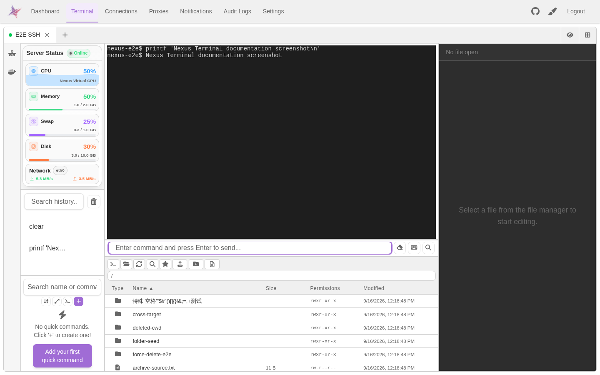
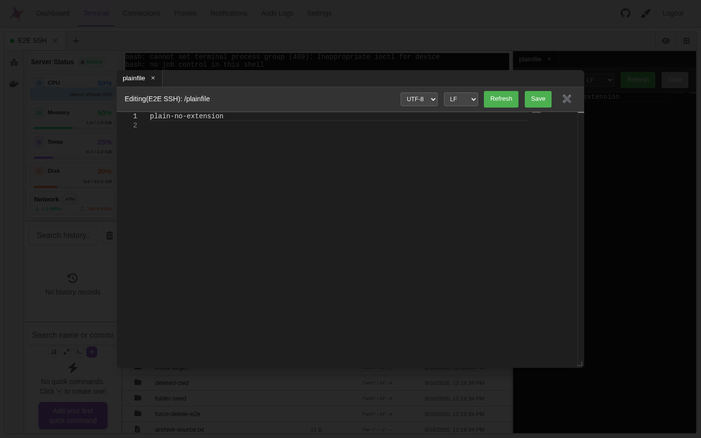
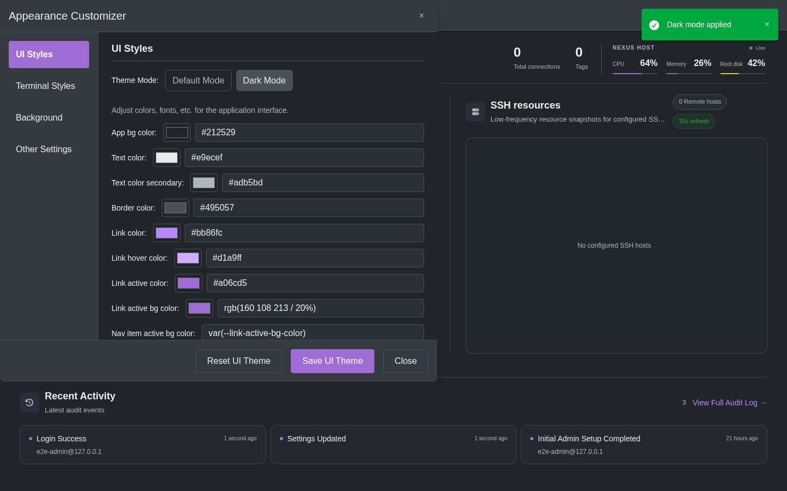
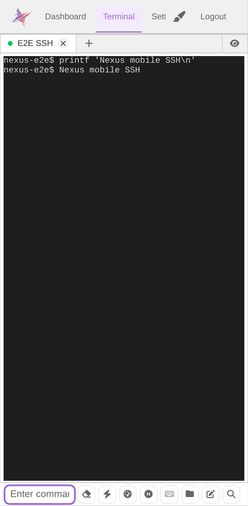

<div align="center">

<h1>Nexus Terminal</h1>

[][docker-url]
[](../LICENSE)

[中文](../README.md) | [English](./README_EN.md)

[docker-url]: https://github.com/0honus0/nexus-terminal/pkgs/container/nexus-terminal

</div>

## Quick Start

```bash
mkdir -p nexus-terminal && cd nexus-terminal

wget https://raw.githubusercontent.com/0honus0/nexus-terminal/refs/heads/main/{docker-compose.yml,.env.example}
cp .env.example .env
# Set NEXUS_ENCRYPTION_KEY to a persistent 32-byte base64 key before startup.
# See doc/DEPLOYMENT.md for the key-generation command.

docker compose up -d
```

Open `http://localhost:18111` · [Deployment & updates](./DEPLOYMENT.md)

Agent File/Shell/ACP operations use explicitly authorized SSH connections, and Browser integration uses Backend CDP. The retired Agent Workspace Runner and Toolchain deployment are no longer supported; ordinary terminal Workspaces and SSH/SFTP/RDP/VNC remain available.

## Features

A browser-based SSH / SFTP / RDP / VNC remote access tool with suspended terminal sessions and cross-device session list updates, file management, online editing, server-to-server transfers, remote dependency installation with confirmation, Agent and plugin marketplaces, security controls, module resource diagnostics, mobile support, and interface customization. RDP / VNC use browser SDKs and an authenticated backend bridge without guacd. Remote software is installed only after confirmation.

This overview describes the current source, including local changes. See [usage](./USAGE.md) and [verification records](./testing/E2E.md) for release and validation boundaries.

## Screenshots

### SSH Terminal

<p align="center">
  
</p>

### File Management & Online Editing

<p align="center">
  
</p>

### Theme Customization

<p align="center">
  
</p>

### Mobile

<p align="center">
  
</p>

## Documentation

[Features, usage & product requirements](./USAGE.md) · [Deployment & updates](./DEPLOYMENT.md) · [Frontend architecture](./architecture/FRONTEND.md) · [Backend architecture](./architecture/BACKEND.md) · [Shared contracts](./architecture/SHARED.md) · [Current plan](./PLAN.md) · [Browser Remote Desktop architecture](./architecture/REMOTE_DESKTOP.md) · [E2E](./testing/E2E.md) · [Development rules](./AGENTS.md) · [中文](../README.md)

## License

[GPL-3.0](../LICENSE)
