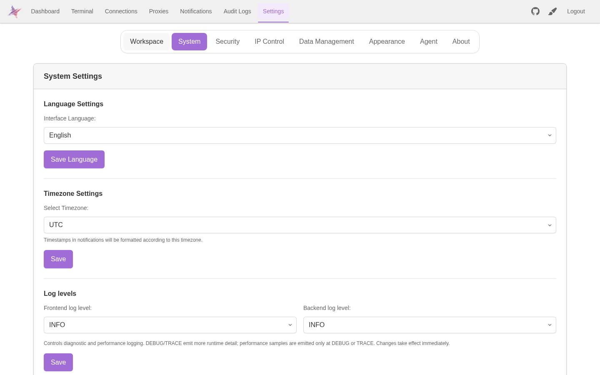
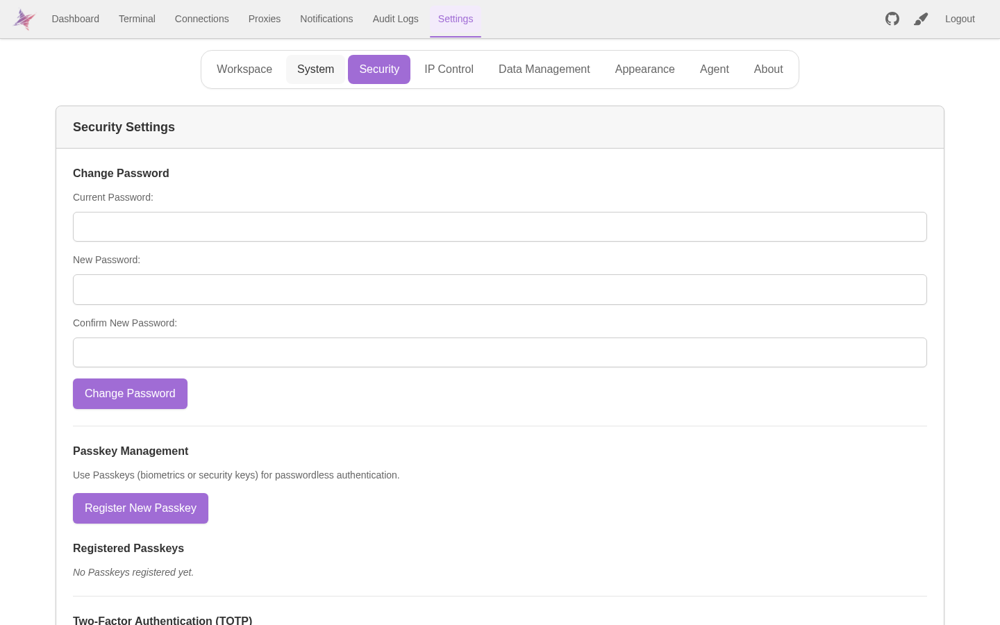

# 使用

本文统一记录正式产品的功能、操作、限制和失败恢复。当前唯一后端为 `packages/backend`（原 backend-next）；统一 E2E 未验范围仍单独保留。部署命令见 [DEPLOYMENT](DEPLOYMENT.md)，设计见 [Frontend](architecture/FRONTEND.md) / [Backend](architecture/BACKEND.md)，开发流程见 [AGENTS](AGENTS.md)。

本页按当前本地源码维护，包含尚未提交的功能和界面调整；不代表已发布版本。具体测试 SHA、执行范围与未验项见 [验证记录](testing/E2E.md)，后续工作见 [实施计划](PLAN.md)。

当前前后端共同消费的业务取值与通信契约统一位于 `packages/shared`；旧 `packages/protocol` 已删除，不保留兼容包。

## 每版产品行为维护

按 [人工规则 H-09](rules/HUMAN.md#人工规则列表)，每版逐项维护所有变更功能点：

- 已有功能就地修改对应章节；新增功能补充章节及导航；删除功能清理失效说明。
- 同版写清变更后的操作、输入输出、权限、容量和失败恢复，合并旧描述，不另追加近义条目。
- 仅内部调整且行为一致时，核对原说明仍真实即可。
- 使用短句、列表、表格和必要示例；保留有效限制，不堆历史叙述或无归属的文末变更项。
- 设计、施工任务和验证证据分别维护在 architecture、实施方案和 testing；未实现、未验收不能写成完成。

## 章节导航

| 功能                   | 章节                                                                                                                                   |
| ---------------------- | -------------------------------------------------------------------------------------------------------------------------------------- |
| 连接、代理、密钥与通知 | [连接、代理与通知管理](#连接代理与通知管理)                                                                                            |
| 新后端连接管理         | [主机信任](#ssh-主机信任)、[标签关联](#新后端标签关联)、[导入与测试](#连接导入与测试)                                                  |
| SSH 挂起与重连         | [SSH 会话](#ssh-会话)                                                                                                                  |
| 输入、快捷指令与历史   | [命令输入框](#命令输入框)、[快捷命令协议与恢复](#快捷命令协议与恢复)、[历史命令](#历史命令)、[个人历史与收藏协议](#个人历史与收藏协议) |
| 终端交互               | [终端](#终端)                                                                                                                          |
| 文件、编辑、预览与传输 | [文件管理器与在线编辑](#文件管理器与在线编辑)、[复制、移动与归档](#复制移动与归档)、[服务器传输](#服务器传输)                          |
| 远端软件依赖           | [远端依赖安装](#远端依赖安装)                                                                                                          |
| 宿主与模块资源诊断     | [宿主诊断](#宿主诊断)                                                                                                                  |
| RDP / VNC              | [远程桌面](#远程桌面)                                                                                                                  |
| Agent、工具与集成      | [Agent](#agent)                                                                                                                        |
| 布局与外观             | [布局与通用操作](#布局与通用操作)、[外观自定义](#外观自定义)                                                                           |
| 关于与更新检查         | [关于与更新检查](#关于与更新检查)                                                                                                      |
| 首页、状态与 Docker    | [Dashboard](#dashboard)、[状态监控与 Docker](#状态监控与-docker)                                                                       |
| 机器突变恢复           | [新后端机器突变恢复](#新后端机器突变恢复)                                                                                              |
| 认证与审计             | [安全与认证](#安全与认证)                                                                                                              |
| 数据备份               | [备份与恢复](#备份与恢复)                                                                                                              |
| 客户端与发布           | [客户端与平台](#客户端与平台)、[镜像发布](#镜像发布)                                                                                   |

## 连接、代理与通知管理

连接目录优化读取与筛选计算；搜索、标签、排序、批量选择和测试结果保留原行为，所有连接仍可通过原滚动与键盘入口访问。

420px 及以下视口沿用紧凑页头，“添加连接”仅显示图标并保留完整无障碍名称；打开 SSH Key 管理等叠加弹窗时，底层连接页也不应产生横向滚动。

- 连接管理页头以四个轻量概览卡显示连接总数及 SSH/RDP/VNC 类型统计，名称与数量横向排列；工具栏提供搜索、标签下拉筛选、排序方向与批量编辑，标签增长时只在展开面板中列出，筛选控件的当前值和下拉选项居中显示。窄屏下概览卡与代理、通知页一致压成单行；搜索独占一行，标签、排序、方向和批量开关合并到下一行，仅极窄视口再按可用宽度拆行。列表级“测试全部／连接全部”在右侧上下两块等高排列，并撑满标题行可用高度。连接按无额外容器描边的单列圆角列表管理，名称、地址、最近连接保持三行左对齐，中窄屏按视口增大字号、行距和内边距，左侧类型图标垂直居中；类型与标签在 360px 以下的最窄布局和宽屏中跟随名称行，在 360–760px 的中间布局改为右侧独立竖排块并垂直居中。底部测试、编辑、克隆与连接作为同一组铺满可用宽度，左缘与类型图标列对齐，按钮内容居中并使用浅色细边框；宽屏可同时显示图标和文字，稍窄时前三项收为图标、连接保留文字，极窄时四项均收为图标并隐藏卡片类型图标。批量编辑栏在窄屏固定为三枚选择操作一行、两枚批量动作一行，批量选择框在卡片左缘跨行居中。测试、编辑和克隆使用无玻璃底纹的按钮，连接保留主操作；“更多操作”使用不透明实心面板。添加/编辑弹窗在可用视口高度内固定，使用不透明表单表面和浅色分区线，表单内容独立滚动，底部操作保持可见；端口数字框提供主题化上下步进按钮，不显示浏览器原生微调箭头。SSH 测试延迟说明收在“测试连接”右侧的信息图标中，悬停、键盘或点击可展开。测试、删除、确认和取消使用同一基础按钮高度，手机端操作等宽。连接、代理和通知表单仍使用自适应布局，长名称、地址和测试说明可换行。
- 手机批量操作分为“全选/取消/反选”和“编辑/删除”两排；管理操作通常四列，窄卡片两列。代理与通知卡片在窄屏将编辑、删除改为内容下方的等宽图文按钮；代理筛选在中等窄屏保持搜索与类型同行，极窄视口按行展开；通知筛选固定为搜索独占一行、类型与状态各占半行。长名称、地址和操作提示可换行，不撑出视口。
- 代理管理页头以三项概览卡显示总数、SOCKS5 和 HTTP 数量；列表支持按名称、主机、类型或用户名搜索，并按类型筛选。每项显示协议、地址与认证状态，编辑和删除使用图标按钮。代理不显示更新时间。
- 正式代理表单只提供 HTTP/SOCKS5、用户名和密码。编辑时密码留空保留，勾选“清除已保存密码”清除；输入新密码替换，秘密不去首尾空格。名称/主机/用户名最多128/512/256 UTF-8 bytes，密码最多8 KiB。
- SSH Key 管理支持手填或上传最多64 KiB的严格UTF-8私钥；名称最多128 bytes、口令最多8 KiB。编辑私钥留空保留，更换私钥不会自动清空原口令；口令留空保留，勾选清除才删除。关闭弹窗、登出或页面停用会丢弃秘密草稿。读取和操作错误通过全局常驻 Toast 提示，不在弹窗内插入错误横条；需要恢复核对时保留原刷新入口。全局 Toast 使用状态标题、正文和底部确认行，不显示左侧状态图标；成功、警告和失败通过标题、细边框与按钮使用对应状态色，卡片保持中性主题底。无业务动作时底部显示“知道了”并关闭提示；带恢复动作时显示原动作，点击执行且不自动关闭。
- 代理/SSH Key使用编辑时原版本保存；冲突先刷新列表重新核对，不自动覆盖。网络断流、结果未知时禁止再次写入，先点“刷新并核对”；已提交的服务端修改可能仍存在。列表最多10,000项，Proxy完整JSON最多64MiB、SSH Key/标签各最多16MiB，超限明确失败，不显示截断的完整列表。删除沿当前后端按ID执行，引用保护仍生效。

关闭错误 Toast 后，再次操作失败会重新提示；相同错误仍在驻留时合并展示。

### 连接编辑与批量操作

批量编辑沿用与添加连接一致的不透明表单表面、分区强调线和固定底部操作，不再叠加玻璃卡片；先选择配置或凭据模式，两者分别提交，不能一次保存混合意图。手机端取消／更新凭据并排，保存配置独占一行。

编辑器的端口、身份与认证、高级选项继续按旧版分区卡片展示；高级选项默认折叠，只有勾选后才编辑代理、标签和备注。配置／凭据模式由当前后端分流，不能在同一个请求中混合提交。

- 新建通过单项导入事务原子保存配置与凭据。编辑先读取元数据与安全凭据摘要，两个版本一致才开放表单；密码始终为空，不回显明文或密文。
- “保存配置”“仅保存凭据”“清除凭据”为独立操作，各使用打开编辑时的原版本。修改密码草稿后只保存配置不会修改凭据；凭据成功后关闭窗口，重新打开取得新版本。冲突、未知结果先只读核对，不自动覆盖或重放。
- 克隆同事务复制配置、凭据与关系；删除按ID执行，不虚构删除CAS。批量配置与批量凭据互斥，使用捕获的各连接原版本串行提交，失败停止后续项；已确认修改不回滚。追加标签后完整刷新连接缓存。
- 脚本支持带引号的值、已有代理/密钥名称和 tagNames，同项创建标签；解析不写库。省略凭据只创建配置；密码原样保留。IP范围仅支持同一IPv4子网的递增末段。脚本最多500项/1MiB，范围与脚本均按50项分批。
- Connections、Dashboard 和 Workspace 使用独立应用对象及毫秒时间；最近连接时间由服务端持久记录，连接列表与单项的必填 `lastConnectedAt` 为 Unix 毫秒或 `null`（尚无成功记录），刷新、换浏览器与重启后仍可读取。SSH 在 PTY 建立后记录（包含 Workspace 与独立/Agent shell），RDP/VNC 在 TCP/TLS 桥就绪后记录；桥接就绪不保证远端认证或画面已经出现。测试、监控、票据签发和已有 SSH 会话恢复不更新时间。写入只递增，不改变配置版本与更新时间；连接期间配置版本、创建时间或协议已改变则不写入旧结果。新建、导入与克隆初始为 `null`，完整备份保留已记录时间。前端连接成功后只读刷新，不用本地时间补写；读取失败保留展示并留待下次刷新，持久写入失败沿原建连失败/资源清理流程收尾，不自动重建；后续交付失败不会回滚已提交的历史。连接完整列表最多10,000项/640MiB（包含最坏JSON转义），超限拒绝而不截断；该预算不是分页或浏览器内存保证。
- 网络断流可能已提交，显式刷新后重新核对。隐藏/停用/登出清理秘密草稿与旧异步回调；取消请求不证明后端回滚。写入已确认但刷新失败会独立提示，不能据此重复保存。

### 引用、跳板与导入

- 跳板链编辑使用按顺序编号的步骤和连接线展示，下拉项同时显示连接名称与 `用户名@主机:端口`，可直接替换或移除；链尾“添加跳板机”只追加下一跳，不改变已有顺序。
- 被引用的 Proxy、SSH Key 不可删除；跳板连接不可删除或改为非 SSH，须先解除引用。保存时事务内重检，不自动改路由。新后端对此统一返回 reference_in_use，引用和原记录保持不变。
- 跳板链按显式顺序逐跳连接，只消费各跳的地址、用户名与认证，不递归执行该连接自身的 Proxy/Jump 路由。
- 标签替换最多 1,000 个安全正整数连接 ID，重复合并，空数组清空。引用不存在返回 404，失败保留原关联。
- 导入只接受新 TargetImportInput 数组，按记录独立提交；单条连接、凭据、内联 Proxy/SSH Key 与标签同事务完成，失败不遗留半条记录，不兼容旧字段或密文。
- 登出后旧响应不回填连接/代理/标签/通知缓存；已提交的服务端修改不撤销。

### 通知配置与投递

管理员在通知页面管理 Webhook、Email、Telegram 三种通道。每项最多32个Header，名称大小写不敏感判重；全部Header值、SMTP密码、Bot Token读取仅显示是否存在，编辑显式选择保留、清除或替换，删除Header条目移除该项。切换通道、关闭表单、离页和身份失效清除秘密草稿。

通知渠道页沿用连接管理的目录式结构：页头概览显示总数及 Webhook／邮件／Telegram 数量，列表可按名称、地址、事件、类型和启用状态搜索筛选；每项显示通道类型、启用状态、目标地址和已启用事件数量，事件名称只参与搜索匹配，不再作为示例列出。列表可直接启用或停用渠道，启停按钮按点击后的动作着色：启用为绿色开启图标，停用为红色关闭图标，按钮底色与边框同步使用对应语义色；操作沿用当前版本与秘密保留语义。编辑与删除在桌面使用图标按钮，窄屏显示等宽图文按钮。通知页只管理渠道配置，不展示投递记录。

通知编辑器使用固定标题、独立滚动内容和固定底部测试／保存区。测试按钮始终显示，必填信息不足时保持禁用，不额外显示“请填写必填字段”一类提示。Webhook Header 仍以当前结构化行编辑；新增渠道直接输入邮件密码或 Telegram Bot Token，已有渠道编辑时才在秘密字段提供保留、清除或替换选择。启用事件支持一键全选与反选。测试回执与失败统一通过全局 Toast 显示，不在表单内插入结果行；queued/dispatched 使用信息提示，sent 才是成功提示，failed/unknown 及请求失败使用错误提示。

保存和删除携编辑/确认时的原版本；冲突、结果未知先点“刷新并核对”，刷新会丢弃当前编辑，不自动覆盖或重放。设置最多64项，请求64KiB、响应8MiB；字段与完整JSON容量由Shared校验。管理员可配置内网SMTP、Webhook及自定义Telegram origin，只使用可信目标，出站隔离由部署网络提供。

已保存测试使用服务器当前保存配置，未保存测试使用完整输入，不从已有配置借秘密。测试只返回投递受理记录；queued、dispatched均不表示发送成功，投递记录为sent才显示已发送。投递历史在审计日志页读取，按服务端nextOffset加载；未知投递先核对接收端，不能自动重发。

### 通知协议与投递

/api/v1/settings/notifications 提供GET列表、POST新增、PUT/DELETE /:id（UUID与expectedVersion）、POST /:id/test及POST /test-unsaved；/settings/notification-deliveries读取实际投递记录。所有通道使用明确config联合，秘密操作为keep/clear/replace，不接受旧flat config或数值ID。

事件只含有限event、subjectId和UTC time；模板支持{event}/{subjectId}/{time}，Email纯文本，默认Webhook为JSON。订阅采用分发时已启用配置，不追溯创建前的事件；禁用阻止后续分发，已排队项仍使用原加密快照，删除令queued失败，不能撤回已派发请求。最多4096在途、单项20秒、串行派发；重启把dispatched标unknown，不自动重发。业务提交与事件发布分事务，通知不作为业务结果权威。

### 通知失败与恢复

400 invalid_input、401 unauthenticated、403 forbidden、404 not_found、409 version_conflict、413 limit_exceeded、503不可用/未知。派发前取消记failed；SMTP明确拒绝全部收件人且未发送DATA记failed，部分接受后其余拒绝记unknown。HTTP响应体释放未确认也记unknown；任一投递清理未确认会停止该实例的新派发和配置/测试写入，仍可读配置与投递。先确认原资源释放，再重启处理后续排队项，不重发原unknown。公网真实供应商验证仍单独待验。

### 独立重构管理入口

`/__targets-next` 使用独立后端/数据。完整 JSON 按 UTF-8 字节计量，包含外壳与转义；前端预检，后端超限返回 413 `body_too_large`。

| 请求                 | 上限                                                                |
| -------------------- | ------------------------------------------------------------------- |
| Connection / SSH Key | 128 KiB                                                             |
| Proxy                | 64 KiB                                                              |
| Tag / Host Key       | 16 KiB                                                              |
| 连接导入 JSON/文件   | 每批 50 项，JSON/文件 1 MiB；multipart 完整正文另有 16 KiB 封装余量 |
| 未保存 SSH 测试      | 完整 JSON 512 KiB，私钥原文 64 KiB                                  |

开发认证与终端见对应章节。新后端管理接口仅管理员可用，每个实际读取/写入事务在开始及提交前复查原会话；排队期间登出、会话到期或改密失效将拒绝该事务，返回401，非管理员返回403。已在撤销之前提交的修改仍保留；已经读取后交付的网络响应不保证可撤回。新后端连接、代理、SSH Key、标签和 Host Key 的持久修改若返回 `operation_unknown`，先重新读取核对，不自动重做；普通存储不可用与提交结果未知分别表示。Host Key 主机名按小写保存，最多253 UTF-8 bytes，拒绝空白、控制字符及非法Unicode；指纹须为SSH公钥的SHA-256。凭据省略保留，代理密码显式 `null` 清除，SSH Key 的空/`null` 口令清除；私钥正文和连接密码不允许空值。新后端独立SSH Key、导入及未保存测试统一支持最多64 KiB私钥、8 KiB口令和128-byte密钥名称；名称去首尾空格，秘密正文不trim。Proxy名称/主机/用户名分别最多128/512/256 UTF-8 bytes，密码最多8 KiB；清除用null，纯空格密码保留原值，不作为空值。Proxy只支持HTTP/SOCKS5的用户名/密码，不保留旧管理API中没有实际传输消费者的key认证字段。连接克隆名称同样最多128 UTF-8 bytes，克隆在同事务复制凭据与关系。连接主机/用户名/备注分别最多512/256/4096 UTF-8 bytes；密码最多8 KiB。每条连接最多16个直接跳板，与递归深度/总展开数量分别计算；新建、编辑、导入及恢复使用相同字段容量，测试密码仍可为空，不因此允许保存空密码。
Proxy 删除结果未知时，列表继续显示最后一次已确认的代理记录，错误通过全局 Toast 提示，不挤占实体列表；Store 的 `needsRefresh` 禁用全部增删改按钮，只有明确成功的只读刷新才解除写入围栏。不得用错误告警遮住待核对的旧数据。

### SSH 主机信任

管理员在连接管理工具栏打开“SSH 主机密钥”，读取已确认的 host/port、SHA-256 指纹及确认时间。先通过可信渠道独立核对指纹，再输入主机、1–65535 端口和 SHA256: 加43个 base64 字符，确认弹窗展示的目标与指纹。主机统一小写、最多253 UTF-8 bytes，不能含空白或控制字符。连接测试不会自动建立信任。正式 SSH 工作区遇到未信任密钥时，在原标签页弹出实际握手目标（包含跳板）的主机、端口和 SHA-256 指纹；密钥变化以警告色分区展示目标、已保存指纹和当前指纹。独立核对后点击“确认信任并重新连接”，保存信任后重试；每个跳板分别确认，不自动信任。取消或确认失败保留标签页，可稍后手动重新连接；关闭标签或退出登录会撤销等待，晚确认不重连。写入回执未知时只读核对，未能确认已保存不重试写入。

主机密钥面板将安全说明收在与全站其它提示一致的标题右侧信息图标中，悬停或键盘聚焦时显示；已信任密钥按主机/端口集中展示，指纹完整换行且可复制，确认时间使用本地化日期。手动建立信任使用独立分区，确认按钮位于指纹输入框右侧；窄屏下主机与端口改为单列，指纹和确认按钮保持同行。面板只保留底部“关闭”入口，内容独立滚动。

确认会覆盖同一主机/端口的信任；移除删除操作当时的信任，包括其他管理员刚写入的新值。二者没有版本条件，操作前均需确认。结果未知、协议失败或已派发的拒绝后先“刷新并核对”，不自动重发；关闭面板或退出登录取消等待，不证明服务端未提交。正常自动读取，失败或需要核对时才显示刷新入口。列表最多10,000项，完整 JSON 最多16MiB；超限返回413 limit_exceeded，不截断。此面板已接新后端，Connections正式通信源码已接Shared，整体回归仍按D17执行。

### 新后端标签关联

正式标签API、选择器和标签组管理已消费Shared。名称保存与关联替换是两个独立按钮，改名携带打开编辑时的版本；替换关联前确认整集合覆盖，未保存的新名称须先单独保存或还原。冲突或结果未知先关闭面板，刷新连接和标签列表后重新打开核对，不自动重复写入；确认成功后刷新失败不撤销原提交。标签选择在缓存重置或读取失败时保留，完整有效列表确认删除后才清理；创建名称集合先完整校验，逐项创建期间失败保留已确认记录，未知时停止后续创建。标签列表最多10,000项/完整JSON 16MiB，超限413 limit_exceeded，不截断。Connections列表/表单/批量与Workspace整体验收仍待F1-C1/C2，不能据标签组件回归宣称正式应用已切换。

管理员通过 PUT /api/v1/targets/tags/:id/connections，以 {connectionIds} 替换该标签的全部连接；空数组清空。POST /api/v1/targets/connections/add-tag 以 {tagId,connectionIds} 向选中的连接追加标签，数组必须非空，不改变其他关联。两者完整 JSON 最多32 KiB，原始数组最多1,000个安全正整数，重复ID合并，成功返回 {updated:true}。Targets管理路径ID与正文ID统一支持1至9007199254740991；路径使用无前导零的十进制数字，超出范围拒绝。标签不存在返回404 not_found，任一连接不存在返回404 reference_not_found，整项失败不修改原关联。

标签名称去首尾空格、最多128 UTF-8字节，导入按同一规范匹配已有标签。每个连接最多64个标签，普通新增/更新、单连接标签替换、导入及批量关联遵守同一限制；导入的已有标签与按名称创建标签合并后也不能超额。DELETE /api/v1/targets/tags/:id 同事务删除标签并解除全部关联。实际改变关联的连接版本各推进一次；已有相同关联不推进版本，标签本身未修改可见字段时不推进其版本。操作后刷新连接列表，已有编辑收到 version_conflict 时重新读取，不覆盖关联变化。

持久写入 operation_unknown 返回503；响应断流也可能已经提交，先只读核对，不自动重试。关联修改使用与其他新后端管理操作一致的事务会话复查。正式 Tags/Connections、Workspace 标签组已消费这两个入口；成功或未知关系变更后完整重读连接，不能只刷新标签目录就解除旧窗口的未知围栏。

### 连接导入与测试

工作区连接列表和导入弹窗正常不显示额外刷新按钮；读取失败或写入结果待核对时提供恢复入口。工作区标签读取失败同样可手动重读。

管理员使用 `POST /api/v1/targets/connections/import`，JSON 正文为 `{items}`；也可上传唯一 multipart 文件字段 `connectionsFile`，文件内容为严格 UTF-8 JSON 数组，每项采用 Shared 的 `TargetImportInput`。每项包含 `connection`，可选 `tagNames`、`inlineProxy` 和 `credential`。凭据采用 `password`、引用已有 `ssh_key`，或带名称/正文/可空口令的 `private_key` 创建意图；内联代理可带密码。新格式不接收旧字段或旧密文。正式前端选择文件后先严格 UTF-8 解码并校验，再通过 JSON items 分批提交；后端 multipart connectionsFile 入口继续保留。前端每次最多500项/1MiB，每批最多50项；全部分批输入先校验再派发，逐项显示原序回执，遇失败停止后续批次，保留已确认项。导出仅含 connection 配置，不含密码、私钥或凭据；引用使用当前实例 ID，最多500项/1MiB，不是跨实例秘密备份。连接列表和导入弹窗不常驻展示这些协议／容量说明，操作失败时仍显示相应提示。

每项的连接、凭据、内联私钥、代理与标签同事务提交；一项失败不会留下部分记录，其他项继续，按原序返回 `items` 的安全结果。文件中非法项返回 `invalid_input`；文件整体无效、超容量或 JSON 请求形状无效则整批拒绝。已有代理先校验持久记录，损坏记录安全拒绝，不作为可复用配置；仅在用户名一致且不携带新密码时复用，新秘密冲突返回 `conflict`，不覆盖原代理；同名私钥冲突也明确拒绝。导入中途失去身份/权限会停止后续项并返回401/403，已经提交的项不撤销；最后一项等待期间超时也不再返回整批成功。导入不是幂等操作，`operation_unknown`、会话过期、超时或响应中断可能已有部分提交，先查询核对，不自动重传。操作观察复用 Operations；观察事件不替代逐项提交回执。

`POST /api/v1/targets/connections/:id/test` 测试已保存 SSH 连接，`POST /api/v1/targets/connections/test-unsaved` 接收 host/port/username、authentication 和明确 direct/proxy/jump 路由及引用。未保存测试支持密码（允许空字符串）、已有 SSH Key 或直接私钥，不创建数据库连接。仅进行 SSH 握手，不开启命令、PTY 或 SFTP；所有跳板与目标须通过已有 Host Key 信任，未知密钥先独立核对并确认。成功返回 `{status:'ok',latencyMs}`，且本地传输已关闭；失败只返回有限安全错误码，不回传供应商错误正文。最多8个在途，完整请求期限15秒；取消后仍等待真实资源收敛，清理失败阻断新的测试并在停机汇总。SSH 测试审计复用 `SSH_CONNECT_SUCCESS/FAILURE`。正式 ConnectionsView/ConnectionForm 已消费该协议及三语安全提示。编辑窗口测试的是已保存配置；新建窗口测试当前未保存输入，不持久化。

## SSH 会话

支持多标签、挂起、续接和布局定制；普通 Workspace 与 Agent SSH 分别授权和管理。打开第二个 SSH 或切换标签时只显示选中会话的终端画面，后台会话继续保留连接与输出。切换到其他页面再返回时保留原终端、命令草稿和已加载布局，不重新创建终端；退出登录或切换用户时清除这些缓存。离开工作区后，已发起的SSH连接继续由原标签管理，但尚未派发的批量/查询打开和挂起接管确认失效；返回页面不会继续旧确认或旧查询的连接动作。

### 挂起与恢复

- 点击挂起仅标记保留；关闭标签或断线后 Backend 接管原 SSH/PTY，适合长任务。
- 终端标签连接指示灯只反映实际连接状态：已连接为绿色，连接或重连中为黄色闪烁，断开或失败为红色，未连接为灰色；标记挂起或恢复后仍按实际连接状态显示，不覆盖为蓝色。恢复成功继续保留挂起标记及原有关闭保留行为。
- 有权限的设备可恢复无人使用的会话，或确认接管使用中的会话；不要求原设备的普通续接凭据。接管撤销原设备控制权，不允许双写。新后端在挂起 owner 的真实租约到期后立即拒绝继续控制和关联文件传输，不等待清理扫描；独立上传、下载分块及多步骤文件操作也检查原 Workspace 权限。普通断线仍按既有宽限期处理。已经派发的远端效果不能撤回；上传中断可能保留临时文件，清理未确认时报结果未知，先只读核对目标文件，不自动重传。
- 挂起成功返回真实会话 ID；失效或注册失败不报成功。
- 恢复先核对历史基线，再独立确认所有权；确认成功才开放输入和Files，不等待SFTP初始化完成。历史先显示不证明恢复完成，未确认输入不自动重发。恢复确认、挂起提交或取消标记结果未知时停止重放，先查看挂起目录核对，不自动取消标记补偿。
- 已标记标签关闭只脱离连接并保留原PTY；要终止正在使用的终端任务，先成功取消挂起再关闭标签；无人使用的后台挂起可在目录移除并终止。续租失败、租约失效或被接管后立即停止控制；旧设备不能继续写入。
- 在挂起目录移除仍有终端使用的会话时，只取消挂起并移除目录记录，不断开正在使用的 SSH/PTY；即使从另一设备移除，原终端也会同步取消挂起标记，不再留下“待关闭”记录。无人使用的后台挂起会话才会被终止，已断开的记录只删除日志与条目。移除期间正在恢复或所有权不明时先读取最新状态，不自动退回终止操作。
- 单次快照最多4MiB UTF-8，完整挂起JSON最多24MiB+16KiB；历史页最多256KiB。历史页失败不会终止健康终端；游标交付不明时不自动重取，须先回到实时输出重置历史，或重新恢复会话。
- 保留最近 100 MiB 原始历史，先恢复状态和尾部，旧历史按需分页；达到上限仍可恢复原 PTY。
- 登录后通过独立 `/ws/suspended-sessions` 订阅当前用户的挂起目录，不绑定某个 SSH 终端；挂起、恢复/接管、续租、断线、改名、终止和过期会推送完整快照，其它在线设备无需等 HTTP 轮询。首次连接、断线重连及浏览器恢复可见时取得完整快照，离开首页仍同步；隐藏浏览器页面时暂停，网络故障时退避重连并保留最后成功列表。目录最多 64 项/1 MiB JSON，WS 完整帧另留 1 KiB envelope；命名、终止、移除和日志使用 HTTP，列表 HTTP 保留给显式核对和操作后的只读确认。命名最多 128 个 UTF-16 单元，完整管理请求/响应最多 4 KiB。日期为 ISO 字符串，租约为 Unix 毫秒。移除结果由 Backend 当时的附着状态决定，不根据浏览器的旧目录状态终止终端。
- 启动页的挂起会话面板与弹窗使用原有紧凑卡片：序号与名称位于首行，挂起时间和状态徽章同排，恢复、导出和移除在卡片底部均分展示。搜索只筛选当前目录，搜索框占位文字统一为“搜索会话”，无结果显示明确空态。搜索框、卡片列表和空态以“挂起的 SSH 会话”标题图标左缘为共同起点并保持同宽；滚动条槽只占用右侧，不通过额外左侧内边距把内容推离标题图标。窄面板中操作组居中，极窄时收起按钮文字但保留可访问名称；弹窗标题栏固定、正文独立滚动，手机宽度不横向溢出。关闭、隐藏或移除后仍沿用原有取消、确认和目录同步行为。
- 挂起会话空态按两条实际会话卡片预留最小高度（单卡 78px、卡片间距 6px），内容在可用区域内整体居中；面板可用高度略小于两行时贴合容器，不因硬编码余量产生无意义的内部滚动。页面滚动模式仍完整预留两行。
- 写入结果未知时保留目录与操作保护，不自动重发；先点搜索框旁的刷新按钮“读取最新状态并核对”，确认当前状态后再决定操作。后台推送不能解除此保护，较早的刷新也不能解除后来产生的未知结果。目录同步和日志读取失败仅说明读取未成功，不显示写入“操作结果未知”；原列表保留。错误通过常驻可关闭的 Toast 展示，不在面板插入告警横条；已识别网络失败沿全局网络通知去重，真正写入未知仍单独提醒并保留操作保护。隐藏、停用或卸载面板会取消原确认和等待，注销还清除目录及共享订阅。
- 日志导出限 60 秒、128 MiB 渲染后 UTF-8 文本，以服务端会话 ID 命名；此限制与 100 MiB 原始历史窗口不同。超限/断流或媒体类型、文件名无效时不启动浏览器下载，按失败处理。

日志经代理压缩传输时，容量按浏览器解码后的实际正文检查，不把压缩传输长度与解压文本长度直接比较；未编码响应仍核对声明长度，截断和超量不作为成功导出。

### 自动重连

- 异常断线约 120 秒内保留原 SSH/PTY、压缩及复制/移动任务，优先续接并补回输出/结果，不重新 SSH 登录替换终端。
- 回到前台、恢复网络或返回终端时检查存活；正常链路不重连，并发恢复共用一次请求。
- 普通续接校验原标签凭据、用户、Workspace 和连接；新标签不可接管旧 Workspace。新后端注销会撤销原 Cookie，现有终端在周期身份复查（约15秒一次）时断开；原 PTY 仍按宽限期/挂起策略保留，并非立即终止远端任务。同用户重新登录后须持原续接凭据并显式确认，文件资源按新登录重新授权；终止任务请主动关闭会话。
- 待挂起标签自动恢复无人使用的会话，不抢占其他设备或关闭后来打开的启动页。页面被回收后通过挂起目录恢复；未标记会话超出窗口不保证保留。
- 主动关闭通过当前附件请求释放；收到确认才表示关闭成功。断连只表示本地脱离，关闭响应丢失仍为结果未知，不能保证原远端进程停止。远端退出或宽限期结束无法恢复。普通断线时可按终端/命令栏 Enter，或再次点击同一连接提前尝试。
- 普通恢复先接收回放，再独立确认所有权，确认后才开放输入和调整终端尺寸。新建或所有权确认结果未知时停止自动和手动重放，终端显示恢复提示；关闭原标签后可新建连接，但新建连接不会终止原远端进程。

### 会话容量与关闭

| 范围           | 限制                                                             |
| -------------- | ---------------------------------------------------------------- |
| 普通 Workspace | 单 Backend 64 个，包含建连预留及弱网续接；已有会话续接不重复占槽 |
| 挂起 Registry  | 每用户 32、全进程 64，包含附着/断开记录                          |
| 连续挂起       | 24 小时后终止；已恢复不按旧时间终止，再挂起重新计时              |

满载拒绝新建/恢复；Server Transfer/Suspend 的独立预算不计入普通 Workspace 上限。Backend reset/shutdown 清理挂起日志，启动清理无 owner 遗留日志，不提供跨重启挂起恢复。

跳板总期限覆盖握手/forwarding，取消后关闭已建资源，晚到 channel 不发布。远端断线回收会话，旧关闭事件不误关新 owner。命令仅零退出码且无 exit signal 算成功；关闭但缺退出状态属于未知结果，不自动重放，也不证明远端进程停止。

### 新后端开发终端

独立 `backend-next` 的 Remote HTTP/PTY 有独立 SessionOwner，不等于普通 SSH Workspace。当前 `/ws/workspace` 已承载真实终端、Files/transfer 和挂起恢复的源码；B3.1 源码与静态收口不代替实际验收。上文多标签终端、完整挂起恢复及管理 HTTP 仍以正式旧 Backend 的产品行为为基线；B3.1 源码完成并于 B10 验证前不得宣称新后端已具备全套能力。正式前端普通连接/恢复/关闭、NXW1和挂起事件已对接 Shared；本轮完整界面回归按 D17 统一留远程 Actions E2E。

**B3.1 后端源码状态（非行为验收）**：`backend-next` 已将 `/ws/workspace` 对接真实 SSH shell/关联 Files lease：终端输出、8 MiB 普通断线 journal、120 秒宽限期、generation/offset 与明确 `workspace.resumeAck`。Shell 先交付，SFTP 后台异步初始化；cwd/PID、Bash/Zsh prompt/queued cd 有源码。C4 已继续安装 `suspend.mark/prepare/commit/unmark/list/resume/resumeAck/owner.renew/history.previous/history.reset/terminate/remove/rename`，同一 SSH shell 在后台挂起 24 小时、日志最多可见 100 MiB、1000 行/4 MiB headless VT checkpoint、256 KiB 历史分页和异常断线 catalog；`/api/v1/ssh-suspend` 五管理 HTTP 与本地文本导出已接线。挂起恢复同样**必须客户端显式发送 `suspend.resumeAck`**，完整 baseline 已发送不代表 owner 已提交；失败/超时退回原挂起 owner，不在新 Workspace 创建 SSH shell。普通workspace.resumeAck已由正式前端迁移并通过真实本机SSH专项；挂起管理五HTTP的正式前端已消费Shared并完成有限专项；挂起ACK与模式事件的正式前端源码已迁移，静态类型/构建与逐项行为结论见 testing。B10 已验证普通续接的错误 ACK/旧 generation 拒绝、离线输出回放、同一 PTY；挂起 prepare/commit、恢复未确认即断开回滚、租约续期及 takeover；注销后旧 Cookie 拒绝、新登录续接及 Files 实际读取。普通 WS 终端未确认输出最多 1 MiB，客户端通过 terminal.flow 累计确认消费；确认超出已发送字节或倒退会拒绝。B10 另已验证 6 MiB 慢消费后精确恢复、满窗口断线后继续原 Shell、续接回放等待字节消费后仍要求独立所有权 ACK，以及 10 MiB 离线输出裁剪后的旧/未来 offset 拒绝和合法尾段回放。B10 已补验挂起 baseline 消费窗口、慢日志积压期间断开仍保持背压，以及真实 45 秒租约到期后不带 takeover 续接同一 PTY；技术日志已核对压缩、绝对分页游标和打开中的旧文件句柄。B10 另已验证准备阶段自然超时或取消挂起标记后仍保留消费背压；prepared状态断开后原PTY继续向日志输出，日志实际写失败会关闭原PTY并保留停机原因。历史数据帧/终帧失败后同页可重读、reset与并发页保持原字节顺序；日志 append/replace/trim 的实际文件系统拒绝、导出渲染后注销、两名额准入和客户端断连已验证。慢日志恢复被另一客户端接管时，回滚仍保留原日志背压，最终原始输出完整。日志追加遇真实空间耗尽可能留下未确认的部分字节，不能当作原子回滚或自动重写；写入失败后该日志保持失败，替换/压缩未发布时保留原文件及已打开的历史窗口，临时删除也失败则保留两项原因。其余管理/容量/期限组合与本轮正式前端整链仍待验收。

挂起历史只保留**最新 100 MiB**，不承诺无限向前翻页：当更早内容已被压缩窗口裁剪，前页查询必须停止，不能重复已显示内容。历史分页发送失败时不得跳过未送达的数据；关闭若仍有未经确认的远端 SSH/SFTP/本地日志清理，报告资源结果未知，而不是显示已释放成功。此为当前新后端源码设计，真实消费与故障行为仍未通过 B10。

正式终端输入每次最多256 KiB UTF-8，拒绝畸形Unicode；窗口尺寸为2–1000列、1–500行。文件管理器的终端目录读取/切换使用当前已连接附件，路径最多4096 UTF-8 bytes；切换需同时收到有效请求回执和实际完成事件，排队不代表完成。断线、超时或回执异常时显示结果未知，先读取当前目录核对，不自动重发切换命令；主动关闭也会结束本地等待，不能据此认为远端切换已撤销。

文件管理器“将终端目录切换到当前路径”在 Shell 提示符就绪后发送普通 `cd '路径'`，安全转义路径中的单引号，不附带随机标记或历史清理长命令。命令和真实错误正常显示，后台输出不隐藏；是否记录这条 cd 由用户的 Shell 历史配置决定。

Workspace 在首个附件可以进行终端输入前完成 Bash/Zsh PID 与提示符 Hook 初始化；结果识别不依赖命令回显，关闭回显的 Shell 仍可初始化。内部探测和 Hook 安装命令不进入终端输出，用户主动发起的普通 `cd '路径'` 仍正常回显。初始化等待期间撤销登录或关闭原会话，不能交付失效附件。非 Bash/Zsh 或初始化失败的会话保持可用，但目录读取/切换明确不可用，不能展示虚构目录；后端不会在用户已输入后向未验证 PTY 注入迟到的内部命令。挂起自动终止事件与日志导出需要有效的当前登录身份；无效或被撤销的 Cookie 不能继续利用先前 WS 升级结果获取管理事件。本段为待验源码行为，非正式前端承诺。

挂起恢复时，即使服务器发送完终端基线并收到 `suspend.resumeAck`，也必须继续尊重浏览器 `terminal.flow` 的已消费字节：用户尚未确认消费的输出不能被“恢复已完成”事件绕过背压。所有权租约超过 45 秒且未续期时旧附件应立即失去写入/管理权限，不能依赖周期性定时器出现短暂授权窗口。一般 `workspace.close` 也只允许当前有效附件发起；旧 generation、旧 socket 不能关闭正在接管的会话。B10 已验证旧 generation 关闭拒绝、显式恢复 ACK 与主动 takeover；未消费输出背压与45秒租约自然过期已有限验证；到期至扫描前的完整写入/管理交错仍待验证。

同一 WS 连接内重开其他 Workspace 时，终端已消费/已发送计数必须以新附件重新计量；旧恢复请求的迟到二进制输出或失败清理不能影响新标签。挂起标记与准备/提交请求在等待磁盘或身份授权期间若已被取消、断开或替换，不得再报告标记成功；45 秒 owner 租约已过期时新设备无需等待周期扫描即可尝试恢复。正式前端已适配上述消息及生命周期；行为结论以 testing 的实际证据为准，本轮变更仍待远程回归。

仅原 Access 会话可操作；WS 断开关闭 PTY，无挂起恢复/命令重放。正常退出等待尾部渲染，异常断线或清理失败报不可用，主动关闭不冒充正常退出。退订失败仍继续关闭底层资源；所有清理失败保留到停机汇总，不能报告清理成功。

打开、读取和关闭终端要求有效管理员会话：未认证返回 401，无权限返回 403；认证有效但资源不存在或不属于当前会话返回 404。建连完成后复查登录会话，期间失效则关闭新建资源，不交付终端。

| 范围              | 限制                                                |
| ----------------- | --------------------------------------------------- |
| 终端尺寸          | 500 列、300 行                                      |
| 输入/输出数据单帧 | 32 KiB                                              |
| 待渲染确认输出    | 128 KiB                                             |
| 已完成释放结果    | 同会话最多保留 128 条、120 秒，窗口内复用成功或失败 |

挂起初始快照最多 4 MiB UTF-8，mark/prepare/commit 的完整 JSON 消息预算为 24 MiB + 16 KiB（包含转义与外壳）；普通控制消息仍最多 1 MiB，历史前页最多 256 KiB。正式前端对接时须消费 Shared 容量，不能把原文上限当成实际发送字节上限。

新后端全 Remote 最多同时导出 2 项日志，单项完整期限 60 秒，包含渲染、响应交付与收尾；超过返回 limit_exceeded。输出每块最多 64 KiB，并在交付每块前重新检查登录身份和原资源是否仍有效；已交付内容无法撤回。终止/删除/取消会中止关联导出并等待真实资源收敛，清理无法确认时报告 operation_unknown，保留名额，不自动重放。临时日志删除失败即使 SSH 已关闭也不算清理成功。

## 命令输入框

- Enter 发送；`↑/↓` 选择历史/快捷命令，命令同步发送至选定目标。当前页面单会话发送成功后追加历史；离开页面或认证撤销后，旧发送回调及尚未派发的排队意图不再追加。已派发SSH输入不能撤回。
- `Alt + ↑/↓` 切 SSH 标签，`Alt + ←/→` 切编辑器标签。
- 桌面始终单行，不因 pane 宽度或高度换行；命令栏高度保持完整展示所需的 38px 至 42px。清空、焦点配置、编辑器、搜索和已启用的文件管理器按钮直接显示，不再使用“更多”菜单；普通态输入框不显示占位文字或提示符。工具按钮各自使用低对比 1px 细边框，悬停和激活时边框随状态增强。空间不足时优先压缩输入框，直到仅保留最小内边距；达到该最小宽度后工具区才在自身区域内横向滚动。手机使用同样无提示的输入区，输入框随可用空间收缩但不小于内边距。搜索态在极窄 pane 只保留关闭，`Enter`/`Shift+Enter` 或上下键继续查找。
- 命令栏的清空、焦点配置、编辑器、搜索和已启用的文件管理器入口始终显示；编辑器入口仍受“文件与编辑”中的弹窗编辑器总开关约束，命令栏不再提供独立的按钮显隐设置。
- 手机保留常驻输入和可横向滚动的工具条；输入框自适应吸收工具组之外的剩余宽度，按钮触控区略增大，工具栏不遮住终端。窄屏只滚动工具按钮，不产生页面级横向溢出。
- 快捷指令单击执行，Copy/Edit/Delete 使用右键菜单；仅点击分组文字编辑名称，箭头/空白展开收起，工具栏适应 pane 宽度。分组与条目列表保留重构前的卡片层级、数量徽章、组内底色和条目间距；顶部搜索、排序、紧凑、显示模式及新增工具区使用当前按钮样式。

### 快捷命令标签与提交

- 批量关联每批 1–1,000 个不重复命令，携带原 ID/version 和标签 ID；非法/超量拒绝，引用不存在返回404，版本冲突返回409，不部分写入。
- 新增/编辑命令与标签关联同事务，失败整体回滚。
- “创建标签后批量关联”是两个请求：关联失败标签仍存在，先刷新再重试关联或删除，不重复建同名标签。

#快捷命令窄栏在宽度不超过 260px 时将搜索框与操作按钮换行，输入文字及清除按钮不会挤掉输入区。文档搜索保留可输入的最小宽度，桌面 PDF 在搜索打开后按需将工具条换行。

## 快捷命令协议与恢复

登录后通过 `/api/v1/quick-commands` 与 `/api/v1/quick-command-tags` 管理当前用户数据。命令保留变量、标签和使用次数；新增/编辑/删除/计数、标签 CRUD 与批量关联已安装，记录数据不执行 Shell。列表使用 offset/limit，命令每页最多50项，按名称或usageCount排序；标签按名称排序。每用户最多2,000命令、200标签，每命令50标签、32变量；命令16 KiB、名称256 bytes、变量值4 KiB、变量名为最多64字符的标识符且拒绝原型保留键。完整请求1 MiB、响应64 MiB，包含JSON转义。

标签名称去首尾空白后保存，同用户规范名称冲突返回409；命令/标签的更新时间由实际写事务生成且不倒退。修改/删除/计数带 expectedVersion；批量关联为 `{commands:[{id,expectedVersion}],tagId}`，最多1,000项且不重复，全部检查后同事务写入，已有关联不增加计数。删除标签同时移除关联并推进受影响命令版本；缺记录404、名称或版本冲突409。成功分别返回command/tag、deleted或实际新增count；unknown不自动重放，先只读核对。正式Workspace面板按Shared协议读取完整分页；编辑和确认保留原版本。标签目录读取失败时，已成功读取的命令仍可执行，以未分组方式显示；错误明确保留，管理写入与使用计数暂停，点击错误 Toast 的“刷新”成功重读两份目录后恢复。遇到冲突或未知结果，先关闭编辑窗口，使用错误 Toast 的“刷新”只读重读，再重新编辑，不自动重放。页面停用、弹窗关闭或认证撤销后，原确认不再派发；已接纳请求仍由原Store追踪。

## 历史命令

截断命令可悬停查看全文。

### 命令与路径历史

- 最近命令 10,000 条、路径 2,000 条；新增/复用时同事务裁剪，同秒优先保留本次触及记录。
- 并发写入按值合并，旧重复保留最小 ID 并更新时间。旧超额备份可导入，读取只展示窗口，下次写入再清理。

### 个人历史与收藏协议

- 命令历史与路径历史保留原 `/api/v1/command-history`、`/api/v1/path-history` 的 GET/POST/DELETE 方法；仅当前用户可读写。POST分别为 `{command}` / `{path}`，按原值去重并更新时间；10,000命令/2,000路径同事务修剪，同秒保留本次记录；记录时间在实际写事务中生成，时钟回退不使本次记录被当成旧项裁剪。单条4 KiB、请求32 KiB；GET用offset/limit（默认100、最多100）返回entries/nextOffset，按时间/ID升序，完整响应4 MiB。新增返回id，删除返回deleted，清空返回count；不执行命令。分页不是跨请求快照，写入/清空后从首页刷新。生产者仍是前端HTTP，后端Workspace不自动记录。
- `/api/v1/favorite-paths` 保留收藏 CRUD、`PUT /:id/update-last-used` 及按name/lastUsedAt排序。列表默认100、每页最多100，返回entries/nextOffset；最多2,000条/用户，名称可null（256 bytes）、路径4 KiB，请求32 KiB/响应4 MiB。编辑/删除/更新时间都必填expectedVersion；修改返回favoritePath，删除返回deleted。其他用户记录视为not_found，版本冲突重新读取，unknown仅核对、不自动重放。写入时间由实际事务生成，编辑及使用时间不会因排队或系统时钟回退而倒退。正式Files收藏与路径历史、命令历史面板直接消费Shared分页和有限回执。收藏冲突或结果未知时，关闭并重新打开收藏列表以只读核对，再重新编辑；历史写入未知先重新打开路径历史或刷新命令历史，不自动重复提交。认证撤销清空本地个人数据与草稿。

## 终端

后台会话输出合并处理，等待上一批解析后再继续提交，以减少多个 SSH 同时刷屏的竞争；输出不丢弃、不重排，切回前台与关闭前仍刷新待处理内容，消费确认保持在解析完成之后。

- 点连接立即显示等待页，连接中禁用输入，成功启用；建连失败后终端用红字输出失败原因，空一行显示“按任意键重新连接”，保持等待而不后台重复建连。聚焦终端按非修饰键触发一次重试，该按键不会发送到远端；拒绝主机信任仍需重新确认，所有权结果未知仍只能按原恢复提示处理，不因按键绕过。`＋` 打开连接/挂起启动页，不停止已有会话，后台连接完成不关闭后来打开的启动页。
- 启动页桌面为连接双栏、挂起 SSH 会话右栏，外层框与终端标签栏同宽衔接；小于 1024px 时挂起会话移到连接下方，页面纵向滚动且连接在前。连接项第二行显示地址与最近连接时间，类型徽标固定右对齐；分组与批量管理入口常显。
- 连接后的工作区只由外层工作区框和分栏分隔线划分，不再为每个分栏重复描边。终端分栏显示连接名、用户名与地址及连接状态，底部显示状态、协议和终端尺寸；高度不足 280px 的分栏自动隐藏这两条信息栏，避免挤压终端。
- `Ctrl + Shift + C/V` 复制/粘贴；桌面有选区右键复制，无选区右键粘贴。接管鼠标的程序保留自身右键，Shift 拖选/右键可执行本地操作。
- OSC 52 只允许当前聚焦且可输入的终端，在用户按键/松开鼠标后 2 秒内写入有效 UTF-8 文本，Base64 最多 1 MiB；不读取本机剪贴板。需浏览器写入许可及 HTTPS/localhost。
- 示例：OpenCode v2.0.18 `Ctrl+X` 后 `Y`，Codex CLI 0.159.2 `Ctrl+O`；实际以应用键位为准。Shift 选区只复制终端缓冲，不拼接应用翻页。
- 移动端双指缩放字体；长按复制不反复唤起软键盘，Copy 后不强制聚焦，普通点按/Paste 恢复输入。触摸能力按设备判断，拖动不交给外层页面；选区清除后尺寸变化不复活选区。
- 小键盘固定 Esc/Fn/Shift、Tab/Ctrl/Alt；Shift 为修饰键，↑ 为方向键，Fn 切换 F1–F12。

| 范围                   | 限制    |
| ---------------------- | ------- |
| 单次终端输入           | 256 KiB |
| SSH 浏览器发送缓冲     | 1 MiB   |
| 文件二进制累计读取     | 64 MiB  |
| 终端历史单次二进制响应 | 256 KiB |

未连接/超量/背压时拒绝并提示，不重发输入；读取超限取消并释放缓冲。输出解析过慢暂停发送，解析后继续，不丢中间输出；历史恢复暂停与网络背压分别解除。

Workspace收到畸形JSON/二进制帧、重复响应元数据或终帧后的额外数据，会中止当前传输并结束等待，不交付不完整内容。断开不证明远端写入已回滚；先核对远端结果，不自动重放操作。

- 前台输出直接解析，后台按 80ms 或 512 KiB 合并；重绘使用动画帧及每批一次 100ms 兜底，DEC 2026 完整画面结束时提交，Codex CLI 等程序的计时随收到的输出更新，无需点击触发。浏览器冻结不触发自动重发。
- 恢复实时画面不等待历史游标重置；新翻页等待重置，旧页面不能覆盖新画面。旧历史写入后按更新后的滚动范围定位，避免跳回尾部；命令栏成功发送命令后回到实时输出，多会话发送对各个成功目标分别恢复。
- 重连、前台恢复和字体加载后同步尺寸；隐藏时保留最近有效尺寸，恢复按可见区域测量。

HTML终端背景在同页会话切换时保留实例；离开Workspace后，重新进入时在可见尺寸下重载沙箱文档，避免只初始化一次的主题以零尺寸启动。

## 文件管理器与在线编辑

- SFTP 浏览支持自然数字排序，目录始终在前，同列相等按名称排序；刷新/搜索替换远端快照，不用本地 metadata 冒充操作成功。已有目录在刷新期间保持可操作，工具栏与列表中央显示读取状态，保留列表交互；读取期间暂停“切换终端到当前目录”，等待新目录确认后再操作，避免上传完成触发的刷新打断目录点击；首次读取仍显示加载画面。
- `↑/↓` 选择搜索结果，`Ctrl/Shift` 多选；右键复制、剪切、粘贴、删除、重命名、权限修改；内部拖动移动，外部拖入文件/目录上传。
- 桌面列表选中项后 `Ctrl+V` 上传截图；输入框仍粘贴文字。手机使用可用文件选择器，取消不上传/报错，失败可重新选择；系统菜单由浏览器决定。
- 表格显示名称、权限与修改时间，列宽/行缩放持久化，窄栏按可用宽度依次收起修改时间和权限；宽屏不重复显示列名表头，列宽拖拽热区仍保留。路径历史与收藏弹层受 pane 高度约束，长路径最多两行并单独滚动。
- Monaco 编辑文本，Ctrl+滚轮调整字号时保持鼠标对应的文本位置（文件首尾受可滚动范围约束）；预览 Markdown、图片、PDF、电子表格、DOCX，支持多标签、刷新、宽内容横滚。文本类预览共用 `Ctrl/Cmd+F` 搜索、计数和跳转，电子表格多页时才显示分页。
- 编辑器顶部只保留标签和文件路径，编码、换行、搜索、刷新、保存、保存状态与关闭统一位于内容下方工具栏。底部工具栏沿用当前主题的玻璃表面、边框和基础按钮；空间不足时先换行再压缩，不产生横向溢出。编码下拉展开为独立宽度，完整显示 `Windows-1252`、`ISO-8859-15` 等长名称，选中项和选项文字居中。
- 文本保存期间，涉及在存文档的标签关闭、右键批量关闭及编辑器关闭暂不可用；收到保存回执后恢复。磁盘已出现新内容不代表保存回执及清理已完成，失败保留草稿。
- 文本编码识别先按连续原始字节校验 UTF-8，再对其他编码使用有界样本检测；大文件的分段采样边界不会把合法的中文或表情拆断后误判为其他编码。
- 上传/复制移动/归档/跨会话传输进入 Progress Display，可隐藏/恢复/取消/移除记录。浮窗不透明，默认 360×190px、最小 280×130px，保存位置/尺寸且不超视口；显示文件、状态、数量/字节、速度与错误，多任务窗内滚动。
- 顶部路径栏保持单行，依次提供路径输入、名称排序切换、收藏、路径历史与工具区；终端、同步、刷新、搜索、编辑器、上传、新建和多选始终直接显示，工具区与路径栏同宽、保持 4px 列距，不使用“更多”收纳，宽屏工具按钮等分铺满。工具按钮采用 28px 紧凑控制尺寸；每枚按钮使用低对比 1px 细边框，工具组不绘制整体外框、底纹或内层卡片。空间足够时单行排列，窄于所需宽度时固定四列，八按钮在 1×8 与 2×4 之间直接切换，不停在 5+3、6+2 或 7+1；关闭编辑器入口或增加触控多选时按实际七/九按钮数量判断单行宽度。桌面浮窗最小宽度约 170px，浮窗及分栏拖动连续跟随指针，不在换行附近吸附或松手后跳变；最小/最大宽度仍生效。文件列表只按名称排序，路径栏内的名称排序图标单次点击切换升序/降序并同步更新 A↔Z 图标，使用动态可访问名称与悬停提示，不占用独立排序行。搜索独占第二行并自动聚焦，`Esc` 或关闭按钮退出。分栏边界保留 1px 视觉线，并提供向侧边扩展约 16px 的透明拖拽热区。
- 新建文件夹、创建文件、重命名和权限修改统一使用标准对话框：标题栏、图标、关闭、字段标签和底部操作区均由基础组件提供。桌面输入与操作按钮使用 36px 的舒适密度，手机使用 44px 触控高度；弹窗桌面最大宽度 448px，手机左右各留 8px，取消与确认按钮等宽，不产生横向溢出。
- 文件行使用悬停与选中背景、选中项左侧细主色线标识，并以极淡横线区分行与表头；空目录、无搜索结果、读取中、错误和外部文件拖入使用居中的独立状态。窄面板、手机工具与路径历史只在自身区域滚动，不产生页面级横向溢出。大量文件或深目录建议先压缩再上传。

- 普通文本编辑使用 `Ctrl/Cmd+F` 或底部搜索按钮打开统一查找栏，输入后定位匹配并显示计数；桌面 Monaco 与手机 CodeMirror 使用同一查找交互。`Enter/Shift+Enter` 或上下匹配按钮切换结果并滚动正文，`Esc` 关闭，查找不会修改文档内容。

### 远端依赖安装

“发送到服务器”、压缩和解压开始前会检查实际需要的远端工具。工具齐全直接继续；缺失时显示服务器、所需工具和包管理器，确认“安装并继续”后才修改远端系统，取消不会派发原传输或归档任务。自动传输保留已有 rsync 优先、scp 回退：两端 scp 都可用时不强制为 rsync 安装依赖；显式 rsync/scp 按所选方法检查。源端会按目标凭据判断是否需要 sshpass。普通 SFTP 上传、下载和跨会话复制不依赖这些系统软件，不发起安装。

多目标发送检查时，若服务器明确拒绝网络连接或网络不可达，仍可创建后台任务，由任务记录各目标的实际结果，其它可用目标继续传输；这不表示离线服务器已通过工具检查，也不会自动安装或重试。主机不受信任、权限拒绝、其它检查失败、安装失败或结果未知仍停止本次发送，取消安装也不派发。压缩/解压需工具检查确认通过才继续，不使用此延后处理。

支持 apt-get、dnf、yum、apk、zypper 和 pacman，使用服务器已配置的软件源和固定包名；不会添加第三方源，也不接受自定义安装命令。归档检测 ZIP、GNU tar、gzip/bzip2 及解压所需的 zipinfo、coreutils 等依赖。root 直接安装，非 root 优先免密 sudo，否则在同一确认框输入 sudo 密码；密码只用于本次 SSH 标准输入，不保存、不进入命令参数。要求终端认证、MFA、su/doas 或没有可用 sudo 的服务器需手动安装。

安装最长等待三分钟，确认计划五分钟有效，绑定当前登录及目标配置；安装结束仍重新检查工具，确认可用后才继续原操作。安装期间不能再次确认或手动关闭弹窗；离页、注销和网络中断取消本地等待，但不能保证远端包管理器停止。结果未知时不会自动重装或重放原文件操作；先在服务器确认安装及相关进程状态，必要时通过设置中的“机器突变恢复”处理工具安装围栏。安装与其他受管远端写入按服务器互斥，冲突时稍后重新发起。失败使用统一 Toast，不插入终端布局。

当前安装能力新增了机器突变来源，按首版数据库政策更新唯一 v1 结构，不兼容旧开发数据库；已有数据库不会自动删除。启用此版前须按数据目录的破坏性更新流程准备新库。

### 上传、下载与搜索

- 刚发起SSH连接、等待主机密钥确认或重连期间，内嵌和浮窗文件管理器均显示小型“正在连接”加载行，不提前显示“文件会话尚未就绪”等错误；连接成功后显示紧凑目录读取提示。拒绝主机信任、取消、未连接或断开后停止转圈，面板内容留白，不重复显示连接错误，具体连接失败及任意键重试提示只在终端输出。未连接或连接等待时暂停文件操作，已连接后的权限、目录读取及Files服务真实错误仍保留原安全提示。重新连接仍按原规则确认主机指纹。
- 目录浏览使用当前 SSH 会话自己的内存快照，5 分钟内返回已访问目录直接展示，不重复等待远端列表；过期后再次进入目录重新读取，当前目录不自动轮询。缓存最多 20 个目录、合计 20,000 项及约 8 MiB 估算数据，按最近使用淘汰；超限目录仍可正常读取和显示，但不进入缓存，不缓存文件正文或跨会话共享。
- 鼠标停留在普通目录行或“..”上级目录行、或键盘定位这些目录约 50ms 后，提前读取对应目录；同时最多一个预读，只保留最新候选，不递归扫描或跟随符号链接。点击同一目录复用在途读取，“..”返回同样使用缓存和预读结果，根目录不预读自身。预读本身不转圈、不切换当前列表；离开目录行、停用或关闭面板停止尚未派发的预读。未缓存的读取超过约 150ms 才显示转圈，避免快速切换闪烁。
- 刷新/F5 始终绕过并清理缓存；新建、删除、改名、权限修改、编辑器保存及传输变更使旧目录缓存失效，结果未知也不复用旧快照。断线/文件资源不可用清理缓存与目录展示，恢复后重新读取。其他终端或外部程序的改动不实时推送，需刷新立即查看，或在缓存过期后重新进入目录；缓存不是文件操作授权，操作仍由后端验证。

离开Workspace、切换标签或退出登录会取消原删除确认、文件选择和剪贴板上传意图，清除归档密码；晚返回不得在新视图派发上传或重新打开密码框。已接纳的传输仍由原任务跟踪，离页不证明远端操作停止。删除确认和提交期间重复触发不会再次派发。

文件通道报告不可用后，此前已派发的只读结果不再交付；即使随后恢复 ready，也必须重新读取当前文件会话，不让旧读取覆盖恢复后的内容。已派发写入仍保留真实回执或结果未知，不因通道失败推断写入回滚。

读取期间文件会话被替换或断开时，失效读取保持“未连接”分类，不误报为响应格式异常；真正的响应解码或路径关联失败仍按协议错误处理。

| 范围               | 限制                                                       |
| ------------------ | ---------------------------------------------------------- |
| Workspace 文件操作 | 16 个准备/上传/复制移动/归档操作，控制 WS 64 个请求        |
| 上传目录 batch     | 准备完成起30分钟，过期后须显式重新选择上传                 |
| 活跃上传           | 5 分钟无有效块或写入无法收敛则失败并清理临时文件           |
| GET/ZIP 下载       | 单用户部署共用 8 个在途任务，满载 429；HEAD 不打开流       |
| 下载预读           | 每流 16 KiB × 最多 64 块，约 1 MiB；按顺序输出，支持 Range |
| 递归搜索           | 8 个并行目录、500 个结果、5,000 个扫描目录                 |
| 上传目录准备       | 新后端先完整校验计划，再逐项准备，全部成功后才上传文件     |

- 正式Workspace下载已接Shared：文件取得同源短期票据，目录直接流式ZIP；票据初始有效期300秒，完整JSON请求/响应最多32KiB。离开/停用文件面板或原附件断开后，晚到票据不再触发下载；浏览器接管后的保存进度不由页面确认，取消页面等待不证明浏览器下载停止。
- 正式上传已接Shared：原附件控制通道确认start和ready后，打开独立字节WS，单块最多1MiB；零字节直接等待完成。保留分块顺序、声明大小和完整终态校验，使用临时文件；发送进度100%不代表发布成功。取消请求受理后仍等待终态，未确认结果显示“结果未知”并保留记录；断线后不自动prepare/start重传，先只读核对远端文件及清理状态，再由用户决定新的上传意图。队列或目录准备期间尚未派发的文件可本地取消，已创建的准备目录不回滚。下载名额等待真实读取收敛后归还，HTTP 断开不提前释放；不承诺带宽/公平分配。

目标未进入 commit 且专属 SFTP stage 仍健康时，取消上传、字节 WebSocket 中断或 `upload.abort` 会先停止接纳新块、等待已派发 WRITE 回执，再确认关闭和删除私有暂存文件。取消请求只返回受理，不等待同组其他文件；终态仍等待整组围栏结算。清理期间重复取消、字节通道关闭、Workspace关闭及后端停止准入共用原任务收尾，不中断正在排空的 SFTP 租约，也不改变最初取消或断线的结果分类。客户端断线结果仍为 `operation_unknown`，只有技术收尾明确确认才能释放内部资源；已进入 commit 或清理失败时仍保持未知围栏，绝不自动重发上传。当前修复仍待远程 Actions 验证。

同一 Workspace、同一目录中不同目标文件的上传可并行，最多16项；父目录检查/创建串行，文件各自使用独立暂存与SFTP连接。同名目标、不同目录及其他写操作按队列执行；其他 Workspace 或 Agent 仍受整机持久围栏保护。上传组全部传输与清理收敛、围栏结算后才交付各文件终态；任一未知结果保留整组围栏，不自动重传。此并发修正待远程 Actions 验证。

- 取消上传时，字节连接提前关闭不代表清理失败；界面等待原控制请求及终态事件确认。控制链断开、取消失败或后端报告未知仍保留结果未知，不自动重传。
- Workspace目录列表完整JSON响应最多8MiB，与入站控制消息预算分开；合法的大目录列表使用该发送预算，不受普通WS默认1MiB发送缓存限制。超过目录项数或完整响应容量时明确拒绝，不截断列表。
- 搜索超限标记截断；根目录失败报错，子目录无权限或已删除时跳过并标记结果不完整，继续搜索其余目录；连接、取消及容量失败仍报错，不伪装完整结果。不跟随目录链接，不承诺遍历顺序。
- 目录准备失败停止新任务并等待已启动任务，可能留下空目录，不递归回滚；仅明确目录类型冲突可释放变更租约，其他未知结果保留隔离。隐式父目录不自动成为授权上传目标。
- 重复二进制 requestId 拒绝，不接管原读取；原请求仍可取消。

上传、复制或归档完成触发列表刷新时，保留用户正在切换的目标目录；不因后台完成返回上一个目录。目录读取失败仍保留最后确认的列表并显示失败。

### 编辑、预览与失败恢复

- Workspace 文件资源随原 SSH 会话管理，不因两分钟没有文件操作而失效；独立 HTTP 文件资源仍保留两分钟闲置限制。会话、目标配置或权限失效时仍拒绝操作。
- HTML/HTM 与其他普通文本使用在线编辑器打开；文件读取失败在当前操作提示具体原因，保留工作区和已打开文档，不用整个工作区的“发生错误”页面替代读取失败。
- 预览/编辑的二进制读取、下载票据准备、下载类型探测和目录 ZIP 各自使用原 Workspace 跟踪的独立 SFTP 资源。取消预览、停止目录下载或离开页面时，只收尾对应读取资源；后续目录浏览、编辑和下载继续使用原文件会话。读取任务及资源关闭实际完成后才结束，不把浏览器中断视为远端已释放。
- 错误提示区分权限不足、文件/活动文件会话不存在、连接配置变化、远端不可用、冲突及登录失效。读取失败可先刷新目录；活动文件会话已经失效时重新连接 SSH。写入结果未知时仍须先核对远端状态，不自动重试写入。

- 文本打开/重载/换编码最多 16 MiB，Large File Mode 不突破容量；预览每 socket 4 个读取，单请求最多 64 MiB，实际接收时检查增长。`maxBytes` 必须正安全整数；关闭预览取消读取，不保证远端即时终止。
- 保存先写同目录临时文件再 replace，保留编码/mode，失败不先截断原文件；原子性取决于远端 replace/rename 支持，断链后须核对实际文件。正式Workspace的保存/新建请求包含JSON转义与外壳后须在1MiB控制预算内，打开文本的16MiB上限不等于可保存大小；超限在派发前拒绝。
- 重命名/删除失效旧路径及后代文档，草稿保留但旧标签不可保存；保存中阻止该文件操作。操作失败须检查实际路径后重新打开。
- 关闭文档/批量标签/弹窗确认丢弃草稿，保存中不可关闭；强制断连保留可复制草稿但不能保存。草稿不跨网页刷新；注销或会话替换会清空编辑与预览，不向后来登录保留草稿。重新加载/切换编码期间继续编辑会使旧读取失效，旧结果不覆盖新内容；旧打开请求不插入已失效标签。
- 批量删除/解压可部分成功，无逐项删除结果清单；失败刷新核对，未知结果不自动重试。新建/保存/重命名/权限修改丢失回执或回执无效时也提示结果未知，先只读刷新实际文件再决定下一操作。双文件管理器属实验功能，多编辑器布局未完整支持。
- 失败/取消等待并行写入和句柄收敛后清理。归档须远端退出码/exit signal 才确认结束；仅 channel 关闭或清理结果不明返回 `OPERATION_OUTCOME_UNKNOWN`，隔离资源，不推定回滚或 writer 停止。

### 复制、移动与归档

- 归档在准备阶段取消也只收尾自身资源，工作区文件浏览可继续；取消后的目录刷新仍读取真实远端状态，不把进度行消失当作远端完成。
- 正式Workspace复制/移动/归档已接Shared。请求受理后继续等任务终态；取消受理、进度100%或本地断开都不代表完成。结果或清理未知时保留记录，先核对源/目标，不自动重做。
- 同Workspace及跨Workspace剪切由后端move完成，前端不在copy后额外删除。成功后刷新对应目录；刷新失败单独提示，不重复移动。跨Workspace仍要求两个原资源均有效；源变化检查不是原子快照或条件删除。
- 支持ZIP、tar.gz、tar.bz2；ZIP可带密码，缺少或错误密码显示明确提示。远端须有zip/unzip/zipinfo、GNU tar及od；密码按现有原生命令argv交付，须信任远端。验证后的ZIP警告显示单独状态，不展示工具原始诊断。
- 递归任务未取得精确总量时只显示实际完成数/字节，不把顶层选择数当总文件数。断线、协议错误和超时后不重放；等待结束不证明远端已停止。

### 服务器传输

文件管理器选择源文件/目录，打开“发送到服务器”；弹窗左侧选择已保存的目标 SSH 连接，标题栏提供全选和清空，右侧设置目标目录与传输方式，逐次确认信任源服务器后发送。后台独立执行，不借用 Workspace 附件或 Agent 授权；当前仅管理员可操作。

目标路径不再手动输入：先选择目标服务器，再点击路径条打开目录选择窗口，以路径栏和目录列表浏览根目录、子目录及上一级，点击“使用此目录”确认；可以刷新目录，也可浏览指向目录的符号链接。只选择已经存在的目录，不在选择器内创建目录；根目录可选，最终是否可写仍由远端权限决定。取消选择器不会改动原路径，读取失败通过 Toast 提示。多目标发送时可指定其中一台作为目录浏览服务器，所有目标仍使用同一条所选路径，请确认路径对其它目标也适用；不因目录浏览成功就保证传输成功。

目录中含换行、制表符、引号或反斜杠等合法 POSIX 名称时，列表和目录导航仍保留原名称，不因单个特殊文件名导致整个目录加载失败。NUL、无效 Unicode 和容量超限仍会拒绝。

当前浏览器按登录用户和目标连接记住最后一次确认的目录，重新打开或重新选中目标后自动恢复；更换浏览服务器读取它自己的上次选择。连接删除重建或配置版本变化不复用旧记忆；上次目录不存在时提示并回到根目录重新选择。本地存储不可用时仍可正常选择和发送，但不保证下次恢复；不跨设备同步。目录浏览使用独立 SFTP 资源，不要求打开目标终端，继承原 Remote Files 完整列表 200 项/48 KiB 元数据预算，超限明确提示而不截断；目录本身已确认存在时，即使其子目录列表无法读取，仍可选择当前目录。关闭、换目标、隐藏或注销会取消读取并释放原资源，不关闭正在使用的终端。

进入或返回工作区会只读获取一次后台任务列表，恢复先前或其它设备创建的任务；只有排队、传输中或取消中的任务才继续约每 2 秒更新，当前读取完成后再安排下次读取。没有任务或全部结束后停止周期请求；本设备发送新任务后自动恢复，离开工作区或注销时停止。提交结果未知时只读核对一次，不自动重发或解除未知保护。空闲页面不持续发现其它设备的新任务，返回工作区时重新读取；当前后台服务器传输尚无独立 WS 推送，不等同于 Workspace 文件上传、复制或归档的 WS 进度事件。

| 范围      | 限制与行为                                                                                                                                                                                                                                      |
| --------- | ----------------------------------------------------------------------------------------------------------------------------------------------------------------------------------------------------------------------------------------------- |
| 输入      | 最多64目标、256源项，乘积≤1,024；路径≤4096 UTF-8 bytes、名称≤255 bytes、完整JSON≤128 KiB。拒绝重复目标/源路径、同名或嵌套源项、源作为目标及相同文本endpoint。                                                                                   |
| 路由/信任 | 源可按已保存代理/跳板连接；目标只支持直连。源/目标须先确认Host Key；实际握手公钥生成私有known_hosts，源端SSH仍严格校验。DNS别名不保证识别为同一机器。                                                                                           |
| 方法      | auto在两端均有rsync时选rsync，否则scp；显式方法缺工具即拒绝。源须有ssh及所选工具，目标须有相应rsync/scp；密码或加密私钥需源端sshpass。rsync须支持secluded args（-s），scp须支持旧协议（-O）。目录均复制目录本身到目标目录，已存在内容可能覆盖。 |
| 任务      | 全进程32个在途/unknown，保留最近100个已确认终态；最多5个不冲突父任务并行，同源/目标串行，父内子项串行。父期限1小时含排队，单子项执行最多5分钟。列表每页8项，时间为Unix毫秒；单任务JSON≤1 MiB。                                                  |
| 取消/恢复 | 取消受理不等于远端停止。已派发或清理无法确认保持unknown，不自动重放、不删除或裁剪。创建回执丢失后本页面阻止再发送；先只读查看任务并人工核对源/目标，确认原意图结果后重新建立页面/会话再发新意图，刷新列表不能证明原意图不存在。                 |
| 重启      | 列表与进度仅在进程内保存；重启后列表清空不代表远端结束。未知执行的机器突变claim持久保留，按子任务ID关联操作与临时目录，人工核对证据后经既有恢复接口释放；不自动续传。                                                                           |

源端rsync/scp接收目标密码、私钥或口令；密码/口令经sshpass argv交付，私钥和known_hosts以0600写入0700独占临时目录。源端管理员仍能读取秘密，必须信任源端；清理失败保持未知并禁止假称释放。完整正式页面及跨业务撤销验收仍见实施方案C2-D，本批真实验证使用本机两套独立OpenSSH端点。

### 新后端独立文件资源

`/__targets-next` 确认 Host Key、保存凭据后打开独立 SFTP 资源，不借 PTY 或 Agent 项目授权。当前开发页面仍只提供目录、stat/lstat 和 UTF-8 读取；backend-next 的 B1 文件接口已补文本保存、新建、重命名、删除、mkdir/rmdir，前端写入入口延期到 F1，不等于正式文件界面已切换。

| 范围      | 限制与行为                                                                                                                                                                                                             |
| --------- | ---------------------------------------------------------------------------------------------------------------------------------------------------------------------------------------------------------------------- |
| 路径      | 远端绝对路径 UTF-8 ≤4096 bytes；本批 mutation 拒绝根路径 `/`，不使用 Backend 本机 realpath 解释远端路径                                                                                                                |
| 完整目录  | 200 项、48 KiB metadata，超限失败，不返回截断快照                                                                                                                                                                      |
| 文本      | 有效 UTF-8 原文 ≤16 MiB；拒绝 NUL/明显控制字符；读取/保存普通文件，不把现有符号链接当文本目标。完整 JSON 请求/响应另按转义后的 Shared wire 预算约束                                                                    |
| 保存      | 同目录独占临时文件；预期新建时用标准 SFTP rename，目标已存在则失败，新文件默认 0600；覆盖已有文件才走 replace，并保留原 mode。客户端提交 `expectedSha256=null` 表示预期不存在，或提交读取所得 SHA-256 表示预期现有版本 |
| 基础操作  | rename 要求目标预检不存在且不主动覆盖；remove 删除单个文件或符号链接自身；mkdir 只建单层目录；rmdir 只删空目录，不递归                                                                                                 |
| 资源/期限 | 单实例 8 个，闲置约 2 分钟；JSON body 接收仍受 Platform 约 15 秒 request timeout，完整解码后单次打开/读写/基础操作的认证、指纹复查和多步文件流程约 30 秒                                                               |

绑定当前会话、目标及配置指纹，敏感操作前后复查。hash/metadata 预检只能尽力发现冲突，SSH/SFTP 不提供本批所需的原子 CAS；普通 rename 也不宣称跨所有服务器的原子 no-overwrite。覆盖已有文件优先使用服务器的 OpenSSH POSIX rename 替换；不支持时使用 backup→rename→cleanup 回退，其恢复/清理也不保证跨断线原子完成。

派发前已取消可确定没有该次文件副作用；请求已派发后若超时、断线、取消或无法确认收尾，返回 `operation_unknown`，资源退役且不自动重试。写入已生效后的读取或结果校验失败同样保持未知结果，不能按普通未写入失败处理。unknown 可能表示远端操作已经成功，也可能留下私有临时/backup 项，须重新打开资源并核对实际路径。确定失败会尽力清理临时文件；清理失败不覆盖原失败。上传/下载流与批量传输已有 B2 源码入口，见下节；正式 Workspace 文件读写与挂起恢复已消费 Shared；独立 HTTP 资源仍保持自身生命周期和权限，真实 SSH/SFTP 与浏览器验收范围见验证记录。

### backend-next 的旧 Workspace Files 子协议

当前仍是源码开发入口，R2 已将 Workspace 文件 attachment 的 64 个含 pending/closing 准入名额与独立 HTTP Files 的 8 个名额分开。名额由 Files Service 持有，资源关闭真正完成后才归还，清理无法确认时不提前释放；两个入口不复用活跃 SFTP lease。有效的 `workspace.ping` 会重新核对登录会话、文件资源/目标指纹并续期，失效则拒绝并开始清理。二进制数据与 0-byte final 帧的背压等待均受同一文件操作的取消和约 30 秒期限约束，不在 Service 返回后再作无限等待。B10已有限验证Service排队撤销、执行前身份/指纹复查、晚构造的64预约及失败保留；Access/SFTP为受控接缝，真实传输并发与故障继续验收，不能把Files-only接口当完整正式Workspace。

为保持正式 Files 消费者的现有通信入口，backend-next 已安装 `/ws/workspace` 的 Files 子协议源码：fresh `workspace.connect`、`workspace.ping`、`filesystem.list/search/stat/readBinary/cancelRead/writeText/createDirectory/createFile/remove/rename/chmod/realpath`，以及 `filesystem.ready/error`。请求/响应继续使用旧 `{type,requestId?,payload?}` / `type=response + payload.ok/data/error` 外壳；控制消息上限 1 MiB、最多 64 个在途请求。binary read 单请求最多 64 MiB、同 socket 最多 4 个，NXW1 response frame 每帧最多 256 KiB；数据结束后先发 0-byte final frame，再发 JSON success。取消只停止当前读取 owner，不证明远端瞬时停止。读取范围固定为开始时的文件大小，后续追加不扩大本次读取；空文件只发送 final，短读报失败，固定范围不代表内容快照。断开后的资源释放绑定原 owner，不要求失效会话重新认证。独立 Files/PTY HTTP 开启接口在响应真正完成前保留断连清理（取得资源后最多等待 15 秒交付），不能以 send 返回判定交付完成。Workspace attachment 撤销时丢弃尚未派发的终端输入，重附着者不会继承旧输入；已写入远端的输入无法撤回。

二次审核进一步把 `workspace.connect` 的 Targets 名称查询放进 Files Service 的同一 30 秒入场预算；Workspace 的 64 槽在**首次认证/目标查询之前**就预留，取消或关闭 socket 只中断本次请求，实际 SSH 清理继续由原 Service 追踪。失效心跳不再同步等待远端 close 才返回失败；无法确认的清理不提前释放名额。底层 Targets 查询没有可取消接口时，期限只保证调用方及时失败，不能声称底层数据库查询已撤销。上述均是源码事实，B10 仍需验证慢查询、失败清理及 64/65 并发。

旧事件面复查确认只有 `filesystem.ready/error`：保存、新建、删除、重命名、chmod 等 mutation 的完成由对应 request/response 表达，旧 Backend/Protocol 没有独立 `filesystem.changed` / file-modified 事件。R1 不为“修改通知”臆造新 WS 消息；界面在 mutation 响应后的刷新/失效仍由前端用例负责。

旧 Workspace Files 路径按 POSIX 绝对路径及 NUL 拒绝规则规范化，不套用上表新 HTTP 的 4096-byte 路径产品限制。list/stat 继续返回旧 metadata（含 uid/gid/atime/mtime 与 file/directory/symlink 标识）；search 保留 500 结果、5000 目录（含待遍历队列）、8 并发及子目录消失时跳过并标明截断，单目录最多扫描 20,000 项；root 或其他目录读取故障明确失败。Workspace 列目录最多 20,000 项；普通递归 remove 单批最多访问 20,000 个节点、根目录为第 0 层且最多向下 64 层。超过容量明确失败；已经发生部分删除时保留 operation_unknown，不自动重试。普通 remove 对目录做 symlink-safe 递归删除且缺失路径视为 no-op；批量按输入顺序执行；明确 force 的目录依次尝试 `rm -rf`、`sudo rm -rf`。write/create 保留已知 iconv 编码、未知编码回退 UTF-8、输入 BOM 处理和 UTF-16LE/BE BOM。

旧 `RemoteTextWriter` 的“已有目标 metadata 读取失败也静默继续保存”**不再由后端兼容**：目标不存在仍是正常新文件情况，但目标存在时 stat/metadata 失败直接返回真实失败。正式前端在 F1 联调时须显式刷新/重新载入并由用户决定再次保存，不依赖后端吞错或自动重放未知写入。

R1/R2 只补齐 Files 子协议的 fresh attachment、受认证存活续期与有界读/发送；不表示整个旧 Workspace 已可在正式页面运行。异常重连的 `workspace.resume`、Terminal/status/docker/suspend 生命周期归 B3；download ticket、HEAD/Range、二进制 upload、copy/move、archive 等传输任务归 B2；旧完整 IP/2FA/会话策略归 B4。正式前端普通终端和Files浏览/编辑/预览已接Shared与独立应用映射；Files等待当前附件SFTP就绪，取消预览同时停止metadata等待或原二进制读取，断线不自动新建socket。上传/下载port已接Shared；服务器传输、挂起与监控也已接Shared；桌面继续F1-C2-C3，完整页面和三语实际操作仍待C2-D。旧包原样作为参考，F1 再迁移实际消费者并删除旧定义，不增加旧路径兼容桥接。浏览器验收仍留 F1/B10。

### Backend B2 传输开发入口（源码已收口、行为待验）

B2 源码阶段已收口，行为验收统一留 B10；本节覆盖 Files 传输，终端、重附着和挂起恢复见 Workspace/挂起章节，正式上传/下载已接新契约，服务器传输及整体页面仍在F1后续。已有源码入口：POST /api/v1/sftp/download-ticket、GET/HEAD /api/v1/sftp/download、GET /api/v1/sftp/download-directory、独立 /ws/uploads 与 Workspace 的 upload.prepare/start/cancel/abort、transfer.copyMove/cancel。短期下载票据绑定原会话摘要、原活动文件资源实例、Workspace、目标、路径、大小/修改时间及来源 IP；直接下载接受单段 Range 或 suffix Range，206 返回 Content-Range，无法满足范围返回 416；HEAD 不读取正文，响应以流式背压和客户端关闭取消收敛。ZIP 目录下载使用有界递归、真实路径祖先去环和流式压缩，不预先缓冲整个压缩包；消费者断开或失败后，生产者和源读取者一起停止并收尾。

对照旧 `sftp.routes.ts` 再核实：非票据 GET `/download` 遇目录时也应直接流式 ZIP，HEAD `/download` 遇目录只返回 ZIP 类型头；inline 预览超出大小限制须明确返回 413 而非并发配额 429。旧版本未实现 ETag、If-Range、Last-Modified 条件下载，不为这些不存在的旧契约增加猜测性兼容。B2 已补上述源码路径，但响应流、断线和实际浏览器行为仍需 B10。

下载票据在认证、资源和指纹复查成功后才登记；HEAD/GET（含空文件、Range）只有完成响应收尾后才续期，最终 flush 失败不按成功续期。Workspace 的下载操作及票据 claim 覆盖整个交付，显式关闭或取消也覆盖 final 等待。定长下载保留最后1字节至源读取及最终授权复查完成，再随响应结束交付；空文件不附加字节。服务器完成响应收尾不替代客户端确认文件完整；断流后核对结果，不以 headers 或进度 100% 判成功。HTTP inline 预览最多 20 MiB，按 Shared 容量定义；前端各格式可以采用更低预算。

B2 每个 Workspace 的准备、上传、copy/move 与归档共用 16 个活跃任务名额，排队任务及清理失败的保留任务也占用名额；满载返回 limit_exceeded。相同 prepareId 正在执行时返回 conflict，准备完成后 allowlist 不继续占用活跃任务名额。

上传使用独立 SFTP lease、同目录随机私有 staged 文件，按 WS binary 顺序写入，完成最后一块后提交、校验并发送 transfer.upload 终态；零字节文件不要求前端另开上传 socket。upload.prepare 单批最多 20,000 个目录，建立限定根目录的相对路径 allowlist；cancel/abort、超时、断线不能证明已派发写入回滚，未知完成保留 operation_unknown 而不自动重试。未知上传可能保留临时文件并阻止同主机其他 Workspace、路径的后续写入；原 Workspace 的健康读取、终端与其他 SSH 端点（host/port）不因此失效。先核对原资源和实际文件，再按机器突变恢复流程处理，不反复重传。SFTP copy/move 使用文件/目录遍历、独立读写 lease、copy 后确认，move 在全部目标确认后删除源；中途可能已有副作用时按 unknown 对待。复制以最多256 KiB内存批次写入，进度只计已确认数据；上传取消停止派发后续写入批次，并等待在途批次和临时文件清理确认。

上传 start 即使携带 prepareId，也重新检查实际父目录；prepare 创建部分目录后失败按 operation_unknown 反馈。目录准备最多4个独立根分支并行，共享隐式父目录的路径串行处理；每条路径仍重新检查完整父链。失败后停止新分支并等待在途创建结束，已经创建的目录不自动回滚。传输路径及 prepare 拼接后的完整路径均不超过 4096 UTF-8 bytes，超限在派发前拒绝；旧 Workspace 基础文件路径政策不变。独立上传、copy/move 和归档取消只收尾自己的资源，健康 Workspace 可继续使用；显式关闭 Workspace 仍中止关联任务，包括正在排队的写操作；尚未执行的排队请求取消不会关闭健康 Workspace。跨 Workspace copy/move 任一端关闭都会中止任务，双端均追踪关联清理失败。上传临时文件、copy/move staged 文件、归档输出/stage/snapshot 清理失败，或独立资源在打开或关闭阶段无法确认清理时，安全出口返回 operation_unknown，任务 ID、任务名额及所属 Workspace 预约名额继续保留，关闭不得虚报成功；终态任务拒绝晚追加或再次取消，不自动重试。旧 attachment 的迟到传输事件不进入新 attachment。

同一已存目标与配置指纹的 copy/move 在写入前检查整批计划：父目录链接别名先规范化，源链接叶节点仍保留本体；目标与任一源相等或互为祖先/后代时拒绝，原始同路径 move 仍不做修改。冲突时重新选择目标或拆分意图，不自动换入口重试。跨目标 move 删除源前，源权限改变也停止并保留整项 unknown；删除子项造成的目录大小/mtime 变化不算外部改写。不同目标 ID 的同主机别名、bind mount 及并发路径交换不构成已解决的原子快照保证。

B2 归档执行器采用远端原生 `zip`、`unzip`/`zipinfo`、GNU `tar`，不依赖远端 Python/`pyzipper`；执行主机需要 POSIX shell、对应格式的归档工具、GNU `cp`、`od` 和基本文件管理工具。TAR 硬链接恢复另需支持 `-P` 的 `ln`。普通文件内容留在远端；ZIP 链接目标只按每项最多 4096 bytes 读取到后端。支持 ZIP、tar.gz、tar.bz2。开始前独立检查所需归档工具；此只读阶段取消不会创建归档、快照或解压目录，已派发写入后的取消仍须核对真实退出和清理，确认缺失时保留 unknown。

归档列表的名称和 metadata 分别按最多 8 MiB 解码；远端 shell 必须能设置文件大小限制，两个列表临时文件各受 8–16 MiB 上限约束（取决于 shell 的单位）。列表工具或编码读取失败直接拒绝，不接受部分列表；收尾清理失败保留 unknown。此限制只保护列表临时文件，不能当作解压任务的总磁盘硬配额。

压缩在同目录写带正确格式后缀的私有 `.part`，完成检查后 rename/replace；仅无密码 ZIP 的非零退出可在独立 `zip -T` 校验成功后携带 warning 提交，加密 ZIP 和其他失败不发布。压缩源可包含输出目录，命令按字面量排除临时归档和旧目标，路径含 `*`、`?`、`[]` 或反斜线也不作为排除通配符；源树先做有界 SFTP 扫描，拒绝控制字符、超过 20,000 项或 64 层的树。只有远端命令确定结束才尝试清理临时输出。

同一 Workspace 中，同一真实目录下的普通文件可并行压缩到不同的新文件，最多16项；输出不能同时是另一任务的输入。目录/链接源、覆盖既有目标、解压及其他写操作仍排队，共用原整机持久围栏。各任务独立取消：压缩命令已派发但尚未启动 writer 时，请求远端 TERM 并等待实际退出和完整输出，确认未越过写入标记、独立资源已关闭才报告 cancelled；同组其余任务继续。无退出证据、已启动 writer 或清理不明仍保留 unknown，不推定回滚。正常写入结果继续等待整组资源排空和围栏结算。此补修待远程 Actions 验证。

解压先用 GNU `cp --reflink=auto --no-dereference` 创建同目录私有快照，核对类型/大小；成员预检与提取使用同一份快照。预检交叉核对名称、类型、大小，拒绝绝对/越界、重复名称和非目录祖先，预算包含隐式目录、硬链接逻辑大小，最多 20,000 项、64 GiB 与 64 层。原生工具只提取普通文件和目录；符号链接与 TAR 硬链接排除后单独创建，再经 SFTP 核对完整 stage 后合并发布。只有链接的归档也有实际恢复路径。

符号链接仅允许归档根内的相对目标，保留原 target 字符串；支持有界的叶节点链接链和根内悬空链接，拒绝循环、越界、将链接作目录以及经过现有特殊节点的目标。路径中的 `..` 逐段检查，不以字符串规范化代替实际路径前提。TAR 硬链接必须最终指向归档内声明的普通文件，真实创建硬链接，不静默复制；不一致权限、循环及非文件目标拒绝。设备及 setuid/setgid 成员仍以 `UNSUPPORTED_ENTRY` 拒绝。不同对象类型不互相覆盖；归档内的链接、目录及文件都计入进度。

密码 ZIP 使用原生 `zip/unzip -P` 的 ZipCrypto，与旧正式方案一致：密码经 shell 转义后直接作为命令参数，**会出现在 SSH 命令字符串及远端 zip/unzip 子进程 argv 中**，此方式已明确保留。不会额外通过环境变量传递密码，不记录完整命令或回传原始诊断；不需要 Python、Expect 或交互 PTY，不提供 AES 兼容承诺。私有 stage/SFTP 检查不提供 `dir_fd/O_NOFOLLOW` 原子隔离；同 SSH 权限的并发替换仍可能产生竞态。取消、断线或超时不等于回滚，未知结果不自动重放，也不冒险清理仍可能在使用的快照。本机OpenSSH下三格式往返、ZipCrypto正确/错误密码及部分链接/属性已验证；跨主机、断流取消和其余终态故障仍待B10。

跨 Workspace copy/move 也已增加对源会话原 token 摘要的 Access 复验，允许当前请求会话与源 Workspace 是同用户的不同有效登录会话，无需保存原始 token；源会话撤销后应拒绝。SFTP 技术层支持 readlink/symlink，复制保留链接对象而不静默跟随目标，目录复制后尝试恢复 mode。旧版本在符号链接上隐式跟随可能改变对象类型或陷入目录循环，新实现明确纠正。

copy/move 还原旧行为：目标为普通文件时以 staged replace 覆盖，已有普通目录递归合并，同目标移动在目标不存在时优先 SFTP rename；已有普通文件或目录走复制确认后删除来源（同路径不重复复制）；复制后恢复来源 mode 与访问/修改时间，并校验类型、大小、mode、mtime。应用时间戳用毫秒，Model 转换为 SFTP 所需 Unix 秒，不能将毫秒直接提交远端。批量请求如果包含同名目标冲突、重复源或父子源路径，**在首次远端创建前明确拒绝**，避免旧循环先部分覆盖或移动后再失败。符号链接目标已存在仍明确拒绝，避免偷偷跟随或覆盖其他文件类型；复制成功的符号链接也计入 completedFiles 并产生逐项进度事件。**能力范围已确定**：保持现有 SSH/SFTP 与原生工具部署要求，不新增远端 helper 或文件系统配额；不提供并发发布原子隔离或解压过程总磁盘硬配额。20,000 项、64 层、64 GiB 是成员预检及事后结果预算，不能防止解压期间磁盘先超量；保留结果检查和失败反馈。本机OpenSSH下ZIP/TAR链接、普通mode/mtime和部分正常终态已验证；其他格式属性及故障仍待验收。正式前端 Files 运行时已对接 Shared；路由和源码完成不代表完整行为验收。B10已验证本机OpenSSH/SFTP、三格式归档、普通Range/票据下载、多块上传及同主机跨Workspace复制/移动；WS大流背压、晚到cleanup、跨主机及取消/断流故障仍待验。

解压现在逐项检查并发布所有成员，目标目录不存在也不整树移动；发布前复查 stage 根/父目录、普通文件大小/mtime/mode 和链接目标。新建目录先允许 owner 遍历，再恢复归档属性；隐式目录仅在本次新建时恢复属性，已有隐式目录保持原属性。发现变化会停止并保留 unknown，不自动重试；原生列表临时文件删除无法确认时同样报告 unknown；逐项 SFTP 检查仍不提供原子隔离。下载 GET（含目录 ZIP）从准入到最终响应 flush 共用 1 小时期限，HEAD 为 30 秒，超时终止未完成响应并归还名额；排队写入在开始执行前复查当前权限，撤销后不沿用排队前的授权。

普通文件下载 GET 使用原 Workspace/会话/路径的相同授权，但实际字节流在独立 SFTP 租约上读取并在请求结束或取消后回收。高 RTT 链路允许限定窗口内按偏移并行读取，响应仍严格按原文件顺序传输并校验完整字节；HEAD 只需元数据，不占用额外字节流。原最长传输期限、鉴权中途撤销、下载 ticket、背压、并发名额与清理失败不可冒充成功的规则不变。用户明确取消未提交上传时，须等待已经派发的写入确认并删除暂存文件才返回确认；已派发提交或断流的不确定结果仍提示 unknown。以上源码修改尚待下一轮八组 Actions 验收。

新的前端 Workspace 上传队列每个会话同时启动最多六个独立 SSH/SFTP 上传，剩余任务保持排队，不放弃或提前标记完成；需要在远程十文件拖入、冲突 apply-to-all、取消/断流场景单独验证。后台 Agent Job 不继承单次工具调用结束后的超时取消源，而是由其 Run 结束/撤销以及独立的 Job 期限共同约束；受限的 shell 执行及权限校验不变。SSH 挂起会话 `originalWorkspaceId` 记录首次标记时的 ID，不因后续恢复重写，前端前台恢复用稳定 suspended session ID 与当前 Workspace 重新关联。以上为源码拟修复行为，尚待远程独立断言。

登录密码轮换在正式账户事务中撤销全部旧 session token。既有 Workspace WebSocket 即使空闲也由服务端独立定期认证复核（当前每 3 秒一次）；身份失效主动关闭连接，旧 Cookie 不因为 WS 已建立而继续获得能力，不依赖用户下一次手动操作。此频率调整待远程密码变更/登出安全断言验收。通知渠道设置卡片绑定正式唯一渠道 ID 方便精确操作；秘密 keep/replace/clear、发送回执和投递最终态仍分开，单次测试按钮受理的 queued 不承诺 sent。外观编辑器上传/移除背景图像确认成功后，在当前编辑器推进 CAS 版本，但不丢掉用户尚未保存的遮罩透明度等草稿；后续保存仍按新版本一次提交，不自动覆盖外部并发冲突。备份恢复、IP 黑名单删除分别需显式二次确认；文件下载票据每用户最多 64 张有效票据，超额拒绝而非悄悄逐出合法持有人。以上前端和消费侧修正仍待新远程八组验收。

GNU tar 提取使用 `--no-overwrite-dir` 防止归档中的 `./` 根条目改变私有 stage 权限。Stage 目录先临时保持 owner 可遍历；明确成员的 mode/mtime 在发布后从深到浅恢复并确认，链接确认在收紧目录权限之前执行，绝不对符号链接调用会跟随目标的 chmod/utimes。已有隐式目录没有归档属性声明时不重写属性。目标路径与链接目标在发布前复查，发现变化不虚报成功；SFTP 逐项检查仍不能隔离远端同权限并发写入。

Workspace 的 SFTP 列表和直接文件操作按 POSIX 字面量保留引号、反斜线和换行文件名；终端目录切换与原生归档继续各自拒绝控制字符，不将文件名直接作为终端指令。Workspace 文件操作及传输路径、文本和密码现在同样拒绝孤立 Unicode 代理字符，避免 UTF-8 编码替换后访问不同文件名或改变内容；有效 Unicode 字符不受影响。

归档属性已补源码恢复：Unix 归档成员的普通 mode 与原生提取后的 mtime 在发布后逐项恢复并校验，目录按从深到浅的顺序处理，已有目录合并也恢复明确声明的目录属性；隐式父目录没有归档属性声明时不重写其已有属性。私有 staging 内临时保持目录 owner 可遍历，最终恢复原 mode，包括只读目录。DOS/Windows ZIP 不再按 Unix mode 误判，不宣称其携带 POSIX 权限。mtime 精度及 ZIP 本地时区以原生工具/文件格式为准，不保证 ACL、所有者或纳秒保真。

设备及 setuid/setgid 成员使用 Shared `UNSUPPORTED_ENTRY`；危险链接在派发前使用 `invalid_input`，已有目标类型冲突明确拒绝；已派发后的不确定副作用保留 `operation_unknown`，不把已发生的远端工作误报为未执行。正式前端专用提示在 F1 对接。链接恢复已经有源码，不代表实机兼容和安全验收通过；密码 argv 可见是已接受的执行方式；并发发布限制仍保留。旧正式版没有 AES 支持。

下载票据过期后拒绝新的 GET/HEAD 准入，已经接纳的慢下载可继续；成功完成续期，重复释放不会影响其他请求。目录 ZIP 长读在输出时按 5 秒间隔复查身份，撤销后停止继续交付。上传流绑定具体任务实例，同 ID 新任务不能接收旧流数据；准备配额在串行操作内判断。跨目标 move 在开始删除前复查所有源的类型、大小、mode、mtime 与链接目标，逐项删除前再次复查（目录删除子项后的大小/mtime 不比较）；观测到源变化时停止删除并报告 unknown，保留已复制的目标，不自动重试。这些检查不能识别同大小/mtime 的内容替换，也不能消除检查与删除间的 SFTP 竞争窗口。

B2 传输任务的请求标识现在由同一 Workspace 内的 upload、copy/move、archive **统一拒绝同时活跃的重名标识**；上传追加和各类取消在 await 身份验证后复查活跃任务仍是同一实例，防止晚到身份结果作用于已经结束或同 ID 新建的任务。SSH 归档 stdout 与 stderr 分别处理：仅白名单协议行进入进度/终态，stderr 在 Model 层排空，不收集或传给客户端，以免远端错误输出堵塞技术通道。上述真实取消、错帧、符号链接交换及大规模解压行为仍须 B10 检验。

## 远程桌面

RDP 传输按完整协议消息交付浏览器，避免握手结束时把随后画面数据混入同一消息而丢失；不等待定时合并或凑满缓冲。远端仍按变化区域更新画面，弱网下可能逐步显示，当前不承诺视频流式的整帧刷新。

浏览器将同一动画帧内收到的 RDP 像素更新合并后显示，重叠区域保留最新内容，减少重复逐块提交；只复制变化区域，协议处理和键鼠发送不等待绘制。单个画面的可选合并底图最多 32 MiB，超大分辨率或底图分配失败时自动采用原直接绘制，不拒绝连接；关闭与分辨率变化释放旧底图。此优化不改变画质，仍不能消除弱网中尚未到达的数据或保证远端整帧同步。

生产构建将 RDP 二进制独立为可缓存资源，首次连接仍需下载完整 WASM；功能和窗口操作不变，普通页面不提前加载远程桌面或编辑器。

RDP 输入优化：普通按键、点击与滚轮立即提交，输入法确认和批量文本按最多 32 个完整字符一组发送，不等待凑满；某批失败时停止后续文本并提示，不自动重放。连续鼠标移动在约 16ms 内合并为最新位置，按键、点击及释放输入前先提交最后位置。传输按实际发送缓冲水位控制背压，减少逐块暂停的调度开销。窗口与操作入口不变，不做本地预测回显；按键后的实际画面仍受网络往返、远端处理及画面传输速度影响。

RDP 窗口连续缩放时先由本地显示已有画面，尺寸稳定约 150ms 后只向远端请求最后的分辨率；相同宽高及有效缩放不重复请求，减少远端桌面重建。输入仍立即发送，关闭取消尚未发送的尺寸变化。后端按完整 TPKT、Fast-Path 或 CredSSP 消息逐条发送 WS，不随意合并握手与后续数据；网络较慢时仍可能看到服务器的渐进画面更新。

RDP/VNC 拖拽产生的小数像素在保存时取整；保存宽度为 320–8192、保存高度为 200–8192。小于此范围的手机窗口仍按当前视口显示，记住的尺寸限制在保存范围内，避免缩放时因小数或窄屏尺寸被拒绝。

支持普通 RDP/VNC 完整桌面：浏览器使用 IronRDP WASM / noVNC，Backend 只提供认证后的 WebSocket → TCP/TLS 桥，无需 guacd、remote-gateway 或额外桌面容器。不支持 RemoteApp，其前端配置、协议字段与数据库列均已删除；这是破坏性更新，使用新的空数据目录，不兼容旧开发库/快照。

在 Connections、Dashboard 或 Workspace 打开桌面，保留原窗口、最小化/恢复、全屏、触控模式与软键盘入口。RDP/VNC 密码仍通过版本化凭据接口加密保存。连接时浏览器临时取得主机、端口、用户名及密码，仅交给当前 SDK 内存实例；不进入 URL、日志或本地存储。公网必须使用 HTTPS，浏览器端的凭据不是对已登录用户隐藏的秘密。

当前认证 Cookie 调用 `POST /api/v1/connections/:id/rdp-session` 或 `vnc-session`，无 body，width/height 为 200–8192，dpi 为 48–480。成功返回 `{ticket,protocol,host,port,username,password}`，完整 JSON 最多 64 KiB，响应 no-store。浏览器使用同一个有效登录的 Cookie 在 30 秒内连接 `/ws/remote-desktop?ticket=...`，ticket 仅可消费一次；URL 不携带凭据。票据写完前断连撤销尚未消费的票据，未取得有效响应时重新签发，不复用不确定票据。

单 Backend 待签发/待用最多 1,024 项，建连/活跃/未确认清理共用 16 槽；满额拒绝新建，不踢旧会话。目标/版本变化、登录撤销、缺少密码、ticket 重复或过期时拒绝继续。签发等待 15 秒、Backend 初始化等待 30 秒、技术握手 20 秒；等待超时不代表原任务结束，所属资源真实收敛后才归还名额。

仅接受 `direct` route，Backend 必须可访问目标端口；Proxy/Jump 目标被明确拒绝，不静默绕过声明路线。RDP 要求支持 TLS（最低 1.2），保留原来忽略远端证书校验的行为；请在可信目标网络部署，不能据此认为目标证书身份已验证。VNC 远端传输本身可能未加密，不建议跨不可信网络直接暴露。

最近连接时间从连接列表读取服务端持久毫秒时间，桌面 connected 事件只触发只读刷新。Backend 在 TCP/TLS 桥就绪后记录，桥就绪不保证远端密码认证或画面成功；桌面是否可用仍看实际画面与操作反馈。网络/响应中断不自动重放，点击“重连”签发新票据。错误使用安全本地化类别，不显示厂商正文；登出、关闭与页面停用撤销原请求和桌面。原生 SDK 无 pending-connect 取消 API，已关闭窗口的晚成功仍由原实例收尾，不重新显示。

剪贴板只同步纯文本，单次最多 1 MiB；权限被拒仍可操作桌面。批量文本输入每次最多 64 KiB UTF-8，超量整次拒绝，不发送部分内容。切换触控模式取消原手势，失焦释放 RDP 按键。RDP 动态分辨率依赖远端 display-control，DPI 换算为 SDK 的 100–500% 缩放提示，初始协商仍受 SDK/远端能力限制；本版不承诺音视频和文件通道。

修改桌面窗口宽高或拖动后保存个人偏好；保存期间禁用尺寸输入及拖动，避免旧响应覆盖新编辑。失败使用本地化提示，冲突或结果未知先刷新核对，不自动重试写入。最小化、恢复与浏览器全屏不重建连接；手机点按操作鼠标，用右上“键盘”按钮开关软键盘，最小化/断开释放焦点。本地关闭不证明远端程序停止。

新桥的指定目标 RDP 基础连接、常用键盘/中文 composition、双向纯文本剪贴板及拒绝授权、窗口/全屏切换、移动仿真输入与触控，以及分钟级持续输入、票据重放/过期拒绝、受控断线后显式重连、建连中关闭和刷新后的连接释放已验证；VNC、其它系统组合键、原生输入法及手机真机、小时级/空闲稳定性、并发、多平台及复杂网络/清理故障仍待回归，不能当作全部桌面能力已验收。旧版 guacd/Windows 验收不作为本版通过证据。设计见 [远程桌面架构](architecture/REMOTE_DESKTOP.md)，检查状态见 [testing](testing/E2E.md)。

## Agent

管理卡片不常驻展示协议容量、事务过程和内部配置版本；具体限制见本章对应功能。上传通过会话附件入口完成，引用只保留必要帮助；文件页清理需先选择来源 App，失败恢复与安全确认继续按实际状态显示。

管理员登录且 Agent 执行设置启用后才显示悬浮入口，通过该入口打开 Agent；执行设置关闭时不显示入口或已打开窗口，重新启用后仍从入口打开。Host 读取真实 App 与插件安装目录，内置应用首次读取时初始化，执行默认关闭、授权为空；先在设置中配置 Provider、启用执行并授予所需能力。App 实例 UUID、App 数字版本与定义／插件包版本分别使用，不以应用名称拼接请求。

Provider、App、插件、Browser 和安全设置沿用旧版卡片、分区和抽屉层级；只保留当前 Shared／后端真实提供的状态、版本、秘密意图和恢复动作，没有数据来源的运行数、审批数、诊断字段或旧协议控件不恢复为常驻界面。

悬浮按钮可拖动、贴边和右键重置；窗口保留拖动、缩放、最大化、最小化、键盘与焦点约束。窗口布局按用户保存在浏览器，采用当前结构，不转换旧布局。最小化或临时切换应用保留各自尚未发送的任务输入，恢复后重新读取权限与会话，不自动发送草稿；浏览器标签页的输入互相独立，不跨网页刷新保存，登出或切换身份清理私有草稿。新建或空会话的欢迎首页填满可用会话区，默认窗口和默认输入区下不产生内部滚动；空间不足或多列建议卡换成单列时仍可正常滚动。配置弹出框打开时，Escape先关闭弹出框，不连带关闭Agent窗口。SSH 目标弹层保留逐项勾选，并提供全部启用、全部停用与当前已选数量；批量选择不授予权限，执行时仍按授权目标核对。原生会话与自定义插件分别显示；不再显示没有真实来源的运行／审批汇总数量和健康标签。目录读取失败先明确刷新，不沿用旧可写目录。

### 线程与运行操作

会话沿用左侧会话栏、对话主区和固定底部输入区布局；只有消息正文滚动，输入区不随正文滚出视口。列表读取完成后，若当前尚无选中会话且列表非空，自动打开最近更新的会话，避免主区空白；空会话显示原欢迎提示卡，点击填入草稿；用户与助手消息保留原气泡样式。输入区回到单层输入壳：键盘提示在上，文本编辑区在中间，模型、SSH 目标、附件、停止和发送集中在底部单行工具栏；窄输入宽度逐级隐藏次要文案，发送按钮收为图标，短窗口压缩输入区高度。模型和 SSH 目标通过工具栏弹出框选择，附件以紧凑文件胶囊展示并在发送前显式关联，Enter 发送、Shift+Enter 换行，输入法确认不发送。任务详情由标题栏的任务按钮展开独立侧栏，审批卡片仍在会话输入区上方，可直接批准或拒绝；操作哈希和工具审计按需展开。顶部按钮折叠／展开线程，窄窗口改为侧滑抽屉，选择线程或点击遮罩关闭。

会话栏提供搜索、新建和单会话删除入口；列表行只显示标题与更新时间，选中行有明确指示，不常驻展示内部版本或技术表单。新建按钮直接创建并选中“未命名会话”，随后重新读取列表；文件页与会话页切换时复用已加载的线程、附件及运行状态，不重复请求或清空当前选择；关闭或最小化后再次展开会只读刷新线程目录，以发现其它页面新建的会话，保留当前选择及未发送草稿。首次进入、显式重试、写入后或身份失效时重新读取。读取失败时提供重试，写入结果未知时先检查原意图，再决定是否重试。行尾删除按钮需在 3.5 秒内再次点击确认；存在 pending、running 或 unknown Run 时会话拒绝删除，先结束或收敛活跃 Run。删除成功后选中相邻会话，没有其他会话则清空主区和附件状态。删除会移除该会话的运行、事件、审批、子任务及附件引用，保留已生成的 Artifact 文件对象，并保留用户记忆但清空其运行来源关联；不做仅浏览器本地的假删除。删除结果未知时保留原线程版本，先只读刷新核对；会话已不存在即收口，仍存在才可按原版本重试。App 切换器、附件选择器和文件来源只显示产品名称，不向普通界面平铺 App UUID；仅在异常或折叠技术详情中按需保留内部标识。

1. 打开内置应用，读取线程；每页最多50项，标题最多128 UTF-8字节。选择已有线程，或点击新建创建默认标题会话；正文按服务端四段游标续读。
2. 选择真实可用模型和本次SSH目标，输入任务创建Run。模型选择绑定Provider配置版本，目录变化不自动换模型；最多50个唯一SSH连接。空目标只表示未选择SSH目标，不授予或撤销其他能力。
3. 输入最多16 KiB UTF-8，包含附件引用；完整Run JSON最多128 KiB。同线程存在活跃Run时由后端拒绝另建。pending、running和unknown均不可当作已收敛；unknown仍可明确请求取消。
4. 查看当前Run的状态、事件、审批和子任务；可见且pending/running时每两秒只读刷新。unknown不自动轮询／恢复执行。事件显示最近200条；正文显示窗口最多128片／约256 Ki UTF-16单元，移出窗口会提示，服务器记录不删除。重新选择线程可从头读取。状态终结后仍可手动续读剩余正文。
5. 终态Run可用原版本发起follow-up，创建同线程的新Run；不再向运行中Run注入输入，不提供旧Goal／输入队列／interrupt／手工预算追加／手工checkpoint恢复或历史删除接口。检查点和预算分别归后端上下文与执行治理，清理归相应管理入口。

写入结果未知时保留原键、输入和版本，先只读核对，再明确重试原意图，或承认可能已提交后放弃跟踪；读取成功不证明原写入未提交，重试被当前版本／权限拒绝也不抹去原未知事实。不会自动换键、套新版本或重放副作用。临时隐藏暂停请求与轮询，保留原实例未知意图；注销／会话重置／销毁清除私有草稿并隔离晚响应。取消本地等待不证明远端停止。

DEV `/__agent-next` 仍提供独立协议诊断，不作为正式入口或行为验收证明。正式适配已完成源码接线，按D17仅静态检查；完整回归留最终远程Actions E2E。

### Provider 与模型配置

顶部“Agent 功能”开关直接保存总开关；读取期间保持可见并显示加载状态，读取失败时禁用开关并可只读重试。新版后端自动初始化内置应用，不要求先安装官方插件。官方仓库卡片的首次安装恢复原推荐插件确认弹窗，取消不安装、不修改开关，确认安装成功后才启用总开关；安装结果未知时先只读核对，不自动重装。新后端的插件初始停用且没有授权，仍需在应用卡片中单独启用和授予能力；总开关不代替应用权限。官方目录不可用时显示失败，不伪造推荐信息或安装进度。

预算与存储沿用单位快捷输入（K/M/G、k/M、m/h）及底部保存栏；窄屏下状态提示可换行，保存按钮固定在右侧，不换成单独的左对齐行。单位换算结果必须是范围内的安全整数，空值、非整数量或超限输入不会发送保存请求。编辑展示保留精确数值，不因缩写或四舍五入改变预算。四个分类共用同一份版本化草稿。

插件仓库沿用 URL 添加条、可移除的仓库标签、搜索及按来源折叠的插件卡片，目录自动读取。第三方发布者仍须显式信任；核验包后进入同一安装／升级确认区，不直接安装。目录部分失败保留成功来源；仓库写入冲突或结果未知时先读取当前配置，不自动重放写入。

“App 与扩展”使用单个工作区容器，按 Agent App、MCP / ACP、插件市场、执行预算四个页签切换，避免应用、集成、仓库和策略四组内容同时纵向堆叠。页签保留在设置页内部，并始终按可用宽度四等分、内容居中；390px 与 320px 下四项仍完整显示且不产生页签自身或页面级横向滚动。Agent App 使用连续目录行展示定义／插件包版本、启停、能力数量和签名来源，不显示内部 CAS 修订；权限在行内抽屉中按能力分组，支持全选切换和显式保存，能力项只控制启停，目标范围由全局禁用名单与本次 Run 的目标选择统一收窄。新版没有旧运行数／待审批数聚合字段，不以零值代替。市场页提供刷新仓库、仓库添加条、可复制来源与按来源折叠的插件行；刷新仓库并入仓库标题操作区，不单独占行，窄屏与添加仓库同排，360px 以下收起文字仅保留带无障碍名称的图标。仓库分组只用箭头表示折叠状态，不显示“展开／收起”文字，整行点击及键盘 Enter／Space 仍可切换。移除的是自定义仓库配置，不是已安装插件。App 与扩展仅从默认官方仓库或已配置的第三方仓库下载签名包、验签并确认安装／升级，不提供本地包选择、上传或上传归属弹窗，也不要求先创建 App。各页签只读取自己的资源，切换页签或离开分类会停用旧页签的写入与晚结果回填。

每个 App 行的“安全策略配置”展开后使用单一授权面板：标题、已授权计数和操作保持同一层级，能力按类别以浅分隔组织，宽屏为两列、窄屏为单列；能力名称与说明连续展示。能力项只控制启停，SSH 目标范围由全局禁用名单和本次 Run 的目标选择控制，不在每个能力项内重复选择。授权项、全部启停和保存仍按原完整集合语义工作。

插件目录确认变化或首次安装完成后，应用列表与定义目录一起重新读取；正在读取或保存应用时合并保留一次后续刷新，不丢失变更，也不自动重放写入。离开 Agent 设置撤销旧目录展示与在途回填，返回后重新读取；读取失败保留最后确认状态，仍通过原恢复入口核对。

卸载入口回到 Agent App 行，须先停用；内置应用不能卸载。确认弹窗使用新版排空流程，未完成时可继续卸载或取消排空。默认保留数据，需要彻底清理时在排空阶段单独核对并确认删除数据，再继续卸载，不提供旧版“卸载并删数据”的原子性承诺；已移除插件的保留数据仍在市场中按需清理。集成页使用连续行与图标操作栏，添加／编辑、删除确认及发现目录分别使用弹窗；无集成时显示空态。新版 MCP 私网例外、凭据保留／替换／清除及 ACP SSH 参数仍按真实字段填写。各 App 的集成与策略相互隔离，切换 App 或离开分类撤销旧视图等待，未知写入不会自动重放。

Agent 设置按原来的“模型与预算、工具与扩展、执行与集成、安全与防护”四个分类浏览；总开关卡片只保留开关和活跃 App 汇总，不重复显示启用／停用徽标，480px 以下四个分类改为两列两行，内容区右侧为滚动条保留稳定留白。提供商采用卡片和添加／编辑弹窗，桌面弹窗支持拖拽大小，窄屏保持原自适应尺寸与定位，表单正文左右对称留白并双侧保留滚动条槽，内容不会随滚动条出现而偏移。提供商标题行按可用宽度换行，添加 Provider 按钮在空间不足时独占下一行并右对齐，不覆盖 Provider／模型统计。调用协议与启用开关在宽屏同高对齐，窄屏改为宽度铺满的独立操作行；API 密钥标签独立成行、显示凭据按钮与输入框同高对齐，模型发现和手动配置保持原流程。提供商与 Agent 配置自动加载，读取失败或写入结果未知时才显示刷新核对操作；高级诊断与恢复在数据设置中展开。模型目录状态与更新入口位于提供商卡片内；创建、版本化编辑、凭据保留／替换／清除、发现模型及连通测试见下文“新后端Provider与模型冻结”。测试会真实请求并可能计费，失败不自动重试；发现成功不等于模型可调用。每模型可覆盖Provider默认协议，Run冻结实际配置，不自动降级或回退。

OpenAI-compatible支持管理员配置的HTTP(S)地址，discovery/test/run使用同一配置；应用不提供逐跳allowlist或DNS pinning，网络隔离由部署负责。错误仅展示Shared安全类别，不回传供应商正文。

### Agent 长对话上下文

Root读取同Thread的持久历史，保留失败、取消、unknown和真实工具结果；Child不继承父私有历史。历史、摘要和工具结果都是不可信数据，不授予权限。模型按冻结预算生成语义检查点，不通过关键词或截断伪造摘要；来源变化、摘要失败或无法安全压缩时明确失败，原始历史保留。

模型历史使用最近连续窗口：最多4096个Root、1024步骤、4096工具和512 KiB原始正文；从最新完整Run向前保留，超出窗口的较早内容不注入本轮，单个历史Run超过窗口则本轮不注入它及更早历史，不阻断新对话。原始对话和审计记录不删除，模型会收到近期历史可能省略的说明；窗口内来源仍逐项核对版本和状态，兼容的语义检查点继续复用。首轮会继续按完整编码、消息数和当前Provider/冻结输出预算缩小近期历史，并同步缩小来源核对范围；不删除原记录，不裁剪当前用户输入或半组工具。首轮成功预留后固定历史来源，后续步骤不靠删旧来源绕过连续性校验。每Run最多1024消息，消息及工具定义合计4 MiB。完整请求与冻结输出预留在派发前核验，不静默重跑工具。工具结果账本最多256 KiB；直接投影超过8 KiB时给出带hash的预览，`tool_result_read`在原权限下按Unicode码点续读已捕获内容，不能恢复未捕获数据。正文UI使用独立的Run序号／步骤／事件／码点偏移游标，不把审计字节数当正文。

### 审批、协作与 Browser

审批展示原工具、风险、目标、摘要及期限；操作哈希按需展开，版本保留在提交校验中。明确批准或拒绝时使用原版本和操作内容；过期、权限变化或冲突先只读核对，不自动批准新内容。批准不是已执行，仍由后端在消费事务复查权限及原操作。旧ask/full_access、plan/execute前端切换按governed策略替换，不拼旧字段。

子任务显示真实状态和 profile，可分别请求取消；消息观察只显示序号／发送者／容量，不读取或确认正文。Run事件、步骤和工具审计各有独立游标；审计支持按步骤编号或工具调用ID读取状态及下一页，不显示凭据、参数或原始输出，也不构造虚假执行树。

Browser使用设置中的独立Backend运行资源，不回落为浏览器本机或SSH桌面。目标、URL规则、当前节点引用与权限按实际工具逐次核对；导航／点击／输入后的断连仍可能产生副作用。具体配置和容量见下文MCP、ACP与Browser章节。

### Agent 执行额度与进度

新执行卡片使用已保存预算，不保留旧Balanced/Deep预设、自动并发或自动增额：

| 范围              | 默认预算 | 默认硬限制 |
| ----------------- | -------- | ---------- |
| 模型请求          | 80次     | 160次      |
| 工具执行          | 400次    | 1280次     |
| 活动时间          | 1800秒   | 7200秒     |
| 并发Run／模型调用 | 4／2     | 8／8       |

预算与权限分别核验，Root冻结全族预算，Child共用账本；App覆盖只能缩窄全局值。修改配置会围栏旧Run，不能撤回已派发效果。正式界面显示真实状态及审计元数据，不以accepted／pending／本地取消表示执行完成，也不伪造精确进度。完整16项配置及硬限制确认见下文。

### Agent 项目目录规则

当前使用按Run隔离的`project_directory_bind/read/clear`，不是旧Thread共享长连接。绝对路径、目标版本／指纹、AGENT.md／AGENTS.md的读取范围与容量见下文“新后端项目目录与突变占用”。规则不自动变成系统权限、Shell cwd或长期Memory。

### Agent SSH 长会话与后台任务

新后端不提供旧`ssh_session_open/list/close`及sessionId，普通SSH应用不受影响。Agent使用独立Remote任务；后台Job与当前Run绑定，通过`shell_job_control`查询／等待／取消，不列任意主机进程。新命令不继承前次cwd/env，也不共享Root/Child活跃连接。配置、授权失效、断连或重启后的未知任务不自动重放。

### SSH 工具与控制中断

File/Shell/ACP/Docker只使用显式选择并授权的SSH连接，不切换目标或回落本机。`file_read`为最多32 KiB的完整UTF-8读取；`file_list`最多200项。`file_search`是区分大小写的字面量搜索，不支持旧正则或glob：最多100文件、100目录、深度8、总2 MiB，单文件32 KiB；结果限额明确标记。路径、hash、版本及单项审批按实际操作核对。

取消Run、Child或Job只发出对应取消请求，不保证远端进程停止或文件回滚；未确认副作用与清理继续保留unknown及机器突变围栏。没有自动重连、降级执行或副作用重试。

### ACP

ACP使用显式SSH目标、argv、绝对cwd及prompt，或当前已保存集成；配置不自动安装远端程序。入口批准与内层permission分别授权。非PTY channel的断连、超时或清理不确定保留unknown，不解释成操作未发生；ACP协议完成仍须独立核对实际结果。

### 执行、完成判定与治理

Run、Step、Tool和审批有各自持久身份及版本；历史批准不替代当前执行许可。新输入与follow-up、Root与Child、批准与实际消费分别表达。后台Job受理、单个工具成功、模型结束及整组资源收敛不是同一个完成判据；unknown不改成成功，记录缺失不补成功。旧Goal/Plan/队列等交互已按当前Run、上下文与治理设计替换。

### 运行额度、终态与清理

Run状态为pending/running/completed/failed/unknown/cancelled。执行、预算与恢复以服务端为权威；重启仅对账／围栏，不自动恢复旧付费模型流或外部副作用。终态、取消信号和实际资源释放分别确认，清理失败继续阻断相关占用，管理员只能按独立事实处理。

### Memory

记忆审核位于对话右侧，不在 Agent 设置中。当前对话的 Agent 或子任务提出新记忆后，自动展开待审核卡片，不抢输入焦点；点击“保存记忆”后才进入此 App 的可召回记忆，点击“不保存”则拒绝该候选。关闭侧栏不会拒绝或自动保存，可通过对话顶部的记忆按钮重新打开；手机端沿用右侧浮层。仅显示当前对话来源的候选，不展示其它对话或无运行来源的记录；已过期候选不能保存。候选内容是不可信文本，不构成执行授权。

当前对话可见时每3秒后台检查一次，每批最多50条，超过时提示逐批处理；保存或拒绝后重新读取第一页。隐藏应用、后台标签页和卸载会停止轮询，切换对话后旧结果不回填。读取失败保留原卡片，通过“重新读取并核对”恢复；审核冲突或结果未知时暂停写入及自动刷新，必须显式读取后再决定操作，绝不自动重发审核。每 App 最多10,000条未过期候选/已发布记忆；已拒绝、撤销或过期的历史不占新记忆名额，审计记录保留。历史分页不再受累计10,000条偏移限制，仍保持每页50条和完整响应预算；只有人工发布且未过期的记忆才能被召回。后端保留全 App 的管理 API、撤销能力、已有记忆和备份，使用方式见下文 Memory 管理 API。

### Artifact 容量与清理

Artifact 历史目录按服务器游标继续分页，不再把10,000条有效资源额度当作累计历史偏移上限；每页和完整响应预算不变。

文件库完整下载支持代理压缩或分块传输；实际内容仍必须与所选文件的版本、字节数和 SHA-256 一致。未编码且提供 Content-Length 时还会核对声明长度，不因缺少该头或压缩后的传输长度不同误拒绝完整文件。

Host文件库采用紧凑工作区布局：标题行只保留文件库名称与清理入口，存储容量合并为单行摘要，搜索、类型／App／状态筛选使用独立基础控件，内容区为单一容器内的虚拟文件列表。删除确认、清理结果、操作成功和失败恢复使用紧凑状态条；列表行提供保留、删除和下载图标，底部按需加载更多。窄屏下搜索与筛选分行展开，次要列收起并把大小、状态移入文件行内，不横向裁切。文件库本身不常驻上传或清理诊断表单，上传仍从会话附件入口完成；清理必须先选择来源 App，再通过一次确认按当前账号清理可回收文件。目录使用当前 Shared 协议，提供有界下载、保留、删除和清理。会话附件选择支持一次选择多个文件，最多补足10个附件，串行上传；失败或结果未知停止后续文件，已确认的文件保留，不自动重试。原生输入选择附件后先读取当前版本，再明确关联当前线程；全部确认后才把artifactId及不可信名称写入prompt，Run不会自动派发。关联不授予`artifacts.read`，执行时仍核对权限、版本和精确Thread/Run范围。

关联结果未知时停止后续关联和Run派发，先只读核对附件；读取文件对象不证明引用已确认，须承认旧关联可能已提交后再明确发起新意图。已确认关联不因后来Run创建失败回滚。完整prompt（含引用）仍受16 KiB预算。

清理每批最多128项，确认有效10分钟，执行时重检版本、期限、引用及当前保护。失败保留unknown，不自动重放；删除保留可查询墓碑。模型分段读取最多4 KiB，HTTP下载逐块复查权限和版本；已交付字节不能撤回。关闭等待所属读写及清理任务，不能以UI隐藏证明资源释放。

### Plugin 与 MCP

应用权限在对应应用卡片内展开。插件发布者管理沿用折叠区；从仓库选择插件后自动下载／暂存／核验，再显式确认安装或升级，授权仍独立处理。普通页面不展示内部暂存版本、手工 JSON 数据修改或运行时诊断；数据页的“诊断与恢复（高级）”现只保留宿主诊断和机器突变恢复，不再提供插件安装恢复、版本目录或运行态入口。卸载后删除保留数据仍在插件页，须明确确认；相关后端接口暂时保留，但不作为当前产品操作入口。

正式管理提供受信发布者、暂存、核验、安装、升级／排空、退役、仓库和数据迁移。签名证明来源，不授予能力或网络隔离；插件App仍须独立启用和授权。Publisher／包版本／安装修订分别核对，静态代码不存秘密。MCP、Browser、插件进程及CDP的实际部署限制见下文；公网供应商与官方新签名包等外部验收仍延期。

### 新后端 MCP、ACP 与 Browser

MCP／ACP 集成选择应用后以卡片列表展示名称、启用状态、MCP 端点或 ACP 工作目录和凭据是否已保存；内部标识与修订不常驻展示。添加／编辑使用弹窗，取消清空未提交草稿；切换分类关闭弹窗。创建结果未知保留原输入和键，先只读核对，不能通过取消或重开表单生成另一创建意图；身份失效或编辑器销毁清除私有数据。应用选择与集成配置是新后端的必要差异，仍使用 Shared 契约。

浏览器目标沿用卡片列表和添加／编辑弹窗；“添加目标”和“添加 Endpoint”使用全站统一基础按钮，添加／编辑目标使用紧凑单卡片，字段标签、等宽标识与 URL 列表分区展示；弹窗保存为主操作、取消为次级操作。取消丢弃本地草稿，保存提交当前配置版本。冲突或结果未知先只读刷新核对，不自动重发；离开分类或设置页关闭弹窗并撤销旧等待。新契约的多个 endpoint、优先级和 TLS 选项在弹窗内编辑。

正式设置页已安装独立MCP/ACP与Browser卡片，不依赖旧聚合settings成功。MCP/ACP先选择App实例，再创建、读取当前配置、编辑/启停、确认删除或发现MCP目录；凭据仅保留/替换/清除，不回显。ACP选择真实SSH连接并填写argv JSON数组与绝对cwd。创建结果未知时，原输入和UUID键只保留在当前编辑器内存（包括所需凭据）；先读取列表，再明确重试原创建，首次回执不会覆盖当前配置。切换App/离页清除私有意图，之后先核对已存在记录。Browser编辑目标、端点、URL规则后整体保存，重新读取会放弃草稿；不再提供旧scope/via或HTTP CDP端点。ID最多128 UTF-8字节，端点4096字节，页面规则2048字节，完整配置32 KiB；每目标至少一个端点和规则，优先级0–100。配置更新冲突或结果未知时只读恢复，不自动重放。管理及正式Host已接Shared；本批功能回归按D17留最终远程Actions E2E。

- 管理员通过 `/api/v1/apps/:appId/integrations` 查询/创建，`/:integrationId` 查询、PATCH 和删除；`/:integrationId/refresh` 刷新 MCP 目录。创建用 UUID `Idempotency-Key`，修改/删除/刷新用 `expectedVersion`；未知结果保留原键、输入和版本，不自动重放。同一创建键重放返回首次提交的安全回执，即使该集成之后修改或删除也不重建；回执只说明首次创建结果，当前状态另行查询。每 App 最多128项，配置 JSON 最多32 KiB、完整响应16 MiB，时间为毫秒。MCP 为 streamable HTTP/2026-07-28，握手使用实际产品版本；ACP 显式保存 SSH connectionId/argv/cwd，保存配置的执行与直接 ACP 执行均按 destructive 风险独立审批；两种入口及获准使用该入口的 Child 都必须逐项取得内层 permission 的独立批准，只发送 allow_once，拒绝时发送 reject_once，外层批准不授予内层权限。
- 凭据写意图为 keep/clear/replace；创建不能 keep，ACP 仅 clear。响应只有 hasCredential/credentialRevision，密码在服务器加密；URL 不允许内嵌密码。私网例外使用明确 host:port，保留合法内网 HTTPS；HTTP 仅非生产的显式 loopback例外。远端跳转/跨源拒绝，DNS地址固定到本次连接。每个MCP连接复用一个固定DNS连接池（最多4条socket），不以累计请求次数充当在途配额；技术目录/结果编码上限8 MiB、单工具schema 1 MiB，重复目录标识拒绝；关闭涵盖尚未建立完成的原连接，清理失败仍占用资源名额。
- 模型通过 `mcp_discover` 列出本 App 的 MCP ID/版本，指定 ID/版本后发现真实 tool/resource/prompt 与 schemaHash；不要求先由管理页刷新。模型调用绑定原 integrationId/version/schemaHash，派发前重取目录核对 hash；管理页已保存的目录仅为观察，不当授权。调用和每次续接沿原Run工具账本/权限/审批，不自动授予 capability。input_required返回服务器生成的续接身份，最多10分钟、全局最多128项，只能用于原user/App/Run、配置、方法、名称及参数；原始远端state不直接当权限。在途调用预留续接名额，满额在派发前拒绝；已派发工具取消后仍可能结果未知。取消或关闭后不发布迟到续接；Run结束释放等待，重启不自动重放。远端执行结果未知不等同本地资源清理失败；真实清理失败仍保留诊断并阻止继续准入。
- Browser配置独立 GET/PUT `/api/v1/agent/browser/configuration`，CAS覆盖完整targets；最多32目标、每目标8个CDP端点和32条HTTP(S)页面规则。CDP使用明确ws/wss、allowPlaintext与verifyTls；页面规则只允许固定origin，路径可使用末尾`*`，不支持任意host通配。按 priority 从小到大尝试端点；只有上一连接的清理已确认且失败为不可用才尝试下一端点，完整期限不重置。不启用宿主浏览器或 Workspace fallback。
- Browser 工具已有 open/close/snapshot/screenshot/console/navigate/back/scroll/press/select/wait/click/type/upload/download 的真实 CDP 路径。会话限原 user/App/Run，最多 16 活跃会话与 16 在途任务；配置更新释放旧会话。存储和备份恢复也校验端点、明文许可、页面模式、数量及唯一目标，损坏配置被拒绝。快照最多 1024 节点、64 KiB、8 层；导航及已观察的 DOM 变更使引用失效；快照采集或节点解析期间失效也会拒绝，重新获取快照后再决策。建连完成后 Run 已取消时不发放会话。按键可作用于页面或同时指定 snapshotId/nodeRef 聚焦，支持导航/编辑键、KeyA–KeyZ、Digit0–Digit9、可打印 ASCII、F1–F12 与不重复的 Alt/Control/Meta/Shift 组合；失败也尝试释放每个键，结果未知不自动重放。navigate/back/scroll/press/select/click/type/upload 支持可选 settleMs（默认250ms，范围0–2000ms），仅做有界网络空闲观察；其正常超时不冒充动作失败，但断开/取消仍保留失败或未知结果。scroll 的 deltaX 可省略并取0。显式 wait 的 timeout/networkIdle 最长10秒，仍是严格等待。截图最多 8 MiB，下载最多 16 MiB，均生成 Artifact 并返回 ID/版本/hash；B10已验证截图正文下载、hash/长度与浏览器PNG解码；上传引用现有 Artifact 的 ID/版本/SHA-256，读取保护覆盖真实上传。下载拒绝跳转，不自动开放原生下载。关闭仅收尾本次独立 context/CDP，下载策略也只作用于该 context；Run 结束释放资源，不退出共享远端浏览器。正式前端对接仍在 F1。
- 插件管理位于 `/api/v1/agent/plugins`：publisher 列表/创建/CAS 撤销，Artifact stage、stage 查询/verify/install，以及 installations/versions 查询。原包预算 50 MiB、展开文件 200 MiB；Artifact 暂存来源仍受 Artifact 的 16 MiB 限制；仓库下载入口支持完整 50 MiB 包。拒绝链接、特殊条目、路径跳转、重复/未列文件；整个 TAR（含元数据/填充）也有展开上限。每用户最多256个当前受信 publisher，已撤销身份保留但不占信任额度；相同已验证包复用原 stage（包括已安装包），不再按累计256条拒绝安装。新增包前循环回收最旧的无引用暂存，保留最近127项并为新包留一项；不可变版本、正在退役和未知 staging 不回收、不占暂存缓存额度。只有包文件删除确认后才删除对应记录；清理失败保留待核对状态，不虚报空间已释放。JSON 请求256 KiB、完整响应32 MiB；管理列表以完整字节预算约束，不再另按累计4096条拒绝解码。版本名称列表与当前安装记录一对一，旧版本不可变身份仍保留。重启只核对 staging 文件/hash，完整则转 staged，缺失/不一致转 failed，不自动安装。

同版本且同hash的“重新核验”只完成核验，不进入准备升级。准备升级后切页、刷新或取消本地候选，可重新选择原版本继续原升级；原stage ID/version保持不变，仍需当前安装修订、受信发布者及退役绑定全部匹配。

- 新签名 manifest 的 frontendEntry/backendEntry 显式可空，分别限定 `frontend/` 与 `backend/`，不转换旧包。安装经 Scope 同事务写入不可变声明和用户 App，初始禁用、空 grant；签名不代替授权。撤销 publisher 同事务禁用对应 App/围栏 Run，再取消本地任务。
- `POST /installations/:appId/upgrade` 提交 expectedRevision、stageId、expectedStageVersion；`DELETE /installations/:appId` 卸载，`POST /installations/:appId/cancel-retirement` 取消退役，后两者传 expectedRevision。先持久 draining/围栏，再分别启动并等待原 Run 与 runtime 收尾；一项失败仍收尾另一项。失败保留 draining，按当前 revision 查询/继续原操作，不能自动换意图重试。取消保留旧版本且不自动启用；重启不重放退役或工具。当前覆盖 Run、前端内容、独立持久数据和后端runtime；数据迁移使用下述明确流程，不执行旧migrate回调。
- `GET /installations/:appId/descriptor` 为当前已启用、受信安装发放30分钟资源地址，绑定会话与安装revision。`/plugins/:appId/:version/:grant/<frontend asset>` 每文件16 MiB，no-store、sandbox/CSP，不提供后端代码或签名元文件。SDK入口 `/sdk/frontend-v1.mjs` 交付完整白名单依赖图；父页通过认证 `POST /installations/:appId/frontend/rpc` 转发 `{grant,envelope}`，严格关联nonce/id/seq/method/App。前端RPC完整JSON为8 MiB+1 KiB；原核心方法仍有512 KiB子预算，后端IPC仍512 KiB。单次等待30秒、最多32个待响应；写入超时、协议失败或关闭后保留原operationId与输入，不自动重发。B10已用隔离父页在真实Chromium加载签名iframe和完整SDK依赖，验证握手、32项等待、8订阅、晚响应及回调失败收敛；协议损坏后的已提交写入保留unknown及原operationId。隔离父页不是正式前端，正式父页桥留F1。
- 前端SDK的request已有26个方法（subagents.messages只返回序号/发送者/正文长度/期限，不输出模型私有mailbox正文；approvals只输出安全inspection）：原host/storage/intents九方法，加definitions/providers.list、threads.list/create/rename/entries、runs.list/get/events/create/appendInput/cancel、subagents.list/messages/cancel、approvals.list/resolve。Thread列表最多50项，新增UUID operationId和rename expectedVersion；每App最多512个实际Thread；重命名等线程意图不再按累计4096次拒绝，保留操作身份及原提交快照用于幂等核对。entries只读取Root的用户输入和assistant文字，不含工具正文、凭据或私有reasoning；每页最多16片，每片4096 Unicode码点/16 KiB，完整512 KiB，以服务器四段码点游标续读，支持emoji/NUL，分片未读完不跳到后项。
- appendInput改为在同一Thread创建新的后续Root Run：原Run必须completed/failed/cancelled且expectedVersion匹配，调用方显式选择当前模型和连接；running/pending/unknown拒绝，不改写活跃上下文。`agent.runs.subscribe/unsubscribe` 是SDK本地500ms轮询既有事件页，最多8个订阅、同订阅不重叠；不是WS推送。退订取消原等待并等待任务，close返回共享Promise并等待订阅；切换/关闭后不发布迟到页。回调可以异步，须收敛；回调内不要等待自身unsubscribe/close。失败回调失败保留两项因果；订阅已退出后显式 close 仍汇总这些失败；关闭/退订期间，已经开始的事件回调若失败也会保留并由 close 汇总。最多保留32项并记录额外失败数量，不自动重订阅。
- 插件独立数据通过 GET/PUT/DELETE /installations/:appId/data/:key 消费；key为128-byte ASCII标识，valueJson为合法JSON文本（128 KiB），JSON null文本与删除墓碑不同。写入传 expectedRevision、expectedVersion、UUID operationId，创建用expectedVersion=0；读取返回 {value}，已删除键保留version/valueJson:null。仅当前已启用、受信安装可读写，身份/信任/版本在写入事务复核；同键同内容操作重放不重复写，不同内容冲突。每App最多1024个有正文的有效键、当前正文8 MiB，删除释放有效键额度但保留版本墓碑。写入次数不再受累计4096次/32 MiB历史正文限制；每键只保留最新有效回执正文，旧意图ID/hash保留防重放。键被再次修改、迁移或清除后，旧回执返回version_conflict，应读取当前状态核对，不返回过时正文。
- 升级需转换数据时先POST `/installations/:appId/prepare-upgrade`（与upgrade同输入），排空后保持draining；GET `/data-snapshot` 返回当前revision及有正文的有效键；版本耗尽记录仍可读取，不能继续写入。管理员自行转换后POST `/migrate-data` `{expectedRevision,operationId,items:[{key,expectedVersion,valueJson}]}`，须包含快照全部有效键，新增且从未出现的键用版本0，删除用null；已删除的同名键仍需GET数据接口读取墓碑版本，不能按版本0复活，遗漏有效键/旧版本拒绝。最多1024键、最终正文8 MiB、完整请求/快照52 MiB；不再按累计32次限制迁移，保留原操作身份与结果回执。数据、安装revision+1和不可变迁移回执同事务；消费者核对changedKeys不超过本次提交条目数。未知结果保持原键/输入，不重复执行插件代码。之后用新revision继续原目标upgrade；迁移已提交后禁止cancel-retirement，避免旧版本读取新数据。取消、重启及失败不自动切换版本或重放迁移。配置、安装与数据版本耗尽时拒绝需要递增的变更，返回version_conflict；仍可读取现状，已确认的同意图回执仍按原授权和状态条件重放。
- 卸载仅保留数据；明确删除使用 POST /installations/:appId/delete-data {expectedRevision,operationId}，仅removed安装允许。事务清除正文/历史结果正文、推进安装修订及数据墓碑，保留旧意图摘要以拒绝换内容重放；返回revision/deletedKeys/updatedAt。未知结果保留原键和输入，明确重试同一意图返回原结果；不再按累计32次限制明确删除，原清除意图和结果仍保留核对。重新安装不接受旧修订或重新发放旧资源grant。全部行为待 B10。

签名包可包含 `skills/<name>/SKILL.md`，最多64份，每份12KiB；name须与目录一致，description最多1024字节。支持受限 frontmatter（name/description/license/compatibility/metadata/allowed-tools），不执行文档，也不将 allowed-tools 当授权。模型通过 `skill_search` 查询当前 App 的文档元数据（query最多512字节、limit最多8），再用精确 name/version/sha256 调用 `skill_read`；需要当前 context.read grant，沿原工具账本。内置 App 返回空搜索，不跨 App 查找；文档明确为不可信内容，不再自动注入每轮提示。升级、撤销、禁用、取消和版本变化拒绝旧读取；未知写入仍不重放。

新后端插件后端入口使用独立 Node 进程：重新校验原包大小/hash/签名后物化到数据库旁的私有 `.modules` 目录，只允许该目录的文件读取，禁止子进程、Worker 和原生扩展，不继承宿主环境变量；这不是操作系统级沙箱，也不承诺网络隔离。SDK 类型位于 Shared agent/plugins/backend-sdk；模块导出可选 activate({context,request})、health()→boolean、quiesce(deadlineUnixMs)、dispose()，当前request支持host.appInfo、storage.get/put/delete和intents.create/listReceived/revoke/artifacts.get/artifacts.readRange。它们绑定原用户/App/安装revision，并在真实SQL事务复核启用与当前信任；intents使用原运行实例的存活授权，在实际事务检查安装revision/双方声明与grant，不伪造后台会话Cookie，也不继承Workspace权限；confirmed:true只是本次公开消息意图，不能替代grant。手工启用App后启动，启动复核/health失败会返回unknown，先读取已保存状态；重启只重新初始化上次已确认关闭、仍启用的受信模块；上次opening/active转unknown并停止自动激活，不重派旧Run、写意图或未知插件任务。最多32个实例、同时2个构造、每实例32个host调用；完整IPC为512KiB，初始化/控制15秒、SDK等待30秒，整体构造60秒。构造/host/进程退出/目录清理均由原owner等待；运行中异常退出会立即围栏原实例、取消它的读取并追踪清理，不继续把旧实例当可用或自动重启。退出通知不等于目录/host任务已清理，失败保留并阻止旧实例退役；升级/卸载/撤销先围栏权限，再排空Run和对应runtime。后端SDK仍限定九个已实现方法，不因前端SDK扩展获得额外Agent权限；完整备份恢复及 B8 源码复审已收口。B10已用两个真实独立进程验证全部九方法、消息/附件范围、原意图重放、grant撤销/重授不复活及关闭后的原进程/目录释放；实例/构造满额与独立生命周期失败已有下述有限验证；其他容量、自然期限及存储/目录混合故障仍待专项。

插件运行状态可由管理员GET /api/v1/agent/plugins/installations/:appId/runtime查询，历史实例用/runtime/:instanceId。状态为opening/active/closed/unknown，包含原instanceId/revision及毫秒unknownAt/acknowledgedAt。出现unknown先完成服务重启与目录对账，再检查可能生效的写入；POST /runtime/acknowledge传{expectedRevision,instanceRevision,instanceId,confirmed:true}，两份revision分别取当前installation与原实例。确认不自动启动、不表示回滚；之后明确启用才可启动新实例，原未知证据保留。升级/卸载的draining按当前安装revision继续。运行目录对账需要Linux /proc；活父进程、缺失/损坏journal或无法确认清理会阻止启动，应保留现场排查。每App循环保留最近128条从未出现unknown、且已确认closed的诊断历史，旧诊断被回收后按ID查询返回not_found；不因累计4096次启停拒绝新构造。当前实例、未知及曾未知后人工确认的证据不参与回收。B10已核对active→closed、SIGKILL后unknown及重启后明确确认；历史循环保留与混合恢复故障仍待专项。

B10已验证真实子进程在quiesce内的SDK调用被拒绝且无晚写入、health=false后原进程/目录关闭，以及SIGKILL后unknown持久保留。未知实例在同进程仍有绑定owner时不能确认；服务重启对账后，按原instanceId/instanceRevision及当前expectedRevision明确确认，错误身份/修订拒绝，重复确认幂等，确认本身不启动模块。显式禁用再启用才建立新实例，旧实例确认不能影响它。health失败时App启用写入可能已经提交，HTTP仍返回operation_unknown，先查询App和runtime。底层IPC已验证单worker的32个host等待/第33个拒绝及回收、8个控制等待，以及关闭期间原host晚结果/独立失败收口。进程已退出不代表host副作用结束；晚成功不能交付时仍保留unknown，不自动重放，也不交给替换实例。关闭诊断保留首个故障、有限后续独立失败及溢出计数，同一失败沿写入链传播不重复计算；任务已派发后的技术拒绝仍按结果未知处理。B10另验证真实HTTP RPC与后端SDK已开始读取附件后的双方撤权、回执撤销及App停用：失效后不返回部分字节，重新授予权限不复活旧回执。接收方停用或准备升级等待原读取收尾及原child退出，新版本使用独立实例；旧回执拒绝，新回执可读。HTTP会话注销使原RPC返回unauthenticated；独立后台实例依自身当前授权继续，不随管理会话注销而停止。B10另验证32个真实实例的满额拒绝与名额回收、31实例时两个并发启用仅一个成功，以及两个在途构造的第三项拒绝/同App共用/释放后继续。实例写入前已同步占位，满额启用仍可能已保存App.enabled=true并返回operation_unknown；先查App/runtime，不自动重试。撤销同一发布者时，quiesce与dispose分别失败的实例保留unknown，健康实例仍关闭，原进程与目录均收尾；真实关闭失败需重启。重启后已有unknown围栏导致的退役拒绝不再触发新的管理故障停机，核对原实例并明确acknowledge后，才能按当前安装revision继续卸载。卸载关闭失败保留draining和原unknown证据，不虚报removed。其他SDK在途副作用、生命周期任务队列/历史记录等容量、自然期限及数据库/目录清理混合失败仍待验。

新后端仓库接口位于 /api/v1/agent/plugins：GET/PUT /repositories，PUT传{expectedVersion,repositories:[{url}]}，首次读取为version=0，最多16个规范HTTP/HTTPS URL（每个4096bytes），拒绝URL凭据、fragment、重复项；保存不证明远端可用。GET /official/catalog、GET /remote/catalog?repositoryUrl，远端必须已配置；原始目录1MiB/64发布者/512包，公开完整目录8MiB。版本范围与实际安装包的产品version核对，最新包sdkVersion为字符串`1`；不转换旧SDK/manifest。目录公钥允许标准 PEM 的 LF/CRLF 换行，边界统一为 LF 后核对固定官方公钥，拒绝其他控制字符；目录中的公钥不自动成为信任。POST /official/stage与/remote/stage按appId/version下载完整包，远端还带repositoryUrl；最多50MiB，大小/hash、签名与实际manifest身份均须匹配；仓库stage在返回前完成验证；已安装的相同包可返回installed，否则返回verified，随后按当前状态显式install/upgrade；Artifact stage仍需显式verify。官方来源固定公钥，显式官方stage可登记该公钥，但不能恢复已撤销信任或授予grant。包下载后复查原仓库配置版本与当前身份，变化返回冲突，重新读取配置后再发起新意图。仓库读取/下载与配置写入按同一队列排序，更新排在在途读取后，后续读取使用新配置。下载最多5次重定向、120秒整体期限，插件stage仍有60秒子期限；合法管理员内网HTTP部署保留，不发出宿主凭据。B10已验证环回目录/真实下载、16源边界、目录解码、重定向/坏hash/身份不符/撤销信任拒绝及读取中注销；官方目录仅脚本化公网响应并保留固定公钥验证，不代表公网或官方新包安装通过。

仓库目录/下载共用8个在途或排队名额，满额返回503 provider_unavailable，结算后回收。真实下载断流返回不可用，不发布残缺包，也不因同一读取错误被cancel重新抛出而停止接单；独立清理失败仍阻断。下载中注销后晚到结果返回401且不新增stage。发布者撤销与原Plugin管理操作串行，排在当前下载后生效，不能安装已撤销发布者的包。停机取消原下载并排空队列，HTTP可能在交付失败前断开；重启后先查询stage，不自动重试写入。上述有限故障已由B10验证，混合清理失败、自然期限和全部容量仍待验。

推荐入口保留GET /api/v1/agent/onboarding/recommended-plugin、POST /recommended-plugin/install（空JSON）。已安装项离线可读，安装复用既有用例；新安装仍禁用、空grant，需明确授权并启用，不自动继承旧推荐入口的全能力授权。B10已验证兼容版本排序、无候选拒绝及已安装项的离线查询/重复安装不自动启用；官方新包完整安装仍待验。返回entry/installation或安装对象，前端F1对齐；数据提交后交付失败保留unknown，不自动重复安装。部署必须同时提供根package.json的产品version，启动读取一次，不使用硬编码版本或工作目录猜测。

新后端跨 App 消息位于 /api/v1/agent/apps/:appId/plugin-intents：POST 创建、GET 接收列表、DELETE /:receiptId 撤销；GET /:receiptId/artifacts/:artifactId 读取元数据，GET 同路径 /content 下载并支持单段 Range。仅当前管理员完整会话；发送和接收 App 均须启用、受信声明并授予 app.intents.exchange，带文件还须双方 artifacts.read。接收意图必须在当前 manifest 声明。消息绑定原 App/授权修订与声明版本，禁用、改授权或升级后旧消息不会恢复有效；接收不生成 Run、不执行模型。

创建传 {operationId,receiverAppId,intentId,inputJson,artifactIds,confirmed:true}；inputJson 是显式公开 JSON 文本，最多 64 KiB、32 层，拒绝保留的凭据/隐私上下文字段名（不检测字符串正文是否包含秘密）；最多 16 个发送 App 自有、ready 的文件。有效期 10 分钟，时间为毫秒。HTTP 完整请求 512 KiB、接收列表完整响应 16 MiB，limit 默认50、最大100，按创建时间/id倒序限制最终可见消息；较新但授权失效的消息不占名额，不是跨请求快照。SDK 使用同一创建对象、显式 limit、receiptId 和 artifactId；RPC 仍为512 KiB，列表编码超限时减小 limit，不截断正文；后端SDK保留1 KiB IPC封装余量。intents.artifacts.readRange传{receiptId,artifactId,start,endInclusive}，单次最多128 KiB且结束字节必须存在；返回同身份/范围的dataBase64，严格校验完整长度和规范编码，短读或授权失效不交付部分结果。两端均复用Artifact lease，运行实例退役取消对应读取。附件授权绑定创建时的文件版本，保留状态等变更推进版本后，旧回执的附件读取返回not_found；需要新建回执重新授权，不能只重试旧回执。

创建与文件授权同一事务，原 operationId/内容重放不会重复发消息，改内容冲突；撤销后/过期后原键拒绝，不复活旧意图。每发送 App 最多100条有效消息，每用户最多4096条未撤销且未过期的有效意图、有效正文64 MiB；过期或撤销不占有效配额，后续创建时清空失效正文/附件列表但保留防重放身份及期限，不复活旧消息；有效容量满额才拒绝新消息，仍可查询/撤销及重放有效确定结果。管理面身份允许在 App 禁用后撤销自己的发送消息；SDK 仍须有效资源授权。消息失去当前读取权限后，未撤销且未到期的原文件grant仍保守阻止删除；发送端显式撤销或期限结束才解除持久保护，读取lease另行释放。有效文件授权进入 Artifact 删除/清理/容量保护，流由 Artifact owner 持有 lease，每块及结束前复查原会话、双方当前修订、有效期和文件版本；空文件也执行当前授权和最终复查；撤销/失效终止后续交付，已交付字节不能撤回。SQLite unknown、响应断流与已提交后身份失效不得自动换键重发。B10已验证实际HTTP创建/幂等/撤销、重启持久化、100条发送容量、跨候选批次可见列表、附件原字节/Range和前端RPC分段；后端runtime九方法和消息/附件授权另已验证；B10另已验证真实在途HTTP附件下载遇到双方grant变化、禁用、回执撤销及准备升级时中止，恢复权限/新版本不能复活旧回执；客户端断连、注销及停机释放原文件句柄，重新登录/受控重启后仍有效的回执可重新读取。自然10分钟到期、已在途SDK/RPC交付及未知恢复仍待专项。正式 UI/SDK 父页对接留 F1。

### Plugin 安装、幂等与生命周期

- intents.create 首次前持久保存 UUID operationId，未知结果同 ID/同 payload 重试；不同 payload 拒绝，重试仍校验 App/grant。receipt 仅 10 分钟，过期先核对业务，不保证外部动作一次性。
- SDK 创建 Thread/Run、追加输入、Run 取消、审批透传稳定身份；Thread 重命名/Child 取消用 CAS，超时重读，不盲目带新版本重发。
- 同用户/App 首次安装串行，先完成版本生效，后请求走 upgrade。升级/卸载 drain App Run/runtime；Runner Manifest 拒绝，无安装引用旧包可清理。
- Frontend Run 订阅每实例 2、每页面合计 4，同实例不重复订同 Run，取消 transport 收敛后归还。
- ready 30 秒超时 PLUGIN_BACKEND_READY_TIMEOUT，RPC 写入/drain 有硬期限，不无限等待。正常关闭须 dispose/操作收敛并确认退出；SIGTERM 2 秒后 SIGKILL 再等 5 秒，未确认报错，只保证直接子进程。
- 重启恢复 builtin/已装 App 的 enabled MCP，失败显示错误，可刷新；全局 Agent 开关 quiesce/启用两类 App，生命周期失败记诊断，不回滚配置或保证所有插件按时退出。
- 删除/禁用使旧 integration refresh 失效，临时 generation 在在途任务结束回收。

### HTTP 来源与认证

正式 Agent 来源拒绝保留 `error.code=CSRF_REJECTED` envelope/request ID；通用规则见 [安全与认证](#安全与认证)。

新后端状态接口与开发前端源码已接入，正式Agent源码已使用Shared，部署切换另行执行。DEV 路由 `/__agent-next` 只支持创建 App/Thread/Run、读取/取消 Run 和事件分页；新 Run 初始 pending、可取消为 cancelled；完整状态联合已包含 running/completed/failed/unknown，模型执行须在执行设置显式启用，并满足实际App授权和预算。真实浏览器行为仍待验收，DEV不替代正式Host的功能验收。

| 范围 | 限制与语义                                                                                                                      |
| ---- | ------------------------------------------------------------------------------------------------------------------------------- |
| 认证 | 使用新 Access 会话，只允许管理员 userId=1；不接受客户端自报身份                                                                 |
| 名称 | name/title 原始 UTF-8 ≤128 bytes，保存前 trim                                                                                   |
| 输入 | prompt UTF-8 ≤16 KiB，不允许全空白，保留原文；创建 Run 完整 JSON ≤128 KiB，其余 JSON ≤16 KiB                                    |
| 响应 | 完整 UTF-8 JSON ≤32 KiB，包含分页外壳及转义                                                                                     |
| 变更 | 创建/取消使用 UUID Idempotency-Key；同 key 同输入重放原提交快照，内容不同报冲突；取消带 expectedVersion，版本不一致报冲突       |
| 分页 | after 默认0，limit 默认50/最大100；nextCursor 为最后事件序号，空页保持传入游标；重复/未知 query 拒绝                            |
| 前端 | Targets/Agent 共用 Auth next 的公开认证 client；切 scope/run、登录或卸载取消旧等待并失效 generation；事件按 runId/sequence 去重 |

同 App/Thread 只允许一个活动 Run（pending/running/unknown 均占用名额）；明确完成或失败后才释放。网络失败、协议异常或提交结果未知不能证明未写入，重试保持原 key 和输入；改变输入才形成新意图，不自动生成新 key 重放。version_conflict 显示冲突并尝试读取最新 Run，不自动用新版本继续取消；已完成的 Run 拒绝取消，unknown 允许有版本条件地取消但不保证远端回滚。安全失败只返回 code；非 JSON、未知状态/错误码或错误 shape 显示协议失败，不伪造成功，也不返回 prompt、hash、秘密或技术 cause。开发入口与剩余项见 [下一阶段方案](PLAN.md)。

### 新后端项目目录与突变占用（源码已接线，行为待 B10）

- 当前Agent移除 ssh_session_open/list/close 和 sessionId，使用独立45秒 Remote 任务及当前 Run 的 Job/取消管理，不继承 shell cwd/env，不共享 Root/Child 活跃连接。
- project_directory_bind v2 参数 connectionId/directory；read 参数 connectionId/可选 path；clear 只有 connectionId。目录绝对路径≤256 UTF-8 bytes，read 仅允许绑定根及深度≤8的子目录。未绑定返回空上下文；目标 version/fingerprint 变化报冲突，重新绑定须独立批准。绑定按 Run 独立保存，删除 Run/connection 清理，不沿用旧 Thread 共享。
- 从绑定根到选定子目录读取不区分大小写的 AGENT.md/AGENTS.md，最多4份、每份≤8 KiB，拒绝链接、超量和越界；返回 path/scopePath/text/sha256。指导是不可信工具数据，不自动变为系统提示、Shell cwd 或权限；bind/clear 需要当前 file.read 与单次批准，read 需要当前只读授权。
- Agent 文件/Shell/Job/ACP/Docker、普通 Files/上传/复制移动/归档/权限修改与 Workspace Docker 按 lowercase host+port 共用持久独占占用。不同连接ID、用户或凭据不能绕过同一文本 endpoint；跨主机复制/移动原子占用两端。冲突直接拒绝，最多128个 endpoint，不自动排队/重试；同资源已有 Files 队列保留。
- 结果及清理确认才释放，unknown/清理失败和重启后的遗留占用保持 blocked；先只读核对，不按 TTL/重启/改连接自动放行。管理员可通过机器突变恢复入口记录独立证据，再单独 CAS 解除；不能确认原生产者和关联资源已停止则继续阻断。DNS/IP别名无法准确合并；交互PTY、外部进程及远端派生进程不受数据库锁隔离。执行按 governed 政策核对，默认 enabled=false；启用设置不授予工具 grant 或审批。 行为待 B10。

### 新后端 App、授权与审批（源码范围）

正式 Agent 设置已独立安装“应用与授权”和全局目标禁用名单：读取服务端定义后创建真实实例，通过实例 UUID 启停；选中实例分别读取/保存能力授权与执行策略。授权限于当前服务端声明，能力项只控制启停；目标范围由全局禁用名单和本次 Run 的目标选择统一收窄，不再在每个能力项内重复选择。授权与策略各自绑定原修订，切换实例撤销原界面请求，不沿用新版本自动提交。应用策略可继承全局值或设置更小的上限；移除覆盖即恢复继承，不使用旧自动增额字段。

全局禁用名单保存完整连接集合（最多50项）和本次原因，原因必填，清空名单也须填写；保存会给全部条目应用本次原因。授权不能覆盖禁用名单；全局范围与“聊天中选择的目标不绕过 Host 阻断”说明集中在标题旁的信息提示中，不再占用独立正文行。每个编辑区域独立只读恢复；冲突或结果未知后先点对应“重新读取”，读取失败不解除写入阻止。此批仅完成源码/静态适配，按D17留最终远程Actions E2E验收。

新后端内置声明为 `nexus.terminal@1.8.0`，声明文件、主机/目标检查、Shell/Docker、ACP/MCP、Browser、应用intents、上下文、Memory和Artifact能力；声明不等于授权或已能执行工具。声明 ID 与 App 实例 UUID 分开：GET `/api/v1/agent/apps` 首次为当前账号原子初始化默认实例，默认启用、grants 为空。重启不重建已存在实例，不恢复用户撤回的权限。治理操作遇到实例缺失必需政策记录时返回安全失败，不静默补权限或假定默认状态。创建新实例使用受信来源，不按名称自动绑定旧实例。

| App / 目标管理接口                      | 操作                                                                                                                                                                                 |
| --------------------------------------- | ------------------------------------------------------------------------------------------------------------------------------------------------------------------------------------ |
| GET `/api/v1/agent/app-definitions`     | 读取服务器受信声明，客户端不能自报 capabilities、版本或执行状态                                                                                                                      |
| GET/POST `/api/v1/agent/apps`           | 读取实例列表；POST `{name,definitionId?}`，省略来源时使用内置声明，返回新 UUID；列表最多 1024 项，超限拒绝而非截断                                                                   |
| GET/PATCH `/api/v1/agent/apps/:appId`   | 读取实例；PATCH `{enabled,expectedVersion}`，CAS 冲突先读取最新实例；禁用不删除历史，启用不恢复旧 Run                                                                                |
| GET/PUT `/api/v1/agent/target-denylist` | 读取/全量替换全局 Agent 目标拒绝名单；PUT `{connectionIds,reason,expectedRevision}`，初始 revision=1，最多 50 个可信 Targets ID，reason 非空且最多 512 Unicode 码点/2048 UTF-8 bytes |

App 返回必填非空 definitionId/definitionVersion、capabilities、enabled/version、毫秒 createdAt/updatedAt 与 `executionState:governed`；enabled 只表示管理准入，不代表 running/healthy。App 列表/声明完整响应最多 8 MiB。grant 定义只显示实例当前真实声明；来源已卸载的实例拒绝授权与创建 Run（403 `app_disabled/capability_undeclared`）。

禁用或声明变更在同事务失效未决审批、围栏活动 Run/步骤，再由执行 owner 收尾。目标集合变更同事务围栏所有旧 App Run：当前 Run 未绑定单个目标，采用保守取消；仅改拒绝原因不取消 Run。取消不证明远端副作用回滚。拒绝条目保留到显式移除，目标删除后仍保留 ID 防止复用绕过；加入时经 Targets public 读取身份、提交时核对版本。denylist 的 changedAt 对外使用 Unix 秒，App/Run 时间使用毫秒。普通 SSH 不受 Agent denylist 影响。审批创建/决议复查当前声明、启用、grant、拒绝名单及目标版本；旧批准快照不是新执行许可。写入/清理结果未知时读取现状，不盲目重发或恢复运行。

当前新后端 Agent 管理员仍使用 Access 登录会话（userId=1），正式前端源码已对接 Shared；生产切换和本版界面行为回归尚未完成。新建 App 的 grant 默认**为空**，策略修订从 0 开始；不因 capability 出现在定义列表、选择 Full Access、模型答复或 SSH 连接存在就自动批准。普通 SSH 的技术通道与 Agent 授权彼此独立，Agent 还须在每次真实工具执行前复查目标身份、当前 Run、ToolCall 和授权版本；该最终执行链由 B6.2/B5-R 承接。

| 已安装的 B6.1 HTTP 路径                                  | 当前语义                                                                                                                                                                                                                                                                                                                   |
| -------------------------------------------------------- | -------------------------------------------------------------------------------------------------------------------------------------------------------------------------------------------------------------------------------------------------------------------------------------------------------------------------- |
| GET/PUT `/api/v1/agent/apps/:appId/grants`               | GET 返回当前声明的能力定义、当前 grants 与 policyRevision；PUT 带 `{expectedPolicyRevision,grants:[{capability,scope}]}`，全量替换、同事务 CAS，撤权使未决审批失效；目标 scope 为 `{kind:"targets",targets:{ssh:{mode:"all"}}}` 或 `{kind:"targets",targets:{ssh:{mode:"ids",ids:["1"]}}}`，非目标能力用 `{kind:"global"}` |
| GET/PUT `/api/v1/agent/apps/:appId/execution-policy`     | GET 返回 `{version,overrides,effective}`，PUT 带 `{expectedVersion,overrides}` 全量 CAS；秒/字节/条数必须是正安全整数并满足硬上限。effective 同事务消费全局动态设置与 App 缩窄覆盖项；Root 创建冻结实际值                                                                                                                  |
| GET `/api/v1/apps/:appId/approvals/:approvalId`          | 读取当前可见审批（含请求、截止秒时间、状态、版本、风险摘要），不存在/非本人返回 404                                                                                                                                                                                                                                        |
| GET `/api/v1/apps/:appId/runs/:runId/approvals`          | 读取此 App/Run 的审批记录数组；到期或终止 Run 的未决审批于读取事务内刷新；最多返回 1024 条，超出时明确拒绝，不截断                                                                                                                                                                                                         |
| POST `/api/v1/apps/:appId/approvals/:approvalId/resolve` | 发送 decision 为 `approved` 或 `denied`、operationHash、expectedVersion、可选 feedback，并附 UUID `Idempotency-Key`；在同一事务复查 App/Run/operationHash/policyRevision/inputRevision/TTL 后 CAS 决议；同 key 同内容重放，变更内容冲突                                                                                    |

授权目标 ID 最多 256 个、每项最多 128 UTF-8 bytes；grants 请求 JSON 上限 512 KiB，其余治理请求 16 KiB，完整响应最多 8 MiB（包含转义与 envelope）。审批列表还受到 1024 条完整记录上限约束，超出返回 413 `limit_exceeded`；仍可按 ID 查询单项，当前无分页接口。无效类型/未知字段拒绝 400，身份失效 401、非管理员 403、不存在 404、版本/审批漂移或幂等内容冲突 409；不可用/未知提交结果须保留原意图并读取现状，不得自行换 key 自动执行。审批摘要的 toolName/toolVersion 各最多 256 UTF-8 bytes、summary 2048；可选 feedback 非空且最多 2000 UTF-8 bytes。审批请求 TTL 600 秒，以实际事务决策时刻核验，超过时限不能批准或消费；已提交审批后的事件发布失败返回未知结果，先按原审批身份读取现状，不新建替代审批；Run 取消已提交而审批失效清理失败时返回 `operation_unknown`，先读取 Run 与审批现状；`approved` 仅表示用户决议已提交，**不是**工具已派发或远端任务已成功。

新后端已安装两个管理员只读工具审计入口：`GET /api/v1/agent/apps/:appId/runs/:id/tools/:toolCallId` 及其 `/events?after=0&limit=50`。事件默认 50、最多 100 条，after/nextCursor 是状态 revision；空页保留 after，非空页取最后一项 revision。未知或重复 query、非规范整数拒绝 400；跨 user/App/Run/Tool 或不存在返回 404；交付前会话失效返回 401，非管理员 403。完整响应最多 128 KiB；只含安全身份、工具名称/版本、能力、目标 ID/version、风险/变更标志、hash/修订/状态及毫秒时间，不含参数、结果正文或供应商调用 ID。正式 Host 已接入安全工具审计及事件分页；读取审计不创建工具或授予执行许可，当前界面行为留远程 E2E 验证。

新后端工具账本现已记录独立操作内容修订、状态修订及状态事件；审批读取真实操作，单次消费与派发意图同事务提交。目录、文件、Shell 和 Docker 工具已有账本与审批消费者；模型派发须 governed 准入与冻结预算，历史批准不可复用。取消/重启将未派发操作关闭、已派发操作标为 unknown，不自动重试。

新后端 Agent 状态接口（App/Thread/Run/步骤/工具及事件页）在异步结果交付前再次核验管理员会话；401/403 或交付失败不证明刚才的创建/取消未提交。写入结果不明时保留原输入与 Idempotency-Key，登录后只读核对，不自动重放。

已派发工具不能报告确定取消；Run 取消或终结后，晚到工具结果不能覆盖账本围栏。存在未结或 unknown 工具时不能报告 Run 成功。启动恢复同时核对模型步骤与工具操作，即使没有模型步骤也保留工具的未知副作用；B10已核对前台取消、后台取消/撤权和重启恢复的部分真实链路，其余故障场景见验证清单。

当前原执行链使用 governed 政策，默认执行关闭；目录、诊断及文件只读工具的可信检查和结果反馈已接线；file_write/patch/move/delete 的审批生产者、可取消等待、单次消费与结果反馈已接线；Shell/Docker 与当前 Run 内后台 Job 已接线；ACP调用、独立权限等待/消费、安全HTTP观察和直接 Child/协作已接线；Run-local项目目录与跨Run持久突变占用已接线，用户通知归 Operations；审批只由真实工具动作产生，POST resolve 不会虚构可批准任务。核心持久Settings已接线；外围集成/工具由B8、Settings与上下文已由B7接线、blocked恢复由B9承接；不得把新后台管理页面未迁移误认为已可操作。源码设计见后端治理章节，当前行为覆盖与未验范围见验证记录。

首工具 machine_connection_list 参数只能为 {}，只返回持久选中且当前授权、未在 denylist 的 SSH 连接 id/name/host/port/username，不返回凭据或非 SSH 项。参数最多 16 KiB、结果最多 256 KiB，超限失败，不截断。结果确认持久后才回送模型；工具步骤不结束 Root，最终 stop 才可成功。当前执行须 governed 准入，未运行行为验证。DEV 尚无选中器，默认 []，多步 UI 留正式前端阶段。

新后端还提供v2只读工具：`machine_diagnostics_read({connectionId})`读取所选SSH机器的CPU百分比、内存/磁盘bytes及1/5/15分钟load指标，generatedAt为毫秒（CPU以同一任务两次采样差值计算），不读取宿主诊断；`file_read({connectionId,path})`读取整个UTF-8文件（最多32KiB，含captured-content SHA-256），不支持旧offset；`file_list({connectionId,path})`最多200条/48KiB metadata，超额拒绝；`file_search({connectionId,path,query,maxResults?})`做区分大小写字面量内容搜索，不接受旧regex/glob/contextLines。maxResults默认20、最多100，每行首匹配，行/UTF-16列从1开始；发现超量匹配时返回truncated。搜索最多100文件、100目录、8层和2MiB，超遍历/编码预算失败，不截断伪报完整结果；非文本文件跳过，文件单项超过32KiB则失败。

新后端 file_write v2 参数为 {connectionId,path,content,expectedSha256}：绝对路径最多256 UTF-8 bytes，content最多8KiB且允许空文本，完整参数JSON最多16KiB。新建必须传 expectedSha256: 'absent'；替换必须传 file_read 返回的原内容小写SHA-256。每次写入单独申请人工批准，审批摘要只含动作、路径、字节数及哈希，不展示正文。B10已在本机OpenSSH验证真实创建、0600权限、并发同键决议与单次消费；拒绝会以failed结束Run，不再请求模型；等待中取消或撤权不创建文件，加入denylist围栏Run。尚未验证派发后断流、写入未知与跨主机故障。拒绝、过期、撤权或取消停止等待；批准需在当前权限/目标版本有效时消费一次，不能授权下一次写入。新建权限0600，替换保留普通权限，不保留特殊权限位，不提供旧mode参数。使用同目录暂存、提交后回读确认；哈希预检并非远端原子CAS，存在跨调用竞争窗口。暂存/提交/确认/最终交付或清理不能确认时记录unknown，不自动重放；需人工核对远端文件与临时文件。读写任务共用8个名额，整项最长45秒，清理未确认仍占名额。

新后端 file_inspect v2 参数为 {connectionId,path}，返回规范路径、kind、fingerprint、fileCount、directoryCount、bytes，不返回内容。允许普通文件（含二进制）与目录；最多100文件/100目录、深度8、单文件1MiB、累计2MiB、元数据256KiB；超过预算整项拒绝，不截断。指纹包含相对路径、权限/所有者、大小/修改时间及文件内容哈希，不是原子文件系统快照。

file_patch v2 参数为 {connectionId,path,expectedSha256,oldText,newText}，原 SHA 来自 file_read；oldText 必须非空且在原文件中唯一出现（重叠重复也拒绝），newText 可以为空，但不能与 oldText 相同。oldText/newText 各最多4KiB，原文件/结果各最多32KiB。取消旧 unified diff/多文件请求，每个文件分别调用、审批，不承诺多文件事务。工具账本已派发后的预检拒绝也可能保守记录为 unknown；哈希过期或上下文不唯一时先核对实际文件，不自动重放。

file_move v2 参数为 {connectionId,path,destinationPath,expectedFingerprint}，file_delete v2 参数为 {connectionId,path,expectedFingerprint,scope}，指纹来自 file_inspect。移动目的必须不存在，拒绝同路径/祖先关系；删除 scope:'entry' 仅普通文件或空目录，scope:'tree' 明确递归删除。路径各最多256 UTF-8 bytes，不允许控制字符、根目录、链接或特殊节点。移动/删除采用上述有界目录预算，每项独立审批；patch/move 要 file.write，delete 要 file.delete 且为 destructive，inspect 要 file.read。删除逐节点复查，部分执行或提交后确认失败为 unknown，不自动重放，人工核对源、目的和剩余树。全部工具参数完整JSON最多16KiB，审批摘要不包含文件正文。

shell_execute v2 参数为 {connectionId,kind,argv?,script?,cwd?,mode?}：kind:'argv' 只允许 argv（最多128项、原始UTF-8合计8KiB），kind:'shell' 只允许可执行 script（8KiB）。cwd 可选绝对路径，最多256 bytes；mode 默认 foreground，也可 background。所有执行均需 shell.execute 和独立 destructive 人工批准，不根据命令文本推断安全。前台返回真实退出状态、stdout/stderr（合计捕获32KiB）和 truncated；非零退出是确认的命令失败。后台返回 {jobId,accepted:true}，只表示受理，不表示进程健康或成功。完整参数JSON最多16KiB，结果最多256KiB，包含转义预算。

shell_job_control v2 使用 {connectionId,action,jobId?,waitSeconds?}。list 不传 jobId；status/wait/cancel 使用原 Shell 工具账本 UUID，只操作当前 user/App/Run（Root 或 Child 各自隔离）、目标版本和指纹一致的 Job。list/status/wait 需当前 shell.execute；cancel 还需独立 control 批准。wait 默认10秒、最多30秒，等待结束不取消 Job。状态为 queued/dispatched/completed/failed/unknown；dispatched 是派发意图，非进程健康。每 Run 最多64条历史，全后端最多8个活跃 Job预约，远端与文件任务仍共用8个资源名额。后台属于实际 Run，Root/Child 各自在结束/取消时收尾自己的 Job，Root 最终收尾覆盖整族；unknown 子任务阻止 Root 成功。启动将 queued 转 failed/not_started、dispatched 转 unknown，不重放。权限每秒复查，撤权/过期取消并等待收尾。每个 Job 从 launch 到远端执行最长45秒，不提供旧24小时后台服务承诺；本地取消或 SSH 关闭不证明远端子进程停止。Job 执行未知时 Root 不报成功；未被用户取消的 Root 在结束收尾时进入 unknown，已取消的 Root 保留 cancelled 和原 Job 的 unknown 证据。

machine_docker_inspect v2 使用 {connectionId,containerId}，要求完整小写64位hex容器ID，返回 containerId/state/image/fingerprint。machine_docker_control v2 使用 {connectionId,containerId,action,expectedFingerprint}，action 为 start/stop/restart/remove，指纹取自 inspect。两者需 machine.docker.manage；control 独立批准，remove 为 destructive，其余 mutate。执行前核对指纹，后核对请求状态或容器不存在；并发窗口不提供原子CAS，派发/后验未知不得自动重放。Docker 与其他独立远端任务共用45秒整项期限。B10 已通过真实 Docker/SSH 核对四种控制、逐次独立审批、状态变化拒绝、等待审批取消及重建不重派；不保证与其他客户端操作的原子 CAS。

新后端 acp_execute v2 使用 {connectionId,argv,cwd,prompt}，仅通过独立SSH调用远端已安装的ACP v1程序。argv最多128项、原始UTF-8合计8KiB，cwd为必填绝对路径且最多256bytes，prompt最多8KiB，完整参数JSON最多16KiB。不接受旧integrationId/target/Workspace/profile，也不自动安装程序或添加本机回落。需当前 integration.acp.invoke、选中目标和独立destructive人工批准；当前调用参数绑定批准，内置声明不授予grant。

ACP派发前目标指纹变化返回conflict，重新读取目标并发起新意图；已派发后的结果不确定仍保留operation_unknown，不自动重放。

ACP执行初始化、创建新会话、提交prompt并收集文本更新；输出最多32KiB，超限整项失败而非截断伪报完整。整项最长45秒，包含内部权限等待，跨层传递剩余期限；独立远端任务共用8名额。stopReason明确返回end_turn/max_tokens/max_turn_requests/refusal/cancelled，协议完成不代表远端副作用已被业务验证或程序处于OS沙箱。

每个受支持的ACP内部权限请求生成独立acp_inner_permission工具操作和kind:acp_permission批准，绑定父调用、会话/请求/远端toolCall身份、目标版本、原输入哈希及独立修订。父批准只允许启动程序，不能批准内部动作。只支持allow_once/reject_once；没有allow_once选项直接取消，不支持allow_always。direct文件/terminal请求拒绝。读取现有审批列表/单项并resolve后，执行方仍须在当前权限有效时原子消费一次，确认许可响应已发送才记录交付；该子操作completed表示许可已交付，不保证远端内部动作成功。审计摘要不展示rawInput或prompt正文，远端title/kind仅是未受信说明。

权限与状态使用现有审批HTTP和工具事件页查询，不透传原始ACP更新或新建独立WS。每父调用最多64个内部权限操作；协议单消息256KiB、总入站8MiB，最多16个在途权限handler。每秒复查当前父授权/目标；撤权、过期、Root取消或停机关闭本次流并等待资源收尾，晚批准不继续。重启收敛未派发子操作与已派发未知意图，不恢复活waiter或自动重放。断线、响应交付/持久确认或清理未知不得报回滚；本地关流不保证远端进程停止。正式Host已接Shared审批与工具审计，行为按testing原证据及D17核对。

以上写入链须 governed 准入；源码接线不表示 B10 已通过；正式前端的参数及审批呈现调整统一留F1。

路径必须绝对，拒绝`..`和符号链接跟随；目录可显示symlink条目。读取前后复查版本、指纹、选中与授权。hash只描述捕获内容，不保证远端并发原子快照；已开始的读取不能因撤权追溯撤回，但结果交付仍会拒绝。每个远端操作受冻结 toolTimeoutSeconds 与 Root 剩余期限共同限制，取消等待实际资源收尾；不自动重放unknown。当前工具执行须 governed 准入，没有运行测试，正式前端已同步Shared字段及安全提示。

### 新后端 Root/Child 与协作（默认执行关闭）

新后端提供九个模型工具：`collaboration_delegate/list/join/cancel/message_send/message_read/message_consume/fact_read/fact_write`（每项都使用完整 `collaboration_` 前缀）。必须显式授予 `app.intents.exchange`；委派、取消、发送、消费和写事实分别批准，读取也须当前授权。父批准不授予 Child 远端工具许可。正式Host提供子任务状态／取消和只读消息元数据观察，执行按 governed 政策核对，默认 enabled=false；启用设置不授予工具 grant 或审批。正式前端仍待 F1 对接；当前验证范围见 testing。

- Root 最多累计四个直接 Child，不支持嵌套。Root/Child/依赖等待共用冻结配置中的并发名额（默认4、硬上限8），满载拒绝，不自动排队或重放。Child 直接复制 Root 冻结的模型与执行设置，继承 Root 绝对期限和模型请求上限，不单独分配请求数或运行秒数；全族模型请求、工具调用和 token reservation 共用预算，委派不会额外增加额度。
- delegate 参数为 profile、objective、dependencyMode 及可选 targets/dependencies。profile=explore|review|worker 仅为角色标签，不再管理独立模型、工具或预算；Child 继承主 Agent 工具集合，但不提供嵌套委派及 Root 专属 join/cancel。所有工具仍受实时权限、目标范围、访问模式和逐次审批约束，继承不扩大权限。objective 为独立任务（最多8 KiB），不复制父私有历史；targets 为选中 SSH ID 的十进制字符串子集（最多50项，省略表示无目标），dependencies 为最多四个此前 Child UUID，success 要求成功、settled 接受终态。完整工具参数 JSON 最多16 KiB，不能只看单字段上限。
- list/join 返回安全状态及 Child 最后正文（最多8 KiB），Child 每步正文也最多8 KiB；正文只是模型生成结果，不是已验证证据。join 只由 Root 发起，childIds 必须为其直接 Child，mode=all|any，waitSeconds 为1–30；超时不停止 Child。父成功前等待全部 Child 成功和实际资源收尾；Child 已取消或效果未知时，父不能报告成功。纯执行未知结算为 unknown，存储提交未知保留原状态供恢复对账，不能自动重放。cancel 独立批准后围栏并等待本地清理；持久围栏确认失败时仍停止并等待原Child任务，保留未知结果与清理失败，不承诺远端进程回滚。
- message_send 使用 recipientId/body/ttlSeconds，只能发给当前族内仍活跃的其他参与者；body 最多8 KiB，TTL为1–300秒。全族最多累计256条/512 KiB原始正文，过期与已消费记录仍计累计配额。接纳不等于消费；不使用旧 runtimeId/任意 JSON/artifactRefs。
- message_read 使用 after/limit（每页1–4条），只读自己的持久邮箱；按服务端 nextCursor 继续，过期文本被省略，但扫描进度保留。message_consume 使用 through/expectedConsumed CAS，只能确认已经连续扫描的范围，跳页不能确认未读间隙。
- fact_read 使用 key；fact_write 使用 key/value/expectedVersion，0表示创建，更新必须匹配当前版本。key 最多128 UTF-8 bytes，value 最多8 KiB，全族最多128 keys。消息和事实均是未验证文本，不能作为权限或可信指令。
- 取消、撤权、Provider变更和停机收尾全族；存储失败仍尝试本地清理并保留失败原因。提交未知不猜测、不重新派发；重启不恢复活 waiter 或旧付费请求，未派发 Child 失败、已运行 Child 保守 unknown。冲突需读取当前状态后由新意图决定下一步，不能自动换键重放。

管理员观察接口前缀为 /api/v1/agent/apps/:appId/runs/:id：GET /subagents 只返回直接 Child 的 id/parentId/status/version/profile/deadlineAt；POST /subagents/:childId/cancel 带 expectedVersion 与稳定 Idempotency-Key，复用 Run 取消结果，冲突先只读核对、unknown 不换键重放。GET /subagents/:childId/messages?after=0&limit=16 只返回 sequence/senderId/bodyBytes/expiresAt，最多32项，完整响应16 KiB；包含过期记录的元数据，按 nextCursor 继续，不读取正文或推进模型消费水位。均须新 Access 管理员会话，错族/错 App/非直接 Child 返回 not_found。外部直接创建 Child 由受审批模型委派替代；已删除独立 Profile 管理及查询工具，不保留旧配置协议。

### 新后端 Memory、Artifact 与语义检查点（源码接线，行为待 B10）

设置中的记忆管理卡片已移除；对话右侧提供当前对话候选的人工保存/拒绝，不提供全 App 管理或撤销界面。后端管理 API 保留，完整请求128 KiB、列表响应8 MiB；不提供跨 App 记忆导入，不改变已有记录和人工发布要求。

Memory 管理归 /api/v1/agent/apps/:appId/memories：列表 status/limit/offset 与可选 threadId、POST 候选、GET 单项、POST /:memoryId/review。threadId 在分页前筛选同用户/App 下来源 Run 属于该对话的记忆，包含子任务；无运行来源的记录不匹配，缺失或不属于该 App 的对话返回 not_found。不传 threadId 则列出全 App 记录。正文最多 16 KiB，审核带 expectedVersion，只有人工 publish 才进入 Recall；模型提案绑定真实 Run。审核结果未知时按原 memoryId 只读查询，不自动重发。

正式文件库从 Agent 浮窗“文件”打开，独立读取真实 App、offset 分页列表和存储统计。用量概览展示已用／上限、保护、可回收和剩余空间；搜索条按名称、类型、应用和保留状态筛选，可重置筛选。保留／删除使用原版本，删除确认显示文件名和大小。上传按预留→字节 PUT 完成，成功后不显示核对按钮；下载核对 ETag、长度和 SHA-256 后作为文件交给浏览器。写入后须重新读取列表，读取统计不能解除写入围栏。上传结果未知时保留已知预留 ID，只读核对；无 ID 时先核对列表，明确承认可能重复后才能开始新上传意图。清理不再提供独立预览步骤；选择 App 后打开一次确认，按当前用户全库清理可回收文件并使受保护文件保持不动，确认未知不重发。文件库不提供手填内部ID的引用管理表单；会话附件通过选取文件并确认绑定到当前线程完成，执行权限仍独立核对。文件页与会话页切换时保留已加载目录、筛选、存储摘要和附件选择结果；首次进入、筛选变化、显式重试、写入后或身份失效时重新读取。切换其它页面或身份清除私有草稿和确认。

Artifact 位于 /api/v1/agent/apps/:appId/artifacts；先 POST name/mediaType/declaredBytes，再 PUT /:artifactId/content，以 application/octet-stream 发送真实字节并带 If-Match 的带引号版本。单项最多 16 MiB，服务端校验实际长度，GET 内容支持单个 bytes=start-end Range，下载不内联执行。新后端普通下载、插件包暂存和消息授权读取在分块交付及结束前复查原授权、ready/有效期及版本；空文件同样检查，不绕过认证。短读或超出声明范围终止交付，已交付字节不能撤回。库 /api/v1/agent/files 与 /files/storage；App 内支持 retain、带版本删除、attachments/解除引用及 cleanup/preview、confirm。被引用或保留的文件不能清理；确认绑定资源版本、十分钟期限并只消费一次。文件发布后 SQL 失败是未知结果，预留额度不因此释放，不能自动重传或删除。

模型工具 memory_recall/propose、artifact_create/read 与 context_checkpoint 使用独立当前能力和必要审批。Artifact 续读按字节 offset 返回 base64；Memory 和摘要均是不可信数据，不能成为授权。语义检查点按冻结 aggressive/balanced/conservative 限制摘要至来源字节的35%/50%/75%，只在完成原步骤工具组后替换已绑定输入前缀，原用户请求和完整当前交换保留；没有开启模型派发就不会伪造摘要。

正式插件管理支持受信发布者、仓库包下载/暂存/核验、已核验包安装、安装实例的准备升级/draining/完成升级/卸载/取消退役，以及官方/指定仓库目录、仓库配置和推荐安装。包需新 manifest 和有效签名；新安装默认关闭、授权为空，启用与授权到 App 管理完成。插件页面没有本地上传入口，文件库的普通附件上传独立保留；未知暂存不自动重放。更新后先读取对应目录；未知结果须核对安装/包/运行态，明确新意图才继续。

插件数据先核对当前安装修订；普通单键读写使用原键版本，删除保留墓碑；仅已准备升级的 draining 实例可读取完整快照并提交 key/expectedVersion/valueJson 迁移数组。已移除实例可明确确认后单独清数据。写入/迁移/清除的未知结果保留原输入及 operationId，先读取后仅允许明确重试原幂等意图；不把首次回执当当前数据。运行态确认须实际取得外部停止/清理证据，不能用管理员点击替代证据。

iframe descriptor 的 maxMessageBytes 对齐完整前端 RPC 预算（8 MiB + 1 KiB），父桥按该值及Shared上限双重限制；核心storage/intents子协议仍各自受512 KiB约束。

自定义插件 iframe 已使用新 descriptor 短期资源及 Shared ready/init/ack、MessagePort RPC；所有请求由新后端按实时授权执行，窗口隐藏/切换/认证撤销/期限到期关闭本地等待，不承诺撤销已派发副作用。原生Agent Host已使用当前工作区协议；本批按 D17 仅静态检查，行为回归统一留最终远程 Actions E2E。

在仓库中选择插件后自动完成下载、暂存和签名校验，再显示包信息供确认安装；升级仍按原安装修订先准备再确认，不自动重复写入。前端不再提供暂存目录、已安装版本目录或运行态观察入口；相关后端接口暂时保留，未知写入和运行态核对语义不因此改变，但当前产品界面不发起这些操作。文件库恢复紧凑列表，移除新增的手填Thread／Run引用管理；记忆审核在对话右侧进行，不恢复设置记忆页、跨应用导入或手工提案表单，不常驻显示内部 ID 和存储版本；管理提案及撤销 HTTP 能力仍保留。

### 新后端执行设置

无效的额度输入每次点击保存都会显示错误 Toast，关闭提示后再次保存仍会提示；校验未通过不发送保存请求。Agent 窗口打开时全局 Toast 仍可关闭、确认及执行恢复动作，通知不受背景交互锁定影响。

管理员 GET/PUT /api/v1/agent/execution-settings 管理 enabled 与完整 limits；初态 version=0、执行关闭。PUT 带 expectedVersion，硬限制与普通预算共用同一保存动作，服务端在事务内重查当前版本、实际占用和全部预算约束后一次生效。App/治理/执行设置的版本耗尽拒绝继续递增，批量变更整体回滚，不返回越界版本；只读和原确定回执仍按各自原有条件处理。Child 直接继承 Root 冻结模型及配置版本，不支持独立选择或自动回退，Child 工具仍需独立授权和审批。Root 创建冻结设置，全族模型请求、工具登记与 token reservation 共用账本；token reservation 是保守预算单位，实际供应商用量另记，不声称精确 token 硬限制。执行按 governed 政策核对，默认 enabled=false；启用设置不授予工具 grant 或审批。

正式 Agent 设置恢复顶部启用／停用入口；16 项额度分别归入“模型与预算”“执行与集成”的性能／存储和“安全与防护”的子任务卡片。四处共用同一设置草稿和版本，保存提交完整配置；有未保存草稿时不允许切换总开关。子任务卡片仅管理直接子任务数量、协作消息条数和消息总字节数，并说明继承主 Agent；独立角色启用、模型、工具白名单、请求数及秒数设置已移除。文件浏览与清理从悬浮窗口的“文件”入口操作，普通附件从会话输入区的文件选择器上传，不在设置重复铺开文件库。执行设置不再加载独立子模型目录，完整 JSON 最多128 KiB。秒和字节单位在字段标注；带单位输入支持 K/M/G 等缩写。输入超出现行字段上下限时显示允许的最小／最大值，只有无法解析的文本才提示格式错误。

在“模型与预算”展开“硬限制”直接编辑完整上限；修改硬限制时普通预算锁定，修改普通预算时硬限制锁定。点击“保存”一次提交，不再显示预览或二次确认面板；服务端拒绝低于预算或实际占用的值。冲突、写后断流或结果未知阻止下一次写入；点击“读取已保存设置”放弃草稿并核对服务端，读取失败不会解锁，不自动重发保存。离页、卸载或身份撤销清除原草稿并隔离晚响应。旧聚合预算/并发/子任务控件已移除；正式管理及运行页已接Shared，整体行为回归仍待最终远程Actions E2E。

全用户模型并发、Root/Child 占用、完整期限、工具输出/超时、Recall、Artifact 额度/TTL 与协作消息均接入实际消费者。配置变化先持久围栏旧 Run，再取消本地任务；App 覆盖项只能缩窄全局值。normal 上下文窗口取 Provider 窗口与“max(32768, 输出预留+2048) 加本轮完整工具定义编码及每工具框架预留”的较小值，extended 使用 Provider 窗口；完整请求仍包含消息框架、请求框架及输出预留，不能突破模型窗口；摘要按冻结压缩模式校验，容量不足明确拒绝。旧 maxAutoModelRequests/maxAutoActiveExecutionSeconds 删除，不保留自动增额双轨。

### 新后端 Provider 与模型冻结

新后端管理员接口前缀为 `/api/v1/agent/ai`。正式 Agent 设置已安装供应商管理及卡片内的紧凑模型目录栏，执行配置按原分类展示，旧聚合设置加载失败不阻止这些卡片。其余管理、运行和插件Host/SDK也已接Shared，当前仍只完成源码及静态，不代表整个Agent已通过行为回归。

模型目录栏可手动更新，读取失败或结果未知时才提供“读取当前状态”。更新期间操作互斥；刷新失败或结果未知后先只读核对，不自动重发。离开缓存页、卸载或身份失效撤销原等待，晚响应不回填。模型查询明确区分“未匹配”与读取失败，供应商未报告的能力保留未知。模型查询最多256 UTF-8字节，Registry完整响应最多8 MiB；时间在界面按本地日期显示。

| 接口                                                                    | 操作                                                           |
| ----------------------------------------------------------------------- | -------------------------------------------------------------- |
| GET/POST /providers                                                     | 查询/创建 Provider                                             |
| GET/PATCH/DELETE /providers/:providerId                                 | 查询、部分更新、删除；更新 JSON、删除 query 需 expectedVersion |
| GET /models                                                             | 查询当前可以冻结的模型及配置版本                               |
| POST /providers/discover-endpoint-models                                | 指定 baseUrl 和可选 credential，读取模型目录                   |
| POST /providers/:providerId/discover-models、/test                      | 发现并记录观察；test body 指定 modelId，发送真实模型请求       |
| GET /model-registry、/resolve?modelId=...；POST /model-registry/refresh | 查询缓存状态、解析能力、手动更新 models.dev                    |

在供应商卡片中可创建、编辑、启停和确认删除，手动或批量加入发现模型，逐模型编辑协议、能力和推理选项，查看来源/观察/冲突并显式应用观察或目录建议。未知可选能力保持“未声明”；缺少必填窗口/输出时必须补齐再保存。每份草稿绑定读取时的版本；更新冲突或结果未知后停止写入，点“重新读取（放弃草稿）”只读核对，读取失败不解除阻止。发现已有供应商成功后读取当前配置再打开草稿；不自动重复发现。连通测试会发出真实请求并可能计费，失败不自动重试。密钥使用保留/替换/清除操作，提交、取消、离页或身份撤销清除本地秘密。旧版全局默认/fallback模型选项不再由管理页拼接；正式Host按本次Run显式选择模型和配置版本。

Provider 配置包含名称、HTTP(S) 端点、启用状态、协议及显式模型能力。单模型协议覆盖 Provider 默认。更新省略字段即保留；credential 省略保留、传新值加密替换、clearCredential:true 清除，两者不能同时指定。缺少加密密钥时拒绝保存凭据；查询只显示 hasCredential 和修订，不回显密钥。发现观察不覆盖手工配置；变更端点、默认协议或凭据会清除旧观察，单独修改模型手工配置保留观察。未知能力不补默认值，放宽已知上限或启用供应商明确拒绝的能力会阻止冻结。

请求最多 128 KiB、每 Provider 最多 128 模型、发现最多 1000；名称 128、modelId 512、URL 2048、credential 8192 UTF-8 bytes。完整响应含 JSON 转义最多 8 MiB；超过返回 413/limit_exceeded，不截断。Provider 请求 10 秒、Registry 单次刷新 15 秒（新请求可能先等待已取消刷新收尾）；非 2xx、网络、无效/未完成流返回安全失败。模型测试传递推理配置并校验完整 SSE 终态，usage 缺省不补零。配置/凭据更新使旧请求失效；取消不能证明上游未处理。

Run 创建必传 model:{providerId,modelId,configurationVersion} 及 connectionIds（最多 50 个唯一正整数，空数组表示未选中目标），与 Run、初始事件、幂等记录同事务冻结模型配置和凭据代际。冻结输入不含密钥；Provider 版本失效/禁用拒绝创建，关联 pending/running/unknown Run 时拒绝删除 Provider。同意图重放保持原 key 和输入及**原提交快照**，不会因后续状态变化修改历史幂等响应；operation_unknown 不代表回滚。当前已有目录、诊断、文件只读及受审批 file_write/patch/move/delete、Shell/后台 Job/Docker 的执行源码，实际执行须 governed 准入。

新后端已有独立 Chat Completions/Responses 增量模型流、Run 执行 owner、持久步骤与恢复源码。当前政策为 `governed`，执行设置默认关闭；开启后仅新建且已确认提交的 Run 可进入原执行 owner，权限、版本、预算逐阶段复查。Run 创建时间和持久期限从实际事务读取完成后计算，不使用请求排队前的时间。Run/Step/Tool 及审批递增耗尽拒绝写入；派发和流式累积预留最终结算空间，恢复/级联写入同事务回滚。pending 不表示已派发；重放和未知结果不触发第二次调用。正式界面已消费当前状态、正文及审计协议；后台状态刷新不禁用取消等可用操作，写入仍串行，版本冲突或未知结果需先核对，不自动重试；较新Run状态停止轮询前再读取当前正文页，避免完成状态先于最终回复显示。真实行为仍按原证据范围及D17验收。DEV 页可选择 Provider 模型和配置版本；候选不保证提交时仍有效，后端按当前配置校验。

Provider/Registry公开失败只使用已定义的安全码，步骤未派发失败码为`DISPATCH_NOT_STARTED`；不返回供应商错误正文。管理接口在异步结果交付前复查会话；创建、更新、删除、发现回写及Registry刷新已写入后，若登录复查、响应编码或交付失败，按operation_unknown处理；先重新登录并查询配置，不能据错误响应推断写入已回滚。Registry resolve的modelId最多256 UTF-8字节；重复或未知query参数拒绝。

模型流普通帧/注释帧上限 128 KiB；Responses 的 done/completed 完整文本快照帧可至 8 MiB。完整网络流上限 8 MiB、正文上限 2 MiB；JSON 转义和重复快照也计网络量。只有明确成功终态、正常结束和本地资源清理完成才可记 completed；断流、拒绝内容、未知事件和非成功终态不能冒充成功；服务器声明的工具调用可形成 tool_calls 步骤终态，无正文也合法，不能直接记 Root 成功；结束原因只接受原始字符串取值，数组或对象即使可转成同名文本也拒绝。Chat Completions 的 `[DONE]` 帧同样受普通帧上限约束。

管理员可读取 `GET /api/v1/agent/apps/:appId/runs/:id/steps/:stepIndex` 及其 `/events?after=&limit=`（stepIndex 为 1–400，属于审计容量，不授予执行额度）。不存在或不属于当前用户/App/Run 的步骤返回 404；默认 50、每页最多 100 条，完整响应限 32 KiB。只返回状态、版本、用量和文本**字节数**，不返回正文、prompt、冻结配置或秘密。DEV 切换 Run/登出会取消旧读取并隔离状态和游标。

Agent模块最多64个在途请求，停机同时中止发现/探测和Registry刷新并等待持久写入；Provider自身关闭也等待网络、末次配置复查与发现结果写入；关闭期间的存储/内部故障保留为关闭失败，单项清理失败仍执行其它清理；网络清理失败后对应owner拒绝后续网络工作。Registry取消后的持久写入异常不静默丢弃。

本机最多 8 个 Run 尝试名额（含在途创建和清理失败任务）、64 个在途写入；关闭或新建满额时在持久创建前返回安全不可用错误；合法幂等重放不重新占用执行名额，也不因执行名额已满而拒绝。尝试期限 5 分钟，仅触发本地 Abort；取消/配置变更不证明供应商端已经停止。停机先停止准入再等待已准入写入和模型任务；清理失败保留内部原因，不暴露供应商诊断。

未派发步骤失败为 failed/DISPATCH_NOT_STARTED；已派发后断流、取消或重启保守归 unknown，不自动重试付费调用。取消先持久围栏再中止资源；unknown 主 Run 保持活跃直到显式取消。重启核对主子状态、版本、hash 与事件，不一致数据拒绝恢复并保留现场。网络或提交结果未知时保留原输入与幂等键，查询权威状态，不能通过重复创建新意图恢复；version_conflict 明确刷新核对，不自动改版重放。

## 布局与通用操作

- 正式界面的普通下拉统一使用半透明模糊玻璃触发器与浮层，不再出现浏览器原生下拉外观；语言、时区、筛选、排序、日志等级及 Provider、模型、目标等选择保持一致，当前值、占位、键盘操作和屏幕阅读器名称继续按实际选择控件工作。
- 全局 Toast 使用主题底色和轻微状态色，标题、细边框与确认按钮区分成功、警告、失败和信息。卡片依次展示标题与右上关闭、正文、底部操作行，不显示左侧状态图标；桌面同侧等宽 288px，手机左右各留 20px。无业务动作时底部提供“知道了”关闭提示；带恢复动作时显示原动作，点击后不会自动关闭。导航存在时在导航下方显示，避免覆盖页头操作；长正文自行换行。失败默认驻留直到手动关闭，成功/信息/警告默认 3 秒，调用方显式时长优先。当前可见的同类同文案去重，恢复范围不同的操作分别保留，错误另有 15 秒短期去重。同一网络故障统一通知，主动取消不提示；关闭 Toast 或恢复网络不解除未知结果保护、不重放写入。关闭按钮保留向外扩展的透明点按范围、无障碍名称与键盘焦点反馈。
- 工作区布局、快捷指令、命令历史，以及设置中的个人偏好、日志、安全、监控、外观、备份、宿主诊断和 Agent 管理的通用读取失败、保存结果与版本冲突统一使用全局 Toast，不在正文插入结果横条或自动弹出失败对话框。设置需要核对时，Toast 提供“重新读取”，关闭后仍可通过页头待核对入口再次打开；工作区布局、连接树及命令列表的错误 Toast 提供只读刷新，原有恢复按钮仍保留。关闭通知不解除写入限制，也不重放操作。字段格式校验、危险操作确认和未知结果的人工核对仍留在对应位置；CAPTCHA/Passkey 冷配置的待重启与保存成功说明只通过全局 Toast 展示，不插入分组正文，避免提示出现或消失时造成布局跳动。
- 导航高 48px，上下各 6px，桌面左右 8px、手机无额外边距，占正常布局且可隐藏；预留滚动条空间，设置/终端共用高度计算。
- 窄屏页面菜单/标签可访问所有入口，桌面窄栏支持鼠标拖动及原生触摸滚动；拖动不触发选择/切页或带动终端。
- 表单/编辑弹窗使用不透明主题底色；更新提示、确认提示与上传冲突使用统一玻璃浮层、标题图标和单一操作区，长内容可滚动。安全检查可展示结构化目标与指纹，警告/危险色只用于状态语义；手机操作按钮等宽且保持至少 44px，登录控件 44px，编辑器下拉紧凑。
- 工作区偏好扁平分组，手机单列/桌面双列，保留分组独立保存、未保存提示和高级折叠。设置页的保存动作统一放在对应分组标题右侧；工作区四组、系统语言/时区/日志、首页与监控、监控核心配置、安全密码/CAPTCHA、IP 白名单/黑名单和外观标题栏颜色均使用“保存”，两步验证启用后的禁用主操作也位于标题右侧。没有实际修改时按钮保持弱化且禁用，草稿与已保存值不同后切换为主题主操作样式。前、后端日志共享一个保存入口，拒绝时不显示成功。
- “设置 → 工作区 → 终端与指令 → 终端右上角按钮”可分别关闭挂起会话、顶栏显隐、进度传输和配置布局；四项默认开启并随个人偏好持久化。进度入口开启后常显，配置布局仍只在桌面提供；关闭偏好后不渲染对应按钮。
- 设置页的页面标题与分组标题只保留名称、图标和操作按钮，不再显示解释性副标题；移动端设置目录不显示条目说明，760px 以下隐藏分组装饰图标，使标题与正文控件共用同一左边界。字段标签、字段帮助、状态值和危险操作说明继续保留。机器突变恢复的独立核对警告放在正文提示中，不占用标题行。
- Ctrl+滚轮统一缩放终端字体、文件行、编辑器字体、快捷指令行、命令历史行和状态面板；普通滚轮继续滚动，达到缩放上下限时不会触发页面缩放或同时滚动内容。容器水平/垂直只改直接子项排列。
- 侧栏宽度持久化，默认点击外部收回，“保持侧栏”持续展开；popup/embedded/sidebar 共用功能状态。
- SSH/文件标签右键支持关当前/左侧/其他/右侧，分组名可点改；触摸终端规则见 [终端](#终端)。

### 独立重构入口：核心持久设置

管理员使用 GET /api/v1/settings 读取 {version,effectiveVersion,requiresRestart,policy,effectiveMonitoring,captcha}；PUT 同路径提交完整 {expectedVersion,policy,captcha}。policy 包含 ipWhitelist、ipBlacklistEnabled、maxLoginAttempts（1–1000）、loginBanDuration（1–2592000秒）、statusMonitorIntervalSeconds / remoteHostRefreshIntervalSeconds（1–86400秒）、passkeys。白名单最多256条IP/CIDR、16 KiB；Passkey站点最多16项。未知字段、旧字符串字典、布局/外观字段均拒绝；个人偏好使用独立 /settings/preferences 与布局入口；外观归 B8。

CAPTCHA配置为 {enabled,provider,siteKey,expectedHostname,secret}，secret 显式使用 {action:'keep'}、{action:'clear'} 或 {action:'replace',value}；key最多1024 UTF-8 bytes，启用时须有效供应商、非空site/secret和准确hostname。更换供应商不能keep旧密钥。读响应只含hasSecret，不含明文或密文。匿名 GET /api/v1/settings/captcha 与 GET /api/v1/auth/captcha/config 都返回当前实际生效的公开验证码配置；管理员 PUT /api/v1/settings/captcha 只更新CAPTCHA，但与完整设置共享expectedVersion，返回安全配置及生效元数据。

正式CAPTCHA/IP安全面板加载已保存的完整配置，不将公共运行时CAPTCHA配置当编辑快照。各面板携带所读原版本保存；网络面板提交该快照的完整policy并保留其余字段和密钥，验证码面板明确选择保留/清除/替换密钥，只显示hasSecret。替换供应商时须清除或替换原密钥；验证码启用须有效site key、secret与预期hostname。版本冲突或写入结果未知后，先点“重试”只读重新加载，再核对并手动保存，不自动覆盖；离开缓存页或卸载清除未保存密钥。

采样周期在系统偏好与工作区偏好共用的“监控核心配置”中独立保存，两个周期均为1–86400秒，仅管理员可编辑，保存后热更新。组件不依赖其余个人偏好加载成功。GET 的 effectiveMonitoring 返回当前实际生效的两个周期，Dashboard使用该值轮询，返回页面时重新核对；其他已打开客户端在下次读取配置时同步，不推送浏览器配置。未读取或配置失效时暂停资源读取，可点只读刷新恢复，不用默认值或已保存值猜测。保存携带原版本及完整配置，保留其它policy、Passkey站点和验证码密钥；冲突/unknown先只读核对，再手动编辑。Workspace图表按真实样本时间与点数降采样，显示参数不修改服务器周期。

核心设置按实际消费者激活，不再统一要求重启：IP 白名单、登录黑名单开关/次数/封禁时长和两个监控周期保存确认后热更新；IP 策略用于后续请求，不踢出现有终端或清除已记录封禁。白名单立即影响新请求；封禁查询异步返回后再次核对白名单与当前黑名单开关，避免热更新期间沿用旧准入结果。保存前应确认当前来源仍在允许范围，保留部署恢复入口。状态订阅重新计时，在途采样不取消、不并发追加；资源 TTL 改变时清除旧成功缓存，在途成功按新 TTL 缓存。CAPTCHA 和 Passkey 站点仍在重启后生效，以保持认证挑战与可信 Origin 一致。读取安全配置时若已有这类冷配置待重启，以警告 Toast 提示；CAPTCHA 保存后需重启时显示成功 Toast，网络/IP 等热更新保存后显示“已保存并生效”Toast。两类提示都不占用设置分组正文。

version 为已保存版本；effectiveVersion 为最近一次全部字段均与运行配置一致的版本，存在未激活的验证码/站点更改时保持原值，requiresRestart 表示这类冷配置尚未生效，不表示监控/IP 热字段未应用。重启读取/校验/解密全部持久设置后才开放监听。已有配置不受初始化环境覆盖；数据库或密钥异常拒绝启动，不回落默认。备份恢复预检也复用同一配置解密与完整校验，拒绝会导致启动失败的配置。网络/主Origin/代理/加密密钥仍由部署提供；站点协议必须与监听主Origin一致，修改协议须同时调整部署后重启。保存成功不等于已通过实际外部验证码或域名配置验证。

请求/响应完整JSON最多64 KiB；400 invalid_input、401 unauthenticated、403 forbidden、409 version_conflict、413 limit_exceeded、415 invalid_input（媒体类型）、503 storage_unavailable/operation_unknown/internal_failure/unavailable。冲突先重新读取并人工核对；设置CAS在同一SQLite事务复查当前管理员会话，先完成撤销则拒绝写入；写入后认证失效、响应中断或未知提交可能已保存，恢复身份后只读核对version与内容，不自动重放PUT，也不以新版本覆盖。CAPTCHA/IP与采样周期正式面板已接新契约；Passkey站点等其余完整系统设置编辑仍留F1-D，不把安全面板子集当全部设置迁移完成。

### 工作区可用面板

- 连接列表顶部只保留搜索与添加入口，搜索提示统一为“搜索连接”。宽栏直接显示分组连接、管理标签和删除分组操作，窄栏收进“分组操作”菜单。连接行在空间足够时显示名称、主机摘要与最近使用时间，极窄栏退回单行名称；启动页同时显示连接类型。点击连接，右键编辑/克隆/删除，批量连接确认与标签管理保持不变。
- 命令历史不再放常驻刷新按钮；搜索、紧凑模式和清空位于标题工具区，空态、无匹配和读取态使用统一状态组件。历史行显示命令与时间，点击执行，右键可复制、删除或发送到全部会话；清空仍先确认。
- Docker 使用统一容器卡片，窄栏保留启动、停止、重启和“更多操作”（移除、进入、日志），宽栏直接显示全部动作；展开后显示统计。读取、未连接、Docker 不可用和空列表均有独立状态，移除仍二次确认。
- 文件编辑器顶部保留标签与文件路径；编码、换行、保存状态、搜索、重载、保存和关闭统一放在底部工具栏，编码选择器按最长编码名称自适应宽度，窄栏按可用空间换行。桌面 Monaco 与手机 CodeMirror 共用查找栏，支持匹配计数、上一个/下一个、Enter/Shift+Enter 导航和 Esc 关闭；编辑正文、草稿与保存结果仍由原会话持有。

### 界面偏好、布局与焦点

连续调整字号或面板比例立即显示最新值，自动保存完成前保留预览，较早保存返回不会覆盖后续调整；保存失败会提示，并恢复已确认的设置。

GET/PUT `/api/v1/settings/preferences` 读取/替换当前用户的完整界面偏好；安全配置仍独立于 `/settings`。保留语言/时区、前端日志级别、终端/编辑器/预览/缩放、Docker面板轮询、标签显示、侧栏尺寸及桌面窗口尺寸字段。backendLogLevel通过独立 /api/v1/settings/logging 管理，状态采样/资源缓存间隔归核心policy；不会因保存UI字段修改这些后端限制。语言仅en-US/zh-CN/ja-JP，时区必须有效；终端scrollback0–100000，预览行10–2000/列5–200，桌面宽320–8192/高200–8192。

GET/PUT `/settings/layout`、`/settings/sidebar`、`/settings/focus-switcher-sequence` 与PUT `/settings/workspace-layout` 均安装；最后一项原子更新布局与侧栏。每项共享同一用户版本，未保存时明确version=0/默认布局，PUT带expectedVersion，首写变成1，冲突先刷新。布局用明确pane/container联合，id/size必填、ID及pane不重复，深度最多12/总节点100，容器至少一项；焦点最多32项、不重复，快捷键为序列项→字符串。请求/响应128 KiB，未知字段拒绝。

正式工作区与系统设置面板已使用这些接口。保存立即成为后续读取权威，无需重启；个人偏好、布局、侧栏和焦点共享版本，旧草稿遇到其它入口保存后会冲突，需先点“刷新”并重新编辑。刷新会放弃当前未保存草稿。协议异常不会回退旧本地布局，工作区通过常驻 Toast 显示安全错误并提供只读刷新，不在终端布局顶部插入错误行。页面离开或身份替换取消尚未派发的保存；已派发结果未知时先读取核对，不自动重放。焦点快捷键仅对启用项保存，关闭某项同时移除其快捷键。

工作区拖动尺寸、布局锁和顶部导航开关共享串行保存队列，派发时基于本地最近确认的状态，只修改本次尺寸或开关。尺寸保存要求布局结构未改变；外部版本冲突、结构变化或未知结果仍停止后续保存，先显式刷新，不自动重试。普通表单草稿仍绑定原编辑版本。

工作区、系统偏好及监控配置正常自动读取，读取失败、冲突或结果未知后才显示恢复刷新入口；首次加载不显示刷新按钮。布局与焦点配置的刷新同样仅在失败后提供，正常操作保持原版。

系统设置中的后端日志自动读取，并在前端日志同一分组右上角共享保存入口，失败或需要核对时才显示刷新，使用 /api/v1/settings/logging 的原版本CAS，不随个人偏好保存。级别仅debug/info/warn/error/silent，正文保留“前端日志等级”和“后端日志等级”两个同级标题及选择控件，两端控件顶边对齐，不显示当前生效级别；后端选择仍保留可访问名称，草稿变化后保存入口切换为主题主操作态。前端日志另支持trace。冲突或结果未知后必须只读刷新再编辑。客户端显示偏好不成为后端资源许可。

前后端日志均使用Pino：前端走浏览器日志输出，后端通过Platform日志实现同步写入stderr单行JSON，保留time/severity/code/facts字段、32项facts及16KiB限制，不增加pid/hostname或将凭据写入公开日志。日志设置、生效级别与审计持久化机制不变，不因更换库将前端日志自动上传至后端。

### 系统设置截图

## 关于与更新检查

设置 → 关于使用“应用信息”分组，以版本和项目地址两张等宽信息卡展示：宽屏并排，窄屏按单列堆叠并保持整行宽度，长仓库名在卡内省略而不产生横向滚动。版本卡显示当前前端版本和自动更新检查结果；有更新时点击状态徽标进入对应发布页，检查失败只显示失败徽标，不阻断其他设置，重新进入页面会再次检查。项目地址卡打开 GitHub 仓库，不用文字竖线把版本与仓库入口拼在同一行。

## 外观自定义

支持明暗、终端配色、页面/终端背景、工作区样式。设置统一分区/控件：桌面使用带左侧选中指示线的紧凑纵向导航，窄屏只显示当前分类选择器，展开后以单列菜单切换四项；主题/HTML 背景共用搜索，主题可下拉切换，长名称和手机按钮不横向溢出。

内置背景深黑，应用时保存内容副本，预设更新须重新应用。动态背景在可见且尺寸有效时独立加载，不等待终端字体测量；切换会话时保留已加载文档，隐藏暂停动画，返回后主动恢复并同步尺寸，无需点击或重新应用主题。减少动态效果时保留静态画面，尺寸变化或恢复后允许补画。主题须自行处理 resize；沙箱不加载外部脚本、字体或网络资源。浏览器完全冻结期间无法绘制，恢复后再同步。

手机/粗指针 HTML 动画最高 20 帧/秒，不可见暂停帧/CSS，减少动态效果只保留首帧；不限制终端/桌面，自定义 timer/视频仍可能耗资源。

### 外观与 HTML Theme

支持本地 HTML 和 GitHub catalog；按当前 Shared 契约读取和保存，不自动转换旧配置或重写第三方仓库地址。内容 API 返回文本，终端只在 sandbox iframe 执行，GitHub 来源不意味着可信。

### 主题升级与背景保存

- 删除活跃主题同事务清空设置引用；同名新 preset 将用户主题改名“原名 (user ID)”（冲突再编号），保留颜色/ID/引用。
- 上传/删除顺序执行；删背景先清设置再删文件，设置失败不先删，清理失败记诊断但不改变已清引用结果。崩溃可能遗留文件，非文件/数据库跨资源原子更新。

正式外观设置、自定义面板与 Workspace 字体已接 Shared 和新 Access 会话。编辑草稿保留原版本；冲突或结果未知先点“刷新”核对，刷新会丢弃草稿，不自动重传。字体预览与保存快照分离，预览结束恢复保存值。主题/背景/HTML 库均沿现有入口，不保留旧响应兼容。

### 新后端主题、外观与背景（部分行为已验证）

完整认证用户只能消费自己的主题、外观和图片；403 个内置终端主题全局只读。GET/POST /api/v1/terminal-themes、GET/PUT/DELETE /:id；更新/删除带 expectedVersion。POST /import 保留 multipart themeFile 和可选 name，GET /:id/export 下载完整颜色 JSON，包含 selectionForeground。删除活跃主题同事务清空引用并推进外观版本；preset 同名处理保留用户颜色、ID 和引用。每用户最多 2,000 个自定义主题。

GET /api/v1/appearance 首次建立该用户默认设置（version=1）；之后读取、重启不会覆盖选择或主动清空的主题。PUT 带 expectedVersion 和实际修改字段；支持 UI JSON、桌面/移动端/editor 字体、窗口色、描边/阴影、背景显示参数、活动主题、HTML 内容副本和 GitHub 来源地址。图片引用只能通过图片接口更改，不接收任意服务端路径。尚未建立设置时 PUT 返回 version_conflict，先 GET；主题选择在写事务核对归属。

POST /api/v1/appearance/background/{page,terminal} 使用 pageBackgroundFile/terminalBackgroundFile 和 expectedVersion；DELETE 同路径使用 JSON expectedVersion。返回 {appearance,cleanupPending}，图片通过返回的 /background/file/<UUID> 路径读取，旧图片更换后不再公开。保留 JPEG/PNG/GIF/WebP/SVG，校验格式签名；SVG 为 UTF-8 内容，沙箱 CSP 交付。读取不代表后端执行 HTML/SVG；交付受服务关闭与请求期限共同取消，以响应完成确认交付，写入错误不会报告读取成功。

上传/读取/删除共用 16 个在途名额并串行，名额覆盖大文件读取、等待、发布和收尾；完整请求期限 60 秒。文件先登记 pending、持久发布，再同事务替换引用/版本并标 ready；旧项 retired 后清理。cleanupPending=true 表示引用已经提交，但仍有文件或元数据待清理；启动、下一次上传和停机复查无引用 pending/retired，失败保留记录和诊断。最多 1,024 个存储记录，未清理项继续占用。文件与数据库不是物理原子事务。

| 范围                    | UTF-8/编码预算                                                                    |
| ----------------------- | --------------------------------------------------------------------------------- |
| 主题名称/单个颜色       | 1,024 / 128 bytes                                                                 |
| 主题 JSON 请求/导入文件 | 32 KiB / 1 MiB；导入请求另留 16 KiB multipart 外壳                                |
| 主题列表/完整响应       | 最多 4,096 项 / 128 MiB，含 JSON 转义                                             |
| 外观请求/响应           | 各 8 MiB；UI JSON 16 KiB、HTML 副本 1 MiB、字体 1,024 bytes、来源 URL 4,096 bytes |
| 背景文件/完整 multipart | 5 MiB / 5 MiB + 16 KiB；五种媒体类型                                              |

UI JSON 为 CSS 变量对象：最多 128 个 ASCII --变量名，单值 2 KiB；HTTP 使用 JSON 字符串，内部使用对象。完整外观输入在应用名额取得后读取，读取期限 60 秒，停机或断连取消读取。字体范围 0.1–512、蒙版 0–1、描边宽度 0–32、阴影偏移 ±512/模糊 0–512。400 invalid_input、401 unauthenticated、403 forbidden、404 not_found/theme_not_found、409 version_conflict/name_conflict/preset_readonly、413 limit_exceeded、415 unsupported_media_type；不可用/内部失败/清理失败/提交未知为安全 503。冲突先只读刷新；operation_unknown 或响应中断先核对当前主题/外观，不自动重传、重删或换版本重试。缺内容/损坏记录报失败，不静默修改用户设置。畸形 JSON、错误媒体类型和超限输入在写入前拒绝，不记为后台停机故障；输入取消不自动重试，已分类的存储或提交未知不因超时降为普通取消。

### 新后端 HTML 主题库（部分行为已验证）

完整认证用户使用 GET/POST /api/v1/appearance/html-presets/local 和 GET/PUT/DELETE /local/:themeName。17 个预置只读，自定义按用户隔离，可覆盖同名预置；删除自定义后再次读取同名预置。列表同时包含两种来源，返回 {name,type,version,updatedAt}；内容 GET 返回 text/plain，后端不执行 HTML。活动 HTML 保存在外观设置的内容副本，修改或删除库条目不会自动修改副本。编辑时改变名称表示另存副本，保留原条目；删除原条目需独立确认。内容允许为空。

POST 使用 {name,content}；PUT 使用 {expectedVersion,content}，DELETE 使用 {expectedVersion}。名称是单个 .html 文件名，最多 255 UTF-8 bytes，允许中文和空格，禁止路径、..、控制字符；放入路径时使用 encodeURIComponent，字节预算按解码后的名称计算。内容最多 1 MiB，允许空文本。更新/删除以自定义列表项的 version 为准；用户级持久修订不因删除重建而复用，也不保证每项版本连续。JSON 请求 8 MiB、完整响应 32 MiB（容纳远端目录最坏转义），列表最多 4,096 项，每用户最多 2,048 个自定义主题。输入先准入再读取，60 秒期限；unknown 或响应断开后只读核对，不自动重写。预期输入拒绝、输入取消及文本交付前断连不记为整个主题服务故障；认证存储失败保留安全失败类别，不冒充未登录。

远端使用 GET/PUT /html-presets/remote/repository-url，读取 {url,version}，写入 {url,expectedVersion}（url 可为 null，版本与外观设置共用）。GET /remote/list 可提供单个 repoUrl，否则使用已保存来源；GET /remote/content 必须提供单个 fileUrl。仓库仅接受 HTTPS github.com 的 owner/repo 或 /tree/ref/path，内容仅接受 HTTPS raw.githubusercontent.com 的 .html；不跟随重定向，不自动改写旧官方 URL。保存来源不证明仓库可用或授予执行权。

目录最多 1,000 个上游条目（含非 HTML 条目），超过返回 413 limit_exceeded，返回 {name,downloadUrl}，只列合法 HTML 文件；内容最多 1 MiB，UTF-8 严格解码、纯文本交付。目录/下载共用 HTML 在途名额（16），网络期限 10 秒，关闭/断连会取消；读取已保存来源期间设置版本变化返回 409 source_changed，重新读取后人工确认。远端不可用为 503 source_unavailable，超限为 413，来源无效为 400；资源释放未确认返回 cleanup_failed 并停止该 owner 新准入，保留诊断。可选 GITHUB_TOKEN/GH_TOKEN 只发给 GitHub API，不发给 raw 内容地址，也不返回给前端。

### 宿主诊断

管理员 GET /api/v1/system/diagnostics 读取采集时间、运行时、进程 RSS、主线程已用堆/堆容量/外部内存/ArrayBuffer、进程累计用户态/内核态 CPU 秒数、当前诊断实例启用后的主线程 GC 次数/耗时、模块资源及数据库可用性/版本，响应最多16KiB。使用 prom-client（官方后继包 `@prometheus-io/client`） 的私有 Registry 聚合，不需安装 Prometheus，不开放公共抓取或调试端口。进程/模块/数据库并非同一物理采样时刻，不含路径、环境、连接 ID 或业务内容。Agent 的 host_diagnostics_read 仍需单独 host.inspect grant，默认不授予；与普通SSH目标诊断分开。

设置 → 数据 → 诊断与恢复（高级）→ 宿主诊断，展开“内存与模块资源明细”查看各组。明细先显示可折叠的统计口径，再以进程开销网格和模块卡片展示资源；模块按内容自适应排列，指标较多的模块横跨整行，仅统计数量的模块使用“仅统计数量”徽标，不重复插入长说明。七个业务模块均显示在途 HTTP 请求；终端与远程操作另显示普通工作区、挂起标记/断开记录、输出/输入/日志写入/恢复缓冲数据量、活动传输/保留记录和状态订阅；Agent 显示活动执行、在途写入与操作；数据库显示已派发未结算的 Worker 请求、排队及执行中的操作和主库 Worker 的独立已用堆/堆容量/外部内存/ArrayBuffer；事务按一项操作计算，不重复累计内部 SQL。系统显示诊断在途。仅有资源数量的模块明确标注尚未计量内存，未接入或采集失败单独显示，不以零代替缺测。

除数据库 Worker 明确列出的独立线程内存外，其它模块字节值是 owner 跟踪的逻辑缓冲数据量，不包含全部对象、底层分配、后台终端解析器或原生句柄开销；不同类别可能共享数据，不应相加或从 RSS 相减来推断剩余占用。RSS 是整个进程，主线程堆不包含数据库 Worker 的独立堆；每个线程的 ArrayBuffer 已包含在对应 external 中，不可重复相加。数据库 Worker 数据不含 SQLite 原生页缓存，也不覆盖临时恢复预检 Worker；诊断消息不执行 SQL，不进入事务队列，但仍需等待 Worker 当前同步任务完成。GC 不追溯本次诊断实例启用前的事件。进入或重新激活数据页时读取，多个调用合并采集、成功快照最多复用一秒，不新增后台轮询或“四个请求”拒绝限制；身份检查仍逐次执行。隐藏页面或身份失效撤销原展示，失败不补默认指标。当前仍未完整计量第三方原生句柄、全部 JS 对象及其它缓存的模块归属；这些缺口不按零显示，也不从 RSS 差值猜测。诊断不执行强制 GC、堆快照或常驻堆采样；停机和在线恢复会退订采集器。

## Dashboard

连接目录完成后结束 loading，挂起会话独立加载。桌面宽度达到 1100px 时使用一屏布局，内容区最大宽度 74.25rem 并居中，连接区在剩余高度内滚动且不产生页面纵向滚动。顶部保留连接总数、标签数量和 Nexus 本机资源摘要，不展示最近连接或重新连接快捷入口；下方不再分左右栏，也不展示最近活动。搜索、标签和排序控件直接排列，不额外套一层卡片外框。窄屏按“统计、本机、连接卡片”自然排列，不压缩卡片，也不产生页面级横向溢出。

连接卡片按 SSH、RDP、VNC 分区展示，只有当前实际存在且通过搜索/标签筛选后仍有内容的类型才显示分区标题和数量。标签紧接连接名称后的协议标签展示，不单独占用卡片底部一行。默认按服务端最近使用时间降序，可选择名称、类型、修改时间或创建时间；切换字段时名称/类型默认升序，时间字段默认降序，排序方向仍可手动切换。标签、搜索和排序选择保留在当前浏览器，点击任意卡片直接进入对应工作区或远程桌面。

同一类型分区内的连接卡片固定同等宽高。SSH 卡片高 188px，使用环形指标展示 CPU、内存和根磁盘占用，环形进度与实际百分比一致，缺测值显示占位符而不是补零，具体内存/磁盘用量显示在对应圆环下方；等待数据、资源检测关闭或读取失败也占用同一内容高度，不因状态改变卡片尺寸。状态下方以较小字号展示“上次连接时间 | 本次更新时间”，左侧为相对时间，右侧为刷新时刻，细竖线分隔；完整含义保留在悬停提示中。RDP/VNC 使用 76px 紧凑卡片，只保留连接信息、状态和上次连接时间，不显示资源占位区，不伪造在线状态，也不混入 SSH 资源指标。资源检测关闭或监控配置不可用时显示有限状态提示。本机资源固定显示运行 Nexus 的宿主机，不提供“本机连接”配置项，也不从连接列表识别本机；隐藏或读取失败时保留恢复入口。本机后台按配置周期刷新，刷新按钮外观保持稳定，后台请求不播放旋转动画；用户点击时复用同一在途读取并在请求结束前显示旋转，不重复派发。本机与 SSH 的根磁盘百分比统一按 `已用容量 / 总容量 × 100` 计算，不采用扣除文件系统预留空间的 `df` Capacity 字段；容量字节仍来自各自真实采样，百分比限制在 0–100%。

本机与 SSH 资源显示最后一次成功采样的刷新时间。后续刷新失败时继续显示最后成功的指标和该成功时间，只在状态处标记“刷新失败”；尚未取得过成功结果时才显示资源不可用提示，不能用失败占位覆盖已有结果。

路由离开 Dashboard 即停止本机 status 与 SSH 资源摘要的周期请求并取消在途读取；已排队回调同样核对当前路由，不在其它页面继续采样。保留最后一次成功状态，返回时先显示缓存而不清空跳变；同一刷新周期内返回不重复读取，周期外后台更新时也保留旧结果直到新结果到达。挂起目录由登录级独立 WS 同步，不随首页停用；打开工作区或恢复健康前台不额外请求 HTTP 目录，需要恢复的断开挂起会话仍读取权威目录核对归属与状态。退出登录或切换用户会清理原会话标签与本地资源；本地标签移除不代表远端关闭已确认，关闭失败或 unknown 仍单独保留诊断，不自动重放操作。

资源按主机去重、主机间隔 200ms 请求，独立显示成功/失败，不一次全量启动；页面销毁取消待请求，不让单主机失败阻止其他状态展示。采集与缓存见下节。

## 状态监控与 Docker

Workspace服务器状态使用透明外层表面，不绘制整块外框或底色；标题分隔线与内部指标卡边界保留。顶部主机状态使用小圆角芯片和加粗主机名，较窄面板隐藏复制装饰以完整显示名称。面板宽度允许时，CPU、内存、Swap 与磁盘使用 2×2 等边方形卡片，卡片内按图标/标题、详情、百分比和进度条重排，容量详情随可用宽度缩放并换行而不省略；网络使用通栏卡片，左侧图标跨标题与速率两行垂直居中。更窄的纵向面板保持单列卡片，避免压缩文字。网络标题与上下行速率保持紧凑但清晰的分隔，趋势模式下网卡名贴网络行右缘显示；时间范围使用单行窄高四段选择，缩放面板时仍保持可读并保留可点击区域。连接中或首轮采样时显示紧凑加载标题与五张低对比骨架卡，骨架尺寸随窄、中、宽栏与最终指标布局一致，不使用大块“等待数据”占位。未连接、拒绝主机信任、取消或断开后停止加载并留白，不显示指标和趋势；成功连接且取得样本后恢复原监控视图。具体连接失败与任意键重试提示只在终端输出，已连接时的采样失败仍显示原安全错误，不自动信任。

监控设置把“显示本机资源”“显示远程资源”与对应采样/缓存周期放在同一开关卡片内，“默认展开容器详情”与 Docker 状态刷新周期同卡展示，分组只保留一个保存入口；当前生效间隔继续显示在分组标题下，保存即应用，不展示内部配置版本或待重启提示。个人显示偏好与管理员核心周期仍分别使用原接口、权限和版本，同一保存动作只提交实际有修改的部分，失败部分保留草稿并保留只读核对入口。IP 设置保存提示已生效；只有验证码/Passkey 站点保留真实待重启提示，失败仍通过 Toast 提供只读核对。

- 默认显示在线状态，可设置显示/复制 IP 和图表缩放；Docker轮询默认5秒。远端实际采样使用服务器生效配置，调整图表显示不改变采样周期。
- 首次数据到达前显示可访问的骨架加载态，窄栏与宽栏均保持最终卡片尺寸，不因状态切换跳动。CPU/内存/Swap/磁盘/网络显示实时数值、总量/单位，适应宽窄矮栏，历史可切指标/时间并关闭；历史采样短于所选区间时按实际已采集跨度自适应窗口，避免图表长期停留在空白区间；极小面板存在可读性限制。
- 指标提示支持悬停/键盘聚焦并原位更新，不重启原生 title。
- Docker 统一使用容器卡片；Start/Stop/Restart/Remove 管容器，Enter/Logs 进入当前 Workspace。窄栏将 Remove/Enter/Logs 收进“更多操作”，宽栏直接显示全部动作。
- 缺测显示不可用，历史不补零。读取失败与Docker未安装分开提示。操作进行中禁止重复派发；结果未知时先人工核对远端，再使用“只读核对最新状态”。轮询成功不会解除未知保护；只读核对仅解除本页保护，服务器持久围栏仍须按下节恢复。已确认命令后的刷新失败不表示命令失败，不要重做。关闭/停用面板取消原删除确认，重新打开不会继续旧确认。

### 新后端与前端对接边界

GET /api/v1/status 无需用户会话，正常返回 {status:"ok",service:"nexus-backend"}，用于现有 Docker 健康检查；不接受额外 query。仍受全局来源/IP 准入约束，关闭准入后返回503，不承诺数据库、SSH 或外部模型健康。宿主诊断的数据库不可用以 available=false 返回，本机状态采集失败为 remote_unavailable，宿主诊断采集失败为 unavailable；关闭等待中的采集失败会汇总，非历史故障记录。

停止监控或关闭后端会等待已启动采样及退订清理；SSH/SFTP关闭未确认保留清理失败，不作为已释放。状态采样遇到清理未确认时停止该订阅的自动采样并保留“结果未知”提示，避免反复新建 SSH 累积未释放资源；这不表示交互终端已断开，也不会因全局观测计数阻止其它连接采样。应核对服务端 SSH 资源与日志，必要时由管理员处理后重启后端，重新打开面板不会清除原未确认释放记录。普通读取失败仍按原周期重试。WS协议错误关闭对应连接，维护开始后不再派发原排队消息。Docker labels保留原生字符串，不转换成字符索引对象。B10 已验证 Workspace 原生 Docker 列表/实际采样及四种控制；Docker CLI 对停止容器若实际返回零样本则保留该样本，没有样本时才返回 null。上传中断后的 HTTP 排空同时观察请求中断和原连接关闭，业务与清理仍由原 owner 等待。

同一 Workspace WS 支持 status.start/stop、status.sample/error 与 docker.status/stats/command；Docker 控制仍为 Start/Stop/Restart/Remove，Enter/Logs 继续走交互终端，不新增任意命令接口。三个 HTTP 保留为 GET /api/v1/system/status、/api/v1/system/ssh-resources、/api/v1/system/ssh-resources/:connectionId。只接受新 Access 管理员会话；正式前端监控/Docker WS、Dashboard本机/SSH单项HTTP与采样配置已接Shared，完整页面验收单列。Dashboard资源读取失败显示有限安全提示；切换页面或隐藏标签会取消在途读取但保留最后一次成功结果，返回后按生效周期决定是否刷新，晚到的旧请求结果不回填；退出登录清除缓存。SSH按规范host/port去重，最多四路独立显示、每个worker的两次请求间隔200ms；同主机可能回退另一连接。缺测不补零，网络失败不伪造服务端检查时间。浏览器单次JSON读取期限15秒，结束等待不代表后端共享采样停止。

| 项目     | 新后端当前语义                                                                                                                                                                                                                                                                                                                    |
| -------- | --------------------------------------------------------------------------------------------------------------------------------------------------------------------------------------------------------------------------------------------------------------------------------------------------------------------------------- |
| 采样     | 独立临时 SSH，不在交互式 PTY 注入命令、不刷新最近连接时间；首轮间隔 500ms 采两次，之后每次完成再等待默认 3 秒，不重叠。                                                                                                                                                                                                           |
| 后台     | 同主机/配置仅在同一登录内合并在途采样，已完成的成功结果缓存仍跨登录共享；一处登录失效不连带取消其它有效设备的采样。TTL 使用当前生效设置（首次默认30秒），从采样完成算；多端登录不设全局4请求限制，每个请求仍最多并行2个主机，单次等待最多120秒。命中缓存仍核对当前会话与配置，保留实际采样时间；当前不复用Workspace活跃SSH。      |
| 本机     | 本机状态在后端共享在途采样，成功结果从采样完成起缓存3秒，采样失败不缓存；多端登录不设全局4请求限制，每次返回仍复核当前管理员会话。单个请求等待最多10秒，等待超时不停止共享采样。                                                                                                                                                  |
| 配置     | 新后端从持久核心设置安装状态间隔和后台资源 TTL，首次默认3秒/30秒，范围1–86400秒；保存后热更新，订阅重排间隔、清除旧TTL缓存，在途采样仍等待实际结算。                                                                                                                                                                              |
| 容量     | 普通 Remote 观测不设跨连接的任务总数上限，9个及更多已接纳 Workspace 可各自采样，不因全局8任务额度拒绝；单订阅仍串行，单项完整期限45秒。仍受服务器实际资源及其它入口既有准入约束。Docker identifier 最多128 ASCII字符、列表最多4096个容器；完整观测HTTP/WS JSON（含外壳）最多512 KiB，本机状态JSON最多16 KiB，输出超限仍明确失败。 |
| Docker   | 非零控制退出返回 command_failed；已派发但缺少退出证据或后续确认失败为 operation_unknown。容器中途停止/确定 stats 读取失败可返回 stats=null，不当成零值。                                                                                                                                                                          |
| 恢复     | 同一连接配置的控制动作互斥，unknown 或清理失败保留控制阻断；先只读核对，不自动重试。占用已持久化并与 Agent/Files 共用，同一文本 host/port 冲突；unknown/清理失败跨重启保留 blocked，无自动解除。管理员通过下述机器突变恢复入口核对与恢复；无自动解除。                                                                            |
| 取消     | stop、附件断开/接管、Workspace 终止及停机取消原实例的观测任务；原 owner 持续追踪真实收尾，清理失败不冒充成功。HTTP 请求取消只结束其等待，其他请求共享的采样由原 owner 继续追踪。                                                                                                                                                  |
| 安全失败 | HTTP 返回 code；WS response.error/status.error.message 和资源 error 使用 Shared 安全码，不回传技术 stderr、cause 或凭据。                                                                                                                                                                                                         |

### 新后端机器突变恢复

Tool 账本派发、原子消费批准或完成事务的确认未知时，不补写推测状态、不继续模型步骤、不重放原操作。重启按原持久账本围栏未完成项，已提交的 completed 结果保留；原远端效果与持久确认分别核对。ACP/后台 Job 即使真实进程已退出，也必须等已开始的权限监控收敛；监控存储失败保留至停机，恢复不自动释放原机器突变围栏。

设置 → 数据 → 机器突变恢复提供管理员列表、详情、人工证据和独立解除入口。逐项勾选生产者及关联资源已停止，填写实际观察时间、结果和证据说明；记录后必须重新明确选择最新证据，再单独确认解除。不会自动勾选、选择证据或重试原操作。隐藏页面取消原确认及草稿；写入结果未知或版本冲突后暂停写入，必须显式刷新权威列表和原操作详情后重新核对。

普通文件、Docker 控制与 Agent 远程突变共用持久围栏。管理员用完整会话访问 GET /api/v1/remote/mutations?limit=20&after=<cursor>（最多50项），或 GET /api/v1/remote/mutations/:id，查看原目标 ID/配置指纹、来源、状态、修订和不可变证据。分页按 ID 排序，不是全局时序快照；原 Agent claim ID 对应 ToolCall 操作身份。held 表示正在使用，blocked 表示执行或清理未确认，released 只表示已解除准入，不证明原操作成功。

1. 先独立核对原执行生产者已停止、全部关联资源已停止及远端实际效果；不能确认就保留 blocked。重启和 owner ID 不同都不证明进程或远端副作用已停止，当前实例产生的阻断返回 resource_active，须先完成原 owner 的退出。服务不自动连接远端探测、杀进程或重放任务。
2. POST /:id/evidence，提交 {expectedRevision,outcome,producerStopped:true,resourcesStopped:true,observedAt,note}。outcome 为 applied/not_applied/partially_applied，observedAt 为不早于 blockedAt 的毫秒时间，note 最多1024 UTF-8字节，写清独立核对依据，不含秘密或原始命令。证据明确来自管理员，不冒充自动技术测量；保存后取得新 claim 修订和 evidence ID。
3. 再 POST /:id/release，提交 {expectedRevision,evidenceId,confirmed:true}，引用最新证据和新修订；冲突重新查询，不能套用新版本自动重试。解除与锁移除同事务，原证据和 Tool/Job/Run 的 unknown 历史不变。需要再次执行时另建新意图，不恢复旧任务。

每个 claim 最多16份证据，最多4096条未释放claim、128个活跃资源；已明确释放的历史不占准入额度，原阻断/释放与人工证据继续保留，不覆盖未知占用。完整 JSON 请求16KiB、响应8MiB。证据或释放响应中断、存储/审计失败可能已提交，先 GET 核对，不自动重放；恢复写入暂停后只读查询仍可用。每步在实际事务入场及读取交付/写入提交前复核原管理员会话，末次复查失败回滚本项写入；记录 REMOTE_MUTATION_EVIDENCE_RECORDED/REMOTE_MUTATION_RELEASED 审计。备份包含阻断与恢复证据，恢复不自动重派。

设置 → 数据 → 诊断与恢复（高级）默认折叠；展开后只展示宿主诊断与机器突变恢复。宿主诊断只读展示运行时、运行时长、驻留内存、主线程堆内存、数据库版本和采集时间，并在内部折叠展示 prom-client（官方后继包 `@prometheus-io/client`） 进程及模块资源明细；机器突变恢复保持权威列表、独立证据与释放入口。插件安装恢复、插件数据迁移、已安装版本和运行态核对的当前前端入口已移除，后端接口暂时保留。两个保留分区在进入或重新激活时自动读取，读取失败通过全局 Toast 提示，正文不保留常驻刷新按钮。

### 资源采集与缓存

Linux 内存与 Swap 直接读取内核的 `/proc/meminfo`，优先使用 `MemAvailable`；老内核缺少该字段时使用空闲、缓存和可回收内存估算。负载读取 `/proc/loadavg`，采集命令统一设置 `LC_ALL=C`，不依赖 `free` 或 `uptime` 的本地化标签，中文系统不会因“Mem:”被翻译而缺失内存数据。当前远端内存以 MiB 四舍五入显示，可能与 `free -m` 的截断值相差 1 MiB；未提供非 Linux 的远端采集回退。

每次采样重读机器信息，不跨采样复用技术采集状态；同主机/配置在途采集共用，只有成功结果进入缓存，TTL 从采样完成计算。失败不占用成功缓存期限，下次读取可重新采样，不自动重放任何控制动作。删/改地址不复用旧配置缓存，reset 不允许旧结果回填；TTL 内可能短暂显示旧状态。

多个并行主机同时返回同一种认证、权限或容量失败时，保留对应错误码和 HTTP 状态，不改报一般网络不可用；真实资源清理失败仍优先按结果未知处理，不被普通拒绝掩盖。

## 安全与认证

IP 黑名单开关切换即保存并热更新，只提交该开关，保留且不提交相邻白名单、次数与时长草稿；白名单和封禁参数保存也无需重启。明确失败恢复原开关，冲突或结果未知先刷新核对。

支持密码、Passkey/WebAuthn、TOTP 2FA、hCaptcha/reCAPTCHA、IP 白/黑名单、登录通知和审计。Passkey 配置见 [部署文档](DEPLOYMENT.md#配置与数据)。

Passkey 注册和两步验证启用等分组主操作固定在标题行右侧；两步验证进入扫码配置后隐藏启用入口，禁用仍需在密码确认表单中完成。

### 初始化、因素与会话

- 空库初始化仅成功一次；已初始化时在密码哈希前返回“已初始化”，避免重复初始化请求继续消耗哈希资源，并发创建仍由数据库事务保护。此保护不验证部署者身份；没有部署 token，先在受控网络建管理员再开放。
- Session 目录 0700、文件 0600，权限失败/异常条目拒绝；仍明文，不隔离 root/同 UID/额外 ACL，保护数据与备份。
- 新增 Passkey/启用 TOTP 由完整会话授权，无统一 recent-auth；改密码/禁用 2FA 仍验证密码。新因素不撤销泄露旧会话。
- 部分 2FA 会话固定 5 分钟、不续期，Backend 最多 64 个，满载拒绝；记住我第二因素成功才生效，不是完整会话/磁盘总配额。
- 2FA 验证失败记 LOGIN_FAILURE、通知及 IP 失败；不存验证码/secret，投递依实际配置。
- Passkey discovery 可公开配置状态、credential ID/transports，标识不是秘密，须签名验证；false 不区分账号不存在/未配置，无专用限流保证。
- 登录页在窄屏（不超过 560px）隐藏品牌图片区，仅保留垂直居中的登录表单，并在登录标题上方显示项目图标；主题切换固定在右上角。手机高度不超过 760px 时使用紧凑间距。561–900px 平板保持上下布局且主题切换与标题同一顶线，矮横屏切换为双栏。错误或二阶段提示需要更多空间时允许页面滚动，不裁切字段和 Passkey 入口。认证成功后导航栏、Agent 浮层与目标页面同时切换，不在登录或初始化页面上提前显示已登录外壳。
- 启用 2FA 约束新密码登录，不自动注销/重挑战已有完整会话。

### 认证并发、撤销与秘密存储

- 正式设置页改密已对接新契约：提交期间防重复；确定成功回登录页，结果未知先核对会话、不自动再提交。改密码失效所有旧 session/WS，旧无凭据版本会话也须重登，Passkey 可继续认证；已接纳副作用不回滚。
- 登出撤销同 session 的 Workspace/上传/桌面/Agent WS，包括其他页面，不撤其他 session；前端缓存/传输轮询清空，晚响应不回填，交错握手可能拒绝。
- 同 session 只支持一个 Passkey 注册/登录 challenge，新流程失效旧流程；失败重新发起。提交重检签名计数器，并发旧快照拒绝；同步零计数器不要求递增。
- TOTP/CAPTCHA/通知配置按实例密钥加密，不提供旧明文启动迁移；错误密钥拒绝解密。备份配置 envelope 加密、导入用目标密钥；用户/TOTP 不在 Full Backup。旧页/WAL/外部备份不擦除。
- 生产建议 HTTPS。

### 来源、反向代理与网络准入

普通写请求检查 Origin/Fetch Metadata，兄弟域 same-site 不放行；无 Origin 的 same-origin 或无浏览器 metadata API 客户端可用，认证不变。Agent 使用同一来源检查，不提供旧 CSRF token 端点。WS 只在可信 TCP peer 时采用 forwarded host/proto，不读取 X-Real-IP，Origin 不替代认证。

代理须正确覆盖外部 Host/Proto/来源。宿主 NEXUS_TRUSTED_PROXIES 默认 loopback，自定义代理指定精确 IP/最小可信 CIDR；Compose 默认仅信任隔离网络中的受控代理，不公开 Backend；Frontend 信任私网入口，必须保护转发路径，不能让不可信私网 peer 伪造 IP。具体示例见 [部署文档](DEPLOYMENT.md#https-与代理)。

### 来源与登录失败策略

- loopback/RFC1918/IPv6 ULA/link-local（含 IPv4 映射）豁免 IP 白名单/失败封禁，不免密码/2FA/Origin；旧内网黑名单行可保留但不阻断。
- 公网按配置阈值/封禁；到期后下次失败开启新周期，未到期不追加延长。并发失败原子累计，仅首次进入封禁触发通知。
- 7 天无新失败且封禁结束可惰性清记录，每 5 分钟至多清一次，不删活跃封禁；分页最多 200，完整列表JSON最多256KiB；正式面板每页50项，可前后翻页并单独刷新，解除使用集合DELETE的JSON正文而非IP路径。解除结果未知先只读刷新，不自动重复；时间戳对外为 Unix 秒、内部存储毫秒，无保留期来源总量配额。

### 独立重构入口认证

F1已开始迁移正式认证页面：初始化、密码登录、TOTP二次登录、状态探测和登出消费新Access契约，基础JSON请求/响应各16KiB。探测失败保留未确认状态，不伪装未登录或已初始化；请求发送后断流/协议失败提示结果未知，先刷新页面核对会话再决定操作，不自动重发密码或验证码。错误使用安全三语文案，不展示技术异常正文。DEV Agent/Targets复用同一认证client，遇到二阶段要求只显示提示，不显示假登录成功。正式改密、TOTP设置、Passkey登录/凭据管理以及CAPTCHA/IP安全设置已对接新契约；正式前端源码适配已收口，当前统一 E2E 仍待完成，不因包名归一宣称行为验收。

当前 Backend 使用 Access 摘要会话，不使用已移除的 Express session/cookie。空库管理员 setup 成功一次，密码长度至少 8、最多 1024 UTF-8 bytes，用户名去空白后不超过 64 字符；普通密码登录的返回身份不含密码 hash 或秘密。会话 Cookie 名 `nexus_session`，HttpOnly/SameSite=Lax，同外部 HTTPS origin 时 Secure；服务端仅存随机 token 摘要和 30 天期限，普通 Cookie 仅本次浏览器会话，rememberMe 才设置 30 天 Max-Age。再次登录创建独立新会话，不提前撤销浏览器原有 token；断连或响应丢失不废止原会话；登出清除当前 cookie 并撤销当前 token，改密提交时会复核原会话仍有效与密码版本，计算期间登出、过期或并发改密可返回冲突且不写入；成功则原子撤销该账号所有会话。状态 200 带 `isAuthenticated:true/user`，无效/过期返回 401 `{code:'unauthenticated'}`（当前开发客户端据此返回未登录）；成功结果仍保留 `isAuthenticated:true`；认证因素不可用时明确返回 `factor_unavailable`，不能降级为仅密码登录；TOTP/Passkey的现行流程与验证范围见下节。

首次初始化读取 `NEXUS_IP_WHITELIST` 的逗号/换行分隔 IP/CIDR（最多 256 项、16 KiB），空值放行全部已知来源；非法条目在监听前拒绝启动。HTTP/WS 入口统一使用直接 TCP/受信代理链提供的真实 IP；未知来源拒绝，loopback、RFC1918、link-local 和 ULA 豁免白名单与封禁，但**不**豁免密码、CAPTCHA、Origin。独立入口 `NEXUS_IP_BLACKLIST_ENABLED` 默认 true、最多 5 次失败、封禁 300 秒，可通过 `NEXUS_MAX_LOGIN_ATTEMPTS` 与 `NEXUS_LOGIN_BAN_SECONDS` 设置有效范围；`createApp.configuration` 的首次初始化工厂可显式关闭；后续重启和配置保存从持久设置读取，不重新用环境覆盖。其他业务的公网封禁入场返回 403 `forbidden`；登录路由由 Access Service 返回 429 `rate_limited`，状态、登出与黑名单管理员恢复路由仅执行来源白名单检查；未知 HTTP 路径也先做来源准入；管理员凭有效 Cookie 可读 `GET /api/v1/settings/ip-blacklist?limit=50&offset=0`（最大 200）及使用 `DELETE /api/v1/settings/ip-blacklist` JSON `{ip}` 解除，保留明确 `removed` 结果。列表读取和解除在实际事务复查原会话；排队期间撤销或到期返回401，不交付列表或提交解除。损坏账户/会话事实返回安全内部失败，不冒充普通未登录；登录失败窗口以真实计数事务的当前时刻计算。登录错误/CAPTCHA 明确拒绝按来源原子计数，正常成功才清对应失败记录；第三方校验期间出现并发封禁，签发事务仍拒绝并返回 429 rate_limited。

CAPTCHA 默认关闭，由管理员在安全设置页面启用并配置供应商、site key、secret 和准确 hostname，保存到数据库后重启生效。界面沿用供应商选择后展开对应配置和帮助链接；停用或切换供应商清除未提交密钥文本，保留／清除／替换及 hostname 使用新后端语义。明确清除密钥可在停用前选择“清除”，随后停用并保存。可选的 `NEXUS_CAPTCHA_*` 环境变量仅用于数据库尚无配置时的首次初始化，后续启动读取持久配置，不覆盖页面保存值。启用时必需字段不完整会拒绝保存，`GET /api/v1/auth/captcha/config` 公开 provider 与适用 site key、不公开 secret；登录 `captchaToken` 必填且最多 4096 UTF-8 bytes。后端向 hCaptcha/Google 验证接口发真实 POST、十秒截止且不重试；启用时必须绑定 `NEXUS_PUBLIC_ORIGIN` 的准确 hostname，成功响应需要 hostname 一致；Google 仅支持 reCAPTCHA v2 checkbox，不接受 v3 score/action 响应，非 2xx 响应体即时关闭；供应商明确失败返回 `captcha_invalid`，网络/格式/超时异常返回 503 `captcha_unavailable`，不固定成功或故障静默关闭。密码与 CAPTCHA 均通过后才签发会话；客户端断连会取消待执行的网络校验/写入意图，已提交的新 token 若未交付则尽力撤销，原 Cookie 不因此失效。本地交付要求原传输仍存活时触发 finish；销毁后清空缓冲或迟到的 finish 不算交付，finish 也不保证浏览器实际收到；SQLite 提交未知仍按未知结果处理。HTTPS/Host/Origin/Fetch Metadata 检查在 Platform 的统一 HTTP/WS 边界实施。核心配置由 B7.1 持久 Settings 管理，CAPTCHA/Passkey站点保存后重启生效，IP与监控配置热更新；正式CAPTCHA/IP安全面板已接版本化新契约；审计与通知正式前端已接 Shared Operations 契约，TOTP/Passkey 挑战已有 B10 部分验证，详见下节；公网供应商、期限/配额与故障交错仍待 B10，前端同步留 F1。

独立入口第一版只保留一个 v1 初始化项，直接创建当前完整表结构，不升级开发版数据库；登录失败记录包含最后失败时间和索引。成功登录/会话验证等存储访问至多每五分钟惰性清理过期会话与已结束且七天无新失败的黑名单行，不清除活跃封禁。SQLite 提交或回滚状态不确定返回 `operation_unknown`（503），可能已有副作用，客户端不得假定失败并重放密码修改或设置写入；重登/重新查状态由当前身份和持久事实决定。

### 独立重构入口 B4.2：TOTP 与 Passkey（部分行为已验证）

本地 B10 已验证 TOTP 设置/激活、部分认证替换与权限隔离、并发单次消费、rememberMe、禁用与注销；受信代理下 HTTP/WS 来源拒绝、封禁与解除通过。CAPTCHA 使用受控 hCaptcha/Google 响应验证表单、hostname、v2/v3区分、拒绝与不可用；Passkey 使用 Chromium 虚拟认证器验证真实注册/签名登录、错误证据拒绝和管理操作。TOTP 生成/验证异常、部分登录密文解密失败和 Passkey options 故障不会启用因素或签完整会话；WebAuthn 实际验签供应商故障返回 factor_unavailable（503），原挑战保留且不降级登录。正式因素设置和安全配置页面已接新契约；未使用实体安全硬件或公网 CAPTCHA；自然过期、配额和提交/撤销竞态继续验收，精确范围见 testing。

- 密码核验正确且当前账户已启用 TOTP 时，`POST /api/v1/auth/login` 返回 200 `{requiresTwoFactor:true}`，设置 HttpOnly/SameSite=Lax 的 `nexus_partial`；服务端待认证记录 5 分钟有效，最多 64 条；同一浏览器重新完成密码核验时，旧部分会话在创建新部分会话的事务内替换。不签 `nexus_session`，该 Cookie 不能用于 SSH/Agent/Targets 管理。`POST /api/v1/auth/login/2fa` 的 JSON `{token}` 需六位数字和原 partial Cookie，TOTP 验证完成后在事务中签普通 Cookie，rememberMe 30 天直到此时才生效。错误验证码计入公网 IP 失败记录；并发完成仅一方可以消费待认证。未启用时“启用两步验证”、已启用时“禁用两步验证”与 Passkey 注册均位于对应分组标题右侧；禁用仍需在正文输入当前密码。
- 已登录管理员可 `POST /api/v1/auth/2fa/setup` 获取一次性 secret/QR（仅向当前已登录的发起者交付），暂存 secret 使用绑定账号的应用密钥 AES-GCM 加密，`POST /api/v1/auth/2fa/verify` 带 `{token}` 验证后启用；`DELETE /api/v1/auth/2fa` 带 `{password}` 再核对当前密码后禁用。TOTP 采用 30 秒、六位数字、相邻 ±1 时间窗；没有恢复码功能，不能向用户暗示已有恢复机制。启用因素不主动注销现有完整会话；禁用撤销未完成的部分认证。
- Passkey 使用独立 5 分钟 `nexus_challenge` Cookie。匿名 options 挑战全局最多 768、每可信来源最多 16，所有因素挑战总额 1024，以免公开入口挤占已认证注册配额；首次无关联 Cookie 的并发匿名请求不能视为同一认证实例，只有携带旧挑战 Cookie 的替换和已登录同 Session 的注册替换才有事务级唯一性。改密递增认证修订、使修改前签发的 Passkey 登录挑战在最终提交时失效；每个 credential 有不可复用的 generation，验签后的会话事务复查 generation 与 counter。已认证用户可请求 `POST /api/v1/auth/passkey/registration-options`，再经 `POST /api/v1/auth/passkey/register` 提交 `{registrationResponse}`。匿名可 `POST /api/v1/auth/passkey/authentication-options`（`{username?}`）和 `POST /api/v1/auth/passkey/authenticate`（`{assertionResponse,rememberMe?}`）登录；`GET /api/v1/auth/passkey/has-configured?username` 查询配置。已认证用户可 `GET /api/v1/auth/user/passkeys`、`DELETE /api/v1/auth/user/passkeys/:credentialID`、`PUT /api/v1/auth/user/passkeys/:credentialID/name` 带 `{name}` 管理本人凭据。
- 注册/认证 JSON 请求最多 128 KiB，单个证据字段最多 96,000 UTF-8 bytes；凭据 ID 最多 1024 bytes，名称最多 128 bytes，transports 最多 16 项、每项 32 bytes。完整options/列表JSON最多8MiB，超限明确拒绝，不截断列表；列表时间为 Unix 秒，前端转换成毫秒展示；交付列表前复查原会话，读取期间登出、改密或到期拒绝交付。持久凭据的账号、编码、名称、transport 和时间损坏返回安全失败，不返回部分正常列表；原始 public key/counter 不公开。
- WebAuthn 只有实际验证完整 challenge、RP ID、公开 Origin、数字签名与 User Verification 才能登录；客户端 options 使用 `required`，与服务端要求的用户验证一致；计数器状态和 challenge 单次消费与会话签发同事务。旧挑战被新请求替换或过期须重新发起，旧失败不能换一个当前挑战重放。每个浏览器上下文 Cookie/Session 绑定挑战，签名结果不等于客户端声称的 verified 标志。支持既有 ES256/RS256 与零 counter 的同步凭据语义；不提供虚构的 recovery-code。公网禁用非安全来源的 WebAuthn RP，独立入口可用 `NEXUS_PASSKEY_RP_ID` 与 `NEXUS_PUBLIC_ORIGIN` 配置。
- 登录/设置流程遵循来源准入和完整会话授权，logout 清理普通、部分、challenge 和 TOTP 设置 Cookie。客户端明确无效的 challenge/Origin/RP/UP/UV/counter 认证证据拒绝登录，不能确定为凭据错误的 Provider 技术失败不回退为通过，也不累计密码错误；密码/因素签发的完整或部分会话以及 TOTP setup/Passkey options 已写入而 HTTP 未完成交付时撤销对应令牌/挑战；会话签发后的身份确认失败保持 operation_unknown 并尽力撤销，HTTP finish 不证明浏览器收到；数据库未知提交不可自动重试；真实第三方浏览器、网络中断和并发安全需在 B10 进一步验收。独立入口已支持持久多 Origin/RP：首次可用 NEXUS_PASSKEY_SITES JSON 数组配置，每项为 {origin,rpId}；未配置时以公共 Origin 和可选 NEXUS_PASSKEY_RP_ID 初始化一个站点。最多16站点，Origin严格规范且与主监听同协议，RP必须匹配域名或其父域；HTTP仅支持localhost/127.0.0.1。HTTP/WS只接收配置站点或主Origin的受信Host/协议，同一请求的Origin必须匹配选中站点，不能跨配置站点借用CSRF许可。未配置RP的主Origin可密码登录但不能签发Passkey挑战；改变/删除Origin/RP在重启后令旧挑战失效，不自动选择首个RP。正式LoginView/Auth Store基础密码与TOTP二阶段、改密及TOTP设置页已接新契约。TOTP二维码只接受inline PNG，完整setup响应最多64KiB；取消/离开缓存页/卸载清除本地secret/验证码/密码，未知结果阻止重复写入，先点“重试”只读核对会话。Passkey登录/注册先严格解码options，再显式转换给浏览器，并强制用户验证；登录页始终显示Passkey入口，不预先查询账号是否已注册，未找到可用凭据、用户取消或验证失败时显示安全提示，不冒充密码登录结果。凭据页支持注册、重命名和删除；结果未知或已成功但刷新失败时先只读刷新，不自动重复写入。离开缓存页、卸载或身份失效取消原等待，旧结果不覆盖新状态。CAPTCHA/IP安全设置已接完整配置与CAS；审计、通知已接Shared，外观、Agent等其余功能继续迁移。当前源码实现及静态执行状态不等于正式功能已经上线。

### 审计日志

操作记录以时间线展示：时间列、事件类别节点和事件内容分离，摘要仅含用户、来源IP、资源ID、路由模板、HTTP状态码和有限事件名称，不展示任意原始详情。支持关键词防抖、操作类型筛选及全部时间/最近24小时/最近7天/最近30天范围；每次筛选、页面重新激活或读取失败后手动重试时按当前时刻重算时间范围，翻页沿用本次读取的范围。每批40条，按服务端 nextOffset 近底或手动续页；只显示已加载数量，不虚构总数。读取失败保留旧项并提供重试，筛选/离页/身份失效取消原读取，旧结果不能覆盖当前列表。长对象和路由可换行，窄屏保留时间线并纵排，使用动态虚拟列表。

页头可在“操作记录”和“通知投递”之间切换。通知投递视图使用同一时间线样式显示事件时间、事件类型、投递状态、渠道编号和可选更新时间，保留 queued/dispatched/sent/failed/unknown 的原始语义；渠道已删除时不显示伪造名称，提示“渠道已不可用”。结果未知的已加载记录显示数量提示，重新读取和继续加载不会重发通知。切换视图或离开页面取消原读取，旧会话结果不覆盖新视图。投递记录仍由 `/api/v1/settings/notification-deliveries` 只读提供，写入和派发语义不变。

SSH Key 新增/更新/删除记录 ID、操作者、来源、字段名，不记录私钥/passphrase，无额外外部通知。

通知管理的 320px 窄屏表单中，事件订阅仍使用可点击的复选框及完整事件名称，长翻译文本在所属选项内换行，不缩小控件或裁剪字段来规避溢出。渠道的 Secret keep/clear/replace、投递状态及失败恢复语义不变。此 UI 改动待完整远程 E2E 验证。

### 新后端审计与日志（源码接线，行为待 B10）

审计观察层现在会在 HTTP 修改请求执行前，通过原会话读取操作者身份并将 userId 绑定到后续事件；Targets 等公开修改回执不包含 user 字段，不能由响应正文推断操作者。匿名/失效会话保持 null，登录等具备身份回执的路由沿用服务端身份事实。这项修复尚待远程 Actions 核对。

GET /api/v1/settings/audit-logs 支持 event/from/to/q/limit/offset：时间为毫秒，默认50条、最多200条，以nextOffset续页。仅记录有限事件、用户/来源IP、资源ID、路由模板与状态码，不记录请求正文、Cookie、密钥或模型正文。相同事件键只接受原绑定内容，改事件、身份、资源或路由/状态返回冲突；HTTP审计记录响应决定，不保证客户端实际收到。审计保留最新50000条和尚未完成通知分发的积压；投递保留最新50000条终态及全部在途项。

GET/PUT /api/v1/settings/logging 使用 {expectedVersion,level}，level为debug/info/warn/error/silent；默认info。已保存阈值启动加载，保存后立即按版本单调激活，GET同时显示effectiveLevel；版本耗尽返回version_conflict，不保存越界版本。Operations事件写有限安全元数据到stderr，失败/未知事件为warn，其余info；不声称所有模块已有详细debug诊断。日志配置和审计只供当前管理员，更新与会话复查同事务，冲突先刷新，未知结果不自动重放。

### 审计保留与失败

保留 50,000 条，新增/按时间及 ID 裁剪同事务。审计 best-effort，故障记安全诊断，不回滚已提交业务，也不保证存储故障时全部落库。

### 安全设置截图

## 备份与恢复

Compose 部署在 `.env` 用 `NEXUS_DATA_DIR` 指定宿主数据目录，默认 `./data`，容器内统一挂载为 `/app/data`；自定义目录后，外部备份也须使用该实际路径。桌面连接不再需要 guacd 服务或相关环境变量，详见 [部署说明](DEPLOYMENT.md)。

实例使用一个独立数据目录，`NEXUS_DB_PATH` 指向其中的数据库文件。默认结构为 `data/nexus-terminal.db`、`data/appearance/`（背景资源）、`data/artifacts/`（Agent 附件与产物）、`data/plugins/`（插件包）；数据库目录即实例数据目录，不同实例须使用不同目录，不能仅更换同目录下的数据库文件名。启动自动创建资源子目录，SQLite 的 WAL/SHM 及恢复临时文件也保留在数据目录内。本次为破坏性布局调整，不读取、迁移或自动删除旧的 `nexus-terminal.db.appearance/`、`.artifacts/`、`.plugins/`；部署使用新的空数据目录，不将旧数据库单独拷入新目录。停机外部备份需保存完整数据目录及实例密钥，不能只复制 DB；应用内导出/导入仍使用原备份入口和逻辑文件分区。

新版完整备份包含 SSH 私钥、私钥口令和已确认的主机信任记录（Host Key trust：host、port、fingerprint、confirmedAt）。恢复时信任记录按备份整体替换，不与目标实例原记录合并；备份没有信任记录时恢复后也为空。主机实际指纹与恢复的记录不符时仍拒绝连接，需要核实后重新确认。此处为源码链路核对结论，信任记录恢复专项尚未在本批执行行为验证。

普通连接导入支持密码、已有 SSH Key 引用及随连接创建私钥，不导入 Host Key trust；导入连接不代表信任远程主机，首次连接仍需确认指纹。

数据管理页的备份导入文件选择框使用可见的圆角、边框、主题背景和键盘焦点状态；长文件名在窄视口内裁剪，不使页面横向溢出。文件格式、完整会话授权、导入前确认及未知结果围栏保持不变。

导出和导入继续使用旧版按钮行与就地结果提示：成功、失败和未知信息显示在对应表单内，不把两类操作的结果合并到页面底部。恢复成功后的全局回执、明确重载和未知围栏仍由恢复遮罩持有。

完整认证会话可导入合法备份，同实例用 instance key，跨实例需备份密码；校验完整性/密钥，不含认证表。无额外 recent-auth/服务端破坏式确认，导入前核对目标，合法旧备份可能回放旧状态。

正式设置的数据管理页已对接 Shared 与新 Access 会话。Backend 已安装 `POST /api/v1/settings/backup/export`：完整管理员会话提交 JSON `{password}`，验证当前密码后下载二进制 `nexus-terminal.nexus-backup`。密码提交后立即清除本地草稿，隐藏数据页也清除密码和所选文件。新后端已接入同路径 backup/import，使用 multipart backupFile 和可选 password；仅完整管理员会话可导入最新备份，不兼容旧备份。password 用于备份解封：同实例可省略，跨实例需备份密码，不是再次验证当前登录密码。B10 已验证隔离实例的加密导出、损坏密文拒绝、同实例 multipart 恢复和现有 HTTP 消费者重绑；跨实例已验证不同实例密钥下的附件字节恢复、SSH 私钥及 Provider 凭据真实使用，目标实例密码与当前会话保持；上传取消释放备份名额，等待上传期间登出阻止导出。故障/未知提交、背景与插件原包恢复等其余专项仍待验，不能视为完整恢复验收。未修改过日志级别时也可备份，恢复继续使用默认日志级别，不需先保存日志设置。恢复预检复用连接元数据、关系图和凭据类型规则；RDP/VNC不能引用SSH Key。非法ID/版本/时间、超容量或非法Unicode元数据、超过16个直接跳板、损坏凭据均拒绝，不自动修补。便携明文秘密在重新加密前校验容量；损坏当前秘密导致导出不可用，不生成无法恢复的文件。

新导出采用最新 NXSEALED2 认证加密封装，载荷及数据密钥分别保护，包含同实例密钥包和密码密钥包；跨实例秘密以受加密保护的明文传递，不复制源实例密文。覆盖五个产品模块的87张固定表和被引用的背景、Artifact、插件原包；HTML自定义库及活动副本已在SQLite。认证表、会话、模型目录缓存和活跃进程目录不导出。

新导出的快照最多64 MiB，文件最多100 MiB；导入/导出共用一个在途名额，输入、预检和执行共用120秒期限；导出的交付也计入期限。采集前后核对全部表内容，复用实际持久记录解码器和跨表读取，检查跳板关系/成环/展开上限、Agent 声明与原包/内置目录一致性、文件实际大小/hash、外观引用和插件清单/签名；上传/发布/删除中的内容或数据变化返回`source_changed`，稍后重新导出，不返回缺引用包。文件句柄清理未确认时停止新的导出；下载断流须重新导出。普通隔离导出/同实例恢复已执行 B10；跨实例与上传中断后的名额归还已完成隔离回归；容量极限、完整期限与提交/清理异常等其余场景仍待验。

### 容量、一致性与运行资源

| 范围              | 限制                                          |
| ----------------- | --------------------------------------------- |
| V1 快照 JSON      | 64 MiB，文件读取前计算 base64 膨胀            |
| 编码导入/导出文件 | 100 MiB，超限明确失败；内存生成，不保证低内存 |

- Artifact 配额不等于备份容量，保留整个 data 的外部备份，勿因导出失败盲删数据。
- 表快照短暂阻塞数据库，扫描文件不占事务；非跨文件/数据库同一物理时点。验证 ready Artifact 大小/hash、Plugin 包/入口/清单，缺失或并发变化拒绝，不交付缺引用包。
- 新后端先完成解密和隔离预检，再暂停 HTTP/WS/public 能力并排空旧 owner；不能安全排空时停止准入。文件和数据库按持久日志及同事务提交标记对账，确认成功或回滚后重建全部模块和接口。
- B10 已验证真实进程在暂存、完整目录发布、未提交事务、提交后及清理后被 SIGKILL 的技术恢复；真实应用启动已验证前两种未提交恢复。日志损坏或提交证据不可读时保留现场，修复依据后再启动，不删除日志强行运行。逐个目录切换中途、实际 SQLite COMMIT 成功但调用方尚未收到确认，以及恢复回滚/清理中再次 SIGKILL 已有限验证；已提交恢复的应用 owner 初始化失败会保持 HTTP 暂停，重启后使用同一恢复标记完成初始化，附件和 SSH 凭据可用。上述不等于断电或持久介质故障通过。
- 正式导入先明确确认替换业务数据；开始后全局阻止旧页面操作。确认恢复后显示回执，必须点击“重新加载应用”后继续；不自动重载。结果未知保留全局提示，即使认证重置也不解除，不提供再次导入或推测性重载。
- 导入响应为 restoredTables/restoredRows/restoredFiles/cleanupPending；cleanupPending 只表示已确认恢复后的旧文件清理待续，不表示恢复回滚。operation_unknown、重建失败或响应断流可能已经恢复，不能自动再次导入；保留数据现场，通过重启对账和只读状态核对处理。
- 认证表和当前会话不恢复；旧模型/工具/Job 不自动续跑，派发未知状态仍保留。历史 queued 通知结算 failed、dispatched 保留 unknown，旧审计不重新派发通知；导入的插件运行时不自动启动，需显式管理操作。
- 恢复清理挂起会话并撤销旧订阅；恢复成功或确认回滚且模块重建完成后，可新建挂起会话。提交未知、排空/重建或旧实例关闭失败时保持维护状态，不继续接受新操作。

## 客户端与平台

前端首屏只合并原本必须加载的依赖，远程桌面、编辑器和文件预览仍按需加载；布局、样式及入口不变。省流、离线、后台页面、2G/3G 或浏览器报告 RTT ≥300ms／下行 ≤1Mbps 时停止后台页面预取，主动打开页面不受限制。生产构建附带 gzip 压缩资源，客户端按支持情况协商使用；哈希资源（含字体与图片）缓存一年，HTML 与更新入口继续及时检查，不缓存认证/API 数据。

支持响应式 Web/PWA；[桌面安装包](https://github.com/0honus0/nexus-terminal/releases/latest) 的部分认证/会话能力可能不同。代理、通知、审计、插件、诊断及设置列表在进入、重新激活或筛选时自动读取，模块标题区不再提供常驻刷新按钮；只有读取失败或写入结果未知时保留一次性的“重试／重新读取”，且不会重放原写入。Service Worker 检测到新的前端资源后显示全局“新版本已就绪”弹层；选择“稍后”只在当前页面会话内抑制同一更新，选择“立即更新”会清理前端缓存并重载页面，重载会丢失当前页面的临时界面状态，但不回滚后端数据或已确认操作。镜像支持 AMD64/ARM64，部署见 [DEPLOYMENT](DEPLOYMENT.md)。

## 镜像发布

Alpine latest、APK 最新 nodejs-current/nginx，更新须重建。稳定发布只发布当前 main，通过完整 E2E 与 high 级生产依赖审计；channel、架构和目标可从 Actions 识别。命令见 [部署与更新](DEPLOYMENT.md)。

## 当前限制与注意事项

具体限制就地维护在各功能章节；开发入口不替代正式能力，静态通过不等于真实行为验收完成。
