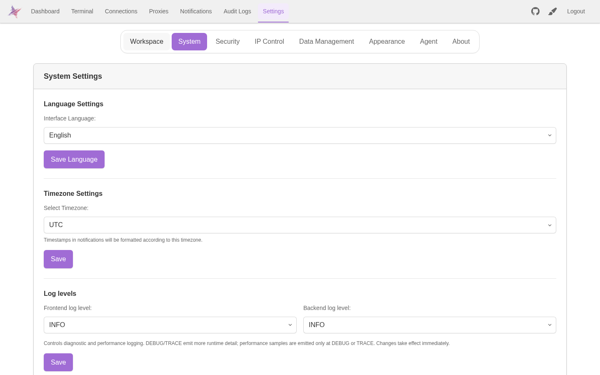
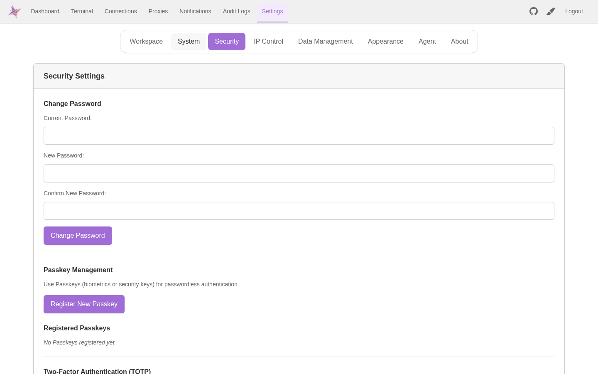

# 使用

本文统一记录正式产品的功能、操作、限制和失败恢复。当前实现与验证边界分别记录。部署命令见 [DEPLOYMENT](DEPLOYMENT.md)，设计见 [Frontend](architecture/FRONTEND.md) / [Backend](architecture/BACKEND.md)，开发流程见 [AGENTS](AGENTS.md)。

本页描述当前源码中的产品行为；实际发布与验证范围以版本和验证记录为准。具体测试 SHA、执行范围与未验项见 [验证记录](testing/E2E.md)，后续工作见 [实施计划](PLAN.md)。

## 章节导航

[连接与凭据](#连接代理与通知管理) · [SSH 会话](#ssh-会话) · [命令输入](#命令输入框) · [快捷命令](#快捷命令协议与恢复) · [历史](#历史命令) · [终端](#终端) · [文件与传输](#文件管理器与在线编辑) · [远程桌面](#远程桌面) · [布局与偏好](#布局与通用操作) · [外观](#外观自定义) · [Dashboard](#dashboard) · [监控与 Docker](#状态监控与-docker) · [安全](#安全与认证) · [备份](#备份与恢复) · [客户端](#客户端与平台)。

接口与协议补充见 [API](API.md)，部署、发布及仓库清理见 [DEPLOYMENT](DEPLOYMENT.md)，开发回归见 [E2E](testing/E2E.md)。

## 连接、代理与通知管理

连接、代理与通知目录以高对比名称、信息色类型徽标、主题强调色标签和浅底色区分信息层级；地址与时间保持次级文字色。工作区连接列表的标签分组标题使用主题强调色，侧栏分组带轻量底色，启动页类型徽标使用同一信息色。配色随现有深色、浅色及自定义主题变量变化，状态继续保留文字和语义色。

连接目录优化读取与筛选计算；搜索、标签、排序、批量选择和测试结果保留原行为，所有连接仍可通过原滚动与键盘入口访问。进入终端时，被配置刷新取代的旧列表读取不显示失败提示；真实读取失败仍提供刷新入口。

420px 及以下视口沿用紧凑页头，“添加连接”仅显示图标并保留完整无障碍名称；打开 SSH Key 管理等叠加弹窗时，底层连接页也不应产生横向滚动。

- 连接管理页头以四个轻量概览卡显示连接总数及 SSH/RDP/VNC 类型统计，名称与数量横向排列；工具栏提供搜索、标签下拉筛选、排序方向与批量编辑，标签增长时只在展开面板中列出，筛选控件的当前值和下拉选项居中显示。窄屏下概览卡与代理、通知页一致压成单行；搜索独占一行，标签、排序、方向和批量开关合并到下一行，仅极窄视口再按可用宽度拆行。电脑端列表标题右侧按“密钥管理／测试全部／连接全部”横向排列；密钥管理打开现有 SSH 私钥管理弹窗，可添加、编辑和删除保存的私钥。760px 及以下保留“测试全部／连接全部”上下等高排列，密钥管理从页头“更多操作”进入。连接按无额外容器描边的单列圆角列表管理，名称、地址、最近连接保持三行左对齐，中窄屏按视口增大字号、行距和内边距，左侧类型图标垂直居中；类型与标签在 360px 以下的最窄布局和宽屏中跟随名称行，在 360–760px 的中间布局改为右侧独立竖排块并垂直居中。底部测试、编辑、克隆与连接作为同一组铺满可用宽度，左缘与类型图标列对齐，按钮内容居中并使用浅色细边框；宽屏可同时显示图标和文字，稍窄时前三项收为图标、连接保留文字，极窄时四项均收为图标并隐藏卡片类型图标。批量编辑栏在窄屏固定为三枚选择操作一行、两枚批量动作一行，批量选择框在卡片左缘跨行居中。测试、编辑和克隆使用无玻璃底纹的按钮，连接保留主操作；“更多操作”使用不透明实心面板。添加/编辑弹窗在可用视口高度内固定，使用不透明表单表面和浅色分区线，表单内容独立滚动，底部操作保持可见；端口数字框提供主题化上下步进按钮，不显示浏览器原生微调箭头。SSH 测试延迟说明收在“测试连接”右侧的信息图标中，悬停、键盘或点击可展开。测试、删除、确认和取消使用同一基础按钮高度，手机端操作等宽。连接、代理和通知表单仍使用自适应布局，长名称、地址和测试说明可换行。
- 手机批量操作分为“全选/取消/反选”和“编辑/删除”两排；管理操作通常四列，窄卡片两列。代理与通知卡片在窄屏将编辑、删除改为内容下方的等宽图文按钮；代理筛选在中等窄屏保持搜索与类型同行，极窄视口按行展开；通知筛选固定为搜索独占一行、类型与状态各占半行。长名称、地址和操作提示可换行，不撑出视口。
- 代理管理页头以三项概览卡显示总数、SOCKS5 和 HTTP 数量；列表支持按名称、主机、类型或用户名搜索，并按类型筛选。每项显示协议、地址与认证状态，编辑和删除使用图标按钮。代理不显示更新时间。
- 正式代理表单只提供 HTTP/SOCKS5、用户名和密码。编辑时密码留空保留，勾选“清除已保存密码”清除；输入新密码替换，秘密不去首尾空格。名称/主机/用户名最多128/512/256 UTF-8 bytes，密码最多8 KiB。
- SSH Key 管理支持手填或上传最多64 KiB的严格UTF-8私钥；名称最多128 bytes、口令最多8 KiB。编辑私钥留空保留，更换私钥不会自动清空原口令；口令留空保留，勾选清除才删除。关闭弹窗、登出或页面停用会丢弃秘密草稿。读取和操作错误通过全局常驻 Toast 提示，不在弹窗内插入错误横条；需要恢复核对时保留原刷新入口。全局 Toast 使用状态标题、正文和底部确认行，不显示左侧状态图标；成功、警告和失败通过标题、细边框与按钮使用对应状态色，卡片保持中性主题底。无业务动作时底部显示“知道了”并关闭提示；带恢复动作时显示原动作，点击执行且不自动关闭。
- 连接标签选择器的已选标签使用主题强调色及浅底色。连接新建/编辑表单的选项加载失败、提交校验错误以及修改连接参数后需补输密码的提醒统一使用右侧全局 Toast，表单底部不插入错误条。选项读取失败 Toast 不会因切换认证方式或编辑字段而消失，可手动关闭；请先核对并刷新相关列表。测试结果徽标、耗时和延迟说明仍在测试按钮旁显示，修改草稿会清除上一次测试结果，重新测试后以当前输入为准。
- 代理/SSH Key使用编辑时原版本保存；冲突先刷新列表重新核对，不自动覆盖。网络断流、结果未知时禁止再次写入，先点“刷新并核对”；已提交的服务端修改可能仍存在。列表最多10,000项，Proxy完整JSON最多64MiB、SSH Key/标签各最多16MiB，超限明确失败，不显示截断的完整列表。删除沿当前后端按ID执行，引用保护仍生效。

全局确认、提示及上传冲突弹窗采用图标与标题同行、整行正文和底部操作区的布局；重置终端、连接/文件/快捷指令删除、主机密钥信任、备份导入均共用基础确认面板。取消在左、确认在右，手机同排按钮等宽并保持至少44px点击高度，多操作和长文案按可用宽度换行。危险操作保留红色标识，详情与复选项位于正文下方，长内容可滚动。原确认、取消、背景点击、Escape和保存中保护按各操作原规则执行，卸载仍保留继续卸载、取消排空及数据清理入口。

关闭错误 Toast 后，再次操作失败会重新提示；相同错误仍在驻留时合并展示。只读请求及挂起目录自动同步遇到网络中断时，先保留10秒前台恢复时间；同一请求地址重新读取成功或目录快照恢复后取消尚未显示的网络提示。页面在后台时不显示新的只读网络提示，返回前台重新等待恢复；离页或注销撤销原读取后也取消对应待提示。持续失败才显示常驻网络 Toast。保存、删除、上传等提交的网络失败仍立即提醒，结果未知必须先核对，不自动重发。此处理不自动重放HTTP读取，也不把网络恢复当作提交成功。

### 连接编辑与批量操作

批量编辑沿用与添加连接一致的不透明表单表面、分区强调线和固定底部操作，不再叠加玻璃卡片；先选择配置或凭据模式，两者分别提交，不能一次保存混合意图。手机端取消／更新凭据并排，保存配置独占一行。

编辑器的端口、身份与认证、高级选项继续按旧版分区卡片展示；高级选项默认折叠，只有勾选后才编辑代理、标签和备注。单个连接编辑使用一次确认同时保存配置和凭据；批量编辑继续选择配置或凭据模式分别提交。

- 新建通过单项导入事务原子保存配置与凭据。编辑先读取元数据与安全凭据摘要，两个版本一致才开放表单；密码始终为空，不回显明文或密文。
- 编辑使用底部一次确认，同时保存配置及输入的新密码或密钥，使用打开编辑时的原版本，同事务只推进一次版本；凭据或引用校验失败时配置也不提交。密码留空保留原凭据；从密钥改为密码需输入新密码。“清除凭据”为密码输入框右侧的勾选项，SSH 密钥认证时显示在密钥选择框右侧；窄屏保持同行。勾选并确认保存后才清除，取消窗口不清除。冲突、未知结果先只读核对，不自动覆盖或重放。
- 克隆同事务复制配置、凭据与关系；删除按ID执行，不虚构删除CAS。批量配置与批量凭据互斥，使用捕获的各连接原版本串行提交，失败停止后续项；已确认修改不回滚。追加标签后完整刷新连接缓存。
- 脚本支持带引号的值、已有代理/密钥名称和 tagNames，同项创建标签；解析不写库。省略凭据只创建配置；密码原样保留。IP范围仅支持同一IPv4子网的递增末段。脚本、范围及文件导入按50项协议分批，不另设前端总条数门槛。
- Connections、Dashboard 和 Workspace 使用独立应用对象及毫秒时间；最近连接时间由服务端持久记录，连接列表与单项的必填 `lastConnectedAt` 为 Unix 毫秒或 `null`（尚无成功记录），刷新、换浏览器与重启后仍可读取。SSH 在 PTY 建立后记录（包含 Workspace 与独立 shell），RDP/VNC 在 TCP/TLS 桥就绪后记录；桥接就绪不保证远端认证或画面已经出现。测试、监控、票据签发和已有 SSH 会话恢复不更新时间。写入只递增，不改变配置版本与更新时间；连接期间配置版本、创建时间或协议已改变则不写入旧结果。新建、导入与克隆初始为 `null`，完整备份保留已记录时间。前端连接成功后只读刷新，不用本地时间补写；读取失败保留展示并留待下次刷新，持久写入失败沿原建连失败/资源清理流程收尾，不自动重建；后续交付失败不会回滚已提交的历史。连接完整列表最多10,000项/640MiB（包含最坏JSON转义），超限拒绝而不截断；该预算不是分页或浏览器内存保证。
- 网络断流可能已提交，显式刷新后重新核对。隐藏/停用/登出清理秘密草稿与旧异步回调；取消请求不证明后端回滚。写入已确认但刷新失败会独立提示，不能据此重复保存。

### 引用、跳板与导入

- 跳板链编辑使用按顺序编号的步骤和连接线展示，下拉项同时显示连接名称与 `用户名@主机:端口`，可直接替换或移除；链尾“添加跳板机”只追加下一跳，不改变已有顺序。
- 被引用的 Proxy、SSH Key 不可删除；跳板连接不可删除或改为非 SSH，须先解除引用。保存时事务内重检，不自动改路由。后端对此统一返回 reference_in_use，引用和原记录保持不变。
- 跳板链按显式顺序逐跳连接，只消费各跳的地址、用户名与认证，不递归执行该连接自身的 Proxy/Jump 路由。
- 标签替换接受安全正整数连接 ID，按完整请求预算准入，重复合并，空数组清空。引用不存在返回 404，失败保留原关联。
- 导入只接受新 TargetImportInput 数组，按记录独立提交；单条连接、凭据、内联 Proxy/SSH Key 与标签同事务完成，失败不遗留半条记录，不兼容旧字段或密文。
- 登出后旧响应不回填连接/代理/标签/通知缓存；已提交的服务端修改不撤销。

### 通知配置与投递

管理员在通知页面管理 Webhook、Email、Telegram 三种通道。每项最多32个Header，名称大小写不敏感判重；全部Header值、SMTP密码、Bot Token读取仅显示是否存在，编辑显式选择保留、清除或替换，删除Header条目移除该项。切换通道、关闭表单、离页和身份失效清除秘密草稿。

通知渠道页沿用连接管理的目录式结构：页头概览显示总数及 Webhook／邮件／Telegram 数量，列表可按名称、地址、事件、类型和启用状态搜索筛选；每项显示通道类型、启用状态、目标地址和已启用事件数量，事件名称只参与搜索匹配，不再作为示例列出。列表可直接启用或停用渠道，启停按钮按点击后的动作着色：启用为绿色开启图标，停用为红色关闭图标，按钮底色与边框同步使用对应语义色；操作沿用当前版本与秘密保留语义。编辑与删除在桌面使用图标按钮，窄屏显示等宽图文按钮。通知页只管理渠道配置，不展示投递记录。

通知编辑器使用固定标题、独立滚动内容和固定底部测试／保存区。测试按钮始终显示，必填信息不足时保持禁用，不额外显示“请填写必填字段”一类提示。Webhook Header 仍以当前结构化行编辑；新增渠道直接输入邮件密码或 Telegram Bot Token，已有渠道编辑时才在秘密字段提供保留、清除或替换选择。启用事件支持一键全选与反选。测试回执与失败统一通过全局 Toast 显示，不在表单内插入结果行；queued/dispatched 使用信息提示，sent 才是成功提示，failed/unknown 及请求失败使用错误提示。

保存和删除携编辑/确认时的原版本；冲突、结果未知先点“刷新并核对”，刷新会丢弃当前编辑，不自动覆盖或重放。设置最多64项，请求64KiB、响应8MiB；字段与完整JSON容量由Shared校验。管理员可配置内网SMTP、Webhook及自定义Telegram origin，只使用可信目标，出站隔离由部署网络提供。

已保存测试使用服务器当前保存配置，未保存测试使用完整输入，不从已有配置借秘密。测试只返回投递受理记录；queued、dispatched均不表示发送成功，投递记录为sent才显示已发送。投递历史在审计日志页读取，按服务端nextOffset加载；未知投递先核对接收端，不能自动重发。

### 通知协议与投递

/api/v1/settings/notifications 提供GET列表、POST新增、PUT/DELETE /:id（UUID与expectedVersion）、POST /:id/test及POST /test-unsaved；/settings/notification-deliveries读取实际投递记录。所有通道使用明确config联合，秘密操作为keep/clear/replace，不接受旧flat config或数值ID。

事件只含有限event、subjectId和UTC time；模板支持{event}/{subjectId}/{time}，Email纯文本，默认Webhook为JSON。订阅采用分发时已启用配置，不追溯创建前的事件；禁用阻止后续分发，已排队项仍使用原加密快照，删除令queued失败，不能撤回已派发请求。最多4096在途、单项20秒、串行派发；重启把dispatched标unknown，不自动重发。业务提交与事件发布分事务，通知不作为业务结果权威。

### 通知失败与恢复

400 invalid_input、401 unauthenticated、403 forbidden、404 not_found、409 version_conflict、413 limit_exceeded、503不可用/未知。派发前取消记failed；SMTP明确拒绝全部收件人且未发送DATA记failed，部分接受后其余拒绝记unknown。HTTP响应体释放未确认也记unknown；任一投递清理未确认会停止该实例的新派发和配置/测试写入，仍可读配置与投递。先确认原资源释放，再重启处理后续排队项，不重发原unknown。公网真实供应商验证仍单独待验。

### SSH 主机信任

管理员在连接管理工具栏打开“SSH 主机密钥”，读取已确认的 host/port、SHA-256 指纹及确认时间。先通过可信渠道独立核对指纹，再输入主机、1–65535 端口和 SHA256: 加43个 base64 字符，确认弹窗展示的目标与指纹。主机统一小写、最多253 UTF-8 bytes，不能含空白或控制字符。连接测试不会自动建立信任。正式 SSH 工作区遇到未信任密钥时，在原标签页弹出实际握手目标（包含跳板）的主机、端口和 SHA-256 指纹；密钥变化以警告色分区展示目标、已保存指纹和当前指纹。独立核对后点击“确认信任并重新连接”，保存信任后重试；每个跳板分别确认，不自动信任。批量连接的公钥确认串行排队，不因排队数量直接判为取消。取消或确认失败保留标签页，可稍后手动重新连接；关闭标签或退出登录会撤销等待，晚确认不重连。写入回执未知时只读核对，未能确认已保存不重试写入。

主机密钥面板将安全说明收在与全站其它提示一致的标题右侧信息图标中，悬停或键盘聚焦时显示；已信任密钥按主机/端口集中展示，指纹完整换行且可复制，确认时间使用本地化日期。手动建立信任使用独立分区，确认按钮位于指纹输入框右侧；窄屏下主机与端口改为单列，指纹和确认按钮保持同行。面板只保留底部“关闭”入口，内容独立滚动。

确认会覆盖同一主机/端口的信任；移除删除操作当时的信任，包括其他管理员刚写入的新值。二者没有版本条件，操作前均需确认。结果未知、协议失败或已派发的拒绝后先“刷新并核对”，不自动重发；关闭面板或退出登录取消等待，不证明服务端未提交。正常自动读取，失败或需要核对时才显示刷新入口。列表最多10,000项，完整 JSON 最多16MiB；超限返回413 limit_exceeded，不截断。此面板已接后端，Connections正式通信源码已接Shared，整体回归仍按D17执行。

### 后端标签关联

正式标签API、选择器和标签组管理已消费Shared。名称保存与关联替换是两个独立按钮，改名携带打开编辑时的版本；替换关联前确认整集合覆盖，未保存的新名称须先单独保存或还原。冲突或结果未知先关闭面板，刷新连接和标签列表后重新打开核对，不自动重复写入；确认成功后刷新失败不撤销原提交。标签选择在缓存重置或读取失败时保留，完整有效列表确认删除后才清理；创建名称集合先完整校验，逐项创建期间失败保留已确认记录，未知时停止后续创建。标签列表最多10,000项/完整JSON 16MiB，超限413 limit_exceeded，不截断。连接列表、表单、批量操作与 Workspace 已接当前契约；完整回归范围见 testing，不能据单个组件回归扩大覆盖。

管理员通过 PUT /api/v1/targets/tags/:id/connections，以 {connectionIds} 替换该标签的全部连接；空数组清空。POST /api/v1/targets/connections/add-tag 以 {tagId,connectionIds} 向选中的连接追加标签，数组必须非空，不改变其他关联。两者完整 JSON 最多32 KiB，原始数组不另设数量上限，成员必须是安全正整数，重复ID合并，成功返回 {updated:true}。Targets管理路径ID与正文ID统一支持1至9007199254740991；路径使用无前导零的十进制数字，超出范围拒绝。标签不存在返回404 not_found，任一连接不存在返回404 reference_not_found，整项失败不修改原关联。

标签名称去首尾空格、最多128 UTF-8字节，导入按同一规范匹配已有标签。每个连接最多64个标签，普通新增/更新、单连接标签替换、导入及批量关联遵守同一限制；导入的已有标签与按名称创建标签合并后也不能超额。DELETE /api/v1/targets/tags/:id 同事务删除标签并解除全部关联。实际改变关联的连接版本各推进一次；已有相同关联不推进版本，标签本身未修改可见字段时不推进其版本。操作后刷新连接列表，已有编辑收到 version_conflict 时重新读取，不覆盖关联变化。

持久写入 operation_unknown 返回503；响应断流也可能已经提交，先只读核对，不自动重试。关联修改使用与其他后端管理操作一致的事务会话复查。正式 Tags/Connections、Workspace 标签组已消费这两个入口；成功或未知关系变更后完整重读连接，不能只刷新标签目录就解除旧窗口的未知围栏。

### 连接导入与测试

工作区连接列表和导入弹窗正常不显示额外刷新按钮；读取失败或写入结果待核对时提供恢复入口。工作区标签读取失败同样可手动重读。

管理员使用 `POST /api/v1/targets/connections/import`，JSON 正文为 `{items}`；也可上传唯一 multipart 文件字段 `connectionsFile`，文件内容为严格 UTF-8 JSON 数组，每项采用 Shared 的 `TargetImportInput`。每项包含 `connection`，可选 `tagNames`、`inlineProxy` 和 `credential`。凭据采用 `password`、引用已有 `ssh_key`，或带名称/正文/可空口令的 `private_key` 创建意图；内联代理可带密码。新格式不接收旧字段或旧密文。正式前端选择文件后先严格 UTF-8 解码并校验，再通过 JSON items 分批提交；后端 multipart connectionsFile 入口继续保留。前端不另设本地文件大小或总条数门槛，每批最多50项并校验协议字节容量；全部分批输入先校验再派发，逐项显示原序回执，遇失败停止后续批次，保留已确认项。导出仅含 connection 配置，不含密码、私钥或凭据；引用使用当前实例 ID，不另设前端导出条数/文件大小门槛，不是跨实例秘密备份。连接列表和导入弹窗不常驻展示这些协议／容量说明，操作失败时仍显示相应提示。

每项的连接、凭据、内联私钥、代理与标签同事务提交；一项失败不会留下部分记录，其他项继续，按原序返回 `items` 的安全结果。文件中非法项返回 `invalid_input`；文件整体无效、超容量或 JSON 请求形状无效则整批拒绝。已有代理先校验持久记录，损坏记录安全拒绝，不作为可复用配置；仅在用户名一致且不携带新密码时复用，新秘密冲突返回 `conflict`，不覆盖原代理；同名私钥冲突也明确拒绝。导入中途失去身份/权限会停止后续项并返回401/403，已经提交的项不撤销；最后一项等待期间超时也不再返回整批成功。导入不是幂等操作，`operation_unknown`、会话过期、超时或响应中断可能已有部分提交，先查询核对，不自动重传。操作观察复用 Operations；观察事件不替代逐项提交回执。

`POST /api/v1/targets/connections/:id/test` 测试已保存 SSH 连接，`POST /api/v1/targets/connections/test-unsaved` 接收 host/port/username、authentication 和明确 direct/proxy/jump 路由及引用。未保存测试支持密码（允许空字符串）、已有 SSH Key 或直接私钥，不创建数据库连接。仅进行 SSH 握手，不开启命令、PTY 或 SFTP；所有跳板与目标须通过 Host Key 信任。连接列表及新建/编辑窗口点击测试后，未信任或密钥变更会显示现有指纹确认框，独立核实后确认信任即可继续测试，无需先打开终端；取消不保存信任、不继续测试、不显示本次成功结果。多跳逐个确认各主机，同一端点再次拒绝时停止，不循环确认；离开页面、关闭表单或身份失效后不继续旧测试。成功返回 `{status:'ok',latencyMs}`，且本地传输已关闭；失败返回有限安全错误码，`host_key_untrusted` 必须带本次握手的 `hostKey`（host、port、fingerprint、expectedFingerprint），不回传供应商错误正文。最多8个在途，每次请求期限15秒，确认等待不保留SSH连接；取消后仍等待真实资源收敛，清理失败阻断新的测试并在停机汇总。SSH 测试审计复用 `SSH_CONNECT_SUCCESS/FAILURE`。新建及编辑窗口输入新密码或选择密钥后，测试捕获开始时的当前连接及认证草稿，不保存连接或凭据。编辑时密码留空且连接地址、用户名和路由未改动，使用已保存凭据测试；这些连接字段改动时，先输入密码再测试；未输入时通过右侧 Toast 提醒，不发送测试请求，避免实际测试旧连接。输入变动后清除旧测试结果；测试成功仍需确认保存。

## SSH 会话

挂起目录的时间文字使用清晰的次级文字色，不叠加额外透明度。

支持多标签、挂起、续接和布局定制。打开第二个 SSH 或切换标签时只显示选中会话的终端画面，后台会话继续保留连接与输出。快速发起多个连接或在连接期间切换标签，以最后一次选择为准；较早的配置读取或批量连接晚完成时只更新后台会话，不切回旧标签，也不关闭后来打开的新连接页。切换到其他页面再返回时保留原终端、命令草稿和已加载布局，不重新创建终端；退出登录或切换用户时清除这些缓存。离开工作区后，已发起的SSH连接继续由原标签管理，但尚未派发的批量/查询打开和挂起接管确认失效；返回页面不会继续旧确认或旧查询的连接动作。

终端输入立即发送并使用远端PTY真实回显；SSH直连、跳板及HTTP/SOCKS代理底层TCP关闭小包合并，减少逐字符输入的额外等待。输入仍逐次校验会话及当前控制权，不缓存授权。实际回显速度仍受浏览器到后端、后端到SSH服务器的往返延迟与远端程序影响。

手机系统输入法确认的空格、标点和文字按实际内容发送；连续空格不会被忽略，输入法替换末尾字符时不会重复发送此前输入。切换离开终端后，迟到的输入仍不会发送。

关闭 SSH 时先请求正常结束；对端只完成半关闭时会强制关闭本次连接的实际传输流，再等待关闭确认。无法确认时仍提示清理失败，不据此重发命令或重建会话；直连、代理和跳板使用同一清理规则。 Workspace正常关闭期间保留关闭回执通道，等待原SSH/SFTP与传输任务收尾；期间不再接受新的终端或文件操作。注销、密码修改导致Cookie失效时仍关闭该通道，不能因正在清理继续使用旧身份。

已连接 SSH 标签的右键菜单（移动端长按）依次为“挂起会话”（已标记时为“取消挂起”）、“重置终端”，后续为原关闭操作。远端程序无法退出时，可选择“重置终端”，确认后关闭旧 SSH 会话并在原标签位置建立新终端。重置会清空终端画面和命令草稿，传输与未保存编辑可能受影响；独立后台进程不保证结束。取消确认不执行重置，其他标签的会话与当前选择保留。仅已连接、未标记挂起且无未知结果围栏的会话可重置，已标记挂起的会话需先取消保留。未收到旧会话关闭成功的明确回执时停止重置，不新建第二个会话；提示关闭结果无法确认后，先核对远端任务再关闭旧标签。新连接失败保留其标签及既有错误恢复入口；本功能由用户手动触发，不检测卡死或自动终止任务。

运行 `nethogs` 后输出大量 `Ethernet link detected`、随后长时间没有统计画面时，可先限定实际要监控的网卡，例如 `nethogs enp35s0`；网卡名以目标服务器为准。默认全接口采集在存在大量容器网桥和虚拟网卡的主机上可能很慢，`q` 也可能等待抓包轮次结束才能处理；工具改变 TTY 模式后，Ctrl+C 不一定产生中断信号。退出无响应时，可通过另一条 SSH 连接核对本次进程的 PID，再对该进程发送 SIGTERM，避免批量结束其他人的任务。排查时分别核对远端程序是否继续产生输出、SSH/工作区连接状态和终端消费确认，避免将远端工具停顿直接判断为终端渲染故障。指定网卡只统计对应接口，不代表全部容器网络。

### 挂起与恢复

工作区挂起会话列表随分栏高度自动展开，放大后可显示更多会话；搜索栏保持固定，只有会话内容超过剩余空间时才滚动。起始页摘要与会话弹窗保留原紧凑列表。

- 点击挂起仅标记保留；关闭标签或断线后 Backend 接管原 SSH/PTY，适合长任务。
- 终端标签指示灯在已连接时区分挂起标记：普通会话为绿色，已标记挂起及恢复后仍保留标记的会话为蓝色；取消标记后恢复绿色。连接或重连中为黄色闪烁，断开或失败为红色，未连接为灰色。恢复成功继续保留挂起标记及原有关闭保留行为。
- 有权限的设备可恢复无人使用的会话，或确认接管使用中的会话；不要求原设备的普通续接凭据。接管撤销原设备控制权，不允许双写。后端在挂起 owner 的真实租约到期后立即拒绝继续控制和关联文件传输，不等待清理扫描；独立上传、下载分块及多步骤文件操作也检查原 Workspace 权限。普通断线仍按既有宽限期处理。已经派发的远端效果不能撤回；上传中断可能保留临时文件，清理未确认时报结果未知，先只读核对目标文件，不自动重传。
- 挂起成功返回真实会话 ID；失效或注册失败不报成功。后台标签恢复不切走当前终端；恢复等待期间切换到其它标签，成功或失败都保留当前选择。
- 恢复先按快照原始行列数重建终端，再按恢复窗口尺寸接入实时输出，避免窗口大小变化造成错行或重复提示；相同尺寸不会重复触发远端重绘。快照保留当前屏幕的滚动区域与光标位置，避免TUI重绘中途挂起后，后续输出冲掉底部输入区或队列。恢复先核对历史基线，再独立确认所有权；确认成功才开放输入和Files，不等待SFTP初始化完成。历史先显示不证明恢复完成，未确认输入不自动重发。恢复确认、挂起提交或取消标记结果未知时停止重放，先查看挂起目录核对，不自动取消标记补偿。
- 浏览器从后台或锁屏返回时，先向服务器复验原控制权，不依据过时的本地倒计时直接判定租约失效。续租响应无法确认时停止控制并显示结果未知；服务端明确撤销才提示对应租约原因。原会话在目录变为无人使用后，当前可见工作区自动恢复原PTY，即使目录更新晚于最初的短暂等待；不会自动接管其他设备正在使用的会话，也不会为此新建Shell。
- 已标记标签关闭只脱离连接并保留原PTY；要终止正在使用的终端任务，先成功取消挂起再关闭标签；无人使用的后台挂起可在目录移除并终止。续租失败、租约失效或被接管后立即停止控制；旧设备不能继续写入。
- 在挂起目录移除仍有终端使用的会话时，只取消挂起并移除目录记录，不断开正在使用的 SSH/PTY；即使从另一设备移除，原终端也会同步取消挂起标记，不再留下“待关闭”记录。无人使用的后台挂起会话才会被终止，已断开的记录只删除日志与条目。移除期间正在恢复或所有权不明时先读取最新状态，不自动退回终止操作。
- 单次快照最多4MiB UTF-8，完整挂起JSON最多24MiB+16KiB；历史页最多256KiB。历史页失败不会终止健康终端；游标交付不明时不自动重取，须先回到实时输出重置历史，或重新恢复会话。
- 保留最近 100 MiB 原始历史，先恢复状态和尾部，旧历史按需分页；达到上限仍可恢复原 PTY。
- 登录后通过独立 `/ws/suspended-sessions` 订阅当前用户的挂起目录，不绑定某个 SSH 终端；挂起、恢复/接管、续租、断线、改名、终止和过期会推送完整快照，其它在线设备无需等 HTTP 轮询。首次连接、断线重连及浏览器恢复可见时取得完整快照，离开首页仍同步；隐藏浏览器页面时暂停，恢复可见或从页面缓存返回时重新连接；网络故障时退避重连并保留最后成功列表，短暂恢复失败不立即弹Toast，前台连续10秒未恢复后才提醒，权限拒绝和协议异常仍按原错误处理。目录按完整 1 MiB JSON 容量校验，不再另设 64 条记录的读取上限；WS 完整帧另留 1 KiB envelope；命名、终止、移除和日志使用 HTTP，列表 HTTP 保留给显式核对和操作后的只读确认。命名最多 128 个 UTF-16 单元，完整管理请求/响应最多 4 KiB。日期为 ISO 字符串，租约为 Unix 毫秒。移除结果由 Backend 当时的附着状态决定，不根据浏览器的旧目录状态终止终端。
- 目录恢复以实际连接结果为准，浏览器显示“离线”但站点仍可访问时也会尝试读取；前台连接失败后沿原退避继续恢复，网络切换通知会立即重建目录订阅。首次目录须在原45秒期限内取得，只有心跳而没有列表也会结束本次等待并重试，不一直显示加载。重建只读目录不会接管或终止SSH会话，隐藏页面仍暂停订阅。
- 启动页的挂起会话面板与弹窗使用原有紧凑卡片：序号与名称位于首行，挂起时间和状态徽章同排，恢复、导出和移除在卡片底部均分展示。搜索只筛选当前目录，搜索框占位文字统一为“搜索会话”，无结果显示明确空态。搜索框、卡片列表和空态以“挂起的 SSH 会话”标题图标左缘为共同起点并保持同宽；滚动条槽只占用右侧，不通过额外左侧内边距把内容推离标题图标。窄面板中操作组居中，极窄时收起按钮文字但保留可访问名称；弹窗标题栏固定、正文独立滚动，手机宽度不横向溢出。关闭、隐藏或移除后仍沿用原有取消、确认和目录同步行为。
- 挂起会话空态按两条实际会话卡片预留最小高度（单卡 78px、卡片间距 6px），内容在可用区域内整体居中；面板可用高度略小于两行时贴合容器，不因硬编码余量产生无意义的内部滚动。页面滚动模式仍完整预留两行。
- 写入结果未知时保留目录与操作保护，不自动重发；先点搜索框旁的刷新按钮“读取最新状态并核对”，确认当前状态后再决定操作。后台推送不能解除此保护，较早的刷新也不能解除后来产生的未知结果。目录同步和日志读取失败仅说明读取未成功，不显示写入“操作结果未知”；原列表保留。错误通过常驻可关闭的 Toast 展示，不在面板插入告警横条；已识别网络失败沿全局网络通知去重，真正写入未知仍单独提醒并保留操作保护。隐藏、停用或卸载面板会取消原确认和等待，注销还清除目录及共享订阅。
- 日志导出限 60 秒、128 MiB 渲染后 UTF-8 文本，以服务端会话 ID 命名；此限制与 100 MiB 原始历史窗口不同。超限/断流或媒体类型、文件名无效时不启动浏览器下载，按失败处理。

日志经代理压缩传输时，容量按浏览器解码后的实际正文检查，不把压缩传输长度与解压文本长度直接比较；未编码响应仍核对声明长度，截断和超量不作为成功导出。

### 自动重连

- 手机终端会按底部工具栏上方的实际内容区域自适应行列数；内置虚拟键盘开启或关闭、横竖屏切换及软键盘改变可视高度后，最后一行保持在终端区域内，原有内容边距和工具栏位置保留。
- 异常断线约 120 秒内保留原 SSH/PTY、压缩及复制/移动任务，优先续接并补回输出/结果，不重新 SSH 登录替换终端。
- 切换 Wi-Fi/移动网络或网络暂时不可用后，传输失败按原退避继续自动重连，不因一次失败永久等待按键；离线时暂停，恢复在线后立即尝试。浏览器支持网络变化通知时，即使“在线”状态未变化也会检查存活；健康连接保持原样。已连接会话优先使用原凭据续接同一 SSH/PTY，补回缺失输出，不重发已输入命令或文件写入。
- 回到前台、恢复网络或返回终端时检查存活；正常链路不重连，并发恢复共用一次请求。布局重建等待显示快照期间若原PTY结束，不会把旧PTY画面恢复到新终端。
- 手机切后台及返回前台时都会清理未结束的触摸和临时键盘禁用状态，避免浏览器漏发触摸结束事件后无法输入；返回后立即重新测量并刷新终端，不等待旧动画帧或网络存活检查。输入资格以当前连接是否就绪为准，连接尚未就绪不会提前开放输入。Android 软键盘开关按实际可视高度调整工作区，收起后恢复；恢复过程不主动弹键盘，轻点终端或使用原聚焦入口打开，失败时可点“重新连接”按钮或轻点终端重试，不为重连主动唤起软键盘；失败等待时仍可聚焦输入框，键盘或输入法输入仅触发重连，不会发送到SSH，连接中仍禁用输入。后台冻结或网络断开仍可能需要续接，不保证浏览器持续维持连接。
- 普通续接校验原标签凭据、用户、Workspace 和连接；新标签不可接管旧 Workspace。后端注销会撤销原 Cookie，现有终端在周期身份复查（约15秒一次）时断开；原 PTY 仍按宽限期/挂起策略保留，并非立即终止远端任务。同用户重新登录后须持原续接凭据并显式确认，文件资源按新登录重新授权；终止任务请主动关闭会话。
- 待挂起标签自动恢复无人使用的会话，不抢占其他设备或关闭后来打开的启动页。页面被回收后通过挂起目录恢复；未标记会话超出窗口不保证保留。
- 主动关闭通过当前附件请求释放；收到确认才表示关闭成功。断连只表示本地脱离，关闭响应丢失仍为结果未知，不能保证原远端进程停止。远端退出或宽限期结束无法恢复。普通断线时可按终端/命令栏 Enter，或再次点击同一连接提前尝试。
- SSH 登录、主机信任、权限或目标失效等明确失败保留原标签，在终端底部显示独立恢复卡片，说明原因、检查事项和“重新连接”按钮；失败文案不再写入终端输出、重复累积或混入日志。桌面可直接点按钮，或聚焦终端区域后按 Enter；复制、Tab、系统快捷键不触发重连。手机按钮和轻点重连不主动弹键盘。蓝色挂起标签的重试沿挂起目录恢复原会话，被占用时仍需接管确认；读取失败和记录不存在会给出明确反馈，不再调用会忽略挂起会话的普通重连。结果未知仍保留原恢复保护，不允许按键重复创建。
- 普通恢复先接收回放，再独立确认所有权，确认后才开放输入和调整终端尺寸。准备续接时旧附件仍占用或服务暂不可用，继续用原凭据等待重试；确认尚未发出即可安全重试准备，但确认已发送而回执丢失仍保留结果未知保护。新建或所有权确认结果未知时停止自动和手动重放，终端显示恢复提示；关闭原标签后可新建连接，但新建连接不会终止原远端进程。

### 会话容量与关闭

| 范围           | 限制                                                             |
| -------------- | ---------------------------------------------------------------- |
| 普通 Workspace | 单 Backend 64 个，包含建连预留及弱网续接；已有会话续接不重复占槽 |
| 挂起 Registry  | 每用户 32、全进程 64，包含附着/断开记录                          |
| 连续挂起       | 24 小时后终止；已恢复不按旧时间终止，再挂起重新计时              |

满载拒绝新建/恢复；Server Transfer/Suspend 的独立预算不计入普通 Workspace 上限。Backend reset/shutdown 清理挂起日志，启动清理无 owner 遗留日志，不提供跨重启挂起恢复。

跳板总期限覆盖握手/forwarding，取消后关闭已建资源，晚到 channel 不发布。远端断线回收会话，旧关闭事件不误关新 owner。命令仅零退出码且无 exit signal 算成功；关闭但缺退出状态属于未知结果，不自动重放，也不证明远端进程停止。

## 命令输入框

- Enter 发送；`↑/↓` 选择历史/快捷命令，命令同步发送至选定目标。当前页面单会话发送成功后追加历史；离开页面或认证撤销后，旧发送回调及尚未派发的排队意图不再追加。已派发SSH输入不能撤回。
- `Alt + ↑/↓` 切 SSH 标签，`Alt + ←/→` 切编辑器标签。
- 桌面始终单行，不因 pane 宽度或高度换行；命令栏高度保持完整展示所需的 38px 至 42px。清空、焦点配置、编辑器、搜索和已启用的文件管理器按钮直接显示，不再使用“更多”菜单；普通态输入框不显示占位文字或提示符。工具按钮各自使用低对比 1px 细边框，悬停和激活时边框随状态增强。空间不足时优先压缩输入框，直到仅保留最小内边距；达到该最小宽度后工具区才在自身区域内横向滚动。手机使用同样无提示的输入区，输入框随可用空间收缩但不小于内边距。搜索态在极窄 pane 只保留关闭，`Enter`/`Shift+Enter` 或上下键继续查找。
- 命令栏的清空、焦点配置、编辑器、搜索和已启用的文件管理器入口始终显示；编辑器入口仍受“文件与编辑”中的弹窗编辑器总开关约束，命令栏不再提供独立的按钮显隐设置。
- 手机保留常驻输入和可横向滚动的工具条；输入框自适应吸收工具组之外的剩余宽度，按钮触控区略增大，工具栏不遮住终端。窄屏只滚动工具按钮，不产生页面级横向溢出。
- 快捷指令单击执行，Copy/Edit/Delete 使用右键菜单；点击标签组文字、箭头或空白展开收起；右键标签栏按顺序提供“删除标签”“删除本组（带标签）”“重命名”，重命名仍使用原行内编辑器，Enter 保存、Escape 取消。“删除标签”只移除标签与关联，保留指令；“删除本组（带标签）”通过全局确认弹窗确认一次，显示全组指令数量；确认后同时删除标签及组内全部指令（包含搜索隐藏的指令），这些指令也会从其余标签组移除，取消不发送删除请求。后端在同一事务核对标签版本、全组成员及各指令版本后删除，列表或指令已变化时整批拒绝，刷新后重新确认，不出现逐条部分删除。“未标记”是虚拟分组，右键提供“删除本组”，使用全局确认弹窗显示全部未标记指令数量，包含搜索隐藏项；确认后同一事务核对完整成员及版本并删除全部未标记指令，不影响有标签的指令。原点击创建标签入口保留，新指令未设置标签时仍归入未标记组。自定义标签与未标记标题统一使用全局界面字体。指令编辑表单中的全局删除标签仍只移除标签和关联，保留指令。菜单与确认均使用全局 UI 组件和样式，工具栏适应 pane 宽度。分组与条目列表保留重构前的卡片层级、数量徽章、组内底色和条目间距；顶部搜索、排序、紧凑、显示模式及新增工具区使用当前按钮样式。

### 快捷命令标签与提交

- 批量关联提交非空且不重复的命令集合，按完整请求 1 MiB 预算准入，携带原 ID/version 和标签 ID；非法或超出完整请求预算时拒绝，引用不存在返回404，版本冲突返回409，不部分写入。
- 新增/编辑命令与标签关联同事务，失败整体回滚。
- “创建标签后批量关联”是两个请求：关联失败标签仍存在，先刷新再重试关联或删除，不重复建同名标签。

#快捷命令窄栏在宽度不超过 260px 时将搜索框与操作按钮换行，输入文字及清除按钮不会挤掉输入区。文档搜索保留可输入的最小宽度，桌面 PDF 在搜索打开后按需将工具条换行。

## 快捷命令协议与恢复

登录后通过 `/api/v1/quick-commands` 与 `/api/v1/quick-command-tags` 管理当前用户数据。命令保留变量、标签和使用次数；新增/编辑/删除/计数、标签 CRUD 与批量关联已安装，记录数据不执行 Shell。列表使用 offset/limit，命令每页最多50项，按名称或usageCount排序；标签按名称排序。命令和标签不设固定总条数上限，按分页读取；每命令50标签、32变量；命令16 KiB、名称256 bytes、变量值4 KiB、变量名为最多64字符的标识符且拒绝原型保留键。完整请求1 MiB、响应64 MiB，包含JSON转义。

快捷命令分组标题使用主题强调色及轻量底色，命令名称保持高对比；折叠、悬停、选中与编辑操作不变。

标签名称去首尾空白后保存，同用户规范名称冲突返回409；命令/标签的更新时间由实际写事务生成且不倒退。修改/删除/计数带 expectedVersion；批量关联为 `{commands:[{id,expectedVersion}],tagId}`，非空且不重复，不另设1,000项数量上限，全部检查后同事务写入，已有关联不增加计数。表单中单独删除标签会移除关联并推进受影响命令版本。标签栏删除组使用 `DELETE /api/v1/quick-command-tags/:id/group`，请求为标签 `expectedVersion` 及全组 `commands:[{id,expectedVersion}]`，成员数量按完整请求 1 MiB 编码预算准入；同一事务核对标签、完整成员和指令版本后删除组及指令，与批量关联一样不另设成员数量上限。未标记组使用 `DELETE /api/v1/quick-commands/untagged-group`，请求仅为 `{commands:[{id,expectedVersion}]}`，同样按完整请求编码预算准入，成员必须与事务内全部未关联任何标签的指令完全一致。缺记录404、名称或版本冲突409，组删除冲突时无部分副作用。成功分别返回command/tag、deleted或实际新增count；unknown不自动重放，先只读核对。正式Workspace面板按Shared协议读取完整分页；编辑和确认保留原版本。标签目录读取失败时，已成功读取的命令仍可执行，以未分组方式显示；错误明确保留，管理写入与使用计数暂停，点击错误 Toast 的“刷新”成功重读两份目录后恢复。遇到冲突或未知结果，先关闭编辑窗口，使用错误 Toast 的“刷新”只读重读，再重新编辑，不自动重放。页面停用、弹窗关闭或认证撤销后，原确认不再派发；已接纳请求仍由原Store追踪。

## 历史命令

截断命令可悬停查看全文；历史时间使用清晰的次级文字色，不额外降低透明度。

### 命令与路径历史

- 最近命令 10,000 条、路径 2,000 条；新增/复用时同事务裁剪，同秒优先保留本次触及记录。
- 并发写入按值合并，旧重复保留最小 ID 并更新时间。旧超额备份可导入，读取只展示窗口，下次写入再清理。

### 个人历史与收藏协议

- 命令历史与路径历史保留原 `/api/v1/command-history`、`/api/v1/path-history` 的 GET/POST/DELETE 方法；仅当前用户可读写。POST分别为 `{command}` / `{path}`，按原值去重并更新时间；10,000命令/2,000路径同事务修剪，同秒保留本次记录；记录时间在实际写事务中生成，时钟回退不使本次记录被当成旧项裁剪。单条4 KiB、请求32 KiB；GET用offset/limit（默认100、最多100）返回entries/nextOffset，按时间/ID升序，完整响应4 MiB。新增返回id，删除返回deleted，清空返回count；不执行命令。分页不是跨请求快照，写入/清空后从首页刷新。生产者仍是前端HTTP，后端Workspace不自动记录。
- 在文件管理器打开收藏并新增时，路径默认填入当前浏览目录，可继续编辑；取消后重新新增会重新读取当前目录，不沿用上次草稿。编辑已有收藏仍读取该收藏保存的路径。
- `/api/v1/favorite-paths` 保留收藏 CRUD、`PUT /:id/update-last-used` 及按name/lastUsedAt排序。列表默认100、每页最多100，返回entries/nextOffset；不设固定收藏总条数上限，名称可null（256 bytes）、路径4 KiB，请求32 KiB/响应4 MiB。编辑/删除/更新时间都必填expectedVersion；修改返回favoritePath，删除返回deleted。其他用户记录视为not_found，版本冲突重新读取，unknown仅核对、不自动重放。写入时间由实际事务生成，编辑及使用时间不会因排队或系统时钟回退而倒退。正式Files收藏与路径历史、命令历史面板直接消费Shared分页和有限回执。收藏冲突或结果未知时，关闭并重新打开收藏列表以只读核对，再重新编辑；路径历史写入未知先重新打开列表核对；命令历史写入未知时提示无法确认保存，可点错误通知的“刷新”只读核对。下一次新的命令历史保存、删除或清空会先读取服务器列表，成功后才执行本次新操作；读取失败不派发本次写入，后续再操作会重新核对。普通重新读取成功也能恢复保存，不自动重复未知写入或终端命令。认证撤销清空本地个人数据与草稿。

## 终端

终端工作区没有已保存连接时，列表仅显示暂无连接提示；新增连接统一使用列表工具栏的“添加连接”，不再重复显示“添加第一个连接”按钮。连接管理页的空列表操作保持原样。

从首页或连接列表进入工作区时，连接与工作区布局读取并行启动，终端按保存的布局就绪后显示，连接完成前仍禁用输入。SSH 优先使用所配置的密码或私钥，减少认证探测等待；主机密钥信任仍需按原流程确认。实际速度仍受网络、跳板和服务器登录脚本影响。

后端每 25 秒通过 WebSocket 标准 Ping/Pong 保活，减少空闲连接被反向代理超时断开的情况；浏览器自动响应，无需页面定时器。保活不续期挂起会话或授权，也不能阻止系统休眠、网络断开造成的重连。

终端连续输入按原顺序合并发送到原 SSH 附件，文件操作繁忙时不会因共用 RPC 名额而截断按键；仍遵守现有输入字节预算。断线、关闭或附件更换后不重放旧输入，明确拒绝时沿原提示处理。终端失活或页面进入后台后，不接收迟到的输入、粘贴和未完成输入法提交；返回后可重新输入，后台协议查询仍正常应答，已发送的命令不撤销。

终端翻页与连续重绘在没有待确认预测时，直接交给终端自身按顺序解析；有待校正输入时仍保留预测与真实输出的同步。滚轮或双指连续缩放将同一帧内的变化合并为最终字号；已有缩放步进、上下限及最新字号保存规则保持，尺寸相同不重复触发远端调整，切换主题不再额外测量行列。实际响应仍受浏览器渲染、历史长度和远端程序影响。

后台会话输出合并处理，等待上一批解析后再继续提交，以减少多个 SSH 同时刷屏的竞争；输出不丢弃、不重排，切回前台与关闭前仍刷新待处理内容，消费确认保持在解析完成之后。

- 点连接立即显示等待页，连接中禁用输入，成功启用；建连明确失败后显示独立恢复卡片，给出本地化原因和“重新连接”按钮，保持等待而不后台重复建连；网络传输故障仍按自动重连策略处理。可点击按钮或聚焦终端按 Enter 重试，重试按键不会发送到远端；拒绝主机信任仍需重新确认，所有权结果未知仍只能按原恢复提示处理，不因按键绕过。`＋` 打开连接/挂起启动页，不停止已有会话，后台连接完成不关闭后来打开的启动页。
- 启动页桌面为连接双栏、挂起 SSH 会话右栏，外层框与终端标签栏同宽衔接；小于 1024px 时挂起会话移到连接下方，页面纵向滚动且连接在前。连接项第二行显示地址与最近连接时间，类型徽标固定右对齐；分组与批量管理入口常显。
- 连接后的工作区只由外层工作区框和分栏分隔线划分，不再为每个分栏重复描边。终端分栏显示连接名、用户名与地址及连接状态，底部显示状态、协议和终端尺寸；高度不足 280px 的分栏自动隐藏这两条信息栏，避免挤压终端。
- `Ctrl + Shift + C/V` 复制/粘贴；桌面有选区右键复制，无选区右键粘贴。接管鼠标的程序保留自身右键，Shift 拖选/右键可执行本地操作。
- OSC 52 只允许当前聚焦且可输入的终端，在用户按键/松开鼠标后 2 秒内写入有效 UTF-8 文本，Base64 最多 1 MiB；不读取本机剪贴板。需浏览器写入许可及 HTTPS/localhost。
- 示例：OpenCode v2.0.18 `Ctrl+X` 后 `Y`，Codex CLI 0.159.2 `Ctrl+O`；实际以应用键位为准。Shift 选区只复制终端缓冲，不拼接应用翻页。
- 移动端双指缩放字体；键盘已打开时，普通点按终端保持输入焦点，不反复收起再弹出，htop等应用的点击仍发送鼠标事件。长按复制不反复唤起软键盘，Copy 后不强制聚焦，普通点按/Paste 恢复输入；键盘关闭时滚动不唤起输入。触摸能力按设备判断，拖动不交给外层页面；选区清除后尺寸变化不复活选区。
- 小键盘固定 Esc/Fn/Shift、Tab/Ctrl/Alt；Shift 为修饰键，↑ 为方向键，Fn 切换 F1–F12。

| 范围                   | 限制               |
| ---------------------- | ------------------ |
| 单次终端输入           | 256 KiB            |
| SSH 浏览器发送缓冲     | 1 MiB              |
| 文件二进制累计读取     | 本次请求的读取预算 |
| 终端历史单次二进制响应 | 256 KiB            |

未连接/超量/背压时拒绝并提示，不重发输入；读取超限取消并释放缓冲。输出解析过慢暂停发送，解析后继续，不丢中间输出；历史恢复暂停与网络背压分别解除。

Workspace收到畸形JSON/二进制帧、重复响应元数据或终帧后的额外数据，会中止当前传输并结束等待，不交付不完整内容。断开不证明远端写入已回滚；先核对远端结果，不自动重放操作。

- 前台输出直接解析，后台按 80ms 或 512 KiB 合并；重绘使用动画帧及每批一次 100ms 兜底，DEC 2026 完整画面结束时提交，Codex CLI 等程序的计时随收到的输出更新，无需点击触发。浏览器冻结不触发自动重发。
- 历史翻页只在普通终端画面生效；全屏程序使用备用屏幕时，滚轮/触摸滚动仍交给程序，迟到的历史页不覆盖新启动的全屏程序。恢复实时画面不等待历史游标重置；新翻页等待重置，旧页面不能覆盖新画面。旧历史写入后按更新后的滚动范围定位，避免跳回尾部；命令栏成功发送命令后回到实时输出，多会话发送对各个成功目标分别恢复。
- 重连、前台恢复和字体加载后同步尺寸；隐藏时保留最近有效尺寸，恢复按可见区域测量。挂起恢复先完成已排队的画面与原尺寸还原，再适配当前窗口，避免提前缩放打乱恢复顺序。
- 弱网输入采用 VS Code TypeAhead 预测：积累回显样本后，在延迟较高且匹配有效时，常见英文字符、退格和左右移动可先显示，再由真实远端输出确认或校正。新输入行首字符等待确认；中文、粘贴及不支持的控制模式继续等待远端回显。复杂全屏应用按缓冲区、光标和滚动区域保守停用，不能保证所有 TUI 都能预测。快速输入接近行尾时保留已显示内容，分包的颜色/光标控制信息不会单独撤回输入；同一行尾的连续输入与退格可衔接本地显示，晚到的输入回显不会重新画出已删除的字符；网络抖动期间保留已显示的待确认编辑，收到不同回显时再校正。跨行、提示符边界或远端重绘仍以真实回显为准。输入只发送一次，断线、后台、尺寸变化及保存快照前撤回未确认内容，不写入历史或挂起快照；无需远端安装额外服务。

HTML终端背景在同页会话切换时保留实例；离开Workspace后，重新进入时在可见尺寸下重载沙箱文档，避免只初始化一次的主题以零尺寸启动。

## 文件管理器与在线编辑

复制覆盖普通文件时，即使大小与修改时间相同，也会传输当前内容。移动仅在目标确认后删除来源；失败、取消或结果未知仍须先核对，不自动重试。相同连接或受信服务器密钥相同的不同连接，会在写入前检查规范路径重叠；跨连接原地复制/移动明确拒绝，同连接原地移动保持不变。此检查不创建额外探测文件，但不能覆盖不同主机密钥、共享存储或挂载别名的全部情况；不要将其当作远端路径的原子隔离。

- SFTP 浏览支持自然数字排序，目录始终在前，同列相等按名称排序；刷新/搜索替换远端快照，不用本地 metadata 冒充操作成功。已有目录在刷新期间保持可操作，工具栏与列表中央显示读取状态，保留列表交互；读取期间暂停“切换终端到当前目录”，等待新目录确认后再操作，避免上传完成触发的刷新打断目录点击；首次读取仍显示加载画面。
- `↑/↓` 选择搜索结果，`Ctrl/Shift` 多选；右键复制、剪切、粘贴、删除、重命名、权限修改；内部拖动移动，外部拖入文件/目录上传。
- 桌面拖动选中的文件/文件夹，在目标文件夹或 `..` 上一级行停留约 0.6 秒会自动进入，可连续进入多级目录；原拖动内容保持不变，松手到目标目录行或当前目录空白处才移动。返回原目录的文件夹行或 `..` 即使无需实际移动也显示可进入的拖动提示，原位松手不会发起移动。拖动中按鼠标右键取消并清空选择，保留当前浏览目录，随后松手不会移动；取消后可重新选择并拖动。支持触屏的电脑使用鼠标右键菜单后，关闭菜单即可立即重新选择文件，不触发触摸长按的点击抑制。不能进入被拖动的目录自身或其子目录。
- 桌面列表选中项后 `Ctrl+V` 上传截图；输入框仍粘贴文字。手机使用可用文件选择器，取消不上传/报错，失败可重新选择；系统菜单由浏览器决定。
- 表格显示名称、权限与修改时间，列宽/行缩放持久化；列宽拖动遇到切页、断连、失焦或取消时立即结束，不保存未完成的拖动，返回后可重新调整。窄栏按可用宽度依次收起修改时间和权限；宽屏不重复显示列名表头，列宽拖拽热区仍保留。路径历史与收藏弹层受 pane 高度约束，长路径最多两行并单独滚动。
- Monaco 编辑文本，Ctrl+滚轮调整字号时保持鼠标对应的文本位置（文件首尾受可滚动范围约束）；预览 Markdown、图片、PDF、电子表格、DOCX，支持多标签、刷新、宽内容横滚。文本类预览共用 `Ctrl/Cmd+F` 搜索、计数和跳转，电子表格多页时才显示分页。
- 文件预览底栏的路径与工具入口保持单行，长路径省略显示并保留完整路径提示；Markdown的搜索、编辑、刷新统一为等大的图标按钮，窄预览栏使用44px触控尺寸，宽栏使用32px。展开搜索时允许搜索控件独占工具区域，关闭后恢复单行；PDF等较长工具组保留横向滚动。
- 图片预览保留原文件字节，支持 GIF 动画。文件管理器使用“设置 → 工作区 → 文件 → 图片预览大小上限（MiB）”，默认 20 MiB，可填写非负整数，0 表示取消该项大小限制；保存后下一次打开或刷新图片生效，已经打开的图片不会自动重载。大图会增加浏览器内存占用，仍受浏览器和网络资源约束。PDF/DOCX 仍为 20 MiB、Markdown 2 MiB、电子表格 10 MiB、数据库 64 MiB。
- 编辑器顶部只保留标签和文件路径，编码、换行、搜索、刷新、保存、保存状态与关闭统一位于内容下方工具栏。底部工具栏沿用当前主题的玻璃表面、边框和基础按钮；空间不足时先换行再压缩，不产生横向溢出。编码下拉展开为独立宽度，完整显示 `Windows-1252`、`ISO-8859-15` 等长名称，选中项和选项文字居中。
- 文本保存期间，涉及在存文档的标签关闭、右键批量关闭及编辑器关闭暂不可用；收到保存回执后恢复。磁盘已出现新内容不代表保存回执及清理已完成，失败保留草稿。
- 文本编码识别先按连续原始字节校验 UTF-8，再对其他编码使用有界样本检测；大文件的分段采样边界不会把合法的中文或表情拆断后误判为其他编码。
- 上传/复制移动/归档/跨会话传输进入 Progress Display，可隐藏/恢复/取消/移除记录。浮窗不透明，默认 360×190px、最小 280×130px，保存位置/尺寸且不超视口；显示文件、状态、数量/字节、速度与错误，多任务窗内滚动；后台服务器传输按创建时间排序显示全部已读取任务，不只取前5项；状态列表继续读取全部服务端分页，不另设前端累计160项门槛。
- 顶部路径栏保持单行，路径文字与左侧文件夹图标垂直居中对齐，依次提供路径输入、名称排序切换、收藏、路径历史与工具区；终端、同步、刷新、搜索、编辑器、上传、新建和多选始终直接显示，工具区与路径栏同宽、保持 4px 列距，不使用“更多”收纳，宽屏工具按钮等分铺满。工具按钮采用 28px 紧凑控制尺寸；每枚按钮使用低对比 1px 细边框，工具组不绘制整体外框、底纹或内层卡片。空间足够时单行排列，窄于所需宽度时固定四列，八按钮在 1×8 与 2×4 之间直接切换，不停在 5+3、6+2 或 7+1；关闭编辑器入口或增加触控多选时按实际七/九按钮数量判断单行宽度。桌面浮窗最小宽度约 170px，浮窗及分栏拖动连续跟随指针，不在换行附近吸附或松手后跳变；最小/最大宽度仍生效。文件列表只按名称排序，路径栏内的名称排序图标单次点击切换升序/降序并同步更新 A↔Z 图标，使用动态可访问名称与悬停提示，不占用独立排序行。搜索独占第二行并自动聚焦，`Esc` 或关闭按钮退出。分栏边界保留 1px 视觉线，横向和纵向拖拽热区均限制为 9px（两侧各约 4px），减少对终端边缘文字选择的遮挡。
- 新建文件夹、创建文件、重命名和权限修改统一使用标准对话框：标题栏、图标、关闭、字段标签和底部操作区均由基础组件提供。桌面输入与操作按钮使用 36px 的舒适密度，手机使用 44px 触控高度；弹窗桌面最大宽度 448px，手机左右各留 8px，取消与确认按钮等宽，不产生横向溢出。
- 返回上级目录的 `..` 行使用更紧凑的上下留白，文字与返回图标垂直居中；仍支持点击、键盘、父目录预加载、右键与拖入。桌面文件可从文件名或行内起拖，已选中文件及未选中文件均支持，不按后缀或文件大小禁用；点击后仍把键盘焦点交回列表，Ctrl/Shift 多选、方向键、Enter 和右键菜单保持原操作。文件行使用悬停与选中背景、选中项左侧细主色线标识，并以极淡横线区分行与表头；空目录、无搜索结果、读取中、错误和外部文件拖入使用居中的独立状态。窄面板、手机工具与路径历史只在自身区域滚动，不产生页面级横向溢出。大量文件或深目录建议先压缩再上传。

- 普通文本编辑聚焦正文后使用 `Ctrl/Cmd+F`，或点击底部搜索按钮，打开编辑器原生查找。桌面 Monaco 使用 VS Code 风格的右上角查找框，保留匹配计数、大小写、全词、正则及替换入口；手机使用 CodeMirror 自带搜索面板。`Enter/Shift+Enter` 或原生上一项/下一项操作切换匹配，`Esc` 关闭。查找本身不修改正文；替换只修改本地草稿，仍需保存才写入远端。图片及 PDF、表格、Markdown 等文件预览继续使用各自现有交互。隐藏预览不拦截查找和 Escape 快捷键，重新打开保留原内容与搜索状态。预览搜索在窄栏或触控设备上使用两行布局，输入框独占第一行，匹配计数和44px上一项/下一项/关闭按钮位于第二行，编辑与刷新仍独立可达。输入框的清除按钮只清空查询，不关闭搜索；开启自带清除按钮的通用搜索框不再同时显示浏览器的第二枚清除图标。多个文档同时可见时，查找与退出查找由当前焦点所在文档处理；编辑器的 `Alt+←/→` 每次只切换一个标签，不重复影响另一编辑器。

### 远端依赖安装

压缩和解压开始前会检查实际需要的远端工具。工具齐全直接继续；缺失时显示服务器、所需工具和包管理器，确认“安装并继续”后才修改远端系统，取消不会派发原归档任务。安装可按需输入提权密码。跨服务器复制粘贴和“发送到服务器”也复用该检查和安装流程：自动方式先检查源端及目标端的 rsync，缺失时确认安装；选择“暂不安装”后，普通文件继续检查 SCP，缺失时再次确认安装，再跳过则使用 SFTP 中转。传输会按当前登录用户、服务器和工具，在本浏览器记住“暂不安装”，刷新后仍保留；再次复制、移动或发送时不重复询问已跳过的缺失工具，继续使用可用的回退工具。每次仍检查工具实际可用性，后来已安装的工具可直接使用，不锁定上次工具。传输进度显示实际使用的 rsync、scp 或 sftp，未开始选择工具时不预先标注；后台多目标使用不同工具时在各子任务详情查看。目标经代理或跳板时直接中转，不提示安装直传工具。普通SFTP上传、下载不依赖系统软件。

多目标发送检查时，若服务器明确拒绝网络连接或网络不可达，仍可创建后台任务，由任务记录各目标的实际结果，其它可用目标继续传输；这不表示离线服务器已通过工具检查，也不会自动安装或重试。主机不受信任、权限拒绝、其它检查失败、安装失败或结果未知仍停止本次发送，传输选择“暂不安装”可继续尝试其它方式；离页、注销或源/目标会话失效则停止准备，不派发原任务。压缩/解压取消安装仍停止原操作，不使用此延后处理。

归档依赖按操作及格式检查，前后端使用同一份清单；后端一次只读检查全部依赖，早于压缩写入或解压快照。缺失或不满足既有 GNU 能力要求时先提示安装，不到开始写文件后才报告笼统失败。未通过安装后的再次核验、提权认证失败、没有包管理器或安装权限时，不派发原操作；提示手动安装后重新发起。

| 操作                 | 依赖                                            |
| -------------------- | ----------------------------------------------- |
| ZIP 压缩             | zip、unzip；unzip用于非零退出时的独立归档核验。 |
| tar.gz／tar.bz2 压缩 | GNU tar及gzip／bzip2。                          |
| ZIP 解压             | unzip、zipinfo、od、grep、GNU cp、GNU ln。      |
| tar.gz／tar.bz2 解压 | GNU tar、gzip／bzip2、GNU cp、GNU ln、od。      |

支持 apt-get、dnf、yum、apk、zypper 和 pacman，使用服务器已配置的软件源和固定包名；不会添加第三方源，也不接受自定义安装命令。归档检测 ZIP、GNU tar、gzip/bzip2 及解压所需的 zipinfo、coreutils 等依赖。root 直接安装，非 root 优先免密 sudo，否则在同一确认框输入 sudo 密码；密码只用于本次 SSH 标准输入，不保存、不进入命令参数。要求终端认证、MFA、su/doas 或没有可用 sudo 的服务器需手动安装。

安装最长等待三分钟，确认计划五分钟有效，绑定当前登录及目标配置；安装结束仍重新检查工具，确认可用后才继续原操作。安装期间不能再次确认或手动关闭弹窗；离页、注销和网络中断取消本地等待，但不能保证远端包管理器停止。结果未知时不会自动重装或重放原文件操作；先在服务器确认安装及相关进程状态，必要时通过设置中的“机器突变恢复”处理工具安装围栏。安装与其他受管远端写入按服务器互斥，冲突时稍后重新发起。失败使用统一 Toast，不插入终端布局。

依赖安装使用持久机器突变来源及恢复证据，数据结构随所属版本交付。后续数据库升级见 [数据库迁移](DEPLOYMENT.md#数据库迁移)。

跨服务器粘贴与“发送到服务器”的凭据安全确认支持勾选“下次不再提醒”。只有勾选并确认继续才保存；取消、关闭或会话失效不保存。在当前浏览器中按登录用户记忆，两个入口共用；清除本站浏览器数据后恢复提醒。此选择仅关闭提示，不改变直传凭据交付方式、工具检测、权限核对或传输失败处理。

### 上传、下载与搜索

- 刚发起SSH连接、等待主机密钥确认或重连期间，内嵌和浮窗文件管理器均显示小型“正在连接”加载行，不提前显示“文件会话尚未就绪”等错误；连接成功后显示紧凑目录读取提示。拒绝主机信任、取消、未连接或断开后停止转圈，面板内容留白，不重复显示连接错误，具体连接失败及重试按钮统一在终端恢复卡片显示。未连接或连接等待时暂停文件操作，已连接后的权限、目录读取及Files服务真实错误仍保留原安全提示。重新连接仍按原规则确认主机指纹。
- 目录浏览使用当前 SSH 会话自己的内存快照，5 分钟内返回已访问目录直接展示，不重复等待远端列表；过期后再次进入目录重新读取，当前目录不自动轮询。缓存最多 20 个目录、合计 20,000 项及约 8 MiB 估算数据，按最近使用淘汰；超限目录仍可正常读取和显示，但不进入缓存，不缓存文件正文或跨会话共享。
- 鼠标停留在普通目录行或“..”上级目录行、或键盘定位这些目录约 20ms 后，提前读取对应目录；同时最多一个预读，只保留最新候选，不递归扫描或跟随符号链接。点击同一目录复用在途读取，快速切换不会因前端已有8个读取而直接拒绝，“..”返回同样使用缓存和预读结果，根目录不预读自身。预读本身不转圈、不切换当前列表；离开目录行、停用或关闭面板停止尚未派发的预读。未缓存的读取超过约 150ms 才显示转圈，避免快速切换闪烁。
- 刷新/F5 始终绕过并清理缓存；新建、删除、改名、权限修改、编辑器保存及传输变更使旧目录缓存失效，结果未知也不复用旧快照。断线/文件资源不可用清理缓存与目录展示，恢复后重新读取。其他终端或外部程序的改动不实时推送，需刷新立即查看，或在缓存过期后重新进入目录；缓存不是文件操作授权，操作仍由后端验证。

离开Workspace、切换标签或退出登录会取消原删除确认、文件选择和剪贴板上传意图，清除归档密码；晚返回不得在新视图派发上传或重新打开密码框。已接纳的传输仍由原任务跟踪，离页不证明远端操作停止。删除确认和提交期间重复触发不会再次派发。

文件通道报告不可用后，此前已派发的只读结果不再交付；即使随后恢复 ready，也必须重新读取当前文件会话，不让旧读取覆盖恢复后的内容。已派发写入仍保留真实回执或结果未知，不因通道失败推断写入回滚。

读取期间文件会话被替换或断开时，失效读取保持“未连接”分类，不误报为响应格式异常；真正的响应解码或路径关联失败仍按协议错误处理。

| 范围               | 限制                                                                         |
| ------------------ | ---------------------------------------------------------------------------- |
| Workspace 文件操作 | 准备/上传/复制移动/归档不按任务数拒绝；控制 WS 64 个请求                     |
| 上传目录 batch     | 准备完成起30分钟，过期后须显式重新选择上传                                   |
| 活跃上传           | 5 分钟无有效块或写入无法收敛则失败并清理临时文件                             |
| GET/ZIP 下载       | 不按全局下载数量拒绝，按流背压；HEAD 不打开流                                |
| 下载预读           | 每流 16 KiB × 最多 64 块，约 1 MiB；按顺序输出，支持 Range                   |
| 递归搜索           | 8 个并行目录，不另设结果条数或扫描目录总数门槛；完整响应仍按8MiB协议预算校验 |
| 上传目录准备       | 后端先完整校验计划，再逐项准备，全部成功后才上传文件                         |

- 正式Workspace下载已接Shared：文件取得同源短期票据，目录直接流式ZIP；票据初始有效期300秒，完整JSON请求/响应最多32KiB。离开/停用文件面板或原附件断开后，晚到票据不再触发下载；浏览器接管后的保存进度不由页面确认，取消页面等待不证明浏览器下载停止。
- 正式上传已接Shared：原附件控制通道确认start和ready后，打开独立字节WS，单块最多1MiB；零字节直接等待完成。保留分块顺序、声明大小和完整终态校验，使用临时文件；发送进度100%不代表发布成功。取消请求受理后仍等待终态，未确认结果显示“结果未知”并保留记录；断线后不自动prepare/start重传，先只读核对远端文件及清理状态，再由用户决定新的上传意图。队列或目录准备期间尚未派发的文件可本地取消，已创建的准备目录不回滚。下载名额等待真实读取收敛后归还，HTTP 断开不提前释放；不承诺带宽/公平分配。

目标未进入 commit 且专属 SFTP stage 仍健康时，取消上传、字节 WebSocket 中断或 `upload.abort` 会先停止接纳新块、等待已派发 WRITE 回执，再确认关闭和删除私有暂存文件。取消请求只返回受理，不等待同组其他文件；终态仍等待整组围栏结算。清理期间重复取消、字节通道关闭、Workspace关闭及后端停止准入共用原任务收尾，不中断正在排空的 SFTP 租约，也不改变最初取消或断线的结果分类。客户端断线结果仍为 `operation_unknown`，只有技术收尾明确确认才能释放内部资源；已进入 commit 或清理失败时仍保持未知围栏，绝不自动重发上传。当前修复仍待远程 Actions 验证。

同一 Workspace、同一目录中不同目标文件的上传可并行，最多16项；父目录检查/创建串行，文件各自使用独立暂存与SFTP连接。同名目标、不同目录及其他写操作按队列执行；其他 Workspace 仍受整机持久围栏保护。上传组全部传输与清理收敛、围栏结算后才交付各文件终态；任一未知结果保留整组围栏，不自动重传。此并发修正待远程 Actions 验证。

- 取消上传时，字节连接提前关闭不代表清理失败；界面等待原控制请求及终态事件确认。控制链断开、取消失败或后端报告未知仍保留结果未知，不自动重传。
- Workspace目录列表完整JSON响应最多8MiB，与入站控制消息预算分开；合法的大目录列表使用该发送预算，不受普通WS默认1MiB发送缓存限制。不设置目录项数量门槛；超过完整响应字节容量时明确拒绝，不截断列表。
- 搜索超限标记截断；根目录失败报错，子目录无权限或已删除时跳过并标记结果不完整，继续搜索其余目录；连接、取消及容量失败仍报错，不伪装完整结果。不跟随目录链接，不承诺遍历顺序。
- 目录准备失败停止新任务并等待已启动任务，可能留下空目录，不递归回滚；仅明确目录类型冲突可释放变更租约，其他未知结果保留隔离。隐式父目录不自动成为授权上传目标。
- 重复二进制 requestId 拒绝，不接管原读取；原请求仍可取消。

上传、复制或归档完成触发列表刷新时，保留用户正在切换的目标目录；不因后台完成返回上一个目录。目录读取失败仍保留最后确认的列表并显示失败。

### 编辑、预览与失败恢复

- Workspace 文件资源随原 SSH 会话管理，不因两分钟没有文件操作而失效；独立 HTTP 文件资源仍保留两分钟闲置限制。会话、目标配置或权限失效时仍拒绝操作。
- 手机普通文本编辑器的查找面板使用深色紧凑布局，查找与导航、匹配选项、替换分别排列，随应用语言切换；支持原生大小写、正则、全词、全部选择及替换。替换只修改草稿，仍须主动保存。
- 手机及窄栏编辑器底栏最多两行：第一行显示路径和服务器名，长路径优先保留文件名并省略目录，保存状态位于右侧；第二行固定编码、换行符、查找、刷新和保存。编码使用剩余宽度，换行符完整显示 LF/CRLF/CR，避免控件互相遮挡；宽屏保持单行。
- HTML/HTM 与其他普通文本使用在线编辑器打开；文件读取失败在当前操作提示具体原因，保留工作区和已打开文档，不用整个工作区的“发生错误”页面替代读取失败。
- 预览/编辑的二进制读取、下载票据准备、下载类型探测和目录 ZIP 各自使用原 Workspace 跟踪的独立 SFTP 资源。取消预览、停止目录下载或离开页面时，只收尾对应读取资源；后续目录浏览、编辑和下载继续使用原文件会话。读取任务及资源关闭实际完成后才结束，不把浏览器中断视为远端已释放。
- 错误提示区分权限不足、文件/活动文件会话不存在、连接配置变化、远端不可用、冲突及登录失效。读取失败可先刷新目录；活动文件会话已经失效时重新连接 SSH。写入结果未知时仍须先核对远端状态，不自动重试写入。

- 文本打开/重载/换编码最多 16 MiB，Large File Mode 不突破容量；预览每 socket 4 个读取，按每次请求的预算检查文件声明大小和实际接收字节，不另设固定 64 MiB 总量上限。`maxBytes` 必须正安全整数；关闭预览取消读取，不保证远端即时终止。
- 保存先写同目录临时文件再 replace，保留编码/mode，失败不先截断原文件；原子性取决于远端 replace/rename 支持，断链后须核对实际文件。正式Workspace的保存/新建请求包含JSON转义与外壳后须在1MiB控制预算内，打开文本的16MiB上限不等于可保存大小；超限在派发前拒绝。
- 重命名/删除失效旧路径及后代文档，草稿保留但旧标签不可保存；保存中阻止该文件操作。操作失败须检查实际路径后重新打开。
- 关闭文档/批量标签/弹窗确认丢弃草稿，保存中不可关闭；强制断连保留可复制草稿但不能保存。草稿不跨网页刷新；注销或会话替换会清空编辑与预览，不向后来登录保留草稿。丢弃确认期间继续编辑、切换文档或离开编辑视图会撤销旧确认，保留草稿；返回后需重新操作。重新加载/切换编码期间继续编辑会使旧读取失效，旧结果不覆盖新内容；旧打开请求不插入已失效标签。
- 批量删除/解压可部分成功，无逐项删除结果清单；失败刷新核对，未知结果不自动重试。新建/保存/重命名/权限修改丢失回执或回执无效时也提示结果未知，先只读刷新实际文件再决定下一操作。双文件管理器属实验功能，多编辑器布局未完整支持。
- 加密 ZIP 在创建解压目录前验证密码和完整性；验证失败可核对密码及压缩包后重试，不把已确认的密码验证失败登记为写入未知。传统 ZIP 加密无法可靠区分错误密码与密文损坏，两者均需核对。
- 失败/取消等待并行写入和句柄收敛后清理。归档须远端退出码/exit signal 才确认结束；仅 channel 关闭或清理结果不明返回 `OPERATION_OUTCOME_UNKNOWN`，隔离资源，不推定回滚或 writer 停止。

PDF 缩放或容器宽度变化后的异步页定位保留当前横向滚动位置，不覆盖等待渲染期间已经拖动的横向滚动；主动跳页仍按原流程定位。

### 复制、移动与归档

- 复制、移动与跨服务器传输进度行明确标注“总进度”，标题保留本次任务的源项名称；当前文件单独显示。进度条和已传输/总大小均为整个任务的累计值，切换文件不会重置；已知总项数时同时显示已完成项数。含目录且总量未知时不额外扫描或编造总大小。

- 归档在准备阶段取消也只收尾自身资源，工作区文件浏览可继续；取消后的目录刷新仍读取真实远端状态，不把进度行消失当作远端完成。
- 正式Workspace复制/移动/归档已接Shared。请求受理后继续等任务终态；取消受理、进度100%或本地断开都不代表完成。失败或结果未知不在浮动进度及隐藏任务列表中驻留，改用统一 Toast 提示；内部仍保留真实结算记录，先核对源/目标，不自动重做。密码错误仍按原流程重新输入。
- 跨服务器复制粘贴与“发送到服务器”共用直传优先、中转回退流程。自动方式优先源端 rsync，普通文件缺少 rsync 且跳过安装后尝试 SCP；源到目标的 SSH 只读探测不可达、直传工具/版本仍不满足或目标经代理/跳板时，尚未开始传文件即可通过后端分别连接两端，用 SFTP 中转。两端不必互通，文件数据不经浏览器。直传已经开始后失败、取消或清理未知，不自动切换方式重传；先核对实际源/目标。
- 跨服务器粘贴前复用全局确认，告知直传会向源服务器交付目标凭据；不信任源服务器时取消本次操作。rsync 不强制压缩，按完整文件连续传输，减少 ZIP 等已压缩文件的 CPU 开销。单文件或纯文件批次直接使用根元数据提供字节总量和实时进度，不为计算进度额外扫描目录。实际吞吐仍取决于保存的连接地址、网络路径、SSH 加密和磁盘。
- 同Workspace及跨Workspace剪切由后端move完成，前端不在copy后额外删除。成功后刷新对应目录；刷新失败单独提示，不重复移动。跨Workspace仍要求两个原资源均有效；源变化检查不是原子快照或条件删除。
- tar.gz/tar.bz2 压缩和解压使用 GNU tar 原生记录检查点报告已处理的未压缩归档数据量，单个大文件也能更新。压缩不额外预扫描目录，总量未知时显示持续进行的进度条及实际条目/字节，不伪造百分比；解压发布阶段复用已验证成员总数显示进度。字节数是 TAR 数据流处理量，含头部和填充，不等同于压缩包大小或网络速度；仅完成退出、校验和发布后显示 100%。
- 支持ZIP、tar.gz、tar.bz2；ZIP可带密码，缺少或错误密码显示明确提示。远端须有zip/unzip/zipinfo、GNU tar及od；密码按现有原生命令argv交付，须信任远端。验证后的 ZIP 警告仅通过统一 Toast 提示，不展示工具原始诊断。
- 递归任务未取得精确总量时只显示实际完成数/字节，不把顶层选择数当总文件数。断线、协议错误和超时后不重放；等待结束不证明远端已停止。

归档任务的“取消／取消中”和完成后的“移除”统一位于任务名称（压缩/解压文件名）同一行最右侧，复制、移动及混合任务的“取消”也位于各任务标题行右侧，底部不再单独占操作行；取消中仍禁用重复取消，“移除”仅清除本地任务记录。隐藏浮动进度后，小入口右侧显示任务进度百分比，单任务使用该任务进度，多任务按当前展示任务的进度等权平均，不再显示任务数量；未知总量不推算新的百分比，沿用任务已报告进度。

切换连接或离开工作区时，原连接的浮动进度隐藏并停止速度采样，实际传输继续由原任务跟踪；返回后重新采样。拖动浮动进度、进度总览或恢复入口时，取消、窗口失焦、切到后台或离页只结束手势，不保存未完成的位置；正常松手仍保存位置。拖动后使用键盘 Enter/空格可立即恢复窗口。已完成传输仍刷新原存活会话的目录，即使期间切换过页面；不会因旧视图失效漏掉刷新或重放传输。

上传、复制、移动、归档及发送到服务器的浮动进度和隐藏任务列表不再附加错误或警告说明，统一使用 Toast，保留原任务状态、进度及操作。后台服务器传输失败通过 Toast 显示文件名与安全错误原因，列表读取和取消/移除失败同样通过 Toast 提示；相同失败不会随轮询重复弹出。同一任务的重复取消或移除共享请求，取消期间发起的移除在取消收尾后单独执行，不会误吞；注销或重置会话后不再派发先前排队的操作。

### 服务器传输

文件管理器选择源文件/目录，打开“发送到服务器”；弹窗左侧选择已保存的目标 SSH 连接，标题栏提供全选和清空，右侧设置目标目录与传输方式，逐次确认信任源服务器后发送。后台独立执行，不借用 Workspace 附件；当前仅管理员可操作。

目标路径不再手动输入：先选择目标服务器，再点击路径条打开目录选择窗口，以路径栏和目录列表浏览根目录、子目录及上一级，点击“使用此目录”确认；可以刷新目录，也可浏览指向目录的符号链接。只选择已经存在的目录，不在选择器内创建目录；根目录可选，最终是否可写仍由远端权限决定。取消选择器不会改动原路径，读取失败通过 Toast 提示。多目标发送时可指定其中一台作为目录浏览服务器，所有目标仍使用同一条所选路径，请确认路径对其它目标也适用；不因目录浏览成功就保证传输成功。

目录中含换行、制表符、引号或反斜杠等合法 POSIX 名称时，列表和目录导航仍保留原名称，不因单个特殊文件名导致整个目录加载失败。NUL、无效 Unicode 和容量超限仍会拒绝。

当前浏览器按登录用户和目标连接记住最后一次确认的目录，重新打开或重新选中目标后自动恢复；更换浏览服务器读取它自己的上次选择。连接删除重建或配置版本变化不复用旧记忆；上次目录不存在时提示并回到根目录重新选择。本地存储不可用时仍可正常选择和发送，但不保证下次恢复；不跨设备同步。目录浏览使用独立 SFTP 资源，不要求打开目标终端，继承原 Remote Files 完整列表 200 项/48 KiB 元数据预算，超限明确提示而不截断；目录本身已确认存在时，即使其子目录列表无法读取，仍可选择当前目录。关闭、换目标、隐藏或注销会取消读取并释放原资源，不关闭正在使用的终端。

进入或返回工作区会只读获取一次后台任务列表，恢复先前或其它设备创建的任务；只有排队、传输中或取消中的任务才继续约每 2 秒更新，当前读取完成后再安排下次读取。没有任务或全部结束后停止周期请求；本设备发送新任务后自动恢复，离开工作区或注销时停止。浏览器退到后台或离线时暂停状态轮询并取消在途状态读取，服务器上的任务继续执行；回到前台或恢复网络后，仅有活动任务、被中断/失败的读取或尚未完成的首次加载时补读，空闲列表不因反复切前台增加请求。提交结果未知时只读核对一次，不自动重发或解除未知保护。空闲页面不持续发现其它设备的新任务，返回工作区时重新读取；当前后台服务器传输尚无独立 WS 推送，不等同于 Workspace 文件上传、复制或归档的 WS 进度事件。

| 范围      | 限制与行为                                                                                                                                                                                                                                                                                                                                                                                                                                                                                                                             |
| --------- | -------------------------------------------------------------------------------------------------------------------------------------------------------------------------------------------------------------------------------------------------------------------------------------------------------------------------------------------------------------------------------------------------------------------------------------------------------------------------------------------------------------------------------------- |
| 输入      | 来源/目标及子项不设固定数量门槛，按实际输入和所有子项状态编码字节动态校验；路径≤4096 UTF-8 bytes、名称≤255 bytes、完整JSON≤128 KiB。拒绝重复目标/源路径、同名或嵌套源项、源作为目标及相同文本endpoint。                                                                                                                                                                                                                                                                                                                                |
| 路由/信任 | 源/目标可按已保存代理或跳板连接；目标经代理/跳板时使用后端SFTP中转。源/目标须先确认Host Key；实际握手公钥生成私有known_hosts，源端SSH仍严格校验。DNS别名不保证识别为同一机器。                                                                                                                                                                                                                                                                                                                                                         |
| 方法      | auto优先rsync直传，普通文件再尝试scp；自动目录传输在rsync不可用时中转，以保留目录内符号链接，不提前扫描目录。符号链接根对象不经scp复制。显式rsync/scp优先所选直传。源须有ssh及所选工具，目标须有相应工具；密码或加密私钥需源端sshpass。rsync发送端须支持progress2/outbuf，目标支持secluded args（-s），scp须支持旧协议（-O）。工具、版本、路由或源到目标连接不满足且未开始传文件时，回退SFTP中转，详情实际方法显示sftp；复制与发送均先对缺失工具提示安装，跳过后才尝试下一种可用方式。目录复制目录本身到目标目录，已存在内容可能覆盖。 |
| 任务      | 不按在途/unknown数量拒绝，保留最近100个已确认终态；最多5个不冲突父任务并行，同源/目标串行，父内子项串行。父期限1小时含排队，单子项使用父任务剩余期限。列表每页8项，时间为Unix毫秒；单任务JSON≤1 MiB。                                                                                                                                                                                                                                                                                                                                  |
| 取消/恢复 | 取消受理不等于远端停止。已派发或清理无法确认保持unknown，不自动重放、不删除或裁剪。创建回执丢失后本页面阻止再发送；先只读查看任务并人工核对源/目标，确认原意图结果后重新建立页面/会话再发新意图，刷新列表不能证明原意图不存在。                                                                                                                                                                                                                                                                                                        |
| 重启      | 列表与进度仅在进程内保存；重启后列表清空不代表远端结束。未知执行的机器突变claim持久保留，按子任务ID关联操作与临时目录，人工核对证据后经既有恢复接口释放；不自动续传。                                                                                                                                                                                                                                                                                                                                                                  |

源端rsync/scp接收目标密码、私钥或口令；密码/口令经sshpass argv交付，私钥和known_hosts以0600写入0700独占临时目录；SCP认证启动脚本以0700写入同目录，可能含本次密码，结束一并删除。SCP单文件进度来自原生百分比，字节数按源文件大小推算，完成仍需最终文件核验；仅控制通道申请PTY，文件数据不经过后端。源端管理员仍能读取秘密，必须信任源端；清理失败保持未知并禁止假称释放。完整正式页面及跨业务撤销验收仍见实施方案C2-D，本批真实验证使用本机两套独立OpenSSH端点。

## 远程桌面

RDP 最小化后的恢复按钮靠最近的左/右边缘半隐藏；悬停、键盘聚焦或拖动时完整显示，点击可见部分恢复窗口；轻点时的少量手指偏移仍按点击处理，拖动不会误触恢复，拖到另一侧后也能轻点恢复。VNC 恢复按钮保持完整显示。浏览器可见区域缩小时，窗口与最小化恢复按钮自动收回可操作区域；自动适配不会保存为用户拖动尺寸，也不重建连接。拖动缩放被取消、失焦或页面隐藏时停止手势，未完成的缩放不保存。

RDP 传输按完整协议消息交付浏览器，避免握手结束时把随后画面数据混入同一消息而丢失；不等待定时合并或凑满缓冲。远端仍按变化区域更新画面，弱网下可能逐步显示，当前不承诺视频流式的整帧刷新。

浏览器将同一动画帧内收到的 RDP 像素更新合并后显示，重叠区域保留最新内容，减少重复逐块提交；只复制变化区域，分散更新超过区域预算时优先合并额外重绘最少的区域，减少无变化区域的提交；协议处理和键鼠发送不等待绘制。单个画面的可选合并底图最多 32 MiB，超大分辨率或底图分配失败时自动采用原直接绘制，不拒绝连接；关闭与分辨率变化释放旧底图。最小化、画布移出可视区域或页面进入后台时，合并底图仍接收最新像素，但暂停画布提交；重新可见后显示积累变化的最终内容，不逐帧回放。超出底图预算等直接绘制回退仍保持原行为。此优化不改变画质，仍不能消除弱网中尚未到达的数据或保证远端整帧同步。

生产构建将 RDP 二进制独立为可缓存资源，首次连接仍需下载完整 WASM；功能和窗口操作不变，普通页面不提前加载远程桌面或编辑器。

RDP 输入优化：普通按键、点击与滚轮立即提交，输入法确认和批量文本按最多 32 个完整字符一组发送，不等待凑满；某批失败时停止后续文本并提示，不自动重放。连续鼠标移动在约 16ms 内合并为最新位置，按键、点击及释放输入前先提交最后位置。传输按实际发送缓冲水位控制背压，减少逐块暂停的调度开销。窗口与操作入口不变，不做本地预测回显；按键后的实际画面仍受网络往返、远端处理及画面传输速度影响。

RDP 使用已修复位图行跨度与边界校验的固定上游构建，避免部分画面更新导致解码器越界并中断输入；窗口尺寸与操作入口不变。RDP 窗口连续缩放时先由本地显示已有画面，尺寸稳定约 150ms 后只向远端请求最后的分辨率；相同宽高及有效缩放不重复请求，减少远端桌面重建。输入仍立即发送，关闭取消尚未发送的尺寸变化。后端按完整 TPKT、Fast-Path 或 CredSSP 消息逐条发送 WS，不随意合并握手与后续数据；网络较慢时仍可能看到服务器的渐进画面更新。

RDP 平板和手机的触控模式收在顶部工具栏的手指/触控板图标中，点开后切换直触/触控板并查看当前模式的完整指南，关闭设置不会改变已选模式。VNC 手机端保留直接切换，操作指南仍由触控标签旁的说明图标展开。RDP 触控操作时显示本地位置指针，触控板首次从画面中心定位，随后跟随手势移动；该指针仅表示本地输入位置，不代表远端已处理操作，使用实体鼠标时隐藏以避免双光标。

RDP/VNC 轻点、双指右击与双击拖动按实际按键状态发送；手势取消或切换模式会释放拖动。VNC 触摸释放同时结束 noVNC 的鼠标捕获，随后工具栏、软键盘及窗口按钮可继续点击；断开时取消待触发的长按。

RDP 窄窗口通过顶部“窗口尺寸”图标打开宽高设置，输入框与标签在弹层内完整显示。VNC 手机端保留底部宽度、高度与重新连接按钮同一行，尺寸输入框随可用宽度收缩。

RDP/VNC 拖拽产生的小数像素在保存时取整；保存宽度为 320–8192、保存高度为 200–8192。小于此范围的手机窗口仍按当前视口显示，记住的尺寸限制在保存范围内，避免缩放时因小数或窄屏尺寸被拒绝。

支持普通 RDP/VNC 完整桌面：浏览器使用 IronRDP WASM / noVNC，Backend 只提供认证后的 WebSocket → TCP/TLS 桥，无需 guacd、remote-gateway 或额外桌面容器。不支持 RemoteApp，其前端配置、协议字段与数据库列均已删除。

在 Connections、Dashboard 或 Workspace 打开桌面，保留原窗口、最小化/恢复、全屏、触控模式与软键盘入口。RDP/VNC 密码仍通过版本化凭据接口加密保存。连接时浏览器临时取得主机、端口、用户名及密码，仅交给当前 SDK 内存实例；不进入 URL、日志或本地存储。公网必须使用 HTTPS，浏览器端的凭据不是对已登录用户隐藏的秘密。

当前认证 Cookie 调用 `POST /api/v1/connections/:id/rdp-session` 或 `vnc-session`，初次请求可无 body 或传 `{certificate:null}`，width/height 为 200–8192，dpi 为 48–480。成功返回 `{ticket,protocol,host,port,username,password}`，完整 JSON 最多 64 KiB，响应 no-store。浏览器使用同一个有效登录的 Cookie 在 30 秒内连接 `/ws/remote-desktop?ticket=...`，ticket 仅可消费一次；URL 不携带凭据。票据写完前断连撤销尚未消费的票据，未取得有效响应时重新签发，不复用不确定票据。

单 Backend 待签发/待用最多 1,024 项，建连/活跃/未确认清理共用 16 槽；满额拒绝新建，不踢旧会话。目标/版本变化、登录撤销、缺少密码、ticket 重复或过期时拒绝继续。签发等待 15 秒、Backend 初始化等待 30 秒、技术握手 20 秒；等待超时不代表原任务结束，所属资源真实收敛后才归还名额。

仅接受 `direct` route，Backend 必须可访问目标端口；Proxy/Jump 目标被明确拒绝，不静默绕过声明路线。RDP 支持 TLS、NLA 及增强 NLA（HYBRID_EX）协商，增强 NLA 的四字节认证结果由桥完整透传后交 SDK 验证，不作为画面数据解析。RDP 要求支持 TLS（最低 1.2）。连接前先读取服务器证书；受系统信任、地址匹配且在有效期内的证书可直接连接。无法验证、地址不匹配、过期或与已记住证书不同，会弹出证书确认窗口，显示目标、颁发者、有效期及 SHA-256 指纹。选择“取消”停止连接；“继续连接”默认仅本次有效；勾选“记住此证书”后，当前用户连接同一主机/端口且证书相同时不再询问，证书变化重新确认。信任保存在后端，并包含于完整备份；没有忽略所有证书的开关。请从独立可信渠道核对指纹；手动记住证书表示接受该具体证书的信任、名称或有效期例外，不代表它获得了 CA 验证。VNC 远端传输本身可能未加密，不建议跨不可信网络直接暴露。

未确认的证书返回 HTTP 409 `certificate_required`，仅包含证书信息，不返回票据或连接密码。明确确认后向同一路由提交 `{certificate:{host,port,fingerprint,previousFingerprint,remember}}`；后端重新读取证书并核对确认内容，保存时复核登录及原信任。成功票据绑定本次证书指纹，实际 TLS 再次核对后才向 SDK 交付握手证据；期间证书变化会拒绝建连，主动重连后重新确认。关闭窗口或退出登录会取消等待；保存响应失败不证明信任未写入，下一次连接重新读取当前信任，不自动重放保存。

最近连接时间从连接列表读取服务端持久毫秒时间，桌面 connected 事件只触发只读刷新。Backend 在 TCP/TLS 桥就绪后记录，桥就绪不保证远端密码认证或画面成功；桌面是否可用仍看实际画面与操作反馈。网络/响应中断不自动重放，点击“重连”签发新票据。错误使用安全本地化类别，不显示厂商正文；登出、关闭与页面停用撤销原请求和桌面。原生 SDK 无 pending-connect 取消 API，已关闭窗口的晚成功仍由原实例收尾，不重新显示。

RDP/VNC的文本剪贴板单次最多 1 MiB；权限被拒仍可操作桌面。批量文本输入每次最多 64 KiB UTF-8，超量整次拒绝，不发送部分内容。切换触控模式取消原手势，失焦释放 RDP 按键。RDP本地输入法候选框锚定最近点击的桌面位置，窗口缩放、全屏和滚动时同步换算；当前SDK没有远端文本光标坐标接口，通过Tab/方向键移动或程序自动切换焦点后，候选框不能精确跟随，可重新点击输入位置。RDP 动态分辨率依赖远端 display-control，DPI 换算为 SDK 的 100–500% 缩放提示，初始协商仍受 SDK/远端能力限制；本版不提供视频加速/媒体重定向、磁盘映射、多显示器或RemoteApp。

RDP窗口顶部工具栏的“文件剪贴板”可选择多个本地文件，随后在远程桌面的目标文件夹按Ctrl+V粘贴；浏览器确实向粘贴事件提供文件时，也支持直接粘贴本地文件，并在远端接受文件列表后发送一次粘贴。上传显示等待粘贴或累计进度，避免重复同步旧文本覆盖文件列表；新复制的本地文本沿原文本通道处理。同一会话中，主动选择或粘贴的上传未结束时不替换批次，已完成文件的远端重复粘贴不阻止重新选择。远端复制文件后，在此面板逐项下载到本机，显示各文件进度，不自动下载；目录本身不打包，目录内已列出的文件可逐项下载。浏览器通常无法把通用文件列表写入本机资源管理器的剪贴板，不能保证像mstsc一样直接在那里粘贴；本机文件是否出现在浏览器paste事件中也取决于浏览器和系统。

文件通道复用上游SDK的CLIPRDR分块传输，远端需允许文件剪贴板重定向。下载保留SDK现有每文件2 GiB限制，本版不再额外设置文件数或大小门槛；使用内存Blob缓冲，不创建浏览器持久临时文件，大文件仍可能受设备内存限制。远端剪贴板改变会使旧列表操作失效，需重新复制；传输失败不会自动重试或报告为全部成功。关闭桌面/断开会取消本地文件传输并释放文件引用，不保证删除远端已经接收的部分文件。VNC仍仅接入纯文本剪贴板。

RDP与VNC的窗口控制按钮统一按“最小化、最大化、关闭”排列；最大化使用Windows式空心方框图标，仍进入浏览器全屏。

RDP非全屏窗口将连接名、状态与操作合并在单行顶部浮动工具栏，操作按“尺寸、重新连接、文件剪贴板、触控模式（触屏设备）、最小化、最大化、关闭”排列，键盘Tab顺序与显示一致，连接成功后自动收起。鼠标移到顶部中央短横条展开，移到桌面区域或窗口外收起；触屏点横条展开、点桌面收起；键盘可聚焦横条按Enter展开，Esc收起并返回横条。文件、尺寸或触控设置面板打开期间工具栏保持可见，Esc先关闭当前设置面板。工具栏覆盖画面而不挤占桌面尺寸；按实际窗口宽度决定呈现，不依赖手机标识：宽窗口直接显示宽高输入，窄窗口使用图标入口、状态圆点与省略的连接名，手机端也不换行；连接中或失败时保持操作可见。VNC保留原上下布局。

宽高输入在失焦、按 Enter 或点击步进按钮后应用完整数值，再保存个人偏好；逐字输入不会切换工具栏布局或打断焦点。拖动完成后同样保存；保存期间禁用尺寸输入及拖动，避免旧响应覆盖新编辑。失败使用本地化提示，冲突或结果未知先刷新核对，不自动重试写入。最小化、恢复与浏览器全屏不重建连接；手机点按操作鼠标，用右上“键盘”按钮开关软键盘，最小化/断开释放焦点。本地关闭不证明远端程序停止。

RDP音频输出默认随连接启用，复用IronRDP的RDPSND通道；当前接入上游尚未合并的Web音频补丁，支持22.05/44.1/48kHz的16位PCM立体声，实际播放取决于服务器音频重定向策略和格式协商。浏览器阻止自动播放时，点击/触摸桌面或按键后恢复；无需麦克风权限，不传输录音。播放采用实时优先策略：暂停期间不缓存声音，应用排队超过相邻实际音频块的较长时长时丢弃旧块并追上最新声音，不再因声卡输出延迟较高而额外保留旧声音，弱网可能有声音缺口。当前为尽力低延迟播放，不保证精确音画同步，也没有音画偏移校准设置；服务器分块、网络与实际音频设备均可能影响声音时序。音频不可用不阻断桌面，断开/关闭释放播放器。已通过指定Windows目标的非零PCM、浏览器播放排程及暂停丢弃/恢复测试；物理扬声器听感、xrdp、真机和弱网仍待验收。

新桥的指定目标 RDP 基础连接、常用键盘/中文 composition、双向纯文本剪贴板及拒绝授权、窗口/全屏切换、移动仿真输入与触控，以及分钟级持续输入、票据重放/过期拒绝、受控断线后显式重连、建连中关闭和刷新后的连接释放已验证；VNC、其它系统组合键、原生输入法及手机真机、小时级/空闲稳定性、并发、多平台及复杂网络/清理故障仍待回归，不能当作全部桌面能力已验收。旧版 guacd/Windows 验收不作为本版通过证据。设计见 [远程桌面架构](architecture/REMOTE_DESKTOP.md)，检查状态见 [testing](testing/E2E.md)。

## 布局与通用操作

个人偏好、快捷命令、历史、收藏及核心设置的并发读取/保存按实际任务追踪，不再因达到固定请求数误报不可用；原有鉴权、版本冲突、请求容量和写入未知保护保持。核心设置仍顺序处理，服务关闭时停止接纳新请求并等待已接纳工作完成。

- 手机设置页的分类条仍支持横向滑动；只有对应方向还有隐藏分类时才显示轻量边缘箭头。切换分类、语言或从总览返回时，当前分类保持可见，键盘Home/End和方向键继续可用；箭头不遮挡文字或拦截点击。

- 正式界面的普通下拉统一使用半透明模糊玻璃触发器与浮层，不再出现浏览器原生下拉外观；语言、时区、筛选、排序、日志等级及目标等选择保持一致，当前值、占位、键盘操作和屏幕阅读器名称继续按实际选择控件工作。下拉列表按触发器上下的实际可用高度收缩并滚动，矮视口仍可选择首尾选项。
- 全局 Toast 使用主题底色和轻微状态色，标题、细边框与确认按钮区分成功、警告、失败和信息。卡片依次展示标题与右上关闭、正文、底部操作行，不显示左侧状态图标；桌面同侧等宽 288px，手机左右各留 20px。无业务动作时底部提供“知道了”关闭提示；带恢复动作时显示原动作，点击后不会自动关闭。导航存在时在导航下方显示，避免覆盖页头操作；长正文自行换行。失败默认驻留直到手动关闭，成功/信息/警告默认 3 秒，调用方显式时长优先。当前可见的同类同文案去重，恢复范围不同的操作分别保留，错误另有 15 秒短期去重。同一网络故障统一通知，主动取消不提示；关闭 Toast 或恢复网络不解除未知结果保护、不重放写入。关闭按钮保留向外扩展的透明点按范围、无障碍名称与键盘焦点反馈。
- 工作区布局、快捷指令、命令历史，以及设置中的个人偏好、日志、安全、监控、外观、备份、宿主诊断的通用读取失败、保存结果与版本冲突统一使用全局 Toast，不在正文插入结果横条或自动弹出失败对话框。设置需要核对时，Toast 提供“重新读取”，关闭后仍可通过页头待核对入口再次打开；工作区布局、连接树及命令列表的错误 Toast 提供只读刷新，原有恢复按钮仍保留。关闭通知不解除写入限制，也不重放操作。字段格式校验、危险操作确认和未知结果的人工核对仍留在对应位置；CAPTCHA/Passkey 冷配置的待重启与保存成功说明只通过全局 Toast 展示，不插入分组正文，避免提示出现或消失时造成布局跳动。
- 布局与个人偏好的重新读取绑定发起时的故障修订；早于新冲突或未知写入发起的读取，不替换当前快照、不覆盖新故障原因，也不解除写入保护。故障出现后再主动重新读取核对，不自动重放保存。
- 导航高 48px，上下各 6px，桌面左右 8px、手机无额外边距，占正常布局且可隐藏；预留滚动条空间，设置/终端共用高度计算。
- 窄屏页面菜单/标签可访问所有入口，桌面窄栏支持鼠标拖动及原生触摸滚动；拖动不触发选择/切页或带动终端。
- 表单/编辑弹窗使用不透明主题底色；更新提示、确认提示与上传冲突使用统一玻璃浮层、标题图标和单一操作区，长内容可滚动。安全检查可展示结构化目标与指纹，警告/危险色只用于状态语义；手机操作按钮等宽且保持至少 44px，登录控件 44px，编辑器下拉紧凑。
- 工作区偏好扁平分组，手机单列/桌面双列，保留分组独立保存、未保存提示和高级折叠。设置页的保存动作放在对应分组标题右侧；空间不足时操作组整体移到标题下方并靠右，保留标题可读宽度，不把长标题挤成窄列；工作区四组、系统语言/时区/日志、首页与监控、监控核心配置、安全密码/CAPTCHA、IP 白名单/黑名单和外观标题栏颜色均使用“保存”，两步验证启用后的禁用主操作也位于标题右侧。没有实际修改时按钮保持弱化且禁用，草稿与已保存值不同后切换为主题主操作样式。前、后端日志共享一个保存入口，拒绝时不显示成功。
- “设置 → 工作区 → 终端与指令 → 终端右上角按钮”可分别关闭挂起会话、顶栏显隐、进度传输和配置布局；四项默认开启并随个人偏好持久化。进度入口开启后常显，配置布局仍只在桌面提供；关闭偏好后不渲染对应按钮。
- 设置页的页面标题与分组标题只保留名称、图标和操作按钮，不再显示解释性副标题；移动端设置目录不显示条目说明，760px 以下隐藏分组装饰图标，使标题与正文控件共用同一左边界。字段标签、字段帮助、状态值和危险操作说明继续保留。机器突变恢复的独立核对警告放在正文提示中，不占用标题行。
- Ctrl+滚轮统一缩放终端字体、文件行、编辑器字体、快捷指令行、命令历史行和状态面板；普通滚轮继续滚动，达到缩放上下限时不会触发页面缩放或同时滚动内容。容器水平/垂直只改直接子项排列。
- 侧栏宽度持久化，默认点击外部收回，“保持侧栏”持续展开；popup/embedded/sidebar 共用功能状态。
- SSH/文件标签右键支持关当前/左侧/其他/右侧，分组名可点改；触摸终端规则见 [终端](#终端)。

### 核心持久设置

直接打开某个设置分类时，只挂载该分类，不预先加载工作区表单。访问过的分类保留实例，分类间切换保留未保存草稿。数据设置的“诊断与恢复”首次展开才加载和查询，收起后停止该区域的读取，重新展开重新核对当前状态。返回缓存的设置页面时，个人偏好与后端日志会自动只读重载。正常初始化和离页造成的读取失效不显示模块失败提示；真实读取失败或写入未确认仍提示重新读取。重新读取只核对服务器当前状态，不重放未确认的写入。

管理员使用 GET /api/v1/settings 读取 {version,effectiveVersion,requiresRestart,policy,effectiveMonitoring,captcha}；PUT 同路径提交完整 {expectedVersion,policy,captcha}。policy 包含 ipWhitelist、ipBlacklistEnabled、maxLoginAttempts（1–1000）、loginBanDuration（1–2592000秒）、statusMonitorIntervalSeconds / remoteHostRefreshIntervalSeconds（1–86400秒）、passkeys。白名单最多256条IP/CIDR、16 KiB；Passkey站点最多16项。未知字段、旧字符串字典、布局/外观字段均拒绝；个人偏好使用独立 /settings/preferences 与布局入口；外观使用独立设置入口。

CAPTCHA配置为 {enabled,provider,siteKey,expectedHostname,secret}，secret 显式使用 {action:'keep'}、{action:'clear'} 或 {action:'replace',value}；key最多1024 UTF-8 bytes，启用时须有效供应商、非空site/secret和准确hostname。更换供应商不能keep旧密钥。读响应只含hasSecret，不含明文或密文。匿名 GET /api/v1/settings/captcha 与 GET /api/v1/auth/login/options 的 captcha 字段 都返回当前实际生效的公开验证码配置；管理员 PUT /api/v1/settings/captcha 只更新CAPTCHA，但与完整设置共享expectedVersion，返回安全配置及生效元数据。

正式CAPTCHA/IP安全面板加载已保存的完整配置，不将公共运行时CAPTCHA配置当编辑快照。各面板携带所读原版本保存；网络面板提交该快照的完整policy并保留其余字段和密钥，验证码面板明确选择保留/清除/替换密钥，只显示hasSecret。替换供应商时须清除或替换原密钥；验证码启用须有效site key、secret与预期hostname。版本冲突或写入结果未知后，先点“重试”只读重新加载，再核对并手动保存，不自动覆盖；离开缓存页或卸载清除未保存密钥。

采样周期在系统偏好与工作区偏好共用的“监控核心配置”中独立保存，两个周期均为1–86400秒，仅管理员可编辑，保存后热更新。组件不依赖其余个人偏好加载成功。GET 的 effectiveMonitoring 返回当前实际生效的两个周期，Dashboard使用该值轮询，返回页面时重新核对；其他已打开客户端在下次读取配置时同步，不推送浏览器配置。未读取或配置失效时暂停资源读取，可点只读刷新恢复，不用默认值或已保存值猜测。保存携带原版本及完整配置，保留其它policy、Passkey站点和验证码密钥；冲突/unknown先只读核对，再手动编辑。Workspace图表按真实样本时间与点数降采样，显示参数不修改服务器周期。

核心设置按实际消费者激活，不再统一要求重启：IP 白名单、登录黑名单开关/次数/封禁时长和两个监控周期保存确认后热更新；IP 策略用于后续请求，不踢出现有终端或清除已记录封禁。白名单立即影响新请求；封禁查询异步返回后再次核对白名单与当前黑名单开关，避免热更新期间沿用旧准入结果。保存前应确认当前来源仍在允许范围，保留部署恢复入口。状态订阅重新计时，在途采样不取消、不并发追加；资源 TTL 改变时清除旧成功缓存，在途成功按新 TTL 缓存。CAPTCHA 和 Passkey 站点仍在重启后生效，以保持认证挑战与可信 Origin 一致。读取安全配置时若已有这类冷配置待重启，以警告 Toast 提示；CAPTCHA 保存后需重启时显示成功 Toast，网络/IP 等热更新保存后显示“已保存并生效”Toast。两类提示都不占用设置分组正文。

version 为已保存版本；effectiveVersion 为最近一次全部字段均与运行配置一致的版本，存在未激活的验证码/站点更改时保持原值，requiresRestart 表示这类冷配置尚未生效，不表示监控/IP 热字段未应用。重启读取/校验/解密全部持久设置后才开放监听。已有配置不受初始化环境覆盖；数据库或密钥异常拒绝启动，不回落默认。备份恢复预检也复用同一配置解密与完整校验，拒绝会导致启动失败的配置。网络/主Origin/代理/加密密钥仍由部署提供；站点协议必须与监听主Origin一致，修改协议须同时调整部署后重启。保存成功不等于已通过实际外部验证码或域名配置验证。

请求/响应完整JSON最多64 KiB；400 invalid_input、401 unauthenticated、403 forbidden、409 version_conflict、413 limit_exceeded、415 invalid_input（媒体类型）、503 storage_unavailable/operation_unknown/internal_failure/unavailable。冲突先重新读取并人工核对；设置CAS在同一SQLite事务复查当前管理员会话，先完成撤销则拒绝写入；写入后认证失效、响应中断或未知提交可能已保存，恢复身份后只读核对version与内容，不自动重放PUT，也不以新版本覆盖。CAPTCHA/IP与采样周期正式面板已接新契约；Passkey 站点与其它系统设置也已接当前契约，行为覆盖以 testing 为准。

### 工作区可用面板

- 连接列表顶部只保留搜索与添加入口，搜索提示统一为“搜索连接”。宽栏直接显示分组连接、管理标签和删除分组操作，窄栏收进“分组操作”菜单。连接行在空间足够时显示名称、主机摘要与最近使用时间，极窄栏退回单行名称；启动页同时显示连接类型。点击连接，右键编辑/克隆/删除，批量连接确认与标签管理保持不变。
- 命令历史不再放常驻刷新按钮；搜索、紧凑模式和清空位于标题工具区，空态、无匹配和读取态使用统一状态组件。历史行显示命令与时间，点击执行，右键可复制、删除或发送到全部会话；清空仍先确认。
- Docker 使用统一容器卡片，窄栏保留启动、停止、重启和“更多操作”（移除、进入、日志），宽栏直接显示全部动作；展开后显示统计。读取、未连接、Docker 不可用和空列表均有独立状态，移除仍二次确认。
- 文件编辑器顶部保留标签与文件路径；编码、换行、保存状态、搜索、重载、保存和关闭统一放在底部工具栏，编码选择器按最长编码名称自适应宽度，窄栏按可用空间换行。桌面 Monaco 使用原生 VSCode 风格查找，保留匹配计数；手机 CodeMirror 使用适配窄屏的原生深色查找/替换面板。两者支持上一个/下一个、Enter/Shift+Enter 导航和 Esc 关闭；编辑正文、草稿与保存结果仍由原会话持有。

### 界面偏好、布局与焦点

连续调整字号或面板比例立即显示最新值，自动保存完成前保留预览，较早保存返回不会覆盖后续调整；保存失败会提示，并恢复已确认的设置。

GET/PUT `/api/v1/settings/preferences` 读取/替换当前用户的完整界面偏好；安全配置仍独立于 `/settings`。保留语言/时区、前端日志级别、终端/编辑器/预览/缩放、Docker面板轮询、标签显示、侧栏尺寸及桌面窗口尺寸字段。backendLogLevel通过独立 /api/v1/settings/logging 管理，状态采样/资源缓存间隔归核心policy；不会因保存UI字段修改这些后端限制。界面偏好仅接受当前完整字段，缺字段或已移除字段均拒绝，不补齐旧记录。语言仅en-US/zh-CN/ja-JP，时区必须有效；终端scrollback0–100000，预览行10–2000/列5–200，图片预览imagePreviewMaxMiB为非负整数（默认20，0不限，MiB换算字节需在JS安全整数范围内），桌面宽320–8192/高200–8192。

GET/PUT `/settings/layout`、`/settings/sidebar`、`/settings/focus-switcher-sequence` 与PUT `/settings/workspace-layout` 均安装；最后一项原子更新布局与侧栏。每项共享同一用户版本，未保存时明确version=0/默认布局，PUT带expectedVersion，首写变成1，冲突先刷新。布局用明确pane/container联合，id/size必填、ID及pane不重复，深度最多12/总节点100，容器至少一项；焦点最多32项、不重复，快捷键为序列项→字符串。请求/响应128 KiB，未知字段拒绝。

正式工作区与系统设置面板已使用这些接口。保存立即成为后续读取权威，无需重启；个人偏好、布局、侧栏和焦点共享版本。配置布局弹窗保存时核对打开时的布局与侧栏基线；同页锁定开关、其它偏好或焦点保存仅推进版本而未修改布局/侧栏时，使用队列中的当前版本继续保存，不必关闭重开。布局与侧栏作为整体核对，不拼接两份不同配置；两者确实被修改且与当前草稿不同，才提示冲突，需先点“刷新”并重新编辑。刷新会放弃当前未保存草稿。协议异常不会回退旧本地布局，工作区通过常驻 Toast 显示安全错误并提供只读刷新，不在终端布局顶部插入错误行。页面离开或身份替换取消尚未派发的保存；已派发结果未知时先读取核对，不自动重放。焦点快捷键仅对启用项保存，关闭某项同时移除其快捷键。

终端、命令输入栏和文件管理器上下排列时，拖动文件管理器上边界会联动终端高度，命令输入栏保持原有紧凑高度；上下往返拖动和分隔条方向键均受面板最小尺寸及布局锁约束。

点击工作区顶部导航的隐藏/显示后，导航、按钮状态和终端可用高度立即响应，保存沿原队列完成；连续点击保留最新选择，较早回执不会切回旧状态。保存失败时恢复已确认状态并提示；结果未知仍须刷新核对，不自动重放。离开页面或退出登录清除未确认的导航预览，重新登录使用当前账号的已确认配置。

工作区拖动尺寸、布局锁和顶部导航开关共享串行保存队列。尺寸自动保存只修改当前页面上次确认后调整过的容器比例，保留其它容器及偏好、侧栏和快捷键设置；同一容器的所有子项比例作为整体核对，避免合并出错误总比例。明确的版本冲突会先只读重新读取；布局结构及所改容器未冲突时最多再保存一次，已是目标尺寸则不重复写入。其它页面同时改了同一组比例、布局结构变化、恢复读取失败、再次冲突或写入结果未知时停止，Toast准确说明布局需要核对，并保留原刷新入口。刷新前保留当前拖动预览，保存回执不回写预览，避免跳动；尚未调整的远端尺寸会在显式刷新后显示。离页或重读后不再派发旧待保存尺寸，包括冲突恢复仍在读取时尚未派发的再次保存；已派发且确认成功的保存仍推进本地确认基线。配置布局遇到服务端明确拒绝的版本冲突时，同样只读核对完整快照；布局与侧栏仍符合原基线时最多再保存一次，已经是目标配置则不重复写入。重新读取失败、再次冲突或结果未知会保留草稿并停止保存。其它普通表单草稿仍绑定原编辑版本，未知写入不自动重放。

工作区、系统偏好及监控配置正常自动读取，读取失败、冲突或结果未知后才显示恢复刷新入口；首次加载不显示刷新按钮。布局与焦点配置的刷新同样仅在失败后提供，正常操作保持原版。

系统设置中的后端日志自动读取，并在前端日志同一分组右上角共享保存入口，失败或需要核对时才显示刷新，使用 /api/v1/settings/logging 的原版本CAS，不随个人偏好保存。级别仅debug/info/warn/error/silent，正文保留“前端日志等级”和“后端日志等级”两个同级标题及选择控件，两端控件顶边对齐，不显示当前生效级别；后端选择仍保留可访问名称，草稿变化后保存入口切换为主题主操作态。前端日志另支持trace。冲突或结果未知后必须只读刷新再编辑。客户端显示偏好不成为后端资源许可。

前后端日志均使用Pino：前端走浏览器日志输出，后端通过Platform日志实现同步写入stderr单行JSON，保留time/severity/code/facts字段、32项facts及16KiB限制，不增加pid/hostname或将凭据写入公开日志。日志设置、生效级别与审计持久化机制不变，不因更换库将前端日志自动上传至后端。

### 前端诊断日志

前端沿用 Pino，系统设置中的前端日志等级保存后立即生效，独立于后端日志等级。打开浏览器开发者工具的 Console 查看；`debug/trace` 还需要启用 Console 的 Verbose（详细）筛选。刷新后，在个人偏好读取完成前的启动日志使用默认 `info`，之后使用已保存等级。日志仅留在浏览器，不自动上传。

| 等级     | 记录内容                                                                                                     |
| -------- | ------------------------------------------------------------------------------------------------------------ |
| `info`   | 应用启动、登录/退出确认、WebSocket/工作区连接成功及订阅恢复。                                                |
| `warn`   | 浏览器离线、已建立连接的异常关闭、网络请求失败。                                                             |
| `error`  | HTTP 5xx、协议异常 更新失败、Vue 组件异常、未捕获异常和 Promise 拒绝。                                       |
| `debug`  | HTTP 派发/完成、取消与业务拒绝，导航耗时、连接尝试、页面可见性及订阅关闭。正常取消与主动退出不额外记为错误。 |
| `trace`  | 进一步输出既有工作区协议阶段及主线程长任务的数量、总耗时和最长耗时；不输出终端帧或聊天正文。                 |
| `silent` | 停止前端日志输出，包括等级切换通知。                                                                         |

选择某等级同时包含更高严重性的日志。HTTP 的 `requestId` 和 WebSocket 的 `transportId` 是当前页面内的诊断编号，可结合 `workspaceId`、`connectionId` 或 `runId` 串联流程；HTTP 耗时表示浏览器本地观测，不证明远端任务已经停止或写入回滚。传输只记录方法、pathname、状态和耗时，不记录查询参数、请求头、请求/响应正文、密码、Token、聊天或终端内容。异常只记录类型和可解析的源码位置，不展开异常正文或自定义对象；正常等级切换不会伪装成告警或错误。

### 后端诊断日志

后端向 stderr 写入单行 JSON，沿用 `time / severity / code / facts`。默认 `info` 记录生命周期、核心状态及写操作；`warn/error` 记录拒绝、异常、未知结果和清理失败；`debug` 增加读取、SSH 建连、外部请求和数据流阶段。系统设置中的后端日志等级保存后立即影响全部这些日志，恢复备份后也使用同一实例与恢复的等级。持久设置加载前的启动早期日志使用默认 `info`；`silent` 生效后停止输出。诊断日志不额外存入业务数据库。

| 范围              | 主要事件与信息                                                                                                                                                                                  |
| ----------------- | ----------------------------------------------------------------------------------------------------------------------------------------------------------------------------------------------- |
| 启动、停机与重启  | `PROCESS_STARTING`、信号、`APP_STARTUP_*`、`HTTP_LISTENING`、`APP_SHUTDOWN_*`；重启表现为前一进程退出及新进程启动。配置失败只记录设置名称。未捕获异常按 Node 原退出行为处理，同时记录安全诊断。 |
| 数据库与恢复      | schema、启动文件恢复、模块初始化/关闭、Worker 不可用、备份预检/导出/导入、暂停准入/排空/应用/重建/恢复，以及失败或未确认。                                                                      |
| HTTP 与 WebSocket | 所有注册 HTTP 路由的入口、状态、耗时、本地响应完成情况；WS 授权拒绝、建连、异常、队列/帧容量、输出拒绝、关闭码与进出字节汇总。路由用模板，不记录实际参数或查询字符串。                          |
| SSH 与工作区      | SSH 建连/断线、PTY 打开、命令结算的退出状态/字节数、清理；Workspace 附着/分离/挂起/恢复/关闭及文件附件状态。                                                                                    |
| 文件与后台任务    | 文件操作开始/完成/失败、机器突变占用与未知结算、服务器传输的开始/取消/子任务失败/最终状态、依赖安装。                                                                                           |
| 监控与通知        | 首次采样失败、连续失败的 debug 及恢复成功；通知派发、结算与外部 HTTP 请求。                                                                                                                     |

`facts` 中按链路包含 `requestId`、`socketId`、`workspaceId`、`sshId`、`fileOperationId`、`taskId`，可按同一 ID 串联入口、派发和失败。HTTP 的 `responseFinished` 仅表示本地响应完成，WS `outputTransportBytes` 含协议开销；均不证明浏览器已收到或处理。后台任务的 `TASK_SETTLED` 表示执行 owner 已结算，最终业务结果仍以持久任务状态为准。

Docker 部署可执行 `docker compose logs --tail=200 -f` 查看；按事件 `code` 或关联 ID 筛选。排障时临时将后端等级设为 `debug`，复现后改回 `info`。终端和文件数据流不逐块打印，避免日志量拖慢交互。日志不包含密码、令牌、Cookie、密钥、命令正文、终端内容、文件内容、外部 URL 或模型对话；异常只保留有限类型/代码/分类、源码位置及最多四个原因节点，不打印原始异常正文。每条日志最多32项 facts、16 KiB，额外原因有界省略，`errorBranchesOmitted` 记录当前已知未遍历原因分支数（不递归计算其后代），`factsOmitted` 记录被省略字段数。诊断输出失败不改变业务结果、重试策略或清理流程。

### 系统设置截图

## 关于与更新检查

更新比较使用标准 SemVer，支持发布标签的 `v` 前缀和预发布顺序；无法解析的版本不提示存在更新，避免把任意不同字符串误认为新版。

设置 → 关于使用“应用信息”分组，以版本和项目地址两张等宽信息卡展示：宽屏并排，窄屏按单列堆叠并保持整行宽度，长仓库名在卡内省略而不产生横向滚动。版本卡显示当前前端版本和自动更新检查结果；有更新时点击状态徽标进入对应发布页，检查失败只显示失败徽标，不阻断其他设置，重新进入页面会再次检查。项目地址卡打开 GitHub 仓库，不用文字竖线把版本与仓库入口拼在同一行。

## 外观自定义

外观窗口拖动遇到失焦、页面隐藏或视口变化时停止；从窗口内拖到遮罩松手不会误关闭窗口，直接点击遮罩仍按原行为关闭。

支持明暗、终端配色、页面/终端背景、工作区样式。设置统一分区/控件：桌面使用带左侧选中指示线的紧凑纵向导航，窄屏只显示当前分类选择器，展开后以单列菜单切换四项；主题/HTML 背景共用搜索，主题可下拉切换，长名称和手机按钮不横向溢出。

内置背景深黑，应用时保存内容副本，预设更新须重新应用。动态背景在可见且尺寸有效时独立加载，不等待终端字体测量；切换会话时保留已加载文档，隐藏暂停动画，返回后主动恢复并同步尺寸，无需点击或重新应用主题。减少动态效果时保留静态画面，尺寸变化或恢复后允许补画。主题须自行处理 resize；沙箱不加载外部脚本、字体或网络资源。浏览器完全冻结期间无法绘制，恢复后再同步。

手机/粗指针 HTML 动画最高 20 帧/秒，不可见暂停帧/CSS，减少动态效果只保留首帧；不限制终端/桌面，自定义 timer/视频仍可能耗资源。

### 外观与 HTML Theme

支持本地 HTML 和 GitHub catalog；按当前 Shared 契约读取和保存，不自动转换旧配置或重写第三方仓库地址。内容 API 返回文本，终端只在 sandbox iframe 执行，GitHub 来源不意味着可信。

### 主题升级与背景保存

- 删除活跃主题同事务清空设置引用；同名新 preset 将用户主题改名“原名 (user ID)”（冲突再编号），保留颜色/ID/引用。
- 上传/删除顺序执行；删背景先清设置再删文件，设置失败不先删，清理失败记诊断但不改变已清引用结果。崩溃可能遗留文件，非文件/数据库跨资源原子更新。

正式外观设置、自定义面板与 Workspace 字体已接 Shared 和新 Access 会话。编辑草稿保留原版本；冲突或结果未知先通过全局设置提示的“重新读取”核对，重新读取会丢弃草稿，不自动重传。故障发生前已请求的读取不能解除后来产生的故障，也不覆盖保存快照或清空预览；故障后重新读取确认才恢复编辑。字体预览与保存快照分离，预览结束恢复保存值。主题/背景/HTML 库均沿现有入口，不保留旧响应兼容。

### 宿主诊断

管理员 GET /api/v1/system/diagnostics 读取采集时间、运行时、进程 RSS、主线程已用堆/堆容量/外部内存/ArrayBuffer、进程累计用户态/内核态 CPU 秒数、当前诊断实例启用后的主线程 GC 次数/耗时、模块资源及数据库可用性/版本，响应最多16KiB。使用 prom-client（官方后继包 `@prometheus-io/client`） 的私有 Registry 聚合，不需安装 Prometheus，不开放公共抓取或调试端口。进程/模块/数据库并非同一物理采样时刻，不含路径、环境、连接 ID 或业务内容。

设置 → 数据 → 诊断与恢复（高级）→ 宿主诊断，展开“内存与模块资源明细”查看各组。明细先显示可折叠的统计口径，再以进程开销网格和模块卡片展示资源；模块按内容自适应排列，指标较多的模块横跨整行，仅统计数量的模块使用“仅统计数量”徽标，不重复插入长说明。六个业务模块均显示在途 HTTP 请求；终端与远程操作另显示普通工作区、挂起标记/断开记录、输出/输入/日志写入/恢复缓冲数据量、活动传输/保留记录和状态订阅。系统显示诊断在途。仅有资源数量的模块明确标注尚未计量内存，未接入或采集失败单独显示，不以零代替缺测。

除数据库 Worker 明确列出的独立线程内存外，其它模块字节值是 owner 跟踪的逻辑缓冲数据量，不包含全部对象、底层分配、后台终端解析器或原生句柄开销；不同类别可能共享数据，不应相加或从 RSS 相减来推断剩余占用。RSS 是整个进程，主线程堆不包含数据库 Worker 的独立堆；每个线程的 ArrayBuffer 已包含在对应 external 中，不可重复相加。数据库 Worker 数据不含 SQLite 原生页缓存，也不覆盖临时恢复预检 Worker；诊断消息不执行 SQL，不进入事务队列，但仍需等待 Worker 当前同步任务完成。GC 不追溯本次诊断实例启用前的事件。进入或重新激活数据页时读取，多个调用合并采集、成功快照最多复用一秒，不新增后台轮询或“四个请求”拒绝限制；身份检查仍逐次执行。隐藏页面或身份失效撤销原展示，失败不补默认指标。当前仍未完整计量第三方原生句柄、全部 JS 对象及其它缓存的模块归属；这些缺口不按零显示，也不从 RSS 差值猜测。诊断不执行强制 GC、堆快照或常驻堆采样；停机和在线恢复会退订采集器。

## Dashboard

连接目录完成后结束 loading。仪表盘不显示挂起会话入口或数量，挂起会话在工作区中管理。桌面宽度达到 1100px 时使用一屏布局，内容区最大宽度 74.25rem 并居中，连接区在剩余高度内滚动且不产生页面纵向滚动。顶部保留连接总数、标签数量和 Nexus 本机资源摘要，不展示最近连接或重新连接快捷入口；下方不再分左右栏，也不展示最近活动。搜索、标签和排序控件直接排列，不额外套一层卡片外框。窄屏按“统计、本机、连接卡片”自然排列，不压缩卡片，也不产生页面级横向溢出。

连接卡片按 SSH、RDP、VNC 分区展示，只有当前实际存在且通过搜索/标签筛选后仍有内容的类型才显示分区标题和数量。标签紧接连接名称后的协议标签展示，不单独占用卡片底部一行。默认按服务端最近使用时间降序，可选择名称、类型、修改时间或创建时间；切换字段时名称/类型默认升序，时间字段默认降序，排序方向仍可手动切换。标签、搜索和排序选择保留在当前浏览器，点击任意卡片直接进入对应工作区或远程桌面。

同一类型分区内的连接卡片固定同等宽高。SSH 卡片高 188px，使用环形指标展示 CPU、内存和根磁盘占用，环形进度与实际百分比一致，缺测值显示占位符而不是补零，具体内存/磁盘用量显示在对应圆环下方；等待数据、资源检测关闭或读取失败也占用同一内容高度，不因状态改变卡片尺寸。状态下方以较小字号展示“上次连接时间 | 本次更新时间”，左侧为相对时间，右侧为刷新时刻，细竖线分隔；完整含义保留在悬停提示中。RDP/VNC 使用 76px 紧凑卡片，只保留连接信息、状态和上次连接时间，不显示资源占位区，不伪造在线状态，也不混入 SSH 资源指标。资源检测关闭或监控配置不可用时显示有限状态提示。本机资源固定显示运行 Nexus 的宿主机，不提供“本机连接”配置项，也不从连接列表识别本机；隐藏或读取失败时保留恢复入口。本机后台按配置周期刷新，刷新按钮外观保持稳定，后台请求不播放旋转动画；用户点击时复用同一在途读取并在请求结束前显示旋转，不重复派发。本机与 SSH 的根磁盘百分比统一按 `已用容量 / 总容量 × 100` 计算，不采用扣除文件系统预留空间的 `df` Capacity 字段；容量字节仍来自各自真实采样，百分比限制在 0–100%。

本机与 SSH 资源显示最后一次成功采样的刷新时间。后续刷新失败时继续显示最后成功的指标和该成功时间，只在状态处标记“刷新失败”；尚未取得过成功结果时才显示资源不可用提示，不能用失败占位覆盖已有结果。

路由离开 Dashboard 即停止本机 status 与 SSH 资源摘要的周期请求并取消在途读取；已排队回调同样核对当前路由，不在其它页面继续采样。保留最后一次成功状态，返回时先显示缓存而不清空跳变；全部主机采样成功时，同一刷新周期内返回不重复读取；存在主机未受信或其它采样失败时，返回首页重新读取，不复用成功刷新间隔，确认主机密钥后无需刷新网页。周期外后台更新时也保留旧结果直到新结果到达。挂起目录由登录级独立 WS 同步，不随首页停用；打开工作区或恢复健康前台不额外请求 HTTP 目录，需要恢复的断开挂起会话仍读取权威目录核对归属与状态。退出登录或切换用户会清理原会话标签与本地资源；本地标签移除不代表远端关闭已确认，关闭失败或 unknown 仍单独保留诊断，不自动重放操作。

资源按主机去重并分批并发采样，空闲 worker 立即处理下一台主机，独立显示成功/失败；页面销毁取消待请求，不让单主机失败阻止其他状态展示。采集与缓存见下节。

## 状态监控与 Docker

工作区状态面板短暂切走时保留原订阅30秒，返回后复用采样基线；超过宽限期停止订阅，停止后晚到样本不再入图。快速关闭趋势图或切换面板时，已销毁图表不再执行排队更新；重新打开按当前历史绘制。订阅启动失败不会永久保留“已启动”状态，下次明确连接或重新激活时先停止原订阅再重试；停止失败保留原绑定供后续核对，不向替换连接误发旧停止请求。

网络卡片的上传、下载数值在各自半栏内居中，保持分隔线两侧留白；窄栏及矮栏继续沿用紧凑自适应布局。

Workspace服务器状态使用透明外层表面，不绘制整块外框或底色；标题分隔线与内部指标卡边界保留；指标卡区域收紧左右外侧留白，加载骨架使用同样的紧凑边距，窄栏和矮栏继续自适应。顶部主机状态使用小圆角芯片和加粗主机名，较窄面板隐藏复制装饰以完整显示名称。面板宽度允许时，CPU、内存、Swap 与磁盘使用 2×2 等边方形卡片，卡片内按图标/标题、详情、百分比和进度条重排，容量详情随可用宽度缩放并换行而不省略；网络使用通栏卡片，左侧图标跨标题与速率两行垂直居中。更窄的纵向面板保持单列卡片，避免压缩文字。网络标题与上下行速率保持紧凑但清晰的分隔；矮面板将上下行速率放到“网络”标题右侧同排显示；收紧面板与卡片左右留白、图标和上下行间隔，标签与百分比略缩小，网络数值按面板实际宽度自适应字号，优先显示完整数值与单位，避免省略号遮住速率。字体只在数值处调整，不叠加父级缩放；加载骨架沿用单行排列。趋势模式下网卡名贴网络行右缘显示；趋势当前值位于标题右侧；网络趋势左侧完整显示标题，右侧上下行速率及颜色标记保持同排，最窄栏位和手机弹窗也不换行；速率文字按实际可用宽度缩放，1/5/10/30分钟选项固定在标题区域下方。趋势标题与 1/5/10/30 分钟选项使用更紧凑的字号和行高，缩放面板时保持清晰及原键盘选择入口。连接中或首轮采样时显示紧凑加载标题与五张低对比骨架卡，骨架尺寸随窄、中、宽栏与最终指标布局一致，不使用大块“等待数据”占位。未连接、拒绝主机信任、取消或断开后停止加载并留白，不显示指标和趋势；成功连接且取得样本后恢复原监控视图。具体连接失败与重试按钮只在终端恢复卡片显示，已连接时的采样失败仍显示原安全错误，不自动信任。

服务器状态趋势选择 1/5/10/30 分钟时，横轴始终覆盖对应的完整时间范围，右端为最新采样时间，左端为对应分钟前；连接时间较短或历史不足时左侧留空，不缩短时间范围、不补造采样数据。各范围保留真实采样的数值和时间，短历史不合并成隐藏的单点；单样本和断点两侧的孤立样本显示小点。缺测、采样失败或停止后恢复保留断点；采样序号连续但实际时间明显中断时，也按完整历史的常规采样间隔断开曲线，不跨空白画斜线，不删除先前的真实样本，各时间范围采用相同判据；选中指标缺测时横轴仍跟随最新监控采样。悬浮提示只显示同一采样时刻的数据，不按不同序列的数组位置拼接上下行。

趋势图下方的时间刻度保持紧凑单行，面板缩放后仍维持相同的文字和间距占位，给曲线保留更多高度。图表加载时在原绘图区显示淡色网格与居中加载提示，使用轻微呼吸效果；系统开启减少动态效果时停止动画，加载完成后原位显示真实曲线。

服务器状态趋势的网络纵轴使用同一组 B/K/M/G 二进制单位和整档步长，避免十进制字节刻度转成 4.8M、9.5M 等不直观读数；纵轴文字更紧凑，空闲时保留 0、1 两档，不重复显示相同刻度。各时间范围仍按可见流量自动缩放。

多 SSH 标签切换保留各会话自己的状态指标、历史及趋势选择，不重建桌面状态面板；最后一个可见状态面板离开后，原订阅继续保留30秒，期间返回不重新初始化采样。超过30秒停止采样并保留最近展示数据，返回后先展示原数据、再恢复实时采样；隐藏期间不补造历史点。实际断开或会话销毁会清理订阅及缓存，不复用其它连接的数据。手机状态浮层仅在所属会话激活时显示。

订阅开始或停止的回执失败时，保留原订阅的收尾责任；后续恢复先确认停止原订阅，再建立新订阅。停止尚未确认时不复用旧的成功回执假称采样已恢复，也不并行建立替代订阅。

监控设置把“显示本机资源”“显示远程资源”与对应采样/缓存周期放在同一开关卡片内，“默认展开容器详情”与 Docker 状态刷新周期同卡展示，分组只保留一个保存入口；当前生效间隔继续显示在分组标题下，保存即应用，不展示内部配置版本或待重启提示。个人显示偏好与管理员核心周期仍分别使用原接口、权限和版本，同一保存动作只提交实际有修改的部分，失败部分保留草稿并保留只读核对入口。IP 设置保存提示已生效；只有验证码/Passkey 站点保留真实待重启提示，失败仍通过 Toast 提供只读核对。

- 默认显示在线状态，可设置显示/复制 IP 和图表缩放；Docker轮询默认5秒。远端实际采样使用服务器生效配置，调整图表显示不改变采样周期。
- 首次数据到达前显示可访问的骨架加载态，窄栏与宽栏均保持最终卡片尺寸，不因状态切换跳动。矮面板中的指标图标高度随卡片可用空间收缩，避免超出卡片；正常尺寸保留原大小。CPU/内存/Swap/磁盘/网络显示实时数值、总量/单位，适应宽窄矮栏，历史可切指标/时间并关闭；历史采样短于所选区间时按实际已采集跨度自适应窗口，避免图表长期停留在空白区间；极小面板存在可读性限制。
- 指标提示支持悬停/键盘聚焦并原位更新，不重启原生 title。
- Docker 容器名称保持高对比，镜像使用信息色，端口与统计字段名使用清晰的次级文字；运行、停止、暂停等状态保留文字与语义色徽标，卡片底色及展开态随深浅主题调整。Docker 统一使用容器卡片；Start/Stop/Restart/Remove 管容器，Enter/Logs 进入当前 Workspace。窄栏将 Remove/Enter/Logs 收进“更多操作”，宽栏直接显示全部动作。
- 缺测显示不可用，历史不补零。读取失败与Docker未安装分开提示。操作进行中禁止重复派发；结果未知时先人工核对远端，再使用“只读核对最新状态”。轮询成功不会解除未知保护；只读核对仅解除本页保护，服务器持久围栏仍须按下节恢复。已确认命令后的刷新失败不表示命令失败，不要重做。关闭/停用面板取消原删除确认，重新打开不会继续旧确认。

### 机器突变恢复

机器突变恢复的阻塞、任务状态与人工证据结果使用对应语义色徽标，普通计数保持中性。设置 → 数据 → 机器突变恢复提供管理员列表、详情、人工证据和独立解除入口。逐项勾选生产者及关联资源已停止，填写实际观察时间、结果和证据说明；记录后必须重新明确选择最新证据，再单独确认解除。不会自动勾选、选择证据或重试原操作。切换记录后，旧详情请求的迟到失败不会覆盖当前记录的状态或错误。隐藏页面取消原确认及草稿；写入结果未知或版本冲突后暂停写入，必须显式刷新权威列表和原操作详情后重新核对。

普通文件、Docker 控制与远端依赖安装共用持久围栏。管理员用完整会话访问 GET /api/v1/remote/mutations?limit=20&after=<cursor>（最多50项），或 GET /api/v1/remote/mutations/:id，查看原目标 ID/配置指纹、来源、状态、修订和不可变证据。分页按 ID 排序，不是全局时序快照；已移除功能的 claim ID 对应 ToolCall 操作身份。held 表示正在使用，blocked 表示执行或清理未确认，released 只表示已解除准入，不证明原操作成功。

1. 先独立核对原执行生产者已停止、全部关联资源已停止及远端实际效果；不能确认就保留 blocked。重启和 owner ID 不同都不证明进程或远端副作用已停止，当前实例产生的阻断返回 resource_active，须先完成原 owner 的退出。服务不自动连接远端探测、杀进程或重放任务。
2. POST /:id/evidence，提交 {expectedRevision,outcome,producerStopped:true,resourcesStopped:true,observedAt,note}。outcome 为 applied/not_applied/partially_applied，observedAt 为不早于 blockedAt 的毫秒时间，note 最多1024 UTF-8字节，写清独立核对依据，不含秘密或原始命令。证据明确来自管理员，不冒充自动技术测量；保存后取得新 claim 修订和 evidence ID。
3. 再 POST /:id/release，提交 {expectedRevision,evidenceId,confirmed:true}，引用最新证据和新修订；冲突重新查询，不能套用新版本自动重试。解除与锁移除同事务，原证据和未知效果事实不变。需要再次执行时另建新意图，不恢复旧任务。

每个 claim 最多16份证据，不设置未释放claim或活跃资源的全局数量门槛；独立服务器的操作不会因其它服务器记录较多而拒绝，原阻断/释放与人工证据继续保留，不覆盖未知占用。完整 JSON 请求16KiB、响应8MiB。证据或释放响应中断、存储/审计失败可能已提交，先 GET 核对，不自动重放；恢复写入暂停后只读查询仍可用。早于新故障发起的重新读取不能覆盖该故障或解除围栏；离开或重置会话后，旧详情读取不会重新填充面板。每步在实际事务入场及读取交付/写入提交前复核原管理员会话，末次复查失败回滚本项写入；记录 REMOTE_MUTATION_EVIDENCE_RECORDED/REMOTE_MUTATION_RELEASED 审计。备份包含阻断与恢复证据，恢复不自动重派。

设置 → 数据 → 诊断与恢复（高级）默认折叠；展开后只展示宿主诊断与机器突变恢复。宿主诊断只读展示运行时、运行时长、驻留内存、主线程堆内存、数据库版本和采集时间，并在内部折叠展示 prom-client（官方后继包 `@prometheus-io/client`） 进程及模块资源明细，包括 SQLite 排队、操作执行和提交的累计次数、总耗时与最大耗时（毫秒，重启后重新累计）；机器突变恢复保持权威列表、独立证据与释放入口。两个保留分区在进入或重新激活时自动读取，读取失败通过全局 Toast 提示，正文不保留常驻刷新按钮。

## 安全与认证

主动退出登录会撤销旧会话的读取、自动保存与通知意图，不因这些正常取消弹出“操作失败”或“个人数据请求失败，请重新读取”。退出清理期间短暂出现的连接列表不再请求数据或提示会话失效。退出后旧通知的“重新读取”不能继续请求旧个人数据；重新登录重新建立当前会话。退出接口本身失败仍显示错误并核对会话状态，未确认写入不视为回滚，也不自动重放。

IP 黑名单开关切换即保存并热更新，只提交该开关，保留且不提交相邻白名单、次数与时长草稿；白名单和封禁参数保存也无需重启。明确失败恢复原开关，冲突或结果未知先刷新核对。

支持密码、Passkey/WebAuthn、TOTP 2FA、OIDC 单点登录、hCaptcha/reCAPTCHA、IP 白/黑名单、登录通知和审计。Passkey 配置见 [部署文档](DEPLOYMENT.md#配置与数据)。

新注册 Passkey 使用已验证注册结果的 AAGUID 识别验证器名称，例如 `Bitwarden Passkey`、`Apple Passwords Passkey`；名称仅用于展示，不代表额外信任。未知验证器仍显示通用名称，已有凭据不回填，手动改名继续保留。名称目录随项目版本更新，注册时不会访问外部目录。

Passkey 注册和两步验证启用等分组主操作固定在标题行右侧；两步验证进入扫码配置后隐藏启用入口，禁用仍需在密码确认表单中完成。

### 初始化、因素与会话

- 空库初始化仅成功一次；已初始化时在密码哈希前返回“已初始化”，避免重复初始化请求继续消耗哈希资源，并发创建仍由数据库事务保护。此保护不验证部署者身份；没有部署 token，先在受控网络建管理员再开放。
- Session 目录 0700、文件 0600，权限失败/异常条目拒绝；仍明文，不隔离 root/同 UID/额外 ACL，保护数据与备份。
- 新增 Passkey/启用 TOTP 由完整会话授权，无统一 recent-auth；改密码/禁用 2FA 仍验证密码。新因素不撤销泄露旧会话。
- 部分 2FA 会话固定 5 分钟、不续期，Backend 最多 64 个，满载拒绝；记住我第二因素成功才生效，不是完整会话/磁盘总配额。
- 2FA 验证失败记 LOGIN_FAILURE、通知及 IP 失败；不存验证码/secret，投递依实际配置。
- Passkey discovery 可公开配置状态、credential ID/transports，标识不是秘密，须签名验证；false 不区分账号不存在/未配置，无专用限流保证。
- 登录页在窄屏（不超过 560px）隐藏品牌图片区，仅保留垂直居中的登录表单，并在登录标题上方显示项目图标；主题切换固定在右上角。手机高度不超过 760px 时使用紧凑间距。561–900px 平板保持上下布局且主题切换与标题同一顶线，矮横屏切换为双栏。错误或二阶段提示需要更多空间时允许页面滚动，不裁切字段和 Passkey 入口。认证成功后导航栏 浮层与目标页面同时切换，不在登录或初始化页面上提前显示已登录外壳。
- 启用 2FA 约束新密码登录，不自动注销/重挑战已有完整会话。

### OIDC 单点登录

在“设置 → 安全 → 单点登录（OIDC）”配置 Pocket ID 或其他 OpenID Connect 提供方：填写名称、Issuer URL、Client ID 和客户端认证方式，将页面显示的固定回调地址登记到提供方。支持 Client Secret Basic、Client Secret POST 和公共客户端 PKCE；远程提供方必须使用 HTTPS，本机回环开发提供方可使用 HTTP。ID Token 使用 OIDC 默认 RS256 签名（Pocket ID 默认配置相同）；本轮未提供自定义签名算法选择。

Docker Compose也可通过`NEXUS_OIDC_ISSUER`、`NEXUS_OIDC_CLIENT_ID`和`NEXUS_OIDC_CLIENT_SECRET`自动配置并启用，认证方式、名称及准确`sub`可选，示例见[部署配置](DEPLOYMENT.md#通过环境变量启用-oidc)。已有管理员必须先完成初始化；显式设置`NEXUS_OIDC_SUBJECT`可替代页面绑定，未设置时沿用下方首次绑定流程。同一配置重启不会撤销登录；变化则更新配置并撤销OIDC会话。保留环境变量时，页面修改在下次重启后会被部署值覆盖；删除全部OIDC环境变量可改由页面管理，不会自动清除或禁用已存配置。

输入当前密码保存配置，然后再次输入密码并点击“绑定账号”，跳转到提供方完成认证。绑定的是当前 Nexus 管理员与提供方的 `issuer + subject`，不按邮箱匹配、不自动创建管理员。绑定成功后自动在登录页显示提供方入口，解绑后隐藏，不再提供单独的“在登录页显示”开关。Passkey同样在至少注册一个密钥后显示，删除最后一个后隐藏；两者都不可用时隐藏其他登录方式分组。短屏可滚动到全部入口。登录页一次读取验证码公开配置、OIDC名称和Passkey可用状态，无定时轮询；后端缓存展示信息，相关配置/绑定/密钥变更后失效重读，实际认证仍核对实时权限与凭据。

- OIDC 使用提供方自身的认证策略；本地 TOTP 属密码登录流程。要求 Passkey 的账号不能通过 OIDC 登录，应在提供方配置合适的多因素认证。
- 保存时密钥留空表示保持原值，服务端只回传“已保存”状态。更换 Issuer 或 Client ID 必须重新提供密钥（公共客户端无密钥），并重新绑定账号，避免向新提供方发送旧密钥。
- 修改配置或解绑会撤销对应 OIDC 登录会话与未完成流程，密码/Passkey 登录会话保持有效。若当前使用 OIDC 登录，保存后返回登录页。
- 认证流程沿用五分钟期限、PKCE S256、state/nonce 和独立 HttpOnly Cookie，回调只消费一次；跨浏览器回调、过期或配置变化时重新发起。完成回调后立即移除地址栏中的授权码；失败不自动重试交换。绑定结果未确认时重新读取设置，不能把网络中断视为没有绑定。
- OIDC 会话复用现有会话期限与“记住我”；退出会清理当前浏览器尚未完成的 OIDC 流程，包括正在交换授权码的流程，阻止其迟到签发会话。秘密与 PKCE verifier 使用实例密钥加密，不保留提供方 access/refresh token，也不实现提供方全局退出。
- 迁移`v4 access-oidc-20261106`创建OIDC表；`v66 access-oidc-binding-visibility-20261109`删除旧显示开关，已有绑定随绑定状态显示，配置、密钥和会话保留。启动自动执行并记录，不改写已执行版本。OIDC 配置、绑定、流程和会话均不随业务快照导入，继续归接收实例所有。

### 认证并发、撤销与秘密存储

- 正式设置页改密已对接新契约：提交期间防重复；确定成功回登录页，结果未知先核对会话、不自动再提交。改密码失效所有旧 session/WS，旧无凭据版本会话也须重登，Passkey 可继续认证；已接纳副作用不回滚。
- 登出撤销同 session 的 Workspace/上传/桌面 WS，包括其他页面，不撤其他 session；前端缓存/传输轮询清空，晚响应不回填，交错握手可能拒绝。
- 同 session 只支持一个 Passkey 注册/登录 challenge，新流程失效旧流程；失败重新发起。提交重检签名计数器，并发旧快照拒绝；同步零计数器不要求递增。
- TOTP/CAPTCHA/通知配置按实例密钥加密，不提供旧明文启动迁移；错误密钥拒绝解密。备份配置 envelope 加密、导入用目标密钥；用户/TOTP 不在 Full Backup。旧页/WAL/外部备份不擦除。
- 生产建议 HTTPS。

### 来源、反向代理与网络准入

普通写请求检查 Origin/Fetch Metadata，兄弟域 same-site 不放行；无 Origin 的 same-origin 或无浏览器 metadata API 客户端可用，认证不变。WS 只在可信 TCP peer 时采用 forwarded host/proto，不读取 X-Real-IP，Origin 不替代认证。

代理须正确覆盖外部 Host/Proto/来源。宿主 NEXUS_TRUSTED_PROXIES 默认 loopback，自定义代理指定精确 IP/最小可信 CIDR；Compose 默认仅信任隔离网络中的受控代理，不公开 Backend；Frontend 信任私网入口，必须保护转发路径，不能让不可信私网 peer 伪造 IP。具体示例见 [部署文档](DEPLOYMENT.md#https-与代理)。

### 来源与登录失败策略

- loopback/RFC1918/IPv6 ULA/link-local（含 IPv4 映射）豁免 IP 白名单/失败封禁，不免密码/2FA/Origin；旧内网黑名单行可保留但不阻断。
- 公网按配置阈值/封禁；到期后下次失败开启新周期，未到期不追加延长。并发失败原子累计，仅首次进入封禁触发通知。
- 7 天无新失败且封禁结束可惰性清记录，每 5 分钟至多清一次，不删活跃封禁；分页最多 200，完整列表JSON最多256KiB；正式面板每页50项，可前后翻页并单独刷新，解除使用集合DELETE的JSON正文而非IP路径。解除结果未知先只读刷新，不自动重复；时间戳对外为 Unix 秒、内部存储毫秒，无保留期来源总量配额。

### 审计日志

操作记录以时间线展示：时间列、事件类别节点和事件内容分离，摘要仅含用户、来源IP、资源ID、路由模板、HTTP状态码和有限事件名称，不展示任意原始详情。支持关键词防抖、操作类型筛选及全部时间/最近24小时/最近7天/最近30天范围；每次筛选、页面重新激活或读取失败后手动重试时按当前时刻重算时间范围，翻页沿用本次读取的范围。每批40条，按服务端 nextOffset 近底或手动续页；只显示已加载数量，不虚构总数。读取失败保留旧项并提供重试，筛选/离页/身份失效取消原读取，旧结果不能覆盖当前列表。长对象和路由可换行，窄屏保留时间线并纵排，使用动态虚拟列表。

页头可在“操作记录”和“通知投递”之间切换。通知投递视图使用同一时间线样式显示事件时间、事件类型、投递状态、渠道编号和可选更新时间，保留 queued/dispatched/sent/failed/unknown 的原始语义；渠道已删除时不显示伪造名称，提示“渠道已不可用”。结果未知的已加载记录显示数量提示，重新读取和继续加载不会重发通知。切换视图或离开页面取消原读取，旧会话结果不覆盖新视图。投递记录仍由 `/api/v1/settings/notification-deliveries` 只读提供，写入和派发语义不变。

SSH Key 新增/更新/删除记录 ID、操作者、来源、字段名，不记录私钥/passphrase，无额外外部通知。

通知管理的 320px 窄屏表单中，事件订阅仍使用可点击的复选框及完整事件名称，长翻译文本在所属选项内换行，不缩小控件或裁剪字段来规避溢出。渠道的 Secret keep/clear/replace、投递状态及失败恢复语义不变。此 UI 改动待完整远程 E2E 验证。

### 审计保留与失败

保留最近 50,000 条；新增审计与通知待处理标记同事务保存，通知分发完成后合并清理已处理的旧记录，尚未处理的通知不会因清理丢失。并发请求和待发布审计按实际任务动态追踪，不因达到固定数量误报关闭或拒绝记录；停机先停止接纳新请求，再等待已接纳请求及其审计、通知收尾。审计 best-effort，故障记安全诊断，不回滚已提交业务，也不保证存储故障时全部落库。

### 安全设置截图

## 备份与恢复

Compose 部署在 `.env` 用 `NEXUS_DATA_DIR` 指定宿主数据目录，默认 `./data`，容器内统一挂载为 `/app/data`；自定义目录后，外部备份也须使用该实际路径。桌面连接不再需要 guacd 服务或相关环境变量，详见 [部署说明](DEPLOYMENT.md)。

实例使用一个独立数据目录，`NEXUS_DB_PATH` 指向其中的数据库文件。默认结构为 `data/nexus-terminal.db`、`data/appearance/`（背景资源）；数据库目录即实例数据目录，不同实例须使用不同目录，不能仅更换同目录下的数据库文件名。启动自动创建资源子目录，SQLite 的 WAL/SHM 及恢复临时文件也保留在数据目录内。停机外部备份需保存完整数据目录及实例密钥，不能只复制 DB；应用内导出/导入仍使用原备份入口和逻辑文件分区。

如果数据目录留有未完成恢复日志，启动先只读检查其兼容性。日志损坏或包含已移除的文件根时，在数据库迁移前拒绝启动并保留原版本和现场；使用对应版本完成恢复，不删除日志强行升级。

新版完整备份包含 SSH 私钥、私钥口令和已确认的主机信任记录（Host Key trust：host、port、fingerprint、confirmedAt）。恢复时信任记录按备份整体替换，不与目标实例原记录合并；备份没有信任记录时恢复后也为空。主机实际指纹与恢复的记录不符时仍拒绝连接，需要核实后重新确认。跨实例回归已核对恢复后的 SSH 私钥与主机信任能共同完成真实连接；证书轮换等边界仍见测试文档。

普通连接导入支持密码、已有 SSH Key 引用及随连接创建私钥，不导入 Host Key trust；导入连接不代表信任远程主机，首次连接仍需确认指纹。

数据管理页的备份导入文件选择框使用可见的圆角、边框、主题背景和键盘焦点状态；长文件名在窄视口内裁剪，不使页面横向溢出。文件格式、完整会话授权、导入前确认及未知结果围栏保持不变。

导出和导入继续使用旧版按钮行与就地结果提示：成功、失败和未知信息显示在对应表单内，不把两类操作的结果合并到页面底部。恢复成功后的全局回执、明确重载和未知围栏仍由恢复遮罩持有。

完整认证会话可导入合法备份，同实例用 instance key，跨实例需备份密码；校验完整性/密钥，不含认证表。无额外 recent-auth/服务端破坏式确认，导入前核对目标，合法旧备份可能回放旧状态。

正式设置的数据管理页已对接 Shared 与新 Access 会话。Backend 已安装 `POST /api/v1/settings/backup/export`：完整管理员会话提交 JSON `{password}`，验证当前密码后下载二进制 `nexus-terminal.nexus-backup`。密码提交后立即清除本地草稿，隐藏数据页也清除密码和所选文件。后端已接入同路径 backup/import，使用 multipart backupFile 和可选 password；仅完整管理员会话可导入最新备份，不兼容旧备份。password 用于备份解封：同实例可省略，跨实例需备份密码，不是再次验证当前登录密码。B10 已验证隔离实例的加密导出、损坏密文拒绝、同实例 multipart 恢复和现有 HTTP 消费者重绑；跨实例恢复保留 SSH 私钥及主机信任，目标实例密码与当前会话保持；上传取消释放备份名额，等待上传期间登出阻止导出。故障/未知提交与背景等其余专项仍待验，不能视为完整恢复验收。未修改过日志级别时也可备份，恢复继续使用默认日志级别，不需先保存日志设置。恢复预检复用连接元数据、关系图和凭据类型规则；RDP/VNC不能引用SSH Key。非法ID/版本/时间、超容量或非法Unicode元数据、超过16个直接跳板、损坏凭据均拒绝，不自动修补。便携明文秘密在重新加密前校验容量；损坏当前秘密导致导出不可用，不生成无法恢复的文件。

新导出采用最新 NXSEALED2 认证加密封装，载荷及数据密钥分别保护，包含同实例密钥包和密码密钥包；跨实例秘密以受加密保护的明文传递，不复制源实例密文。覆盖当前注册的产品表与被引用的背景文件；HTML自定义库及活动副本已在SQLite。认证表、会话和活跃进程目录不导出。

新导出的快照最多64 MiB，文件最多100 MiB；导入/导出共用一个执行名额，原始导入上传、预检和执行共用120秒期限；导出在完整 JSON 请求接收后取得名额，密码验证、采集及交付计入期限。未传完的导出请求不会占用执行名额，上传过程中登出后不能继续导出。采集前后核对全部表内容，复用实际持久记录解码器和跨表读取，检查跳板关系/成环/展开上限、文件实际大小/hash、外观引用；上传/发布/删除中的内容或数据变化返回`source_changed`，稍后重新导出，不返回缺引用包。文件句柄清理未确认时停止新的导出；下载断流须重新导出。普通隔离导出/同实例恢复已执行 B10；跨实例与上传中断后的名额归还已完成隔离回归；容量极限、完整期限与提交/清理异常等其余场景仍待验。

### 容量、一致性与运行资源

| 范围              | 限制                                          |
| ----------------- | --------------------------------------------- |
| V1 快照 JSON      | 64 MiB，文件读取前计算 base64 膨胀            |
| 编码导入/导出文件 | 100 MiB，超限明确失败；内存生成，不保证低内存 |

- 保留整个 data 的外部备份，勿因导出失败盲删数据。
- 表快照短暂阻塞数据库，扫描文件不占事务；非跨文件/数据库同一物理时点。核对背景文件大小/hash与引用，缺失或并发变化拒绝。
- 后端先完成解密和隔离预检，再暂停 HTTP/WS/public 能力并排空旧 owner；不能安全排空时停止准入。文件和数据库按持久日志及同事务提交标记对账，确认成功或回滚后重建全部模块和接口。
- 既有专项已验证真实进程在暂存、完整目录发布、未提交事务、提交后及清理后被 SIGKILL 的技术恢复；真实应用启动已验证前两种未提交恢复。日志损坏或提交证据不可读时保留现场，修复依据后再启动，不删除日志强行运行。逐个目录切换中途、实际 SQLite COMMIT 成功但调用方尚未收到确认，以及恢复回滚/清理中再次 SIGKILL 已有限验证；已提交恢复的应用 owner 初始化失败会保持 HTTP 暂停，重启后使用同一恢复标记完成初始化，SSH 凭据可用。上述不等于断电或持久介质故障通过。
- 正式导入先明确确认替换业务数据；开始后全局阻止旧页面操作。确认恢复后显示回执，必须点击“重新加载应用”后继续；不自动重载。结果未知保留全局提示，即使认证重置也不解除，不提供再次导入或推测性重载。
- 导入响应为 restoredTables/restoredRows/restoredFiles/cleanupPending；cleanupPending 只表示已确认恢复后的旧文件清理待续，不表示恢复回滚。operation_unknown、重建失败或响应断流可能已经恢复，不能自动再次导入；保留数据现场，通过重启对账和只读状态核对处理。
- 认证表和当前会话不恢复。历史 queued 通知结算 failed、dispatched 保留 unknown，旧审计不重新派发通知。
- 恢复清理挂起会话并撤销旧订阅；恢复成功或确认回滚且模块重建完成后，可新建挂起会话。提交未知、排空/重建或旧实例关闭失败时保持维护状态，不继续接受新操作。

## 客户端与平台

导航栏切换在浏览器完成布局后测量并定位当前入口，窄屏继续自动滚动到当前入口，横向拖动与页面状态保留原行为。

前端启动只加载当前语言的文案，切换语言按需加载；三语键完整性在构建阶段校验。首屏只合并原本必须加载的依赖，远程桌面、编辑器和文件预览仍按需加载；布局、样式及入口不变。省流、离线、后台页面、2G/3G 或浏览器报告 RTT ≥300ms／下行 ≤1Mbps 时停止后台页面预取，主动打开页面不受限制。生产构建附带 gzip 压缩资源，客户端按支持情况协商使用；哈希资源（含字体与图片）缓存一年，HTML 与更新入口继续及时检查，不缓存认证/API 数据。

支持响应式 Web/PWA；[桌面安装包](https://github.com/0honus0/nexus-terminal/releases/latest) 的部分认证/会话能力可能不同。代理、通知、审计、诊断及设置列表在进入、重新激活或筛选时自动读取，模块标题区不再提供常驻刷新按钮；只有读取失败或写入结果未知时保留一次性的“重试／重新读取”，且不会重放原写入。Service Worker 在页面加载完成后注册，异步语言包加载不会错过注册时机。检测到新的前端资源后显示全局“新版本已就绪”弹层；选择“稍后”只在当前页面会话内抑制同一更新，选择“立即更新”会清理前端缓存并重载页面，重载会丢失当前页面的临时界面状态，但不回滚后端数据或已确认操作。镜像支持 AMD64/ARM64，部署见 [DEPLOYMENT](DEPLOYMENT.md)。

## 镜像发布

镜像构建与运行使用官方 Node.js 26.13.0 LTS Alpine 镜像，pnpm 固定12.16.1；本地与 workflow 读取 `.node-version`，Node 更新须同步 Docker 默认版本并重建。Nginx 通过 APK 更新。稳定发布只发布当前 main，通过完整 E2E 与 high 级生产依赖审计；channel、架构和目标可从 Actions 识别。命令见 [部署与更新](DEPLOYMENT.md)。

## 当前限制与注意事项

具体限制就地维护在各功能章节；开发入口不替代正式能力，静态通过不等于真实行为验收完成。
