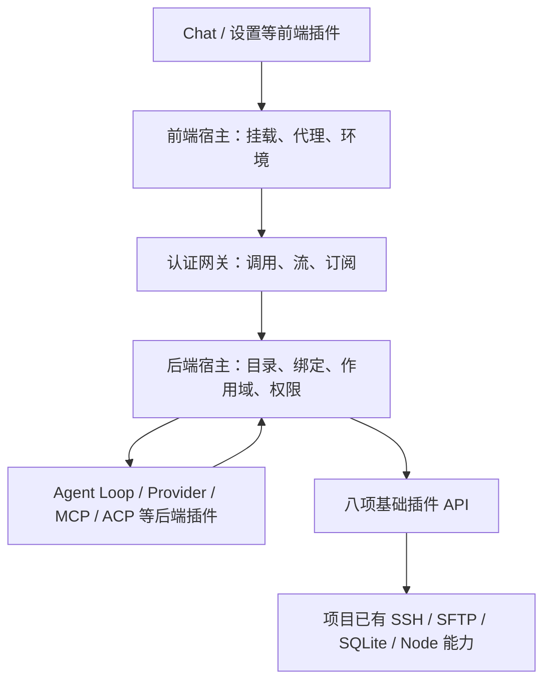

# Agent 重构

> 2026-11-10 重新规划，尚未实施。本页为目标架构及通用插件宿主设计，API 名称表示目标语义，不是当前 SDK 使用说明。当前实现见 [AGENT](AGENT.md)，上一轮设计保留在 [SDK4 设计参考](AGENT_SDK4_DESIGN.md)，任务与决定见 [PLAN](../PLAN.md#agent-动态插件架构重新设计)。

旧 Agent 本体及独立插件仓现已按用户要求清空旧实现，见[整体移除清单与历史参考](AGENT_REMOVAL.md)。本体只保留必要的私有历史迁移；插件仓主分支从空树重新开始，两仓旧代码均可通过 `archive/pre-agent-reset-20261110` 标签查阅。本页继续作为后续重建目标，新通用宿主及八项API尚未实现，不保留旧运行兼容。

## 1. 职责与范围

按“项目已有基础能力 → 基础插件公开 API → 其余功能插件”设计。基础能力从本项目已有实现派生；基础插件负责适配和注册接口。供应商、Agent Loop、工具与 UI 等均属于普通插件，运行实现归独立插件仓。本体原 Agent 目录按职责拆除，通用宿主统一归 `plugins` 域，不把旧 Agent 模块整体改名后保留。

目标是插件可独立安装、配置、替换和发布，普通插件新增服务方法、事件或 UI 实现时不要求本体增加业务枚举。新增真正的宿主特权、传输能力或不兼容的宿主协议仍需要本体更新。第一版完成通用服务调用、订阅及前后端桥接，不要求复制 dsh 全部功能包。

宿主拥有真实身份、权限判定、包信任、隔离进程、浏览器挂载边界与资源释放。宿主不定义模型供应商、Agent Run、会话消息、工具目录、压缩、命名、MCP/ACP 或聊天状态机；这些业务对象由插件定义。需要跟踪真实 I/O 派发和未确认效果的基础能力继续保留必要事实，不因移出 Agent 业务而放弃权限、去重与资源收尾。



## 2. 基础能力与现有归属

以下八项已确认，均按“已有基础能力 → 基础插件 → 公共 API”描述，到 API 层为止；名称表示职责，具体契约与发布包划分后续确定。

### Remote

```text
Remote 基础能力（项目已有 SSH、远程进程及 PTY 实现）
    → Remote 基础插件
    → Remote API（命令、进程、终端输入输出、尺寸及生命周期）
```

复用 Backend `modules/remote` 与 `platform/ssh`，连接配置、凭据、代理及主机信任沿用本体。

### RemoteFile

```text
RemoteFile 基础能力（项目已有远程文件实现，以 SFTP 为主）
    → RemoteFile 基础插件
    → RemoteFile API（目录、文件信息、读写、传输、移动及删除）
```

复用 Backend `modules/remote/files`；必要的远端命令沿用已有 Remote 能力，不另建连接管理。

### Database

```text
Database 基础能力（本体现有 SQLite 实现）
    → Database 基础插件
    → Database API（记录读写、条件查询、索引及事务/原子更新）
```

业务数据结构由使用方插件定义，公开契约与数据隔离方式后续细化。Database 操作记录与事务，LocalFile 操作路径、目录和文件字节；插件按需选择，不增设统一 Storage 中间层。

### SecretBox

```text
SecretBox 基础能力（本体现有 Node crypto AES-256-GCM 实现）
    → 加密基础插件
    → 加密 API（字符串加密、解密及上下文绑定）
```

复用 Backend `platform/security/secret-box.ts`，实例密钥由宿主管理，不向插件暴露。上下文由宿主根据调用身份与授权范围绑定，不能由插件任意指定其他用户或插件的范围；上下文校验不代替权限校验。当前仅有内部工具实现，公开 API 尚未实现。

### LocalProcess

```text
LocalProcess 基础能力（Node 子进程）
    → LocalProcess 基础插件
    → LocalProcess API（启动、标准输入输出、退出通知、取消及关闭）
```

支持参数、工作目录与环境变量，进程生命周期绑定插件作用域，不依赖 Agent Run；PTY 按实际需求确定。LocalProcess 负责本机执行，Remote 负责远端执行。MCP stdio、ACP 客户端可使用本机进程能力，其协议与业务仍归普通插件。

### HTTP

```text
HTTP 基础能力（Node HTTP／fetch）
    → HTTP 基础插件
    → HTTP API（请求、流式响应及取消）
```

负责后端出站 HTTP 通信；供应商协议、鉴权方式与重试策略由使用方插件负责。宿主仍负责调用身份、权限与资源生命周期，前端到宿主的通信另归插件宿主机制。

### WebSocket

```text
WebSocket 基础能力（后端 WebSocket 客户端）
    → WebSocket 基础插件
    → WebSocket API（连接、收发、关闭及状态事件）
```

负责后端出站双向通信，连接绑定插件作用域；消息协议、心跳与重连策略由使用方插件负责。浏览器与宿主之间的通信归插件宿主机制。

### LocalFile

```text
LocalFile 基础能力（Node 文件系统）
    → LocalFile 基础插件
    → LocalFile API（目录、文件信息、读写、移动及删除）
```

操作本体所在机器的文件，支持流式读写，访问范围由宿主授权。配置、附件、日志等业务语义由普通插件负责；本机文件操作与 Database 的记录、查询及事务分别提供能力。

### 插件宿主机制

采用统一的服务契约、事件声明与作用域机制。基础插件与普通插件共用注册、依赖、调用和订阅规则，基础插件额外通过可信适配访问原资源 owner。

#### 子功能与代码归属

本体采用 Backend `modules/plugins`、Frontend `features/plugins`、Shared `plugins`，双 SDK 各放所属模块的 `sdk`。这是目标目录，尚未移动源码；当前实现仍见 AGENT。一次替换真实消费者，不保留 `agent/plugins` 重导出或旧入口兼容树。

```text
nexus-terminal/
└── packages/
    ├── backend/src/
    │   ├── bootstrap/                     # 装配现有模块与通用插件宿主
    │   ├── modules/
    │   │   ├── plugins/
    │   │   │   ├── packages/              # 仓库、发布者信任、验签、安装与更新
    │   │   │   ├── instances/             # 逻辑实例、组合选择、激活配置引用
    │   │   │   ├── registry/              # 契约、目录、依赖及精确绑定
    │   │   │   ├── runtime/               # 作用域、调用、流、订阅及资源排空
    │   │   │   ├── permissions/           # 授权、委托和可信批准
    │   │   │   ├── foundations/           # 八项基础插件的可信适配
    │   │   │   ├── snapshots/             # 宿主元数据及插件命名空间的备份接入
    │   │   │   ├── interfaces/            # http / ws / ipc 的唯一插件协议入口
    │   │   │   ├── sdk/                   # 后端公开 SDK 源码
    │   │   │   ├── public.ts              # 真正跨模块的安全接口
    │   │   │   ├── public-errors.ts
    │   │   │   ├── register.ts
    │   │   │   └── migrations.ts          # 只编排，不放 SQL
    │   │   ├── remote/                    # 原 SSH、SFTP、远端进程及突变 owner
    │   │   ├── targets/                   # 原连接、凭据、代理及目标配置
    │   │   └── ...                        # access / operations 等原有模块
    │   └── platform/                      # Node、SQLite、网络、加密、隔离等技术实现
    ├── frontend/src/
    │   ├── features/plugins/
    │   │   ├── management/                # 市场、已安装项、来源与实例管理
    │   │   ├── host/                      # iframe、Surface、可信交互及通用窗口壳
    │   │   ├── permissions/               # 宿主授权与确认展示
    │   │   ├── i18n/                      # 仅宿主管理与可信交互的文案
    │   │   ├── api/                       # 宿主 HTTP/WS 接入与 wire 投影
    │   │   ├── model/                     # 本模块共用的前端应用类型与 mapper
    │   │   ├── sdk/                       # 前端公开 SDK 源码
    │   │   └── public.ts
    │   ├── app/                           # 原产品路由、设置分类和页面装配
    │   └── foundation/                    # 原通用 UI，不承接聊天或模型逻辑
    └── shared/src/plugins/
        ├── packages/                      # 包声明、签名引用、目录及安装协议
        ├── instances/                     # 实例、组合与宿主激活配置引用协议
        ├── registry/                      # 契约描述、发现、绑定与目录事件
        ├── runtime/                       # 调用、流、订阅、生命周期及 SDK 公开类型
        ├── permissions/                   # 真实宿主权限及批准的通用协议
        └── foundations/                   # 八项宿主基础 API 的公开契约
```

这些目录表示职责边界，不要求每个目录立刻创建完整文件模板。Backend 的每个实际子功能按需组织 `service/`、`model/`、`storage/`、`adapters/`，内部类型归所属 `model/*-types.ts`；通信统一在模块 `interfaces`。Frontend 的具体管理与权限应用类型归对应子功能，只把确实跨子功能共用的类型放模块 `model`；不是把所有状态集中进一份 Store。Shared 各实际子域按 `values/model/http/events` 及 codec 组织，不建立全量业务类型入口。

| owner                 | 职责与边界                                                                                                                      |
| --------------------- | ------------------------------------------------------------------------------------------------------------------------------- |
| `plugins/packages`    | 管包与仓库事实；不负责模型目录，不用“包注册表”混淆运行服务目录                                                                  |
| `plugins/instances`   | 保存实例启停、服务/UI 选择及已批准配置修订引用；普通插件的配置值、默认值、校验与设置页面仍归 Settings/业务插件                  |
| `plugins/registry`    | 原子发布契约与可见目录、解析依赖、颁发精确绑定；不执行 Agent 调度                                                               |
| `plugins/runtime`     | 通用作用域与调用 owner，持 IPC 生命周期、事件、背压及关闭；不建立宿主 Run/Thread 数据模型                                       |
| `plugins/permissions` | 校验调用身份、基础特权、委托、目标范围和可信批准；模型调用次数等业务预算不放这里                                                |
| `plugins/foundations` | 按八项基础 API 适配既有可信 owner，做授权、类型转换及资源绑定；不包含模型工具 schema、提示词、MCP/ACP 协议或 Agent 专用日志投影 |
| `plugins/snapshots`   | 接入宿主包/实例/授权与插件数据命名空间，不逐条解释 Agent 消息、工具或模型业务行                                                 |
| `features/plugins`    | 插件市场与通用挂载、权限、环境及窗口壳；聊天、模型选择、思考等级及会话虚拟列表归 UI 插件                                        |
| `shared/plugins`      | 通用宿主及基础 API 契约；业务契约随对应插件/契约包发布，不重新汇总成新的 `shared/agent`                                         |

Service 持有用例和政策，Model 持有应用类型及技术/存储转换，Adapter 持有 SQL、传输与真实资源。模块根 `register.ts` 只装配，按真实子功能提供装配函数，不再形成原 `agent/register.ts` 同时组合模型、Run、工具与安装管理的巨型入口。

#### 八项基础插件放在哪里

本体保留必要的可信适配，在 `modules/plugins/foundations/{remote,remote-file,database,secret-box,local-process,http,websocket,local-file}` 按同一服务注册机制发布 API。它们是宿主提供的基础插件，不再套一层 Agent driver；注册表按契约处理，不按目录名给予特权。

Remote/RemoteFile 调用 `modules/remote/public.ts` 与 Targets 的安全公开接口；SQL 连接、密钥、原生网络/文件/进程句柄留 Platform 或原模块。Foundation 内只能出现实际授权与资源适配，不能复制原 SSH 池、SFTP 实现或数据库引擎。不为八项接口在独立仓再建立八个仅转发调用的空壳包；以后确有独立可更新的组合或转换逻辑时，再作为普通插件交付。

基础插件的公共 API 与这些可信实现一起随本体交付，新增真正的宿主能力需要更新本体。Provider、Agent、工具、Chat 和协议客户端组合已有 API 时可以只更新独立插件，不要求更新本体。基础能力和普通插件分仓的成本与更新边界以此为准。

#### 独立插件仓目标目录

继续使用 [nexus-agent-plugins](https://github.com/0honus0/nexus-agent-plugins)，其主分支已清空旧文件；旧实现从归档标签查阅。以下名称仅表示职责提案，不是已发布的新包，不强制沿用旧插件ID或兼容旧SDK，也不要求为每个业务函数发布一个包。

```text
nexus-agent-plugins/
├── plugins/
│   ├── nexus.agent/                       # Loop、Run、会话、上下文、记忆及调度
│   ├── nexus.ui.chat/                     # 聊天 UI、会话展示、命名及其后端协调
│   ├── nexus.providers.openai-compatible/ # 现有模型协议与供应商目录/能力逻辑
│   ├── nexus.services.settings/           # 配置值、schema、校验与设置组合
│   ├── nexus.services.credentials/        # 秘密记录、引用及受管使用
│   ├── nexus.services.content/            # 附件、完整日志与生成文件引用
│   ├── nexus.services.mcp/                # 现有 MCP 协议服务
│   ├── nexus.services.acp/                # 现有 ACP 协议服务
│   ├── nexus.tools.remote/                # 远端工具与模型可见说明
│   ├── nexus.tools.browser/               # CDP 客户端、浏览器工具及设置
│   ├── nexus.tools.agent/                 # Agent/子任务等业务工具
│   └── nexus.tools.integrations/          # MCP/ACP 等协议工具适配
├── contracts/                            # 仅真正跨包共享的纯契约
│   ├── model/                            # Provider 与调用者共用
│   ├── agent/                            # Agent、Chat 与 Agent 工具共用
│   └── ...                               # content 等按实际消费者加入
├── lib/                                  # 仅插件仓特有的构建时共享源码
│   ├── settings-ui/                      # 设置页组合；通用控件从 nexus-terminal/ui 引用
│   └── ...                               # 按职责命名，不复制已发布的宿主公共库
├── package.json                          # 声明 nexus-terminal 及真实构建依赖
├── pnpm-lock.yaml                        # 锁定成品版本与完整性，不保存 sdk 成品副本
├── templates/                            # 单一插件骨架与生成入口
├── tests/                                # 跨插件互操作、浏览器产品流程及受控服务
├── scripts/                              # 统一构建、检查、签包、目录及发布
└── catalog/                              # 发布目录资产，不放业务实现
```

契约只由一处定义：仅本包使用的公开契约放该插件 `contracts/`；多个独立包共同实现/消费的放根 `contracts/<域>`，以纯契约包依赖，不再复制到各包或本体 Shared。契约包无运行服务、无安装实例、无生命周期；不引入额外“契约插件”。目录中列出共享域不代表必须预先创建空包。

每个普通插件采用一致的源码布局：

```text
plugins/<plugin-id>/
├── manifest.json
├── package.json
├── contracts/                    # 本包拥有的公开声明；共用契约改为显式依赖
├── src/
│   ├── backend/                  # activate、服务处理器及业务 service/model
│   ├── frontend/                 # App/设置 UI，按实际需求组织
│   └── shared/                   # 本包双端私有类型与转换，不复制公共契约
├── migrations/                   # 本插件数据变更，经 Database API 作用于自己的命名空间
├── tests/
│   ├── logic/
│   └── integration/
├── docs/                         # 设置说明、工具使用及维护信息
└── dist/                         # 构建出的 manifest 引用资产，不作为手写源码
```

仅有前端或后端的插件不创建另一端空目录。小插件在端内用少量具名文件，复杂子功能再按职责细分，不机械给每个函数建立目录。原 `src/run.mjs`、`src/settings`、根 `backend/frontend` 混合布局逐包转为上述源码/产物边界；产物由构建生成，签包从对应 `dist` 读取，不在源码树手工维护第二份实现。

SDK 源码仍只在本体双端模块内，通用 UI 源码归本体 Frontend foundation；从这些唯一 owner 自动构建单一公开包 `nexus-terminal`。独立仓通过标准包依赖消费，不再保存 `sdk/*.mjs`、Shared 压缩包或宿主源码副本；Chat 与各设置页的重复通用控件统一改用公开 UI 入口。`lib/settings-ui` 保留插件设置页组合，不复制宿主基础控件，其余库按真实职责归属。共用代码随消费者构建进包，不成为未经声明的共享可变运行状态。工作区和构建脚本按插件 manifest/实际 workspace 发现模块，不再为新增插件手工追加宿主模块名单。

#### 单包发布与体积边界

用户已确定公开包名为 `nexus-terminal`，先包含双 SDK、宿主公开契约与通用 UI/必要纯工具，后续通过子路径扩展。发布单个 npm 包不新增独立 SDK 源码 workspace，也不发布整个终端应用。以下为目标入口，尚未构建或发布：

| 公开入口                                                                    | 来源与职责                                                                            |
| --------------------------------------------------------------------------- | ------------------------------------------------------------------------------------- |
| `nexus-terminal/sdk/backend`                                                | Backend `modules/plugins/sdk` 的协议代理及生命周期客户端，不包含 SSH/数据库等宿主实现 |
| `nexus-terminal/sdk/frontend`                                               | Frontend `features/plugins/sdk` 的 MessagePort 代理，不加载 UI、Vue 或后端模块        |
| `nexus-terminal/contracts/<子域>`                                           | Shared `plugins` 中实际公开的宿主/基础 API 类型、取值与 codec；插件业务契约仍归独立仓 |
| `nexus-terminal/ui`、`nexus-terminal/ui/<组件>`                             | Frontend foundation 的通用控件，类型与实现同源；不依赖应用 Router、Store 或业务页面   |
| `nexus-terminal/ui/styles.css`、`nexus-terminal/ui/styles/<主题或职责>.css` | 通用主题与控件 CSS，明确导入；完整样式入口与实际需要的细分入口均可用                  |
| `nexus-terminal/utils/<职责>`                                               | 确有公开消费者的纯工具，按需增加，不建立兜底杂项集合                                  |

公开 npm 包、插件安装包、运行服务实例为三种不同对象：npm 包在插件开发/构建时安装，前后端代理通过原宿主机制取得能力；运行服务仍经 registry 绑定，不因 import 获得权限。纯 JS/浏览器依赖编入签名插件成品，用户安装插件时不运行 npm；原生依赖和外部可执行程序若有实际需求，另按其真实运行条件设计，不能假定打包能消除系统依赖。

体积按三个指标分别控制：npm 压缩包与解包文件、依赖安装闭包、插件最终 JS/CSS 产物。子路径和 tree shaking 主要降低最终产物，不让 npm 只下载被导入的部分；单包后续增加公开功能时下载体积仍可能增长。

本体构建按以下边界优化，保持现有应用 UI 与行为：

- 发布从真实 owner 到 `dist/npm/nexus-terminal/` 的生成成品；为该目录单独生成 `package.json`，仓库根仍保持开发入口，不直接解除根 `private` 后发布整个项目。`files` 使用公开 JS、声明、CSS、必要资产及 LICENSE/README 的白名单，排除应用构建、源码快照、测试、媒体及缓存；sourcemap 按调试需求单独交付。
- 使用 ESM 多入口及显式 `exports`，前后端入口隔离，不建立同时加载 Node 与浏览器模块的根入口。公共模块保留可裁剪的模块结构/共享 chunk，不为每个入口重复内联同一套 codec，也不把整个 Shared 的应用协议作为发布内容。`d.ts` 依赖闭包必须完整，不能遗留私有 `@nexus-terminal/shared`、源码别名或 workspace 路径。
- UI 采用现有 Vite/Vue 工具的库构建，独立生成 JS/声明及 CSS；没有副作用的 JS 按真实情况标记，CSS 保留 `sideEffects`。初版优先复用现有职责样式，只有确认存在体积收益时再细分，避免为裁剪样式改变原视觉或做新 CSS 框架。
- 发布依赖根据公开代码的真实闭包生成，不继承本体前后端依赖清单。Vue、Reka 等仅 UI 需要的运行依赖采用明确版本范围的可选 peer，UI 消费方显式安装，SDK-only 消费方无需安装；Node 内置模块保持 external。被设为 external 的其他真实依赖必须有声明，不能靠宿主偶然安装的依赖运行。
- 不默认交付整套图标字体、编辑器、文档预览、终端、RDP/VNC、模型客户端或数据库引擎。确有公开消费者的资产另设显式入口，不能用移除必要样式/资产换取体积数字。
- 使用现有构建器输出与 npm pack 清单核对公开闭包，不另造包管理器。CI 记录压缩/解包/依赖及代表插件构建体积，审查相对基线的增加原因，不设置无依据的固定 KB 门槛；包含 frontend-only、backend-only、单 UI 控件及完整设置页的消费检查，确保无跨环境泄漏、重复 Vue 和 CSS 被误裁剪。

源码修改 → 公开入口构建/类型与消费者验收 → CI 发布不可变 `nexus-terminal` 版本 → 插件更新依赖及 lockfile → 重建并签名受影响插件。发布版本与 SDK 协议版本分开，握手继续检查宿主实际支持范围；包升级不让旧宿主获得未实现的特权。共享库版本不自动替换已安装插件的代码。第一版只采用当前 ESM 消费链，不无依据地额外交付第二套 CommonJS 成品。

#### 原 Agent 目录逐项去向

下表描述拆分 owner，不能按目录整体挪动后继续保留 Run 参数；真正的 SQL、凭据与远端效果事实须单独核对。

| 当前目录/内容                                                                                                 | 目标去向                                                                                                                                                             |
| ------------------------------------------------------------------------------------------------------------- | -------------------------------------------------------------------------------------------------------------------------------------------------------------------- |
| Backend `agent/plugins`                                                                                       | 按职责进入本体 `plugins/{packages,instances,registry,runtime,...}`；配置值和凭据业务移 Settings/Credentials 插件                                                     |
| Backend `agent/scope`                                                                                         | 包实例与组合进入 `plugins/instances`；Thread、会话命名字段及聊天关联移 Agent/Chat 契约与数据；不保留宿主 `AgentStateApi`                                             |
| Backend `agent/runs`、`context`、`memory`                                                                     | 进入 Agent 插件；通用取消、作用域及资源释放提取到宿主 runtime/真实 I/O owner                                                                                         |
| Backend `agent/providers`、Agent 专用 `platform/ai`                                                           | 进入 Provider 插件，包括请求适配、目录、协议、推理及用量；主机通用 HTTP/网络保留 Platform                                                                            |
| Backend `agent/tools`                                                                                         | 工具说明和业务调度进入工具插件；SSH/文件/进程及持久效果收尾回实际基础 owner；不保留宿主的工具名/操作枚举                                                             |
| Backend `agent/integrations`、Agent 专用 `platform/browser`                                                   | CDP 客户端、节点引用、工具及设置归 Browser 插件，优先通过已有 HTTP/WebSocket API 接入成熟库；实际网络授权和连接生命周期仍受管，不与 RDP/VNC 共用的浏览器能力一起删除 |
| Backend `agent/execution`                                                                                     | 模型请求数、Token、工具次数与 Agent 业务预算归 Agent/Provider 插件；真实磁盘/进程/连接资源政策留实际 owner，不复制隐含总上限                                         |
| Backend `agent/governance`                                                                                    | 宿主真实权限、目标限制和可信批准进入 `plugins/permissions`/原目标 owner；Agent 审批记录和模型交互归业务插件，不能把放行权一起搬走                                    |
| Backend `agent/operations`                                                                                    | 真实 I/O 的派发回执/未确认效果进入实际 owner；Agent 步骤、工具调用、历史投影归插件；普通服务包装不保留万能持久账本                                                   |
| Backend `agent/artifacts`                                                                                     | 内容目录、引用及清理业务进入 Content 插件；Blob/文件技术实现保留原 Platform，秘密或文件授予仍由真实边界控制                                                          |
| Backend `agent/snapshots`                                                                                     | 通用宿主快照接入进入 `plugins/snapshots`；插件数据通过 Database/文件资源注册备份，移除本体对具体消息/工具/模型行的解释                                               |
| Backend `agent/interfaces`、`register.ts`、公共类型与错误                                                     | 通用接口/错误进入 `plugins`；具体业务由插件服务契约公开，删除原固定 Run/模型/工具路由及装配                                                                          |
| Backend 根部 `agent-errors/failure/storage-failure/tool-identity/validation` 与 `service/agent-request-owner` | 按真实消费者拆分：宿主身份、生命周期与有限错误归对应宿主子功能；Run/工具失败与校验归业务插件；不改名保留全能 Agent 工具集                                            |
| Frontend `features/agent/plugins` 及 `host`                                                                   | 安装管理与可信挂载移 `features/plugins`；内容相关选择器保留通用文件交互，Artifact 业务投影改由 Content 契约承接                                                      |
| Frontend `features/agent/settings`、`api/model/composables`                                                   | 安装/授权/宿主状态留 `features/plugins`；Provider、预算、会话、思考等级、任务状态和工具展示移对应插件；逐文件拆分，不整目录平移                                      |
| Frontend `features/agent/files`、`next`、固定 Run 事件/诊断                                                   | 文件业务和调试面归所属插件；纯开发入口按真实消费者删除或迁移；通用宿主诊断留宿主，不保留第二套聊天页面                                                               |
| Frontend `features/agent/i18n`、`locale-format.ts`、`runtime/native-tool-summary.ts`、`events` 与 `public.ts` | 市场/授权/挂载文案归 `features/plugins/i18n`；聊天/工具文案及摘要归对应插件；通用格式化复用原基础设施；出口仅暴露实际壳消费者，不遗留业务类型转导出                  |
| Shared `agent/*`                                                                                              | 通用协议转 `shared/plugins`；Run/Thread/模型/工具/内容业务契约转独立仓；删除旧跨端枚举、解码及失效出口                                                               |

本体最终不再保留 `modules/agent`、`features/agent`、`shared/src/agent` 业务目录。产品中的“Agent”名称、设置分类与启动入口可以继续存在，由原页面装配选择的插件 Surface；它们不要求本体持有 Agent 业务类型，也不借目录迁移修改现有 UI。

#### Platform 逐项剥离

剥离范围包括 `packages/backend/src/platform`，不只调整三个 Agent 目录。技术实现属于哪个 owner，要看它提供的语义、真实消费者和特权边界；不能因为当前只被 Agent 引用就全部搬走，也不能因为位于 Platform 就保留 Agent 专用实现。

| 当前 Platform 内容                                                   | 目标归属与处理                                                                                                                                                                                                                                                   |
| -------------------------------------------------------------------- | ---------------------------------------------------------------------------------------------------------------------------------------------------------------------------------------------------------------------------------------------------------------- |
| `ai/*`                                                               | 全部现有模型目录、OpenAI-compatible 协议、请求/流解析、推理状态、图片与文本合批进入 Provider 插件的 `src/backend`；删除宿主模型 Port、模型错误与模型专用配额。真实联网授权、凭据注入、连接/响应关闭仍通过 HTTP/WebSocket 基础 API 执行，不随协议代码迁出可信边界 |
| `browser/*`                                                          | 当前 BrowserClient 及 Puppeteer/CDP 实现只供 Agent 浏览器使用，进入 Browser 插件的 `src/backend`；节点引用、DOM 快照、截图、操作及控制台语义由插件拥有。经宿主基础 API 适配连接，端点准入与真实网络资源生命周期归宿主                                            |
| `blobs/text-log-store.ts`、`adapters/native-text-log-store.ts`       | 当前只供 Agent 完整工具日志使用，记录格式、索引、追加/续读与清理策略进入 Content 插件；文件操作改经 LocalFile，不能原样携带 `node:fs` 绕过授权。Bootstrap 不再单独初始化 Agent toolLogs Store                                                                    |
| `blobs/content-inspector.ts`、`adapters/native-content-inspector.ts` | 当前只供 Agent Artifact 使用，内容类型探测进入 Content 插件；使用成熟 file-type 等库，受管字节流的读取与关闭经基础 API 维持                                                                                                                                      |
| `blobs/blob-store.ts`、`adapters/native-blob-store.ts`               | 原背景图片与快照恢复也在使用，保留通用 Blob 技术实现；Content 不再深层 import 它，由 LocalFile 等公开 API 提供受管 I/O。目录存在不意味着向 npm 公开原生文件句柄                                                                                                  |
| `isolation/*`                                                        | 保留隔离进程、IPC、恢复及真实进程清理的技术实现，由通用 `plugins/runtime` 消费；移除 worker 的默认 `agent` 导出、Agent 专用报错及旧双调用签名，采用通用注册/调用协议                                                                                             |
| `packages/*`、`validation/*`                                         | 保留归档读取、签名验证、本体版本读取及通用 Schema 校验，供插件宿主使用；包信任/安装政策在 `plugins/packages`，动态契约政策在 registry，不能移入不可信普通插件或保留 Agent 业务枚举                                                                               |
| `network/*`                                                          | 保留受管出站请求、DNS/TLS/目标约束、字节流与真实关闭能力；HTTP/WebSocket 基础适配按需复用/补齐，不复制一份网络栈。供应商认证格式、模型重试和 MCP/ACP 协议语义归使用方插件                                                                                        |
| `http/*`                                                             | 保留本体 Fastify、入站 HTTP/WS、流交付与关停技术层；原 Agent 业务路由由通用插件网关替换。此处服务端 WS 与出站 WebSocket 基础 API 分别管理                                                                                                                        |
| `ssh/*`、`commands/*`、`archive/*`、`text/*`、`transfers/*`          | 现有 Remote、文件管理器及跨服务器传输仍消费，保留实际技术 owner。模型可见工具说明、命令批次编排和工具结果渲染归普通插件；通用参数编码、字节读写与既有非 Agent 批处理能力继续由原 owner 提供                                                                      |
| `desktop/*`、`terminal/*`、`docker/*`、`tools/*`、`system/*`         | RDP/VNC、挂起终端、Docker 管理、远端工具安装与服务器状态仍在使用，保留。`desktop/adapters/browser-desktop.ts` 是远程桌面传输，不属于待迁出的 Agent CDP 实现；`platform/tools` 也不是模型工具目录                                                                 |
| `storage/*`、`security/*`                                            | 保留 SQLite、快照引擎、密钥、认证、令牌与主机安全技术能力；Agent 业务表/解码不进入这些目录作为运行时兼容层，通用 Database/SecretBox 由可信基础适配公开                                                                                                           |
| `logging/*`、`lifecycle/*`、`cache/*`、`images/*`、`delivery/*`      | 诊断、资源排空、登录选项缓存、背景图片验证和通知投递有真实非 Agent 消费者，保留。插件只消费公开的诊断及必要纯工具，不深层引用宿主技术实现                                                                                                                        |
| 空的 `acp/adapters`、`mcp/adapters`                                  | 当前无实现，实施清理时移除空目录；MCP/ACP 协议实现继续归各服务插件，不在 Platform 恢复同名旧实现                                                                                                                                                                 |

`isolation/adapters/module-worker.ts` 当前将 `agent` 作为默认导出，并按是否传入 exportName 切换调用签名；这些是本轮确认要解除的耦合，不能只把上层 Agent 目录改名。通用生命周期方法仍由宿主协议定义，业务方法只来自已注册契约，不开放任意导出名作为调用入口。

现有 `ai/adapters/model-sdk-request.ts` 直接使用 OpenAI SDK/Undici；迁移时保留成熟供应商库，但其网络执行要适配宿主 HTTP。现有 CDP 客户端同样需验证成熟库的受管 transport 接口；原页面 URL 过滤不等于宿主能验证任意远端 CDP 行为，端点准入与插件协议政策须分别验收。纯协议实现移出不能顺带删除真实安全与清理保证。

所有权变化同步依赖和测试：OpenAI/Puppeteer 在本体没有其他真实消费者后移除后端依赖，由 Provider/Browser 插件构建声明；`file-type` 仍被本体背景图片验证使用，不能随 Content 迁移误删。模型协议、CDP、日志格式和内容探测测试随插件迁出；隔离、验签、Schema、网络安全与非 Agent 回归留本体。本轮仅登记目标去向，未修改这些源码、依赖或测试。

#### Backend 旧 plugins 子域继续拆分

`agent/plugins` 并不是可以整体平移的通用宿主。当前注册表、实例、SDK、连接和 Intent 仍引用 `AgentCapability`、Run、工具或 Artifact；以下按真实语义拆分，目标不保留这些业务类型的宿主替身。

| 当前内容（相对 Backend `modules/agent`）                                                                  | 处理与目标 owner                                                                                                                                                                                                                |
| --------------------------------------------------------------------------------------------------------- | ------------------------------------------------------------------------------------------------------------------------------------------------------------------------------------------------------------------------------- |
| `plugins/service/plugin-{service,repository-service,runtime-service}.ts`、包/仓库/验签 Adapter 与 Storage | 包来源、信任、安装、激活及排空能力保留到通用宿主；服务内部的 Agent 执行入口、业务注册字段和业务错误拆出，不整类照搬                                                                                                             |
| `plugins/registry/model/*`、`plugin-{manifest,dependency,composition,instance}-*` 及相应规则/存储         | 保留动态契约、实例、依赖和精确绑定；清除固定 Agent capability、App execution 选择器及 Agent 专属 callable 分类，按已声明契约处理。通用发布者/版本匹配继续复用 semver                                                            |
| `plugins/model/plugin-agent-types.ts`、`plugin-run-{types,capability-types}.ts`、`plugin-app-execution-*` | Workspace 分支、Run capability 工厂和 Agent 工具/执行策略移 Agent 插件；通用调用身份、授权委托和实例依赖分别归 runtime/permissions/registry。移除按 `agent.` 前缀区分调用类型的分派                                             |
| `plugins/model/plugin-skill-types.ts`、`plugin-skill-rules.ts`、`plugin-tool-authority-rules.ts`          | Skill 文档目录/读取、工具暴露与模型说明归 Agent/工具插件；签名包只验证资产路径、摘要及真实权限，不解析 Skill 语义或固定工具名                                                                                                   |
| `plugins/service/plugin-intent-service.ts`、Intent model/storage/SQL                                      | 当前 Intent 把跨 App 调用、Artifact 交付、权限和持久收据绑在一起；改用通用服务调用/事件及显式资源委托，交付业务归 Chat/Content 等实际插件。迁移已有有效引用与回执后删除专用 Intent RPC/表，不为普通调用默认创建持久信箱         |
| `plugins/service/plugin-connection-service.ts`、connection model/storage/SQL                              | HTTP endpoint、远端 argv/cwd 和协议连接设置归消费插件/Settings，秘密记录归 Credentials；底层连接、凭据受管使用、目标授权和撤销留可信基础 owner。宿主不保留仅为 MCP/ACP 设计的固定连接类型配置器                                 |
| `plugins/service/plugin-service-transport.ts`                                                             | HTTP、远端进程字节流、背压、关闭及真实结果查询归基础 API；MCP/ACP 会话、toolCallId 和协议审批映射归服务插件。实际批准仍由宿主验证，批准送达与未知写入证据不得随旧 transport 删除；不延续仅支持 GET/POST/DELETE 的专用 HTTP 联合 |
| `plugins/model/plugin-data-types.ts`、data/config/extension-data SQL 与私有数据清理                       | 数据与事务统一经 Database 命名空间；业务配置值、schema/defaults/校验归 Settings/业务插件。删除重复 KV/config RPC 和前端宿主表单解释器；宿主保留命名空间归属、授权、备份及保留/清除数据生命周期，配置修订引用仍进入精确绑定      |
| `plugins/sdk/index.ts`、manifest/IPC codec 及运行错误                                                     | 公开 SDK 改为通用代理；模型/Run/工具/内容便利方法随业务契约迁插件，不靠重命名保留旧方法集合。宿主安全错误与插件业务错误分开，不让 `provider_unavailable` 代表宿主不可用                                                         |
| `scope` 的 App 管理与执行/治理关联                                                                        | 通用实例启停、授权及 UI 选择留宿主；模型选择、目标偏好、Thread、Agent 执行政策进入对应插件。允许多个 App 和同包多实例，宿主不要求每个实例附带一个 Agent Loop                                                                    |

签名 manifest 可继续携带通用设置 Surface、静态说明和契约声明，但业务字段的解释与编辑交给其服务/设置插件；不能把旧配置系统移到 `plugins/instances` 后继续由本体解释全部插件设置。

#### Frontend 逐项剥离

本轮核对了 `features/agent` 的宿主、管理、设置、API、模型、文件与开发入口，并追到 App、路由、设置装配和 locale 构建。迁移以保持原有桌面/手机界面、主题和交互为判据；下面的“删除”表示替换消费者后删除本体重复实现，不表示删除相应产品功能。

| 当前内容（相对 Frontend `features/agent`）                                                                                                                           | 处理与目标 owner                                                                                                                                                                                                  |
| -------------------------------------------------------------------------------------------------------------------------------------------------------------------- | ----------------------------------------------------------------------------------------------------------------------------------------------------------------------------------------------------------------- |
| `plugins/components` 中市场/仓库、安装管理、安装计划、已安装项及相应 API/model/composables                                                                           | 迁 `features/plugins/management`，保留多来源合并、版本切换、信任、安装引导、数据保留/清除及实例设置入口；业务分类与设置内容改由声明驱动                                                                           |
| `host/{AgentSurfaceHost,AgentHubWindow,AgentLauncher,AgentAppSwitcher}.vue`、`window-manager.ts`                                                                     | 通用 App/Surface 挂载和窗口壳留宿主；列表与可用性读宿主注册/激活状态，不再先读 Agent execution settings。原用户身份/管理员边界继续由授权 owner 决定，不能借解耦放宽访问                                           |
| `host/agent-host-state.ts`                                                                                                                                           | 拆出通用窗口布局、挂载及不透明 UI 恢复状态；Run/Thread checkpoint 判别、任务/审批业务 Map 移插件。身份变化清理、旧代窗口隔离和布局恢复留宿主                                                                      |
| `host/NativeThreadPanel.vue`、`composables/use-native-threads.ts`、`api/native-thread-api.ts`、`model/native-thread-*`                                               | 会话增删、搜索、分页、命名及选择移 Chat/Agent 插件；复核独立仓已有会话组件后合并唯一实现，删除本体重复会话面板与固定 Thread 客户端                                                                                |
| `host/AgentTaskNotice.vue`、`use-agent-task-notices.ts`、`model/task-activity-types.ts`                                                                              | Run/usage/approval 状态解释、完成提醒和操作组合归插件；宿主仅保留确有通用需求的提示壳及显式服务动作，可信批准仍经宿主权限入口，不建立新的通用“任务中心”业务模型                                                   |
| `plugins/host/{host-bridge,ui-host-bridge,settings-ui-bridge}.ts` 与 runtime/bridge 类型                                                                             | MessagePort、来源/nonce、身份、取消、代际、环境/主题/locale 及关闭保留；固定 `agent.runs.*`、`agent.approvals.*`、用量、内存事件和 Artifact 路径移对应插件契约，通过通用调用/流/订阅代理接入                      |
| `plugins/host/Plugin{App,Settings}Frame.vue`                                                                                                                         | 保留通用 iframe 隔离和 Surface 生命周期；App/设置均按签名声明及实例绑定加载，移除对宿主 Agent API 的硬依赖                                                                                                        |
| `plugins/host/HostArtifactPicker.vue`、`host-artifact-selection*`、`files/*`、`use-artifact-{picker,library}.ts`                                                     | 附件库、Thread 附加、预览业务和 Artifact 元数据归 Content/Chat；宿主保留系统文件选择及跨实例文件授予的可信交互，受控读取不由 iframe 自行放行。不能把当前带 `attach(threadId)` 的整个选择器当成基础能力保留        |
| `settings/ModelProviderSettings*`、`ProviderModelEditor`、`ProviderCatalogCard`、`ModelRegistrySettings`、`use-provider-management`、Provider/Registry API 与 mapper | 模型目录、供应商编辑/测试、协议、默认模型与思考等级移 Provider/消费插件设置；宿主市场注册表不承接模型注册表                                                                                                       |
| `settings/{ExecutionSettings,AppExecutionPolicySettings,AppExecutionPolicyEditor}.vue`、`use-execution-settings`、execution API/model                                | 请求数、Token、超时、上下文、子任务及存储业务政策进入 Agent/Provider/Content 设置；真实系统资源约束留原 owner，不保留宿主统一 Agent 硬限制系统                                                                    |
| `settings/{AppManagementSettings,AppGovernanceEditor,SafetyNetworkSettings}.vue`、`use-app-{management,governance}`、`use-agent-resource-control`                    | 通用安装实例/授权、目标限制、出站访问和可信批准拆到宿主；Agent 调度、子任务及工具政策归插件。资源查看/手动关闭按真实资源 owner 接入，不丢失进行中任务确认和撤权清理                                               |
| `settings/Agent{SettingsPanel,ExtensionsSettings,OnboardingModal}.vue`、`use-agent-onboarding`                                                                       | 设置分组/启用/必需插件安装入口保留为通用管理装配；移除“保存 Agent 预算后才允许启用”的业务依赖。Provider/运行/安全配置由对应插件设置 Surface 承接，保持原视觉与操作可达性                                          |
| `plugins/components/Plugin{ConfigurationEditor,ConnectionEditor,Capabilities}.vue` 及 config/connection/capability 客户端                                            | 普通配置表单与连接编辑移 Settings/服务插件；真实权限声明、批准和授予展示留宿主。宿主只保存/选择已批准配置修订，不重复校验业务字段                                                                                 |
| `api/{native-workspace-request,page-stream,native-resource-api}.ts`、`model/native-{run,resource}-*`、`native-target-preferences`、`runtime/native-tool-summary.ts`  | Run 历史/续读、目标偏好、工具摘要与 Agent 资源投影归插件；通用请求/流与取消复用项目已有基础设施，不保留第二套 Agent 请求层                                                                                        |
| `api/management-*`、`use-agent-management-operation`、`model/management-failure.ts`                                                                                  | 仅保留真实管理操作、配置冲突、未确认写入与重新读取处理；业务失败归对应插件，不再把所有插件错误转换为 Agent 错误枚举                                                                                               |
| `settings/QuantityInput.vue`、quantity 工具、`locale-format.ts`、i18n、`events/agent-host-events.ts`                                                                 | 确有通用消费者的控件/格式化归原 foundation，业务数量/格式化随设置插件；宿主仅保留管理/授权/挂载文案及事件，业务文案随插件。主题 token 与语言继承保持，不复制整套宿主翻译                                          |
| `next/*`、`public.ts` 的 Agent Next 出口                                                                                                                             | 删除临时 `AgentNextDevView`、固定 Run controller/API 和专用翻译；App router 同步删除 `/__agent-next` 及其开发守卫分支。先核对其未知写入、游标及取消断言的真实接收者；不连带移除仍有用途的 Targets/Remote 开发入口 |

`app/App.vue`、`app/pages/settings/SettingsPage.vue` 改消费通用插件宿主出口，产品设置分类和启动名称可继续叫 Agent；错误边界随真实 owner 记录。`build/locale-messages.ts` 自动发现功能翻译，迁移后检查键归属、重复键及三语完整性，不为保留旧 Agent 文案创建额外扫描入口。

#### Shared 与模块外消费者

Shared `agent/governance` 和 `agent/operations` 另按权限与效果拆分：真实宿主授权、可信批准及 I/O 效果协议归新宿主/原资源 owner，Agent 审批投影、步骤与工具业务契约归插件；不能随其他业务契约整体迁出可信边界。根部错误、codec、values 和 package exports 同步拆分，不留下新的全量 Agent 入口。

| 当前内容                                                                                                                               | 处理与目标 owner                                                                                                                                                                                           |
| -------------------------------------------------------------------------------------------------------------------------------------- | ---------------------------------------------------------------------------------------------------------------------------------------------------------------------------------------------------------- |
| Shared `agent/{providers,runs,scope,execution,memory,collaboration,artifacts,integrations,tools}` 及业务错误/常量/codec                | 随业务转独立仓唯一契约 owner；删除本体固定业务出口，不将全量 Shared 作为 `nexus-terminal/contracts` 发布                                                                                                   |
| Shared `agent/plugins` 的包、仓库、信任、安装计划、实例、registry、runtime/UI envelope                                                 | 提取通用部分到 `shared/plugins`；字段、codec 和取值同步实际消费者，Agent/Run 依赖不随目录改名保留                                                                                                          |
| Shared `agent/plugins/{app-runtime,app-outcome,run-context,agent-extension,tool-schema,content,intent-*}`                              | 业务运行、工具、内容和 Intent 契约分别迁移/替换；通用实例身份、生命周期和实际权限单独提取，不把文件整体重新导出                                                                                            |
| Shared `agent/plugins/{host-operations*,host-operation-rpc-result,frontend-events,frontend-rpc-codec,ui-streams*,events,rpc-codec}`    | 删除固定业务操作联合、Run/memory 流来源及 Workspace 合并协议；通用 envelope、ACK、代际与取消留宿主，业务输入/输出和事件由签名契约声明，不再每加工具修改本体联合类型                                        |
| Shared `agent/plugins/{settings*,connection*,data,service-transport*}`                                                                 | 设置/凭据/协议连接归普通插件；Database、HTTP、Remote 字节流、真实批准和资源授权归各基础 API/宿主权限契约。旧 RPC 不作为新 API 的兼容入口                                                                   |
| `bootstrap/{create-app,module-manifest,schema,data-paths}.ts`                                                                          | 替换 `AgentStateApi`、Agent 错误、register/backup、初始化/路由/WS/资源采集/关停与 owner 映射；删除宿主专用 toolLogs Store 装配，原日志按数据归属迁入 Content 命名空间后再移除旧路径。迁移链保持原版本/签名 |
| Shared `remote/mutations/values.ts`、Remote `machines/adapters/sqlite/mutation-schema.ts` 和 `service/operation-service.ts`            | 解除 `origin='agent'` 的硬编码和 SQL CHECK 绑定，记录经宿主验证的插件来源/身份；非插件调用来源继续保留。用迁移转换旧来源事实，不能删除已有未确认效果或允许插件自报身份绕过恢复围栏                         |
| Shared `system/diagnostics/values.ts`、Frontend `HostDiagnosticsPanel.vue` 与 Bootstrap 资源采集                                       | 宿主诊断键从 Agent owner 调整为真实插件宿主 owner，同步图标/配色/采集器；插件诊断作为有身份的子资源，不接受任意插件冒充宿主模块，不因改名丢失资源泄漏观测                                                  |
| Backend `operations/interfaces/http/operation-observer.ts`、Shared `operations/values.ts`、Frontend `audit/model/auditPresentation.ts` | 替换固定 Agent execution-settings 路由事件映射；新插件行为使用通用宿主调用/权限/效果审计及已验证来源，业务摘要归插件。继续不读取请求秘密；历史 `AGENT_*` 记录可保持既有审计展示，不构成旧业务 API 兼容层   |

扫描同时区分无关同名项：远程桌面 browser adapter、系统远端工具安装、浏览器 userAgent、其他功能的 `next` 和原 SSH/SFTP owner 均不在删除清单。所有清理须以实际 import、路由、构建和数据消费者为依据。

#### 测试、迁移与构建目录

本体测试按新真实 owner 放 `tests/backend/plugins/<子功能>/<层>`、`tests/frontend/plugins/<子功能>/<层>`、`tests/shared/plugins/<子域>` 和 `tests/e2e/specs/plugins`。SSH/SFTP 的技术与效果断言归原 Remote 测试；Agent/Provider/Chat/工具/MCP/ACP 的逻辑及业务集成归各插件 `tests`，跨插件和真实浏览器流程归独立仓根 `tests/interoperability`、`tests/e2e`。保留每个旧场景的断言去向，不因目录剥离直接删除覆盖；宿主不重复运行插件完整业务矩阵。

已发布的数据库迁移不能随旧模块一起删除。按先完整移除旧 Agent 的阶段，旧迁移及必要冻结解码/SQL 依赖归 `platform/storage/sqlite/adapters/migrations/agent-history`，只允许迁移入口消费，不依赖新插件宿主；保留版本、签名及执行语义，新迁移按当前实际 owner 归属。历史数据转换只在迁移路径存在，不再被 runtime 当作兼容读取层。快照、空库安装、跨版本升级和未确认效果依据均单独验收。

本体 SDK 构建、公开资源 URL、package exports、Bootstrap 注册/迁移、前端页面装配与动态加载、独立仓 SDK 来源、workflow 与测试发现同批切换。不为路径改名凭空增加协议版本，但本轮已规划的破坏性协议变更仍需明确新版本；旧路径不转导出。目录和依赖删除前，核对包资产、实际运行消费者及所有构建入口。

| 现有入口/资产                                                                                                                             | 同批替换与删除范围                                                                                                                                                                                        |
| ----------------------------------------------------------------------------------------------------------------------------------------- | --------------------------------------------------------------------------------------------------------------------------------------------------------------------------------------------------------- |
| 双端 `build/build-plugin-*-sdk.mjs`、Backend `build/copy-plugin-frontend-sdk.mjs`、相应 package scripts                                   | 改为唯一 owner 的公共单包构建，删除旧 SDK 单文件副本和向 Backend Agent 目录复制前端 SDK 的步骤；保留 SDK 消费验证，不用简单删 build 脚本代替新产物                                                        |
| `plugins/adapters/frontend/plugin-sdk-assets.ts`、`storage/plugin-sdk-assets.ts`、`/sdk/frontend-v4.mjs` 路由                             | 插件已编入版本化 npm SDK 后删除旧 SDK 下载 Adapter/Port/路由及无依据的 1 MiB 交付门槛；插件签名 UI 资产托管、CSP、缓存及授权继续由通用宿主提供                                                            |
| Frontend Vite `/sdk`、`/ws/agent` 等代理，固定 `/api/v1/agent`、`/ws/agent-runs` 消费者                                                   | 同步到通用插件网关与订阅入口；删旧代理/路由和固定业务客户端，不用通配转发保留旧业务协议。真正的插件 UI 资产代理继续按新 owner 保留                                                                        |
| `Dockerfile`、双端 `dist-plugin-sdk`、`.dockerignore`、`.gitignore`、E2E workflow 成品路径                                                | 同步新构建依赖、产物复制/忽略/缓存/上传范围；镜像不保留废弃 SDK 目录，公开 npm 包与应用运行成品分别交付                                                                                                   |
| `scripts/e2e/{host-test-artifact,balanced-shards}.mjs`、`tests/support/native-plugin-package.mjs`、受控插件仓库 fixture 及测试内 SDK 路径 | 替换硬编码 `backend-v4.mjs` 和旧产物闭包；统一使用本轮真实构建的公共包/插件成品，保留不可变身份和独立插件互操作，不能误测已安装的旧 SDK                                                                   |
| 旧 Agent 测试、测试发现/耗时估算、runner 构建输入与文档                                                                                   | 逐项登记保留/迁插件/合并/删除及独有断言接收者；真实隔离、安装、信任、授权和资源回收留本体，模型/聊天/工具业务随插件，替换完成才清除过时 fixture、截图和估算项。不因路径重构新增 runner 或重建整套受控服务 |

最终清理同时核对两仓清单、lockfile、npm exports/声明引用、locale、脚本、CI 与文档链接。只删除已无消费者且替代能力已验收的源码/产物；已有迁移及未知效果证据另按各自生命周期处理，不通过全仓替换 `agent` 字符串完成重构。

剥离完成的判据：本体运行时代码不再引用旧 Agent 路径或持有 Run/Thread/模型/工具业务类型；Platform 不再保留模型/CDP/Agent 日志等业务实现和默认 `agent` 派发；Agent 业务改动只涉及插件仓的实现与契约。历史迁移依赖仅迁移入口可达，不形成运行时兼容层。现有 Provider/CDP 客户端能否直接使用受管 HTTP/WebSocket，需要在迁移时验证成熟客户端的 transport 接入和取消语义；目录规划不代表这部分已完成适配。

#### 身份与作用域

区分包、已安装包、逻辑实例、激活代、服务提供者、绑定和调用。包 ID 或显示名不能代替活跃实例身份。同一包可有多个逻辑实例；多个应用可选择同一份不可变包，各自的配置、授权、数据和活跃资源仍独立。

宿主建立用户及已安装实例的作用域；插件可在其拥有的作用域下创建业务子作用域。子作用域沿父链获得可见服务，并可显式选择局部实现；绑定同时遵守真实权限，不能依靠继承扩大授权。作用域父链禁止形成环，不设置任意层数上限。

作用域承担注册、监听、调用和资源的所有权，不预设 `run`、`thread` 或 `settings` 类别。Agent 插件可创建任务作用域，Chat 插件可创建页面或会话作用域；名称和业务含义归插件。浏览器视图作用域与后端长期实例作用域分开。

#### 服务契约与注册

服务契约描述“可做什么”，提供者描述“由哪个实例实现”。契约有稳定的命名空间标识和 SemVer 版本，包版本与契约版本独立。处理器在激活时注册，公开声明、schema 与资源文件来自已验证的包资产。

契约定义声明其命名空间及受信发布者身份；其他包可显式依赖并实现该契约，不取得重定义其命名空间的权力。用户信任第三方包不等于允许它覆盖已有契约定义。动态 MCP 工具目录等可变业务内容通过服务结果表达，不要求每发现一个远端工具就向宿主新增一个方法或执行任意代码 schema。

一个包可以发布多个契约或实现多个已有契约；同一契约可有多个提供者。多模型供应商、多 Agent 实现和可替换 UI 均使用同一机制。声明服务不自动变成模型工具；模型工具目录由普通插件解释和组合。

激活先收集完整注册批次，验证所有契约、schema、导出范围及必需依赖，再原子发布一个目录修订。重复定义、同版本不同 schema、缺失处理器或声明与实现不符时整批拒绝，不发布半份目录。撤销句柄绑定本次发布，旧句柄不能删除新代贡献。

纯契约依赖可独立发布为包内资产或共享契约包；运行时不必启动一个没有行为的“契约服务”。宿主不要求所有业务类型加入 Shared，也不靠读取 TypeScript 类型在运行时猜测契约。

## 3. 依赖方向

插件间的注册、绑定、调用与订阅经过统一宿主机制。调用方通过基础插件 API 使用上述已有能力。文件操作与进程操作共用既有远程基础设施，不另建一套连接管理或执行引擎。

### 依赖解析与能力选择

区分三种关系：代码/资产依赖决定安装与加载；服务依赖决定何时可激活及绑定哪个提供者；调用关系只表示当前执行链。安装依赖不自动暴露全部工具，也不自动授予权限。

必需依赖未就绪时实例保持可解释的等待状态，不进入服务处理；可选依赖可缺失，通过目录事件获知新增或撤销，不轮询。每个依赖声明契约、版本范围、单个或多个提供者，以及当前作用域的选择。单提供者依赖中，用户或组合配置显式选择优先；没有选择且只有一个符合条件的提供者时自动绑定，存在多个候选时报告歧义，不按加载顺序、显示名或“官方”静默挑选。多提供者依赖绑定当前组合允许的候选集合，各项有独立精确绑定；顺序由契约或组合显式定义。

依赖图按服务提供关系计算。第一版不支持互相等待激活的必需依赖环，报告实际环路，由插件改为独立共享服务或可选的后绑定；不把限制写成固定深度。普通调用可双向发生，宿主跟踪父子调用、取消与真实资源，不能沿调用图递归卸载或等待自身退出。需要串行的业务由实际状态 owner 定义，网关不全局串行所有服务。

依赖解析产生精确绑定，固定提供者实例、激活代、配置修订、契约版本及摘要。配置替换、提供者或契约变化使旧绑定失效，并发调用各自保留原归属；新绑定只接纳后续新调用，不把在途写入改投另一个实现。只有宿主能分配和改变目录修订，插件通知不能伪造目录更新。

### 调用与授权链

标准流程为“发现契约 → 选择/解析提供者 → 取得绑定 → 校验输入及当前权限 → 精确派发 → 校验结果 → 交付”。发现、描述、调用和订阅分别授权；目录只返回调用者可见的安全说明，不携带凭据和配置秘密。

宿主从认证会话或已建立的后台实例授权派生调用身份，并记录原始发起者、直接调用插件、父调用及具体作用域。插件传入的用户、App、调用链或授权字段不能作为凭据。A 调用 B 不会取得 B 的全部权限，B 调用基础能力仍需检查真实发起范围及明确的委托政策；B 的私有配置和凭据使用另按该服务声明的访问政策核对，既不返回给 A，也不以 B 的全权限绕过 A 的调用授权。

服务默认仅供所属实例使用，向组合内其他插件或前端导出必须显式声明，并经用户当前选择与授权生效；跨 App 共享是明确授权的独立绑定，不默认开放用户下所有实例。平台身份边界不允许仅凭相同契约名跨用户调用。

授权区分两种情形：代调用者操作其选择的 SSH/文件目标时，目标范围按原授权链逐层收窄；Provider 等封装服务使用自身配置端点和凭据时，由其服务调用授权及已批准的受管资源使用声明允许内部访问，不要求 Chat 取得 API 密钥或任意联网权。声明必须绑定实例配置、用途和允许的资源；宿主仍验证真实网络/文件/进程准入，不能用“内部服务”申请无限代理权限。新增底层特权种类仍需宿主支持，普通插件不能通过自定义权限文字得到特权。

权限判断基于当前声明和实际资源，而不是服务名猜测。方法的“只读/有副作用”说明只用于调用约定，不能作为安全证明；真正的文件写入、命令派发和联网仍由基础能力 owner 准入。宿主外的任意原生代码不能因声明契约便被当作无副作用代码，进程隔离保证按实际运行方式验收。

### 前后端及插件间通信

| 边界                    | 传输与责任                                                                            |
| ----------------------- | ------------------------------------------------------------------------------------- |
| 后端插件 → 后端插件     | SDK 通过宿主目录和 IPC 绑定调用；不直接导入对方私有代码或取得对象引用                 |
| 前端插件 → 后端插件     | iframe MessagePort → 认证 HTTP/复用 WS → 后端宿主 → 目标实例；不为每个插件创建独立 WS |
| 前端插件 → 前端插件     | 前端宿主内的同类目录与受控代理；各 iframe 保持隔离，不共享 DOM、Vue 实例或 Store      |
| 后端 → 前端             | 已授权订阅推送；需要用户回答时使用显式交互服务，不假定浏览器永久在线                  |
| 基础插件 → 本体现有实现 | 模块公开接口及可信适配；保留真实权限和资源 owner，不在内部同进程协作中绕一圈公网 RPC  |

请求/响应、单向流、双向流及事件采用同一套服务契约；物理传输负责关联、分块、背压和控制消息。独立逻辑流分别取消，关闭一个订阅不关闭共享连接。关闭、取消和授权撤销不排在大数据队列末尾；真实 TCP 拥塞仍可能影响共享连接，不宣称复用后绝无干扰。

出站 HTTP/WebSocket 基础 API 与上述宿主通道分别管理。插件注册入站 Webhook 属于额外的路由能力，按实际需求适配已有 Fastify，明确路径、认证和撤销 owner；第一版通用 RPC 不授予任意公开路由或新开监听端口的能力。

### 普通插件

以下已确认归普通功能插件，通过基础插件 API 组合能力：

| 插件          | 职责                                                       | 使用的基础 API                                                |
| ------------- | ---------------------------------------------------------- | ------------------------------------------------------------- |
| `Settings`    | 配置格式、默认值、校验与设置展示；变更通知复用宿主事件机制 | Database                                                      |
| `Credentials` | 秘密存储、引用及受管使用                                   | Database、加密                                                |
| `Content`     | 附件、生成文件及完整日志的内容引用、访问与清理生命周期     | LocalFile／RemoteFile 保存内容，Database 保存元信息与引用关系 |

普通插件定义业务数据及语义，底层文件、数据库与加密能力保持通用。本节确认普通插件的职责与依赖方向，具体包划分及公开契约后续确定。

其余主要功能按以下目标边界消费同一机制，不构成新的宿主特权类别：

| 功能           | 目标归属与协作                                                                               |
| -------------- | -------------------------------------------------------------------------------------------- |
| 模型供应商     | Provider 插件提供模型目录、请求、流与用量；消费 HTTP/WebSocket、Credentials 等服务           |
| Agent Loop     | 插件自行管理执行循环、会话、上下文、工具调度与任务状态；调用 Provider、工具及所选扩展        |
| 工具与发现     | 普通插件将服务适配为模型工具，提供描述及详细 schema；服务注册不自动开放给模型                |
| MCP / ACP      | 协议插件组合 LocalProcess/Remote、HTTP/WebSocket 等能力，提供可被 Agent 或其他插件调用的服务 |
| Chat / 命名    | Chat 提供 UI 与会话展示；独立命名调用 Provider 服务，不伪造主 Agent Run 或借用其循环         |
| 配置及权限呈现 | 配置 schema 和页面归插件；当前真实授权与可信确认仍由宿主执行，插件页面不能自行放行           |

服务调用不限定由 Agent 发起。Chat 命名、设置中的模型测试、MCP 管理及后台任务都可在各自授权作用域内使用同一契约，不新增三套专用执行内核。

## 4. 类型与转换

### 契约描述

公开描述与可调用句柄分开。最小契约字段如下；精确字段名、编码和 SDK 版本在实施时同版冻结，不保留旧运行兼容分支。

| 对象         | 必需语义                                                                                                      |
| ------------ | ------------------------------------------------------------------------------------------------------------- |
| Contract     | 稳定 `contractId`、SemVer 版本、schema 摘要、方法、事件及插件业务错误声明                                     |
| Method       | 名称、说明、`unary` 或 `stream` 模式、输入/结果 schema；流模式还声明下行及可选上行 schema，标注效果及重试约定 |
| Event        | 名称、说明、payload schema、作用域与导出范围；区分通知和可等待的扩展钩子，声明是否支持来源续读                |
| Provider     | 已安装包身份及签名来源、逻辑实例、激活代、契约引用与当前可见状态，不返回秘密配置                              |
| Binding      | 宿主颁发的不透明引用，绑定调用者可见范围、提供者实例/代、配置修订和契约摘要；不是永久权限令牌                 |
| Call         | 请求关联 ID、绑定引用、方法、应用输入、取消及可选完整期限；必要的幂等键由实际效果 owner 定义                  |
| Stream       | 本次调用身份、逻辑流代、方向、帧序号、数据或终结；ACK 与窗口只描述消费和背压                                  |
| Subscription | 来源与绑定、订阅代、事件选择；可恢复来源另携带该来源定义的游标                                                |

ID、时间和编码均有唯一契约：宿主期限对外采用 Unix 毫秒，内部耗时使用单调时钟；序号只在相应流/激活代内有效。业务游标保持不透明，不将不同来源的游标或版本互相比大小。用户、作用域归属和父调用身份由宿主提供，不接受插件通过上述业务输入改写。

业务值使用明确的 JSON schema；二进制采用受管字节流或内容引用，不强制完整 Base64/JSON 缓冲。大数据分页和流式处理不变成文件总量或工具总结果的隐含上限。秘密仅在授权写入或受管使用边界传递，普通描述、事件、结果和日志不泄露凭据；ssh2、SQLite、原生流和 DOM 对象不穿越公开边界。

### Schema、类型和版本

复用现有 Ajv，第一版使用当前实现支持的 JSON Schema draft-07，严格校验，不强制转换类型、不填默认值、不静默删字段。schema 是签名声明资产，不执行插件提供的自定义校验 JavaScript；引用仅解析明确随包或依赖声明的资产，不在校验时任意联网取 `$ref`。不可信 schema 的编译及验证成本需要在可隔离、中止的技术边界验收，签名不代替此保证。

同一契约版本在同一可见目录内必须对应同一规范摘要；冲突拒绝发布。变更按 SemVer 声明，绑定还核对摘要，不能只相信版本号或以包版本替代接口版本。提供者不能偷偷为既有方法换 schema；新代的候选调用必须重新解析绑定。

契约作者在自己的包内维护 schema 与类型的同源构建产物；可选契约包供消费者生成或导入类型代理，动态消费者通过描述使用通用代理。宿主只实现通用 envelope 和 schema 校验，不为第三方方法生成本体源码或修改本体事件名单。字段破坏性变化发布新契约版本并同步真实消费者，不保留旧请求回退。

| 边界                               | 唯一类型 owner                          | 转换及校验 owner                                                        |
| ---------------------------------- | --------------------------------------- | ----------------------------------------------------------------------- |
| HTTP/WS/MessagePort/IPC envelope   | Shared `plugins`                        | 各传输严格解码及接口 mapper，再进入应用类型                             |
| 插件服务输入、输出、事件与业务错误 | 提供该契约的插件资产/契约包             | 宿主在真实入口/出口按已绑定 schema 校验；插件 mapper 转成自己的应用类型 |
| 宿主注册、调用和作用域内部对象     | 对应 Backend/Frontend 子功能 model 类型 | Service/Model，不从 wire 或存储类型继承                                 |
| 真实数据库、文件、SSH 及进程       | 各 storage/Platform owner               | Model 与技术 Adapter；秘密和原生对象不进入公共结果                      |

### SDK 语义

前后端 SDK 暴露对等的服务、目录、事件与作用域语义；只有后端可获准使用后端基础 I/O，浏览器能力经过前端宿主桥。示意名称如下，不提前新增代码或独立包：

| 能力       | 目标 API 语义                                                                                       |
| ---------- | --------------------------------------------------------------------------------------------------- |
| 提供服务   | `services.provide(contract, handlers)`，返回本次注册的释放能力                                      |
| 发现与绑定 | `services.discover(query)`、`services.bind(selection)`；均限定在当前授权范围                        |
| 普通调用   | `binding.call(method, input, options)`，返回经验证结果或明确失败                                    |
| 流式调用   | `binding.stream(method, input, options)`，返回下行异步迭代、可选上行写入及取消/关闭能力             |
| 目录跟随   | `services.watch(query)`，先交付当前快照，再交付有序目录修订                                         |
| 事件订阅   | `binding.subscribe(event, options)`，返回受管订阅；仅提供者能发布其声明事件                         |
| 扩展处理   | `hooks.handle(binding, event, handler)`、`hooks.invoke(event, input)`；仅在契约显式声明该钩子时可用 |
| 作用域     | `scope.create()`、`scope.onDispose()`、`scope.dispose()`；当前调用另外取得 `signal` 和授权上下文    |
| 诊断       | 复用项目诊断组件提供带实例/调用关联的分级日志，不另建独立日志栈                                     |

SDK 负责代理、校验消费和生命周期，业务逻辑留在插件。不存在任意访问宿主对象的 `ctx` 逃逸；子作用域或服务句柄不能变成跨用户授权凭据。

普通调用只交付一个经验证的结果或失败。流调用先建立句柄，再提供 `read` 异步迭代、按需 `write/end`、`cancel` 与 `closed`：上行半关闭不代表下行结束，提前退出下行迭代会取消本次流；终结帧分别携带最终结果/失败及已交付位置，不能把最后一个数据 chunk 当作成功。连接意外结束且未收到终结时明确失败，消费者不根据 EOF 猜测操作成功。

协议握手绑定 SDK 支持范围、准确包/实例/代和宿主颁发的 Surface 或 IPC 身份；不支持的宿主协议在发布贡献前拒绝，不退回旧的固定 Agent RPC。业务契约可在插件间协商版本，不能借此绕过宿主协议检查。浏览器不取得后端 session token 或通用服务端秘密。

## 5. 入口与安装

SSH / SFTP 由后端按需建立，沿用已有连接配置、凭据、代理与主机信任。前端不承担 SSH 建连。八项可信基础适配随本体交付，经统一注册机制提供 API；普通插件由独立仓发布，具体依赖组合与启用引导在实施前冻结。

### 包声明与启动

签名 manifest 声明契约资产、服务提供/依赖、前后端入口及导出范围；市场展示兼容性和所需授权，但不因声明或安装自动授予权限。基础插件由可信适配绑定原能力，普通插件不能通过自称“基础插件”获得特权。

启动顺序为验证包/资产 → 从声明构建候选依赖图 → 按依赖顺序启动已选择提供者 → 建立消费方实例作用域 → 执行激活并收集注册 → 复查必需依赖与契约 → 原子发布 → 通知依赖方及目录订阅者。候选声明只能用于解析，尚未激活时不能被当作可调用服务；同批启动的消费者只取得已发布依赖。失败撤销本次注册和已创建资源，保留准确故障，不持久化可重建的安装过程或下载进度。

前端与后端有独立的运行实例和激活代，通过契约关联，不能假定同时启动。服务在首次需要时可按需激活，由宿主合并同一实例的并发启动；依赖就绪、失败、配置变化和撤销均事件触发，不增加健康状态轮询。网络心跳只证明传输存活，不证明业务推进。

| 实例状态    | 含义及变化来源                                                                      |
| ----------- | ----------------------------------------------------------------------------------- |
| `inactive`  | 未启用/未激活，无可调用贡献；显式启用或授权的按需调用可开始解析                     |
| `waiting`   | 已启用但缺少必需依赖或明确选择；依赖事件/配置变化后重新解析，不定时尝试             |
| `starting`  | 当前代激活与注册准备中，同实例的并发启动共享结果                                    |
| `active`    | 完整贡献已发布，可按当前权限接纳调用                                                |
| `quiescing` | 已停止新准入，跟踪原代调用与资源排空                                                |
| `failed`    | 激活或排空失败，保存安全原因；显式恢复或明确配置/依赖修复后重新准备，不无限自动重启 |

逻辑实例身份跨激活代保留；单个 scope 的 `open → closing → closed` 生命周期不逆转，重新启动创建新 scope/generation。安装、保留数据与清除状态属于包管理，不混入以上运行状态。缺依赖只有 `waiting`，真实启动异常不能被掩盖成普通等待。

### UI 挂载与可信交互

前端宿主保留现有 iframe/MessagePort 隔离、签名资源加载、主题变量、locale、可见性和关闭通知。UI 插件可声明 App 页面、设置 Surface 和插件定义的扩展位置；父插件定义局部 UI 契约，由当前组合选择 provider。宿主无需理解聊天消息或角色数据，也不直接加载插件的私有 Vue/Store。

通用前后端服务代理替代固定的 Agent 功能 RPC 联合；现有可信确认、秘密输入、文件选择和资源关闭通过明确宿主接口保留。插件可以提供问题内容和操作意图，授权决定、原意图校验及秘密处理仍在宿主可信边界。没有在线 UI 的交互返回可解释的不可用结果，不伪造用户批准。

仅新增或替换插件内容不会改变本体挂载壳样式。当前 UI、布局和正常交互继续保持，确需改变时另按 H-13 授权。

## 6. 数据、事务与并发

### 状态所有权

复用原连接配置、资源池与可信 owner。运行目录、绑定、监听器、调用队列和激活代为可重建内存状态，不持久化一份“当前服务在线”或安装流程。包安装事实、用户选择、授权与真实效果恢复依据按所属 owner 持久化。

插件业务记录由其通过 Database API 管理，文件由 LocalFile/RemoteFile 管理，Content 和 Credentials 组合这些服务。Database 的用户/实例命名空间隔离由基础 API 实施，不能让插件传入任意表名或用户前缀取得他人数据；记录、查询、索引、事务及插件数据迁移的细节在基础 API 实施前冻结。

任务、会话、工具历史和插件检查点归业务插件，宿主不再为所有插件建立 Agent Run。真正派发的基础 I/O 保留必要的授权、稳定操作身份、回执及未确认效果依据，沿用实际 owner 的恢复与去重逻辑。读取、纯计算、目录查找和服务包装不统一写入一层持久操作账本，也不重复计量同一真实效果。

### 订阅、一致性与续读

目录、事件和业务内容流分开：目录由宿主提供原子快照及连续修订；普通通知为实时事件，不默认永久保存；需要刷新后恢复的业务流由提供者声明游标、快照和补读接口，其数据归该插件或实际资源 owner。

订阅先登记增量，再取得与来源水位对应的快照；来源 owner 提供快照/增量边界，宿主不能对任意业务查询承诺数据库原子快照。客户端先应用快照，再接纳连续增量；检测到缺口时向来源续读，来源无法恢复则明确要求重新取快照，不把中断期间的数据假装全部收到。

业务写入与可靠事件需要同事务时，由该插件使用 Database 事务保存变更及待发布事实；普通失效提示可在恢复时用权威快照重新核对，不强制每个插件实现 outbox。事件总线本身不是持久队列，不承诺任意副作用“恰好一次”。

每条逻辑流/订阅使用独立 generation 和序号，业务游标与传输 ACK 分开。ACK 只在校验及消费者实际应用完成后推进；回调失败不 ACK，也不把 UI 消费失败当作远端业务执行失败。多个流之间没有全局顺序或事务承诺；跨流关联由业务契约表达。

### 大数据与并发

采用异步迭代、分块和消费确认，慢消费者沿所属流传播背压；控制消息独立调度。不为每层再叠加工具总大小、调用次数、路径深度或等待上限。技术单帧/窗口容量只控制在途内存，须注明实际依据，并保留全量续读或流式消费；源不支持暂停时由实际 owner 明确落盘或失败，不能静默丢弃原始输出。

不同实例与无冲突调用可并发，数据库事务、进程输入和文件冲突由真实 owner 序列化。不能通过同一网关大锁把长流和短控制操作排成一条队列。资源不足按实测和真实约束准入或等待，等待可取消，已派发任务的结算与清理不被新请求队列堵住。

本轮仅设计，无 SQL 变化。后续每条数据库变更按 H-21 单独迁移，插件业务数据迁移与宿主基础 schema 分别归属；SQL/脚本转换旧结构，业务运行不保留旧字段读取、旧 Run scope 或双 SDK 分支。涉及未确认效果的旧事实只能按证据保留或明确处理，不能直接当作废弃字段删除。

### 完整调用示例

Chat 自动命名：前端 Chat 在自己的视图作用域请求 Chat 后端命名服务 → 后端命名服务建立其拥有的调用作用域，解析已选 Provider 契约 → Provider 使用自己配置的受管凭据和 HTTP 能力完成模型请求 → Chat 按会话版本保存标题并发布变化。只有 Chat 定义标题格式和冲突策略；宿主不创建 Agent Run，Provider 不直接写 Chat 数据。页面离开不证明已提交标题撤销，晚结果按原会话/版本结算。

Agent 调用 MCP：Agent 插件绑定所选 MCP 服务实例 → MCP 服务在自己的协议 session 内通过 HTTP 或 LocalProcess/Remote 发起请求 → 结果按服务契约流式返回 Agent。MCP session 可跨多次调用复用，但每次调用均保留独立取消和授权；关闭一个调用不自动结束共享 session，实例释放才排空其所有会话。模型工具名称及描述由 Agent/工具插件组织，不作为宿主精确派发身份。

## 7. 生命周期与失败

权限、复用、取消与真实关闭由原资源 owner 执行；插件调用绑定真实调用者及资源作用域。通用基础接口不强制依赖 Agent Run。断连或本地取消不作为远端停止、写入回滚的证明。

### 事件与扩展钩子

通知、聚合及拦截采用明确语义，借鉴 Cordis，不把所有事件都做成等待返回值的 RPC：

| 语义              | 行为及失败归属                                                                                |
| ----------------- | --------------------------------------------------------------------------------------------- |
| `emit`            | 实时通知，不等待业务应答；宿主隔离、记录各消费者交付失败，不中断无关订阅                      |
| `parallel`        | 启动全部已选处理者并等待所有结果，失败聚合；不用首个失败掩盖其他处理者仍在执行                |
| `serial` / `bail` | 按声明顺序寻找处理者；跨进程为异步串行，明确区分“委托下一位”和实际结果                        |
| `waterfall`       | 具名中间件链，可继续、返回或拒绝；`next()` 对同一次处理最多调用一次，处理异常不会静默视为委托 |

通知通过 schema 校验后发出。扩展钩子显式声明输入、结果、处理顺序与作用域；优先级来自当前组合配置或契约，不用加载顺序当策略。异步钩子在开始时固定当前处理链和配置修订，后续撤权/卸载可取消相关调用，新加入者不插入正在运行的链。

`serial/bail` 使用显式 `handled/delegate/rejected` 结果，不靠空值或异常猜测。真正的 `waterfall` 允许处理者在 `await next()` 后继续处理结果：SDK 将 `next()` 转成宿主颁发的一次性 continuation 请求，宿主驱动剩余链并把结果回给原处理者，外层处理者仍由同次调用跟踪。continuation 绑定原调用、处理位置与 scope，取消/结束后失效；重复或越权使用明确拒绝。跨进程不传递可执行函数，网关调度 continuation 时不得持有等待整个外层 handler 的串行锁。

事件 namespace 由已验证包/契约占有，只能发布本次注册的事件；跨前后端导出名单由插件声明、宿主校验并投影，不在本体维护业务事件枚举。发布、订阅和用户应答逐项检查可见性与权限；普通插件注册一个审批事件不等于它取得宿主的授权权力。

订阅返回可等待的关闭能力，显式退订和作用域释放都撤销监听，阻止后续回调并等待已进入的回调收敛。监听器从自身回调发起关闭时，先同步撤销后续派发，最终等待由外层 owner 追踪，不能等待自身结束形成死锁。回调的晚成功、失败及关闭失败均归原订阅代。

### 调用失败、取消与重试

宿主协议区分：未派发拒绝、已确认业务结果、取消等待、派发后执行结果未确认，以及资源清理未确认。`invalid_input`、`dependency_unavailable`、`binding_stale`、`permission_denied` 等宿主原因使用有限错误码；插件业务错误按其契约的 namespace/code/schema 投影，不因新增业务错误改本体枚举。异常正文、堆栈与 cause 只留脱敏诊断。

返回值/schema 非法会拒绝交付，但不能反推副作用没有发生；已取得真实效果回执时保留它，没有回执则保留未确认状态。通用网关不凭插件自报“取消成功”清除基础 I/O 的实际占用或效果围栏。

调用支持 `AbortSignal` 和调用者按需求设置的完整期限，不给所有插件套一个固定任务超时；认证授权到期或作用域撤销是真实准入条件。等待结束先停止该调用继续派发，再按实际 owner 取消并收尾；已经发生的效果不能被记成未执行。结果与清理分别确认，handler 返回不证明派生资源已关闭。

网关恢复传输和只读订阅，不自动重放普通方法。只读重试由调用者按契约决定；有副作用的重试必须先使用原稳定意图查询实际 owner 的回执，缺少可核对结果时不换键重试。请求关联 ID 只关联一次传输，不等同于业务幂等键。具体基础写入必须在派发前建立必要的恢复依据；普通插件无需为了执行一段纯计算创建持久任务。

A 调用 B 再调用 C 时，宿主传播原作用域、父调用和取消。取消一个调用只影响它拥有的资源，不撤销健康共享连接或其他订阅；独立后台任务必须显式移交到具备自身授权的长期作用域，由新 owner 跟踪，不能靠异步函数未被 await 而逃逸原生命周期。

### 断线、卸载与更新

浏览器断线关闭该连接的传输和视图订阅；已归后端长期作用域的任务继续由其 owner 管理。前端重连按当前身份重新发现、绑定和订阅，再按来源游标恢复；不复用旧会话 grant，也不重发未确认写入。刷新 iframe 或隐藏页面不自动结束后端任务；明确关闭应用的既有交互按当前产品行为适配，活动任务仍需要可信确认。

依赖提供者撤销时先停止相关新准入并撤销目录可见性，通知依赖方取消并排空原代调用；在依赖方必要收尾完成前，保留所需的受限清理能力，不让已卸载实例继续开展新业务。可选依赖失效只撤销对应绑定；必需依赖失效使受影响消费方进入等待/停止状态。闭包按依赖图计算，不波及无关实例。

更新流程为校验候选包/契约及显式数据迁移计划 → 确定受影响实例与 UI → 停止新准入 → 排空旧代 → 应用归属明确的迁移 → 激活并原子发布新代。不能边迁移边让旧代码继续写同一数据，也不自动恢复已经失败的任务。候选失败时保留真实安装、停用或失败状态；数据已经迁移时不自动启动不兼容旧代码。UI-only 更新只替换相关 Surface，不取消无关后端任务。

`dispose()` 在启动清理前保存共享 Promise，重复关闭共享同一完成及失败。独立资源均开始清理，再聚合结果；未确认清理阻止原资源退役或同归属替代实例接管。宿主关停先停止准入、发取消，再等待所属任务和资源，不因等待顺序形成环，不以强制退出冒充清理成功。

### 诊断与时间

复用项目诊断组件，日志关联用户的安全引用、包、实例、激活代、作用域、绑定、调用及传输 ID，支持既有等级，不记录 token、Cookie、凭据、完整私密输入或原始供应商错误。调用延迟、排队/背压和未确认收尾可观测，但不引入一个额外的业务状态缓存。

运行时定时器和监听注册到真实作用域并随其释放；时间解析复用标准库或成熟库，不另建调度内核。定时提醒等业务由普通插件实现。可替代的时间测试按 H-22.1 使用对应进程的虚拟时钟，不能用前端快进冒充后端期限或远端资源结束。

## 8. 当前状态与下一步

### 当前与目标的差异

当前 SDK4 已有签名包、原子目录、精确绑定、隔离 IPC、iframe 及部分事件/流能力，但调用 scope、前端公开请求和模型能力仍耦合 Run 等宿主业务对象；不能据此把本页通用宿主标为已经实现。

本页完整设计了注册、发现、依赖绑定、调用、订阅、前后端桥接与生命周期；八项基础能力及 Settings、Credentials、Content 的归属已确认。目录方案覆盖本体 `plugins` 域、独立插件仓、双 SDK，并已补齐 Backend 旧 plugins 业务残留、Frontend 各功能、Shared、模块外消费者、Platform 及测试/迁移/构建的逐项去向。清单是后续新宿主实现的职责要求；两仓旧代码已在清理阶段移除并保留归档标签，不表示新宿主、SDK或插件已实现。USAGE仅描述清理后本体仍提供的功能。目标精确 wire 字段、SDK 协议版本、基础 API 细节与迁移编号在实施前冻结；这些是落地契约工作，不再重开通用宿主的职责边界。

### 验收矩阵

| 层级                    | 必须覆盖的行为                                                                                                    |
| ----------------------- | ----------------------------------------------------------------------------------------------------------------- |
| 逻辑 / 契约             | schema/版本冲突、原子发布、单/多提供者及歧义、必需环、可选依赖变化、权限投影与命名空间、全部事件语义              |
| Backend 模块 / 真实 IPC | 非 Run 调用、父子授权及撤销、并发激活、输入/输出校验、双向流、精确绑定失效、取消/晚结果、跨插件清理与排空         |
| 存储 / 故障             | 每条迁移、持久回执及提交未确认、写后失去事件、来源补读、插件数据隔离、迁移后候选启动失败                          |
| 前端模块                | 通用代理与目录跟随、不同 iframe 隔离、实际消费后 ACK、旧代帧/回调、退订、自身回调关闭、环境及主题/locale 生命周期 |
| 浏览器正常流程          | 安装并选择插件 → 调用服务/流 → 接收事件 → 刷新恢复 → 替换/卸载；保持原桌面及手机 UI                               |
| 独立插件仓              | 每个插件的契约及业务测试、Chat 独立命名、Agent 与 MCP/ACP 服务组合、同契约替换实现                                |
| 真实边界                | 大数据与短控制并发、代理与断网、作用域释放后真实 SSH/SFTP/进程收尾；不以 mock 或传输心跳代替                      |

关键扩展判据：无需改本体业务枚举，第三方可增加一个新契约和事件，前后端插件能发现并使用；同一服务既可由 Chat/设置调用，也可由 Agent 调用；两个 App 或同包两个实例不共享秘密、授权与资源。旧绑定、旧事件及旧关闭句柄不能操作新代。

测试复用现有 Vitest、Node 原生测试与 Playwright，异常矩阵下沉到实际 owner，浏览器保留正常产品流程及独有安全边界，不创建平行测试框架。模块完成后测真实耗时，时间等待能替换的都用虚拟时钟；验证与实施顺序只在 [PLAN](../PLAN.md#agent-动态插件架构重新设计) 维护。本轮仅文档格式、链接及 diff 检查，不执行或声称上述运行时验收。

### dsh 对照与选型边界

核查快照为 `deepseek-ai/deepseek-harness@fcc0ad462172522aaf5c93a7b2e01f6b9f0b0159`，不是对其后续版本的承诺：

- [Cordis Service](https://github.com/deepseek-ai/deepseek-harness/blob/fcc0ad462172522aaf5c93a7b2e01f6b9f0b0159/vendor/cordis/src/service.ts) 和 [Context](https://github.com/deepseek-ai/deepseek-harness/blob/fcc0ad462172522aaf5c93a7b2e01f6b9f0b0159/vendor/cordis/src/context.ts)：命名服务、依赖注入及生命周期归属。
- [Events](https://github.com/deepseek-ai/deepseek-harness/blob/fcc0ad462172522aaf5c93a7b2e01f6b9f0b0159/vendor/cordis/src/events.ts) 和 [Scope](https://github.com/deepseek-ai/deepseek-harness/blob/fcc0ad462172522aaf5c93a7b2e01f6b9f0b0159/packages/core/scope/README.zh.md)：事件分派、作用域可见性及释放。其进程内作用域不是安全隔离。
- [Gateway](https://github.com/deepseek-ai/deepseek-harness/blob/fcc0ad462172522aaf5c93a7b2e01f6b9f0b0159/packages/api/gateway/README.zh.md) 和 [转发事件声明](https://github.com/deepseek-ai/deepseek-harness/blob/fcc0ad462172522aaf5c93a7b2e01f6b9f0b0159/packages/api/remotes/src/remote-events.ts)：前后端调用、逻辑流与事件。该快照依赖生成契约和应用层集中事件名单；本方案将第三方业务契约和导出声明随插件交付。

本方案参考这些机制，复用已有 Ajv、semver、Fastify、ws、SSH/SFTP 和诊断组件；不将采用 dsh 的 vendored Cordis/Typert 视为已完成选型。新增依赖仍须按 H-14 核查维护、缺陷处理及采用成本，不在本轮引入第二套容器、RPC 框架或连接池。
