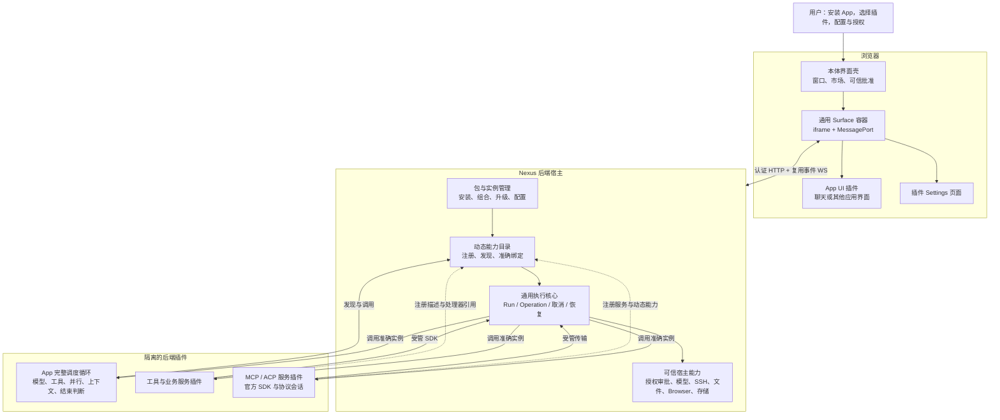
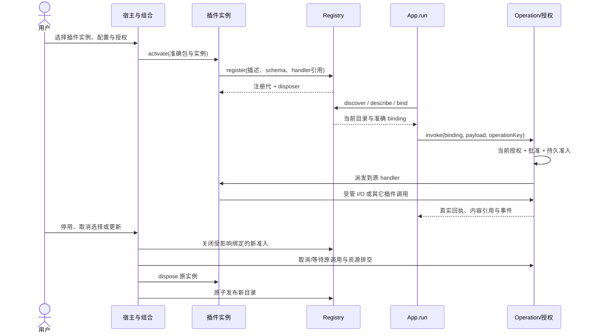

# Agent 重构

> 2026-11-06重新设计，2026-11-07完成本轮实现、正式验收及发布。本文维护SDK4动态扩展边界和持续验收判据，替代此前五阶段App策略及D27-C1服务方案；具体版本、测试范围与发布证据见[当前验收基线](../testing/E2E.md#当前验收基线)。

本文是 Agent、插件市场及前后端动态扩展设计的唯一正文。决定、实施顺序与审核表见 [PLAN](../PLAN.md#agent-动态插件架构重新设计)，当前源码说明见 [AGENT](AGENT.md)，产品已实现行为见 [USAGE](../USAGE.md#agent)。产品操作仅在USAGE维护，不恢复旧Agent运行协议。

## 1. 职责与范围

目标是：**用户安装一个 App，为它选择插件；App 自己编排任务，插件提供能力，Nexus 宿主统一执行授权和资源管理。** 工具、服务、应用流程和 UI 在公开 SDK 支持的范围内独立更新，不要求本体同步发布。

保留聊天、图片、思考等级、历史、文件、完整日志、审批、Memory、Skills、Browser、MCP/ACP、子 Agent 与资源管理等主要功能。可以重设接口和内部流程，不保留旧名称、旧五阶段或单模型运行假设。酒馆类应用用于检查架构是否支持不同应用逻辑，本轮不开发酒馆产品。

支持多个 App 并存和并行运行，同一个 App 包可创建多个拥有独立 appId 的 App 实例；不是每种包只能装一个可用应用。每个 App 独立选择插件实例/配置/UI 与授权，持有自己的会话、Run 和私有数据；不同 App 可复用不可变包文件，不能因此共享调用权限或协议 session。切换当前 App 只改变视图可见性，不停止其它 App 的后台任务；明确关闭/删除只影响目标实例及其资源，共用包的卸载则先检查所有引用者。共享模型预算和机器带宽等仍按真实宿主资源管理，不把逻辑隔离宣称为物理性能无影响。

### 1.1 整体示意图

图中 Host 是可信宿主；虚线表示描述或展示，实线表示受管调用。插件 UI 不能直接调用宿主内部对象，后端插件不能借用浏览器登录身份。



这是职责示意，不是每个方框建立一个进程或独立 npm 包。前端壳、插件进程与可信服务通过明确协议通信；模型和协议网络请求始终由拥有实际连接的 owner 管理。

### 1.2 本体核心与可插拔功能

| 层次         | 唯一职责                                                                       | 不承担的业务                                               |
| ------------ | ------------------------------------------------------------------------------ | ---------------------------------------------------------- |
| 通用执行核心 | Run、Operation、作用域、幂等、取消、资源收敛、结果引用与恢复条件               | 聊天循环、模型选择、标题、压缩、MCP/ACP 协议、具体工具算法 |
| 插件平台     | 包身份、验签安装、实例、用户组合、动态注册、绑定及配置存取                     | 为 App 决定工具顺序、默认模型或任务是否完成                |
| 可信宿主     | 身份、秘密、当前授权、批准、预算、实际模型/网络/SSH/文件/Browser I/O、持久化   | 插件业务 schema、角色、提示词、远端协议的完整执行算法      |
| App 插件     | 完整调度、模型选择和请求组织、工具曝光、并行与分支、上下文/压缩/标题、展示内容 | 签发权限、修改宿主账本、绕过真实效果准入                   |
| 能力插件     | 工具、可供其它插件调用的服务、MCP/ACP 协议、说明和业务配置                     | 自行提高调用者权限、持有其它 App 数据或全局管理身份        |
| 前端插件     | App UI、插件设置页、私有业务交互                                               | 宿主 Cookie、可信批准与秘密输入、全局 Vue/路由注入         |

“小核心”是依赖方向，不是把所有可信实现改名为 core。新增功能若只组合已有受管能力，只更新插件；若需要宿主从未提供的特权访问或新的内核数据结构，仍需本体升级。插件私有文档/schema 的变化使用自己的 namespace 和数据迁移，不为新增角色、记忆类型或工具参数增加宿主 SQL 表或 Shared 业务联合。

核心自身只依赖作用域/准入、调用与回执、内容引用和资源关闭契约。模型、SSH、文件、Browser 是独立的可信能力实现，经装配交给调用侧，不成为运行核心必须依赖的服务。Memory 的分类/检索、Skills 组织、标题、压缩、提示词和思考策略由插件持有；本体只提供已有授权的数据/文件/模型能力。检验边界时应能在未安装聊天、MCP、Browser 的情况下启动核心并运行一个确定性 App。

扩展机制按真实消费者渐进实现：一个作用域 Registry、一个调用入口、一套资源生命周期即可，不复制工具/服务两套调度器。新业务 contract 和实例内事件使用发布者命名空间与独立 API 版本，Host 不维护所有业务名称枚举；App、工具、服务、UI 是贡献用途，不是互斥包类型，一个包可同时提供多个用途。新增一种宿主交互位置或特权仍需明确的宿主支持，不能靠任意 hooks 绕过边界。

### 1.3 dsh 借鉴依据

固定参考 [deepseek-harness / fcc0ad46](https://github.com/deepseek-ai/deepseek-harness/tree/fcc0ad462172522aaf5c93a7b2e01f6b9f0b0159)，不以其当前主分支的变化替代本次证据。

| 已核实机制                                                                                                                                                                                                                                                                                                  | Nexus 的取法                                                                |
| ----------------------------------------------------------------------------------------------------------------------------------------------------------------------------------------------------------------------------------------------------------------------------------------------------------- | --------------------------------------------------------------------------- |
| [Agent registry 与独立 agent-loop](https://github.com/deepseek-ai/deepseek-harness/blob/fcc0ad462172522aaf5c93a7b2e01f6b9f0b0159/packages/core/agent/src/index.ts)                                                                                                                                          | App 注册实际运行入口，自己执行完整循环；Host 不硬编码默认循环               |
| [工具 register、resolve 与 disposer](https://github.com/deepseek-ai/deepseek-harness/blob/fcc0ad462172522aaf5c93a7b2e01f6b9f0b0159/packages/core/tools/src/index.ts#L128)                                                                                                                                   | 作用域注册、每次决策固定已解析定义、准确撤销，不按全局同名工具重新路由      |
| [scope 生命周期](https://github.com/deepseek-ai/deepseek-harness/blob/fcc0ad462172522aaf5c93a7b2e01f6b9f0b0159/packages/core/scope/src/index.ts#L137)、[Cordis 依赖者释放](https://github.com/deepseek-ai/deepseek-harness/blob/fcc0ad462172522aaf5c93a7b2e01f6b9f0b0159/vendor/cordis/src/reflect.ts#L291) | 注册及资源有明确归属；依赖就绪后启用消费者，先排空消费者再释放 provider     |
| [每实例 MCP client](https://github.com/deepseek-ai/deepseek-harness/blob/fcc0ad462172522aaf5c93a7b2e01f6b9f0b0159/packages/mcp/mcp-client/src/index.ts#L203)                                                                                                                                                | 协议客户端、动态目录与生命周期归服务插件，不留在本体专用 IntegrationService |
| [出站 ACP provider](https://github.com/deepseek-ai/deepseek-harness/blob/fcc0ad462172522aaf5c93a7b2e01f6b9f0b0159/packages/subagent/subagent-acp/src/index.ts#L76)                                                                                                                                          | ACP 可作为可选服务；与其 packages/acp/acp 入站 server 区分                  |

dsh 不是只能运行单 Agent；其 registry、子 Agent 和 ACP provider 支持多种装配。酒馆的多角色发言也不必等同于多个独立 Agent，角色与发言顺序可以是一个 App 的私有调度。

借鉴机制，不直接引入 Cordis 进程内 Context。dsh 的对象/函数注入依赖可信进程环境；Nexus 跨进程、跨浏览器传递描述快照和受管引用，额外保留身份、权限、持久效果与恢复边界。不增加另一套 DI 框架、通用工作流 DSL 或全局事件总线。

## 2. 子功能与目录

### 2.1 本体目录

前后端继续使用一致的 `agent/plugins` 归属；不恢复独立 `packages/plugin-frontend-sdk`，也不为尚无其它消费者的“通用插件平台”提前抽顶层产品模块。以下路径对应当前源码，不按概念方框机械增加目录层级。

| 当前路径                                                                              | 职责与真实消费者                                                                                                          |
| ------------------------------------------------------------------------------------- | ------------------------------------------------------------------------------------------------------------------------- |
| Backend `modules/agent/plugins/{service,model,storage,adapters}`                      | 包、仓库、安装、组合、实例、配置与连接；分别由具名 Plugin/Repository/Instance/Connection Service、Model 及存储 owner 承担 |
| Backend `modules/agent/plugins/registry/model`                                        | 作用域描述、注册代、发现、准确 binding 与事件；App、工具、服务及 Surface 消费                                             |
| Backend `modules/agent/plugins/service/plugin-runtime-service.ts`、`adapters/runtime` | 隔离进程、实例注册、调用与释放；技术进程由 Platform owner 持有                                                            |
| Backend `modules/agent/plugins/sdk`                                                   | 公开后端 SDK4；只暴露受管能力，不导出 Service 容器                                                                        |
| Backend `modules/agent/{scope,runs,operations}`                                       | App/会话身份、通用 Run、操作账本与资源归属；Operation 不依赖模型 step 或工具名称                                          |
| Backend `modules/agent/{governance,providers,artifacts,tools,integrations}`           | 准入、模型、内容及受管 I/O；经窄能力装配到执行侧，插件持业务算法和协议客户端                                              |
| Backend `modules/agent/interfaces`、`register.ts`                                     | HTTP/WS/RPC 边界及唯一装配                                                                                                |
| Frontend `features/agent/plugins/{api,model,components,composables}`                  | 市场、已安装列表、配置与连接编辑的边界、状态和组件                                                                        |
| Frontend `features/agent/plugins/{host,sdk}`                                          | App/Settings iframe、可信交互与浏览器 SDK；应用壳保留窗口、App 选择及通用执行观察                                         |
| Shared `agent/{plugins,runs,operations}`                                              | 双端协议、公开 SDK 类型、严格解码及安全错误；不承载执行实现或存储行                                                       |

每个有实际数据/用例的子功能按既有 Service → Model → storage/Adapter 分层。Service 持流程与政策，Model 做应用/存储/技术转换，Adapter 持 SQL 与技术资源；不能因为动态注册而绕过 H-04–H-08。内部协作使用窄契约，不绕到 HTTP 或模块 public 做一次空转。

### 2.2 独立插件仓库

正式实现仍放在 [nexus-agent-plugins](https://github.com/0honus0/nexus-agent-plugins)。以下是发布职责，不要求每个小功能单独建包：

| 包/发布职责                                | 内容                                                                     |
| ------------------------------------------ | ------------------------------------------------------------------------ |
| `nexus.agent`                              | 默认聊天/图片 App 的完整循环、上下文、压缩、标题、思考等级解释与展示策略 |
| `nexus.ui.chat`                            | 聊天 UI、虚拟历史、输入区、文件/GIF 预览和工具展示；仅消费公开前端 SDK   |
| `nexus.tools.remote`                       | 远程工具定义、命令组织、分页/检索和结果适配                              |
| `nexus.tools.browser`                      | Browser 工具定义与业务组合                                               |
| `nexus.tools.agent`                        | 发现/按需加载、Skills/Memory 检索、子 Agent 和允许的插件配置工具         |
| `nexus.tools.integrations`                 | MCP/ACP 的模型工具适配；消费服务契约，不另建协议客户端                   |
| `nexus.services.mcp`、`nexus.services.acp` | 官方协议 SDK、连接/会话算法、动态贡献和各自设置页面                      |

服务方法不自动曝光给模型；App 可以直接消费服务，工具包也可以把服务包装成模型工具。普通工具插件可自行注册模型工具，安装第三方工具不要求修改 integrations 包。推荐组合是可编辑预设，不能变成 App 签名中的全部可选插件白名单。

MCP/ACP 等包可以携带后端、设置页、schema 和说明。UI-only 包可单独更新；若同一包包含后端，整个包更新须按后端影响排空。完整包独立克隆、构建和测试，不从本体复制源文件或引用私有路径。Full-stack 示例保留为模板/测试用途，不进入默认产品推荐。

## 3. 依赖方向

### 3.1 允许的调用与禁止的耦合

正常执行链：

`App UI → Host 接纳 Run → 准确 App.run → 发现/绑定插件能力 → Host Operation 准入 → 插件 handler → 受管宿主能力 → 原资源 owner`

插件 A 调用插件 B 时也经过相同受管入口；可以传参数、结果引用和经授权的资源引用，不传 Service、数据库连接、Cookie 或任意进程内对象。

- 核心依赖窄调用/准入/账本/资源契约，不导入具体工具、市场 manifest、Provider/Integration/Browser Service。
- Registry 不导入 Run/治理实现；`agent/register.ts` 将真实身份、准入和调用能力注入准确绑定。安装/管理流程同样消费窄能力，不形成相互寻找 Service 的环。
- 插件 SDK 面向实际能力分组；不存在 `getService(anyName)`、任意 SQL、宿主任意 HTTP 路由注册或全局事件对象。
- 跨模块资源仍走 Access/Targets/Remote 等窄 public 入口。SSH 技术可以复用，普通终端会话的身份、资源和授权不能借给 Agent。
- 未安装可选功能时，它不出现在可调用目录；不需给核心伪造 Browser、MCP 或默认聊天实现。缺必要准入/存储适配则启动失败，不能默认放行。

### 3.2 三种依赖分别处理

| 依赖         | 来源和解析                                                   | 变化规则                                                                     |
| ------------ | ------------------------------------------------------------ | ---------------------------------------------------------------------------- |
| 代码交付依赖 | 包真正必需的发布者、包 ID、版本范围；构建依赖打入产物        | 安装计算完整闭包，不再限制一层；App 实现及启动所需代码在本次 Run 固定        |
| 接口就绪依赖 | 消费者声明所需 contract/API 版本，组合明确选择 provider 实例 | 受管订阅就绪/失效；必需接口未就绪时对应消费者不可用，可选接口由 App 分支处理 |
| 实际调用关系 | 当前 Operation 对另一个准确能力发起调用                      | 由父操作和资源 owner 追踪；不以静态服务 DAG 禁止正常双向业务调用             |

启动必须相互等待的接口依赖环要报告具体路径，不能无限等待；普通调用链不直接套用安装依赖环规则。按实际持有资源避免等待自身排空，不设置无依据的递归深度或并发阈值。

依赖就绪按实际贡献/消费 scope 处理，不用“任一可选依赖失败”停掉整个包。包可以注册基础工具，再为一个可选服务建立局部消费 scope；provider 出现、替换或消失时只启停该 scope 的贡献和资源。只有声明为整个实例启动必需的依赖才阻止实例就绪。消费 scope 复用 Registry 的订阅、准确 binding 和 disposer，不另建 DI 容器；不会按 YAML/列表顺序决定生效，也不通过轮询发现 provider。

用户显式选择的 roots 决定对 App 公开的插件贡献；自动带入的依赖只满足内部注入。依赖的全部工具不会自动曝光，除非用户另行选择或有明确重导出，并经过相同授权。删除一个 root 时重算闭包，仍被其它 root 必需引用的包不能一起撤销。

多个 provider 实现相同 contract 时，用户组合或明确的 App 选择绑定具体实例；不静默取全局默认或最新同名实现。版本要求冲突直接报告引用者和要求，不做静默降级、任意选版或后台自动安装。

不为首版预设插件数、工具数、实例数、依赖层数或调用深度常量。目录用分页与按需描述，通信和资源用背压、取消及实际容量分配；已有用户可调预算仍由用户决定。协议物理上限与经测量需要的资源保护归真实 owner，并按 H-20 记录依据，不能把实现方便写成业务限制。

### 3.3 动态目录与固定调用

Run 只固定 App 的准确实现、代码依赖和启动输入，**不永久冻结全部可选能力目录**。

1. App 每次 discover 获取当前所选实例、可见贡献和当前权限下的目录快照。
2. 每次模型请求或 Agent 决策记录当时实际使用的目录引用、schema 摘要与输入。回复只能调用该次曝光集合中的原绑定。
3. prepare/申请批准时就固定准确 provider、注册代、配置与 schema 修订。等待期间被替换则返回失效，重新发现/准备；批准后不能换一个实现执行。
4. 同 Run 后续 discover 可见新选择的能力，但新包 hash/新效果范围不继承旧 grant；选择与授权分别完成。
5. 撤权或取消选择立即挡住受影响的新派发，并取消/排空确实失去授权的旧调用。沿原 owner 保留结果，不准继续派发新的远端效果。
6. provider 更新先关闭受影响准入、排空，再原子发布新代；旧 handle 明确失效，不按名字回退。
7. 若更新的是正在执行的 App 实现或其必需代码依赖，首版等待 Run 完成或用户明确取消后更新，不做运行栈热替换。

“固定目录”只用于一次决定和调用的证据；“目录动态”不代表调用中替换处理器或自动扩大权限。

## 4. 类型与转换

### 4.1 最小对象与身份

| 对象              | 含义                                                                               | Owner                    |
| ----------------- | ---------------------------------------------------------------------------------- | ------------------------ |
| PackageArtifact   | 发布者、包 ID、版本、内容 hash、签名；不可变代码身份                               | 插件包管理               |
| AppInstance       | 独立 appId、所属用户、App 实现绑定及所选组合；同包可创建多个应用                   | App scope 与组合         |
| PluginInstance    | 某用户/App 内的逻辑实例及配置归属；同一 MCP 包可创建多个连接实例                   | 组合与配置               |
| RuntimeGeneration | 此次进程/iframe 的运行身份，重启后不同                                             | 运行实例 owner           |
| Registration      | 实例内稳定导出 key、contract/API 版本、schema、摘要/说明引用、handler 引用、注册代 | Registry                 |
| Binding           | 准确 provider、实例、注册代、schema digest、配置修订的受管引用                     | Host 根据当前 scope 解析 |
| Run               | 一次有输入、App 实现、生命周期、检查点和输出边界的执行                             | Run owner                |
| Operation         | 一次真实受管调用/效果、原调用者、父操作、请求和回执                                | Operation owner          |
| ResourceScope     | 真实任务与连接、流、进程、协议状态的归属及关闭能力                                 | 资源 owner               |
| SurfaceDescriptor | 准确前端资源、用途、实例与可用 SDK 范围                                            | 后端签发，前端验证并挂载 |

包版本、接口 API 版本、Host/SDK 协议版本、配置 schema 版本与数据修订彼此独立。进程或注册 generation 不是业务配置版本，工具显示名不是可派发身份。

### 4.2 manifest 与注册分别声明什么

manifest 只持不可变发布事实：身份、完整文件清单、代码/UI/Settings 入口、Host/SDK 兼容、真正必需的代码依赖、允许贡献的类别/命名空间及请求的宿主能力上界。

实际工具、服务和 App handler 在激活时注册；不再维护 `App.toolNames` 固定清单，不要求 App 预列所有未来服务 alias。静态描述也只保留一个源，由包代码/签名描述资产读取注册，不在 manifest、SDK 和 Host 再复制一份业务 schema。

MCP 动态工具在该实例获准的 namespace 注册。Host 验证来源、结构和能力上界，保存真实 schema 摘要；远端目录本身不是包签名内容，不能把远端 readOnly 注解或摘要当成授权证明。

Settings 的持久配置 schema、详细说明、允许 Agent 编辑的字段规则及静态入口作为签名资产随包安装。运行注册引用同一资产；UI、Agent 与 Host 校验消费同一修订。这样停用、未配置或后端启动失败时仍可打开设置，不形成“先激活才有设置，先设置才可激活”的循环。远端模型/目录等动态候选值通过受管只读服务加载，失败不妨碍编辑静态配置；动态返回不能悄悄改掉已批准字段的含义或权限。

插件 Settings UI 是可选贡献。首版可用公开 UI SDK 的 schema 表单覆盖普通配置；需要复杂交互的包提供独立设置页。公共表单/样式工具只负责呈现，写入仍走同一 Host settings 用例，不把每个字段的产品逻辑搬进本体。

### 4.3 边界表

| 边界                 | 输入/输出与类型唯一 owner                                                           | 转换 owner / 消费者                                            |
| -------------------- | ----------------------------------------------------------------------------------- | -------------------------------------------------------------- |
| 包 → 安装            | Shared plugins 发布协议；内部 packages/model 与 storage 分别定义                    | 包 Adapter 严格解码；Model 白名单转应用事实；市场与安装消费    |
| 隔离插件 → Registry  | Shared 注册 envelope；contract 描述与 schema 资产归提供包                           | IPC 解码和入口 mapper；Host 注入 package/instance/generation   |
| App/UI → 调用        | Shared binding、调用/流/取消/安全结果 envelope                                      | 真实通信入口派生 principal，mapper 转应用命令；Operation 准入  |
| 业务 payload         | 提供插件的版本化 contract、schema 与纯 codec；具体 MCP/ACP 类型不进入 Host 巨型联合 | 调用边界按冻结 schema 解码，提供包显式转换；服务消费者校验结果 |
| Host 能力 → 实际 I/O | 各真实领域 typed 契约；不透明资源引用不包含秘密                                     | 领域 Model 与技术 Adapter；不能用通用 payload 绕过领域准入     |
| 人工/Agent → 配置    | Shared 配置 envelope + 包 schema；内部 settings/model                               | 两入口派生不同真实身份，共用配置用例；Model 转存储命令         |
| 应用 ↔ 存储          | 各功能 model、storage 分别归属                                                      | Model 白名单转换，SQLite Adapter 解码行/执行 SQL               |
| Host → 浏览器/iframe | Shared 安全目录、Surface、Run/Operation/内容引用与事件                              | HTTP/WS mapper、前端 API mapper、SDK 与实际视图                |

通用 envelope 不意味着任意 JSON 直通；外部一律从 unknown 解码，业务数据按已绑定 schema 校验。具体业务错误由 contract 定义；Host 的未接纳、拒绝、失效、确定结果、提交/执行未知与清理失败使用有限安全类别。技术 cause 不出边界。

沿现有成熟 schema 校验器和官方协议 SDK，不另写 schema 引擎或 MCP/ACP 协议栈。新依赖采用前按 H-14 核实维护与问题修复情况；版本号、签名域和 SDK URL 在契约实施时一次确定，不让中断的 SDK4 字段反向决定本稿。

### 4.4 App 完整运行入口

以下只说明行为契约，不是已发布 SDK 签名：

```ts
app.run(context): Promise<
    | { kind: 'complete'; outputs: ContentRef[] }
    | { kind: 'suspend'; checkpointRef: CheckpointRef; inputRequest: InputRequest }
>
```

Context 提供明确分组的能力：输入/恢复事实、取消信号、目录发现与调用、模型、子 Run、配置、私有状态、来源读取、检查点与展示。它不包含全局 Service locator，身份、父操作和能力上界由 Host 绑定，插件不能通过参数选择 userId 或冒充管理会话。

App 可以先执行工具，再调不同模型，或完全不调用模型；可以并行、等待、检查结果、继续或结束。不保留 `open / prepareStep / afterResponse / prepareAuxiliary / projectResult`、`prepareAction`，也不保留 Run 的 `model | service` 硬模式。

App 决定上下文和工具调度；Host 保留真实输入、模型请求/结果、用量及工具回执，不要求每个调用来自模型提案。模型协议 Adapter 仍校验合法消息与工具响应关联；App 可减少曝光或不执行提案，但不得伪造“Host 已执行”的记录。模型返回 stop 不等于 Run 结束。

完成输出允许为空，纯动作 App 不必制造聊天消息或伪文件；App 抛错、主动取消和真实未知效果仍由 Host 按原事实结算。检查点与可恢复挂起按 App 实际能力声明，普通 App 可只实现 run；没有恢复能力时重启后保留中断与真实回执，不强迫所有插件实现恢复 DSL。

首版仅提供已有需求的执行原语，不加入任意持久工作流、无限后台触发器或无消费者的扩展钩子。App 可以通过版本化服务 contract 组合检索、记忆、压缩或策略插件；这些是 App 的可选消费点，不新增内核五阶段或全局生命周期 hook。

## 5. 入口与安装

### 5.1 注册、发现、调用与释放

统一流程为：

`安装可信包 → 用户选择实例 → 解析依赖/配置 → activate → 原子注册 → discover → describe → bind → invoke → dispose`

| 阶段           | Host 行为                                                   | 插件行为                                                   |
| -------------- | ----------------------------------------------------------- | ---------------------------------------------------------- |
| 安装           | 验签、校验完整产物及兼容，保存实际安装事实                  | 不在生产环境运行 npm 安装脚本                              |
| 创建/选择实例  | 绑定 user/App/config，计算 roots 和依赖闭包；选择不授予权限 | 接收自己的实例上下文                                       |
| 激活           | 按准确包创建隔离实例；收集注册草稿，校验后原子发布          | 初始化并注册 handler；必要网络初始化通过获准的生命周期操作 |
| 注册           | 注入实例身份，保存 schema/说明快照；返回准确 disposer       | handler 留在插件进程，跨进程只传引用                       |
| 发现           | 返回 scope 可见目录及 directoryRevision                     | App 按摘要/contract/标签寻找能力                           |
| 详细描述与绑定 | 返回本项完整说明/schema，绑定 provider、配置/schema 修订    | 选择准确引用，不按显示名猜调用对象                         |
| 调用           | 复核当前选择、授权、批准和父上界，持久接纳后派发            | 执行 handler；子调用带原 owner 进入同一准入链              |
| 撤销           | 关闭新准入、撤对应注册、取消并等待真实资源收敛              | 释放自身 scope，不能自行宣布远端效果回滚                   |

App/Settings 静态入口可以由安装目录提供；可执行 handler 只有激活成功才进入 ready 目录。目录必须区分已安装、已选择、配置缺失、依赖缺失、未授权、启动失败和排空中，不能用“未显示”掩盖失败。

远端 MCP inventory 等需要 I/O 的初始化/刷新必须使用受管操作。已配置、启用并获准的实例可由 Host 激活/重连事件自动启动生命周期操作，不要求用户再手动点击一次发现；仅安装包不构成这项授权。该操作绑定实例、配置、scope 和当前授权，负责准备/只读目录；不能借激活偷跑 App 任务、付费模型请求或未批准的远端业务效果。失败保留可管理状态，受原重连政策与取消约束。Host 从已保存的实例启用、授权与配置签发生命周期 scope，不保存或冒用当时的登录 Cookie；停用/撤权立即失效，准入范围不包含替用户发起任意 App 任务。

这与 dsh MCP client 在 `apply()` 内连接并等待初始目录的使用体验一致，但 Nexus 的实际 I/O 仍经 Host 准入和资源 owner。管理发现资源属于实例管理 scope；Run 专属协议资源仍属于执行，二者不共用授权。连接实例/配置变化撤回旧 inventory；Run 专属协议产生的贡献只对该执行 scope 可见。可复用的库存快照只供发现，不是可派发 handle。新 Run 按本次执行授权准备自己的协议 session，必要时重新发现并核对 inventory/schema，再生成绑定该 session 的调用 handle，之后才申请此次工具效果的批准与派发。准备 session 的网络操作自身也受管，不因处于“准备”就免于授权。若 schema 或 inventory 变化则重新描述/绑定，不继承旧批准；不借管理发现的 session 权限，不给旧 handle 静默更换 session。



动态注册替换同一实例的 inventory 时按完整批次校验、原子换代；部分失败不能出现半份目录。旧 generation 的迟到注册、回调与 disposer 只能影响自身，不能删除新代同名项。

### 5.2 发现与插件共享能力

目录先返回摘要、contract 版本、实例来源、标签和准确引用；完整说明、参数/结果 schema、示例按需读取。搜索排序、推荐和 token 曝光策略属于 App/发现工具插件，Host 仅校验返回引用仍在当前可见范围。

当前授权可用集合为 A，本次模型曝光为 E，始终 E⊆A。工具加载只影响曝光，不增加权限。每次模型工具名映射到该次保存的绑定；同名不同实例不会冲突到同一 handler。

插件之间通过 `discover(contract) → bind(provider) → invoke` 共享服务。消费者使用版本化 contract，可从独立仓共享纯契约模块，不依赖 provider 私有实现。SDK 可把这条链包装成具名、类型化代理供普通插件调用，绑定和校验仍是同一 owner；不要求每次局部纯函数调用都发现或跨 IPC。UI 用途、管理用途和 Run 用途分别授权；服务不会因为提供给 Settings 就同时得到任务创建权。

调用 scope 的可见能力、可再委托的权限和生命周期由 Host 派生。父 scope 可给子调用缩窄能力，但局部注册/同名覆盖不能恢复被祖先禁止的能力；多实例同名工具用准确引用区分，模型名称映射只影响本次曝光。dsh 的 scoped shadowing 是可信进程机制，不照搬其中“当前 scope 自注册项豁免继承过滤”的权限语义。

第一版不支持普通插件向 Host 顶层注入任意 Vue、路由、审批 UI 或全局 hooks。复杂 App UI 在自己的隔离 Surface 内完成；工具结果优先复用文本/Markdown、图片/GIF、文件和结构化展示，不一张工具卡建立一个 iframe。

### 5.3 前后端 Surface

后端提供一致的已安装/可用贡献目录和准确 SurfaceDescriptor。前端不再从多个独立列表猜测 App、UI 与服务的对应关系。

App UI、Settings 共用 iframe/MessagePort 生命周期与 SDK transport，通过 purpose 和真实 scope 区分能力。App 声明所需 UI contract，用户组合选择兼容的 Surface provider，不把 ChatUI 包名或一对一 App/UI 包关系写死在本体；一个包可以提供多个可选入口，首版按实际 App 与 Settings 入口接入，不预造面板/菜单插件系统。Settings 绑定实际用户会话、包、插件实例和 schema 修订，不制造假 Run，不借 ChatUI 的执行 grant。

UI 请求调用某项服务时，Host 从真实会话与 Surface scope 派生权限，不能让后端服务沿用“打开页面的管理员”的无限权限。插件返回的数据只决定内容，不产生可信审批按钮；可信操作保持 Host 原入口。

Host 提供主题、语言、内容区尺寸/安全区、焦点、文件选择、可信秘密输入和必要导航。插件共享 UI 组件随包交付，不依赖宿主私有 CSS。聊天继续按可用宽度自适应，保持现有视觉风格及主要交互。

停用或故障插件仍可打开静态设置/说明、调整配置、修复和卸载。配置页本身失败时由 Host 给出失败与管理入口，不自动执行后端插件修复代码。可信批准、任务取消与资源关闭始终可从 Host 访问。

### 5.4 配置：人和 Agent 使用同一个 owner

用户在已安装插件列表点击“设置”，选择实际消费的 App/实例后打开插件页面。MCP/ACP 专用集中表单迁出；Provider、全局预算、安全和真实宿主资源配置仍在 Host。每个可编辑字段必须有实际消费者。

插件提交签名配置 schema、说明、默认值和可编辑字段规则。Host settings 用例统一完成读取、创建、更新、删除、版本校验和事件发布：

1. 人工入口取真实登录身份；Agent 入口取原 Run/Operation 和调用链。两者不能互相冒充。
2. 读取返回非秘密配置、revision、schema 修订及凭据存在状态。
3. 写入提交明确 patch/替换意图与 expectedRevision。Host 读取原值、计算实际差异、按当前权限决定是否需要批准。
4. 批准绑定实例、旧 revision、schema 修订及真实差异摘要；等待期间变化则冲突，不自动套用最新版本。
5. 事务内写配置、推进 revision 并保存必要幂等回执；成功后通知真实消费者。保存成功不等于远端探测成功或旧资源已排空。
6. 影响连接/秘密/执行的变更撤销旧 grant，由原资源 owner 排空；纯展示配置只更新对应视图。插件声明不能把实际敏感变化降为无风险。

Agent 只能编辑用户允许的业务字段；不能修改权限、发布者信任、宿主硬限制或读取秘密。SecretBox/Vault 保留凭据；替换由 Host 可信输入产生受限引用，模型与插件只见状态和不透明引用。HTTP endpoint、SSH target/argv 是 Host 明确管理的连接绑定，不能藏入任意业务 JSON 绕过目标政策。

普通读取无需持久操作记录；普通 CRUD 使用 CAS 与必要的同事务 mutation receipt，不为每个字段增加 queued/draining/unknown 配置状态机。副作用未知或需要远端测试时由通用 Operation 追踪。

dsh 在本次参考版本**没有通用 model-facing set_config 工具**：[tool-cordis](https://github.com/deepseek-ai/deepseek-harness/blob/fcc0ad462172522aaf5c93a7b2e01f6b9f0b0159/packages/extensions/tool-cordis/src/index.ts#L41) 是只读 inspection；[官方开发 skill](https://github.com/deepseek-ai/deepseek-harness/blob/fcc0ad462172522aaf5c93a7b2e01f6b9f0b0159/packages/preset/agent-preset/skills/cordis-plugin-development/SKILL.md#L8) 引导编写 bundle/config patch 后安装，不直接改 profile 文件。插件代码可用 [ConfigEditor](https://github.com/deepseek-ai/deepseek-harness/blob/fcc0ad462172522aaf5c93a7b2e01f6b9f0b0159/packages/preset/agent-preset/skills/cordis-plugin-development/references/host-plugin.md#L66)，UI SettingsController 也不等于模型工具。Nexus 采用自身受管配置入口，不让模型改本体配置文件。

### 5.5 市场、安装与独立交付

市场发现、包安装、App 选择、实际注册和授权是独立事实，不能合成“安装即全功能可用”。

| 范围        | 目标行为                                                                                                   |
| ----------- | ---------------------------------------------------------------------------------------------------------- |
| 推荐安装    | 可编辑预设选择 App/UI/工具/服务实例；用户确认的推荐新装可按明确清单授权，普通安装不自动授权                |
| 包与 App    | 仅 App 贡献创建应用；工具、服务、UI 不产生伪 App 卡片；多个 App 可共享包字节但隔离实例/数据/权限           |
| 来源与信任  | 官方和第三方同一验签/安装路径；仓库地址不等于发布者身份，添加源不自动信任发布者                            |
| 版本        | 按发布者/包 ID 聚合 SemVer，预发布需明确选择；比较全部引用者要求，不能将版本不同一律视为可升级             |
| 安装过程    | 不持久化安装计划、进度或结果账本；保存实际包、绑定和必要安全围栏。失败后重读事实重新准备，复用准确已成功项 |
| 更新        | 候选完整校验后才停止原准入；列明受影响 App、权限/数据变化与排空要求，不直接覆盖活跃实现                    |
| 卸载/清数据 | 先处理引用与排空，再按用户选择清配置、凭据及插件私有数据；历史/已生成产物沿明确保留政策                    |
| 保留数据    | 卸载后不留可运行 App 卡片；已安装管理/市场保留重装与清数据入口，源下架也不丢失管理能力                     |
| 发布        | 每包独立版本、不可变 hash 与兼容要求；只重建变化包，catalog 引用准确产物，不能覆写同版本内容               |
| 模板        | App、工具、服务、UI/Settings 使用同一公开 SDK 和校验流程；不要求第三方修改本体或进入官方仓                 |

不同源独立读取，同源在途读取可合并；慢源不阻塞本地管理。目录缓存绑定源配置修订和快照，部分失败标过期；删源再加、分页换版不能混入旧结果。打开、显式刷新或读取过期缓存时更新，不为仓库增加周期轮询；目录更新只截至上次成功读取。

dsh 的[官方可选 bundles](https://github.com/deepseek-ai/deepseek-harness/blob/fcc0ad462172522aaf5c93a7b2e01f6b9f0b0159/packages/util/official-bundles/README.md)、[第三方 Discover](https://github.com/deepseek-ai/deepseek-harness/blob/fcc0ad462172522aaf5c93a7b2e01f6b9f0b0159/packages/experimental/plugin-market-bundle/README.md) 与安装器分离；参考版本没有默认官方 Discover 索引。Nexus 保留已有官方 catalog/第三方源，不引入 npm 安装脚本、可信进程内插件或市场自动管理工具。

### 5.6 通信与事件

保留三段物理边界，不给每个能力开 socket：

| 边界                 | 传输                          | 用途                                                |
| -------------------- | ----------------------------- | --------------------------------------------------- |
| iframe ↔ 浏览器 Host | MessagePort                   | SDK 请求、授权事件、按需内容与 ACK                  |
| 浏览器 ↔ Backend     | 认证 HTTP + 页面会话复用的 WS | HTTP 命令/快照/分页/文件；WS 多个授权订阅与状态增量 |
| Backend ↔ 隔离插件   | IPC                           | 注册、受管调用、数据/结果引用、取消与关闭确认       |

每段逻辑上区分请求响应、带背压的数据/事件、优先控制。取消、停止准入与关闭确认不能排在长调用或日志队列末尾；本体内部仍用明确方法和有 owner 的订阅，不把普通函数都改成消息事件。

事件包含 scope、实体 revision、来源 cursor 与连接 generation。先登记监听，再一致性读取快照和游标；之后补读变化。重连允许重复交付，按来源去重；游标失效明确重新取快照。ACK 表示已校验并应用到受控状态，不等待 DOM 绘制；旧连接 ACK 不确认新帧。

插件自己的业务事件也使用同一注册与订阅机制：提供包声明命名空间、版本化 payload schema 和来源读取 contract，Host 注入实例/scope/generation 并复核发布/订阅权限。需要恢复的事实随原数据提交 revision/来源游标，再发布失效通知或增量；纯临时进度可明确不持久化，重连读取当前快照。不得只允许固定 Run/Memory 主题，迫使新插件改 Host 枚举或退回轮询；也不开放跨实例任意广播。用例只要求失效补读时，不强迫包维护可回放的完整事件日志。

变化只更新受影响页，保留虚拟历史与滚动锚点。终态引用已提交输出终点，正文未补齐继续续读；不因先收到 completed 而留下空白。任务提醒依据新状态修订，不在每次重连重播旧完成提醒。

大日志和文件完整保存到原内容 owner，通过分页/范围读取；流上只交付分块、进度和引用，不复制全量正文。不因慢 UI 丢原始输出，也不增加未经测量的总量限制。慢 iframe 暂停自身订阅后补读，不阻塞其它 App；共享 TCP/IPC 仍有物理竞争，验收要测取消/审批延迟，不能宣传绝对无影响。

去轮询先覆盖真实变更生产者：会话/授权/发布者撤销、组合/配置变更、目标/凭据/信任变化、Provider、Run/Operation、Memory/Artifact 和到期。已知到期用一次性定时器，派发及敏感 I/O 仍查权威状态。保活、重连退避、输出合批和本地计时不是业务轮询。

首版前提为单 Backend 权威写入，插件经 IPC 写，迁移/恢复在维护排空后执行。若有合法外部写入者而没有可靠通知，先补通知或保留集中核对，不直接删安全复查。浏览器状态通道暂不增加 broker、通用 outbox、SSE 或另一套 socket 库；MCP 等远端协议本身需要的 HTTP/SSE 由服务插件按官方 SDK 接入，不受这项前端传输选择限制。

## 6. 数据、事务与并发

### 6.1 单一事实来源

| 数据         | 持久化内容                                                                                    | 不持久化的运行对象                          |
| ------------ | --------------------------------------------------------------------------------------------- | ------------------------------------------- |
| 包/实例/组合 | 不可变包、实际安装、用户 roots、逻辑实例、引用、配置/数据 schema 修订                         | 安装任务进度、临时下载等待                  |
| 配置与秘密   | 非秘密文档、CAS revision；独立连接绑定、密文与 generation                                     | 明文秘密、UI 草稿、临时 grant               |
| Run          | 准确 App 实现/代码依赖、输入引用、父子关系、预算/期限、取消/结束决定、检查点、输出引用        | JS 调用栈、Promise、运行时调度队列          |
| Operation    | 稳定键、规范化请求与 hash、真实 principal/父操作、准确绑定、批准消费/派发事实、结果和效果证据 | callback、AbortController、IPC request 对象 |
| 内容与展示   | 原始模型/工具/日志事实、已确认文件来源；App 展示流及其格式版本                                | 每个 token 的整页快照、所有客户端 ACK       |
| 资源         | 确需跨崩溃核对的出生身份、归属、远端效果/关闭证据                                             | 旧 SSH 句柄、旧端口、失效 continuation 对象 |

Run 是一次执行，Operation 记录需要持久核对的受管执行；没有模型 step 的服务执行也是正常 Run。首版按新职责设计存储，不机械给旧 `agent_run_tools` 扩字段，也不建立真假并存的两套账本。领域专用明细通过 operationId 关联；通用账本不复制全部 Provider 或协议字段。

不把 discover、describe、目录订阅、普通只读配置和包内计算逐条写成持久 Operation；跨边界读取仍有调用身份、取消和资源 scope，存在实际资源时仍须受管关闭。模型请求、对用户可见的工具执行、真实外部效果和需要恢复/幂等的调用才持有对应操作事实。记录类别由 Host 按实际入口/子效果决定，插件不能把突变标成纯读逃过账本。纯算法服务不需要额外派发状态机；父服务有真实子效果时汇总其事实，不重复计量同一模型/SSH效果。临时调用 scope 不伪装成数据库 Operation；子效果关联最近的持久 Run/Operation owner 并保留调用因果，派发前完整持久接纳，不引入半写入的父账本或事后补批准。

准入与审批分开：每层受管调用都复查范围，但纯编排包装不凭空增加一轮弹窗。已知的批次可让用户确认准确效果计划，批准绑定原实现、参数和版本；真实效果仅消费一次相应批准，后续新效果或改参仍按原政策处理。不能把对包装服务的宽泛同意当作未知子调用的通行证。

需要区分调用结果与效果事实：服务 handler 报错不一定发生远端未知；返回成功也不能清除子 HTTP/SSH 写入的未知事实。App 可交付已知输出，Host 仍独立核对真实操作与资源是否收敛。展示流不能伪造可信工具卡、产物或 Run 终态。

资源归属树决定取消/排空；消息因果图只表达内容来源，可以多源汇合，不授予权限。多个角色并行不需要伪装成单条模型步骤链。

### 6.2 事务与恢复

- 实际派发前，在同一存储事务复核当前权限/版本、消费批准并登记唯一派发意图。提交未知不派发。不能分成 `authorize()` 成功后另一次无条件 `dispatch()`。
- 原调用者具有当前历史读取权限时，先按原 operation key 和规范化请求查询已接纳操作，返回原回执或原未确认状态；不同请求冲突。此只读核对不要求旧 binding 仍可执行，不重新激活旧实例，也不转派新 provider。只有尚未接纳的新派发才检查当前 handle/配置与授权；避免更新后旧 handle 失效导致成功回执无法取回。调用者仍有责任不为同一未知意图换新键。
- 配置 CAS、内容写入与对应回执在可覆盖的真实事务内提交；网络/文件系统不是 SQLite 原子事务的一部分，分开保存确认事实。
- 父 Run 成功前核对所有关联操作的实际效果与资源；有未确认效果/关闭事实则不能报完整成功。仅 handler 结果不可得、但实际效果已证明未派发或已确定且资源已收敛时，由 App 判断业务是否仍可完成，不把它重新混成效果未知。确定未派发的取消不制造未知效果；实际未确认效果不能因父取消或进程退出被改成已回滚。
- App 显式保存检查点：绑定 Run、准确 App 实现、App 状态引用、已消费回执的来源边界和仍待处理的稳定操作意图。请求及稳定 key 在效果派发前随原 Operation 持久化；并行完成不靠一个时间戳猜“都已消费”。恢复核对检查点边界之后的全部原操作/回执，关联尚未消费的结果再推进状态；同一未确认意图不得生成新 key 重派。无法对应意图或存在未确认效果时停止自动续跑；不恢复任意 async JS 栈，不盲目重跑整个 loop。
- 每个 Run 用持久执行代及原子 CAS 保证唯一执行者，恢复前核对旧代资源已收敛。所有新准入绑定当前执行代；complete/suspend 先关闭该代新准入，收拢已接纳操作/资源，再同事务复核围栏并提交结束或挂起。并发 resume 只能一个取得执行权；旧代迟到结果只补记其原 Operation，不得新派发或覆盖新代状态。单 Backend 不能替代这项异步竞争保护。
- 需要用户输入时 App 可显式 suspend，保存等待及检查点并排空该执行的活跃 I/O 后释放执行实例；不能安全释放的协议状态仍归原执行，不能假称已持久挂起。
- 没有安全检查点、原实现不可用或效果未确认时保留现场并给出恢复动作，不自动切新版实现接管。

所有 SQL 和迁移正文归对应 Adapter，`schema.ts/migrations.ts` 只安装编排。每条实际变更按 H-21 独立追加迁移；本轮不预占版本、不改已执行记录。本轮按用户确认删除SDK1–3的App、旧运行家族、来源记忆、集中集成和包档案，不转换旧执行历史；当前SDK4运行、签名、请求hash与未知效果围栏保留。迁移61–63追加执行，已发布1–60不改写；旧附件通过持久删除队列清理，未收敛拒绝快照。不在业务读取时猜字段、补旧默认或降级运行。

App 私有数据按 user/App/publisher/package/instance/namespace 隔离，包升级不以 hash 改变逻辑数据归属。插件通过带 CAS、分页和内容引用的受管存储访问自己的数据；逻辑 schema 由包持有，不暴露任意 SQL。首版不为假想检索建立通用数据库 DSL，实际需要的新索引/查询能力再按 owner 增加。数据 schema 变化由显式迁移候选、校验及提交处理，不能 activate 时偷偷迁移。迁移只作用于自己的 namespace，版本与本体 schema_version 分开；不兼容时不承诺只换回旧包即可回滚。

### 6.3 事件与提交

持久变更和其恢复所需游标/版本在原事务推进。确定提交后发布事实；提交不明只发布“需要核对”的失效通知，不伪造成功。通知失败不能改报已经提交的写入为回滚；订阅需重同步或明确断开，不能保持永久陈旧的健康状态。

不做全量事件溯源，不复制所有内容为第二份事件日志。内存通知用于唤醒，持久来源用于补读。崩溃后 WS/IPC 断开并从源恢复；只有出现独立可靠后台业务消费者时，才为该消费者评估事务 outbox。

## 7. 生命周期与失败

### 7.1 作用域与复用

插件进程按需要激活并复用，不一工具一进程。代码共享不等于授权共享；每个逻辑实例、Run、Operation 和前端 Surface 都有真实 owner。

SSH transport、exec channel、SFTP 与协议 session 是不同资源。继续沿已确认的 Run 资源复用和十分钟滑动空闲政策：工具活动续期，任务最终完成/取消、用户手动关闭或明确关闭应用时进入清理，不在 App 的中间步骤完成时提前关闭。手动关闭存在前台/后台任务时保留可信确认。实际技术对象由原资源 owner 持有，插件只取得当前范围的引用。

并发传输的命令 channel 可独立，但共享 SSH transport 仍可能有窗口和带宽竞争。大文件/大日志与交互/ACP 的隔离选择由现有实测与资源 owner 决定，不把“两个 channel”当成无影响证明，不为每个工具重复建立连接池。

跨调用协议会话是 execution-owned resource。每次调用重新核验当前权限，复用会话不能复用过期调用的 control。MCP continuation、ACP 回调绑定真实 session/config/generation；新请求不能接管旧回调。连接复用不意味着每个 operation 结束就 DELETE 远端 session。

### 7.2 更新、取消和失败

| 场景             | 行为与最终责任                                                                      |
| ---------------- | ----------------------------------------------------------------------------------- |
| 激活失败         | 撤回注册草稿、清理原实例；管理目录保留失败与配置/卸载入口                           |
| 缺依赖/冲突      | 明确列出缺失 provider、版本或启动环；不注入假能力，不将不可用当空目录成功           |
| UI 隐藏/最小化   | 保留任务与必要状态；按可见性暂停展示，Host 继续观察新任务提醒                       |
| iframe 崩溃/刷新 | 只撤销对应 Surface、端口与订阅；不冒充用户取消 Run                                  |
| 用户明确关闭 App | 检查前台/后台任务，按确认取消并排空；关闭视图与实际任务停止分别交付                 |
| UI-only 更新     | 替换对应 Surface；本页允许的草稿/线程/锚点可交接，不自动发送，不取消 Run            |
| provider 更新    | 先校验候选、关闭受影响准入、等待/明确取消在途操作并排空，再发布新代；原 handle 失效 |
| App 实现更新     | 等待该实现的 Run 完成或确认取消；不迁移活跃 JS 栈、不偷偷替换 driver                |
| 撤权/信任撤销    | 立即阻止相关新 I/O 并取消原资源；真实结果和清理仍由旧 owner 记录                    |
| 取消 root        | 只撤实际失去可见性/权限的绑定；其它 roots 仍需要的 provider 保留，不误取消无关 Run  |
| 超时/取消        | 等待截止、执行截止、远端停止分别确认；控制先停准入，真实 close 后释放占用           |
| 断线/回执丢失    | 用原 key 查询原结果；订阅重连不重放写入，不换 key 猜测重试                          |
| unknown/清理失败 | 保留准确边界、原操作与资源证据；阻止不安全重派/升级，不虚报完成                     |
| 卸载/清数据      | 引用与排空确认后处理；清正文与保留防重放/未知证据分开，不误删其它实例               |
| 历史展示         | 缺旧 UI renderer 时仍可看安全通用内容/文件；不为看历史运行旧可执行插件              |

provider 失效先计算受影响集合并关闭新准入，再按真实 Operation/资源归属排空依赖调用，最后释放 provider。缓存 binding 和“可能调用该接口”的关系不持有执行租约，不能沿可能有环的实例依赖图递归等待对方 close；必要启动依赖与本次在途资源分开处理。可选 provider 更新只失效其 binding、排空真实关联调用/会话，不必终止仍能处理失效的整个 App Run。App 的必需代码依赖更新仍按 App 实现更新处理。共享关闭 Promise 幂等，独立清理失败不阻止其余资源收尾；晚成功资源与晚拒绝仍归原 owner。不能把管理更新排在需要同一管理锁完成的清理之前形成等待环。

### 7.3 协议与安全保证

MCP/ACP 的官方 SDK、帧解释与会话算法在服务插件；Host 负责固定目标、凭据注入、实际字节 I/O、权限和关闭事实。

原始 HTTP/stdio 是授予准确协议 provider 的强会话能力。Host 不解析协议时，不能保证恶意 provider 的每帧“只读”；插件自报 catalog/readOnly 或工具 schema 不降低该能力风险。官方 ACP provider 仍逐次请求内层批准并确认真实交付，这与宿主能够约束任意第三方协议语义是两项保证。

签名证明来源，不证明代码安全；独立进程、Node permission 与 iframe 也不能直接宣称完整恶意代码隔离。首版须验证实际文件/网络/进程访问边界，SDK 受管保证只覆盖经过它的调用。不能既允许绕过 SDK 直接联网，又声称所有副作用都经过审批。

日志沿现有诊断组件，关联 app/instance/run/operation/generation，区分 info/debug/trace 与错误；不输出秘密、Cookie 或完整私密正文。没有事件不判定卡死，心跳也不证明任务推进；等待批准、外部任务、资源故障由真实状态表达。

## 8. 当前能力与验收

### 8.1 当前状态

SDK4宿主、前后端SDK及八个官方包已完成实现、正式验收与发布；后续复审、测试矩阵及发布状态随当前验收基线维护。D24–D26旧SDK切片仍仅作历史证据，不替代本版结果；源码、发布版本、摘要及首次失败统一见[当前验收基线](../testing/E2E.md#当前验收基线)。

下列场景保留为设计与持续回归判据，不表示已穷尽全部故障组合。旧夹具已由新测试体系迁移并验收；真实模型、移动真机、介质故障和性能实测继续见[PLAN](../PLAN.md#agent-动态插件架构重新设计)，不将编译或受控fixture等同于这些实测。

### 8.2 功能设计验收

| 场景           | 必须证明                                                                                                    |
| -------------- | ----------------------------------------------------------------------------------------------------------- |
| 默认 Agent     | 原主要聊天/图片/推理等级/上下文/标题/压缩功能在独立 App 中实际执行；Host 没有五阶段或默认算法 fallback      |
| 无模型 ACP App | 未配置 Provider 仍可调用选定 ACP 服务、输出内容、批准/取消/恢复；没有伪模型 step                            |
| 多角色架构检查 | 一个测试 App 调用两个模型并组织发言，复用同一本账本；角色数据和上下文属于 App，不新增 Host 酒馆字段         |
| 子 Agent       | 父子权限收窄、并行结果/用量、取消与真实资源排空；未派发取消不误判 unknown                                   |
| 动态能力       | 安装本体未知的新工具/服务，用户选择授权后同一 App 可发现；取消选择/更新后旧 handle 明确失效                 |
| 多实例         | 同包两个 MCP 连接、两个 App 使用同包互不串配置、session、目录、权限或清理                                   |
| 设置           | 未启用插件能打开设置；人工与 Agent 写同一配置 owner，冲突/撤权/秘密/响应丢失一致处理                        |
| 模型工具发现   | 摘要搜索后按需读取详细 schema；本次曝光准确绑定，远端 inventory 变化不重解释旧调用                          |
| 前端独立交付   | 固定本体只更新 ChatUI，保持 Run、历史、文件、草稿与提醒；新 App Surface 不需 Host 包名分支                  |
| 完整工具迁移   | 逐项覆盖现有工具实际功能，不以旧 65 个名称作为新 API 限制；批次完整预检、审批、日志、结果续读与产物来源保留 |
| 管理与市场     | 安装≠选择≠授权；源失败仍可管理，依赖冲突可定位，升级/卸载/保留数据/清理及第三方交付通过                     |

多角色只用于确定性契约夹具验证，不表示新增酒馆产品或额外 UI 范围。所有正式功能都需真实入口和消费者，不能靠 schema、空 hook 或模板包代替。

除了逐功能验收，还必须通过以下扩展判据，防止“目录拆了、运行仍写死”：

- 第三方包新增一个检索/记忆策略 service、一个模型工具和一个实例内事件；固定 Host 构建即可发现、调用、订阅及卸载，不增加 Host 枚举或轮询。
- 一个包提供基础工具与依赖 ACP 的可选工具；未安装/移除 ACP 时只有相关贡献失效，基础工具和设置继续可用。
- 已获准 MCP 实例激活后自动完成受管连接准备；仅安装未授权时不能联网，管理发现会话不能变成 Run 执行授权。
- 不配置模型的纯动作 App 可完成且输出为空；无恢复功能的 App 也可运行，中断后明确保留事实，不自动重跑。
- 同一 App 切换兼容 UI provider，或更新插件私有配置/数据 schema，不修改 Host 包名分支或业务表。
- 目录查询/纯计算不产生多余持久派发记录；多个包装服务围绕同一真实效果时不重复计量/批准，祖先拒绝不能被局部注册绕过。

### 8.3 可靠性与性能验收

| 类别       | 场景与判据                                                                                                                     |
| ---------- | ------------------------------------------------------------------------------------------------------------------------------ |
| 准入原子性 | 批准期间更新 schema/provider/config，撤权与派发竞争，提交未知不派发；准确 binding 不回退                                       |
| 真实效果   | 配置提交成功但响应丢失；SSH 写入未知；一个并行子效果未知；已确认产物与失败父操作并存                                           |
| 恢复       | 并行写成功但 checkpoint 未推进、并发 resume、complete/suspend 与迟到调用竞争；原意图不换 key，旧代不能新派发；无安全依据不重放 |
| 协议会话   | MCP 真实 session-bound continuation、ACP 内层批准/取消及晚回调；sessionless fixture 不能替代有状态场景                         |
| 生命周期   | 更新/卸载中有前台任务、后台 Job、待批准、共享 provider；停止准入、依赖者排空、真实关闭均被证明                                 |
| 通信       | 首份快照竞争、重复/旧代 ACK、断档/重连、终态先于正文、慢 iframe、长日志下控制响应                                              |
| 无业务轮询 | 列出全部写入/撤权生产者，空闲页面不周期读业务表；保活/期限/重连分别统计                                                        |
| UI         | 320/390px 和宽窗口、虚拟历史/GIF/附件、思考等级、快速批准、会话切换、任务提醒与资源关闭；保持现有风格                          |
| 数据       | 空库/升级/连续 dev/重复启动/签名拒绝/备份恢复；旧SDK1–3数据删除，当前SDK4历史与未知证据保留                                    |
| 独立发布   | 固定兼容本体，分别升级 App/工具/服务/UI；独立仓只依赖公开 SDK，第三方模板走同一路径                                            |
| 性能       | 相同任务/数据/并发下记录首字、取消/审批延迟、RPC 排队、SQL 读写、内存和连接数，不预称优化比例                                  |

后续变更继续按[E2E入口](../testing/E2E.md)执行适用的静态、真实生命周期、指定浏览器与正式远程验收，逐项记录实际代码基线。设计审查、编译通过、旧 SDK 局部测试和正式产品验收分别报告。

测试归属见[测试架构](TESTING.md)：Host通用安全与生命周期在本体；官方App、工具、MCP/ACP和ChatUI业务在插件仓各包`tests/`；完整Agent真实Host链路归插件`tests/interoperability/`，业务浏览器归`tests/e2e/specs/<packageId>/`。本体通过准确源码/签包产物调用外仓用例，不维护第二套官方业务测试或Playwright→Node包装。历史发布通过与本轮测试框架重构验收分别见[测试入口](../testing/E2E.md)。
