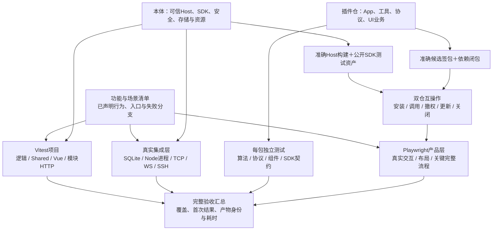

# 本体与插件测试体系

> 2026-11-08完成测试分层迁移和两仓完整门禁；整轮3–5分钟目标未达，冷/热同基线性能对照仍待实测。本文维护当前owner、框架入口与扩展约定；实际结果及耗时见[测试入口](../testing/E2E.md)，待验范围见[PLAN D35](../PLAN.md#d35本体与插件测试体系重设计2026-11-08)。

逐用例耗时保存在框架原始报告；本体浏览器的 `spec-durations.json` 同时保留按耗时降序的 `cases`，包含项目、完整分组标题、状态和每次 retry，首次失败不会被后续通过覆盖。质量作业也保留Host fast的Vitest JSON、插件Vitest JSON及原生Node JUnit；统计逐case时与资源metrics分开解析，按层注明覆盖范围。文件级估算仍仅消费最终全部通过的 `specs`，不将相同标题或重试耗时混作独立场景。

## 1. 职责与范围

目标是：**同一功能在最合适的层验证，所有产品功能有明确覆盖，插件能独立验证和发布，完整自动回归不依赖一台机器串行跑整套应用。** 本体与独立插件仓共用测试约定、公开SDK和产物身份，各自拥有业务测试；不再把所有测试统称为E2E。

“覆盖全”指已声明功能、真实通信入口、权限与生命周期分支都有可追踪的自动或实机判据，不表示穷尽全部输入、故障排列和硬件。不能用用例数量、代码覆盖率或模拟协议通过代替产品覆盖；已有未验事项继续保留在PLAN。测试重构保持产品既定UI和正常交互；迁移同时审核生产代码，确认的缺陷和无依据限制同批修复并补回归，不借测试提速放宽安全或数据库语义。

### 重构依据

迁移前固定Backend runner、Playwright包装Node、重复全栈装配和包内重复构建造成耗时集中，部分独立用例未进入正式清单。原始测量与方案依据归[历史记录](../testing/HISTORY.md#测试重构设计依据2026-11-08归档)；当前以互斥框架发现、逐场景迁移、准确成品及原生分片核对覆盖，不能将旧用例数当作新门禁结果。

### 成熟项目参考与选型

以下核对了实际源码及工作流，链接固定到本次读取的提交。借鉴测试边界与现成框架，不引入这些产品的宿主框架。

| 项目                                                                                                                                                                                                                                                                                                                                                                                                                                                                              | 已核实做法                                                                   | 本项目采用方式                                                                                  |
| --------------------------------------------------------------------------------------------------------------------------------------------------------------------------------------------------------------------------------------------------------------------------------------------------------------------------------------------------------------------------------------------------------------------------------------------------------------------------------- | ---------------------------------------------------------------------------- | ----------------------------------------------------------------------------------------------- |
| [Fastify](https://github.com/fastify/fastify/blob/0b076ca595d19951c536daf515c778b38cf6ba69/test/inject.test.js)                                                                                                                                                                                                                                                                                                                                                                   | `node:test`直接使用`inject()`验证路由、header、状态和ready                   | HTTP模块测试运行真实路由、解析及钩子，普通参数矩阵不监听TCP                                     |
| [Backstage模块测试](https://github.com/backstage/backstage/blob/453e51585aee6663d4e4030955d0459d5c564cf2/packages/backend-test-utils/src/wiring/TestBackend.ts)与[数据库夹具](https://github.com/backstage/backstage/blob/453e51585aee6663d4e4030955d0459d5c564cf2/packages/backend-test-utils/src/database/TestDatabases.ts)                                                                                                                                                     | 按features装配测试后端，可替换外围服务；复用昂贵物理环境，分配独立逻辑数据库 | 复用生产模块安装入口和窄依赖；复用不可变基础设施，隔离每例数据，不引入Backstage DI              |
| [Grafana插件CI模板](https://github.com/grafana/plugin-tools/blob/c238e79daffbbcb348c28298a1181a374f0c6dcc/packages/create-plugin/templates/github/workflows/ci.yml)、[API夹具](https://github.com/grafana/plugin-tools/blob/c238e79daffbbcb348c28298a1181a374f0c6dcc/packages/plugin-e2e/src/fixtures/commands/createDataSource.ts)与[Vitest project](https://github.com/grafana/plugin-tools/blob/c238e79daffbbcb348c28298a1181a374f0c6dcc/packages/plugin-e2e/vitest.config.ts) | 插件单测/构建与浏览器验收分开；UI测试通过API准备数据                         | 每包独立项目，候选签包对真实宿主验收；借鉴fixture方式，不引入绑定Grafana的`@grafana/plugin-e2e` |
| [VS Code普通测试](https://github.com/microsoft/vscode/blob/425edb2f1285509174564beba978bf18069ecaa8/test/unit/README.md)与[产品Smoke](https://github.com/microsoft/vscode/blob/425edb2f1285509174564beba978bf18069ecaa8/test/smoke/README.md)                                                                                                                                                                                                                                     | Node、浏览器及产品验收分工，产品测试匹配实际构建                             | 终端解析/状态下沉；真实布局、IME、焦点和成品交付独立验证，不复制其自定义runner或过时环境说明    |

以下为2026-11-08实际锁定并完成验收的框架版本；后续升级仍需同批验证真实工具链，不使用浮动框架版本。

| 能力                                              | 选型与边界                                                                                                                                     |
| ------------------------------------------------- | ---------------------------------------------------------------------------------------------------------------------------------------------- |
| 快速逻辑、Shared、前端状态、Vue组件和普通模块集成 | **Vitest 5.1.0**，使用官方projects、fixture/hooks、mock timers、并行、分片及报告；Vue组件使用**Vue Test Utils 2.5.1＋jsdom 31.0.0**            |
| 前端HTTP失败/延迟/撤销组合                        | **MSW 3.0.4**，拦截实际API client的请求，仍使用生产转换与codec；未声明请求直接失败，不自行重写fetch或Axios客户端                               |
| 真实Node进程、权限/隔离、现有原生协议用例         | **Node内置`node:test`**直接运行。只在需要真实进程/内置运行时或迁移已有用例时使用，不再由Playwright包装，也不将纯函数新用例同时登记到两个runner |
| HTTP模块                                          | **Fastify内置`inject()`**，消费实际路由及生产HTTP装配；不叠加Supertest或自建HTTP仿真层                                                         |
| 浏览器、布局、真实iframe/MessagePort及成品流程    | **现有Playwright Test**，复用官方projects、fixtures、APIRequestContext、clock、trace及分片                                                     |
| 代码覆盖与报告                                    | Vitest官方V8覆盖、Node原生覆盖、框架JUnit/JSON和Playwright HTML；报告注明工具和源码基线，不能机械相加不同覆盖分母                              |

Vitest的Node/Vite声明支持当前Node26与Vite8；Vue Test Utils支持Vue3。Vitest、Vue Test Utils、jsdom、MSW均未归档、Star超过200，近期发布或问题处理有记录：Vitest5.1.0于11月2日发布，jsdom31于11月5日、MSW3.0.4于11月6日发布；Vue Test Utils2.5.1于9月16日发布，11月仍有问题处理。声明兼容不代替安装和运行验收；签名沙箱中的插件仍运行正式编译产物，不导入Vitest运行时。

不另建测试DSL、运行状态数据库、通用环境编排服务或模拟完整Host的第二份业务实现。初版不引入Nx/Turborepo、Pact、Testcontainers或另一种浏览器runner：当前需求可由上述框架、SQLite、已有受控协议服务及GitHub Actions满足。项目自有代码仅保留领域fixture、功能清单校验、产物核对与薄的CI计划/报告连接。

## 2. 子功能与目录

### 测试分层

| 层          | 内容                                                         | 真实部分                                                 | 允许替换部分                                 | 不必启动                            |
| ----------- | ------------------------------------------------------------ | -------------------------------------------------------- | -------------------------------------------- | ----------------------------------- |
| 逻辑/契约   | codec、mapper、纯规则、搜索、分页、工具参数、前端store及竞态 | 被测生产函数与独立输入/期望值                            | 时钟、窄I/O依赖、确定性模型响应              | 应用、数据库、HTTP监听、SSH、浏览器 |
| 存储/模块   | SQLite事务、CAS、迁移；Service/Model；HTTP模块；Vue简单交互  | 按用例使用真实SQLite、真实路由/serializer/hook、真实组件 | 被测范围以外的服务；非安全策略专项的身份输入 | 无关模块、真实远端、完整Agent循环   |
| 协议/宿主   | TCP/WS、SSH/SFTP、背压、断连、插件进程、权限、关闭、恢复     | 实际技术Adapter、传输、持久账本与资源owner               | 外部Provider、MCP/ACP服务器和可控故障端      | 无关前端页面和不参与的插件          |
| 产品/互操作 | 用户关键流程、签包安装/更新/卸载、SDK双向通信                | 实际成品、本体、准确插件包、真实可信批准                 | 外部服务可使用明确标识的受控端               | 不相关的完整参数排列                |

性能、长时和真机是这些层的专项判据，不是把慢测试丢进去便可移出门禁的兜底目录。jsdom不验证布局、Canvas/WebGL、原生IME、iframe来源隔离或实际浏览器调度；`inject()`不证明真实TCP中止、网络背压或远端停止。

### 正常流程与异常矩阵的归属

按用户最新要求，**Playwright主要验证正常产品流程；异常与边界矩阵尽量在各自负责的一侧完整验证。** 这里的单侧测试仍执行实际生产代码：前端使用真实client/controller/组件，后端使用真实规则、路由或SQLite；需要验证跨边界性质时保留对应真实集成，不以全链路或全mock作为统一模板。

| 场景                                                                                         | 主测试位置与方式                                                                           | Playwright承担的范围                                                            |
| -------------------------------------------------------------------------------------------- | ------------------------------------------------------------------------------------------ | ------------------------------------------------------------------------------- |
| 正常创建、编辑、保存、删除、连接、传输、插件调用与设置                                       | 各层保留自身业务断言，正常产品链路通过实际UI与真实后端验证                                 | 每项可观察用户功能有正常流程覆盖；准备无关数据走API，关联步骤可组成独立用户旅程 |
| 前端读取失败、写回执丢失、旧响应晚到、CAS提示、撤权及恢复交互                                | Vitest＋MSW＋Vue组件；分别断言草稿、状态、请求次数、原意图及实际反馈，不能只断言mock被调用 | 普通状态码和输入排列不重复跑浏览器；只保留确需真实浏览器才能暴露的问题          |
| 后端非法输入、未授权、冲突、事务失败、提交未知与版本竞态                                     | Fastify inject、真实SQLite、模块及Adapter故障测试；安全用例使用真实授权与持久条件          | 正常UI能正确调用和消费结果，不逐条重复后端拒绝矩阵                              |
| 插件参数、协议畸形输入、续接状态及模型调度失败                                               | 插件仓直接测试真实处理器/官方协议SDK，使用窄Host依赖及受控协议端                           | 正常插件任务、设置和结果展示；不为每个坏参数新开完整Agent Run                   |
| TCP/WS断连、SSH/SFTP失败、背压、跨进程取消、审批/权限交错及实际资源退出                      | 无浏览器的真实协议/宿主集成；验证真实生产者与消费者、持久事实及收尾                        | 仅保留浏览器参与后有额外语义的场景，如浏览器重连后的游标恢复                    |
| 焦点/IME、原生键盘、拖放取消、布局/虚拟列表测高、真实iframe/MessagePort、浏览器断网/隐藏恢复 | 少量Playwright真实浏览器专项，按是否需要真实Host选择组件页面或产品环境                     | 保留该异常本身的关键断言；不扩成全部错误码、设备和业务组合                      |

例如配置保存：前端用MSW覆盖409/503、丢回执、切页及晚返回，后端直接验证CAS事务、权限和幂等；Playwright验证编辑→保存→重新打开后内容正确。MCP输入矩阵迁入服务包直接验证，真实宿主集成核对续接、权限与释放；Playwright验证正常App调用和结果交付。

迁移Playwright异常用例前逐项记录独有断言与替代位置。单侧测试不能替代浏览器/跨进程才存在的性质；同一参数矩阵也不因分层而再在所有层各跑一遍。新Playwright异常场景说明为何需要真实浏览器，普通400/403/409/503分支默认进入负责侧测试；发现的新缺陷先在能复现其根因的最低层补回归，必要时再保留集成/浏览器证据。

### 本体目录

采用实际代码模块→验证层，只有存在用例才创建目录：

```text
tests/
  package.json / vitest.config.ts / playwright*.config.ts
  tsconfig.json / tsconfig.contracts.json
  cases/migration.json                 历史来源、展开场景、资产与替代owner
  fixtures/runner/Dockerfile           全验证层共用的CI依赖与协议工具镜像
  shared/<domain>/                     协议向量与codec
  backend/<module>/<subfeature>/<layer>/
                                        logic/storage/http/protocol
  frontend/<feature>/<layer>/           logic/components/integration
  frontend/{app,client,foundation,runtimes}/
  e2e/specs/<feature>/                  实际浏览器流程
  e2e/support/                         UI步骤、页面对象与浏览器fixture
  e2e/support/agent-host/              公开Host浏览器测试辅助代码
  e2e/fixtures/                       静态输入及固定签包源码/来源记录
  tooling/<owner>/                    CI、维护、构建与交付脚本用例
  support/http/                       真实HTTP/Worker/OpenSSH应用fixture
  support/protocols/                  受控SSH、RDP/VNC、CDP、模型及协议服务
  support/plugins/                    准确候选包、签名、安装与Host测试入口
```

后端子功能按需使用`logic/storage/http/protocol`，例如终端输入规则在`backend/remote/terminal/logic/`，真实SSH交互在同一负责模块的`protocol/`；纯Registry规则不因旧文件位于`storage/`就继续测完整数据库。各子功能私有helper放就近的`support/`，只有实际跨领域复用的环境能力才提升到根`support/`。跨模块可执行受控服务放`support/protocols/`，静态镜像/配置/密钥与样本放`fixtures/`；不能把模型、仓库或桌面服务代码因其被测试使用就混入静态数据。Actions仅提供runner/容器与预装依赖，服务的启动、就绪、故障控制和关闭归测试fixture；常规门禁不依赖人工提供的公网主机。

前端`<feature>`对应当前真实目录：`agent`、`appearance`、`audit`、`auth`、`backup`、`command-history`、`connections`、`docker`、`file-editor`、`file-preview`、`filesystem`、`logging`、`mutation-recovery`、`notifications`、`preferences`、`proxies`、`quick-commands`、`remote-desktop`、`remote-tools`、`security`、`ssh-keys`、`ssh-suspend`、`status-monitor`、`system-overview`、`tags`、`targets-next`、`terminal`、`transfers`；不是要求每个功能都创建两层空目录。测试归`targets/`并按真实行为分层，不借测试布局改产品模块。

浏览器`<feature>`使用`access/connections/terminal/filesystem/transfers/remote-desktop/preferences/system/agent-host/shell/ingress`等功能归属。密钥/代理/标签归连接，预览/编辑归文件，趋势/Docker可按实际用例拆独立功能目录。移动端差异写成所属功能下的`touch-input.spec.ts`、`compact-layout.spec.ts`等，用project/tag声明能力；不再并列维护一套`mobile/`业务副本。公共导航/全局弹窗归`shell/`。

**唯一测试workspace为`tests/package.json`，包名`@nexus-terminal/tests`**。根scripts、pnpm filter、workspace和锁文件均消费新入口；旧`tests/e2e/package.json`和旧配置已移除。产品依赖仍由产品包管理。

`cases/migration.json`保留历史源文件SHA256、标题/断言及新文件或外仓owner。它是迁移与覆盖审核索引，不是第二套执行清单；实际发现和执行归框架。`pnpm check`校验替代文件与来源唯一性；提供`NEXUS_TEST_PLUGIN_SOURCE_ROOT`时同时验证外仓目标。本体当前没有实现全API自动覆盖率门禁，不将文件映射等同于每个接口分支的覆盖证明。

各层test文件直接位于对应层目录，子功能分组放在层目录上方，避免HTTP等模块名与层名相同造成重复发现。Vitest按`shared`、`backend-logic`、`backend-storage`、`backend-http`、`backend-protocol`、`frontend-logic`、`frontend-components`、`frontend-integration`等实际环境定义project，目录负责归档，project负责执行条件；同一文件只归一个执行project。Playwright按确需的设备/浏览器能力分project，以目录和tag筛选功能，避免将所有功能乘以每种视口、主题和浏览器。`ingress/`独立配置，明确消费`NEXUS_PRODUCTION_BASE_URL`；现有WebAuthn related-origins和PDF worker部署验证保留真实浏览器及真实入口，不能改成纯接口测试。未提供部署地址时标记该专项未验，不声称完整部署验收通过。

前端真实HTTP集成使用jsdom组件和独立Node Worker中的Backend成品，避免浏览器全局变量及前端fetch注入污染后端SDK。APIRequestContext持有真实Cookie，正文与安全结果继续经过生产codec；重启验证通过正常关闭后用相同SQLite文件和密钥重新装配实际应用，不换库或重种数据。应用/OpenSSH夹具注册框架收尾，在测试失败或超时后仍释放原资源；不把此有界JSON夹具当作原生fetch流取消、TCP背压或浏览器安全隔离的证明。普通状态码/竞态矩阵优先使用MSW及窄模块，实际持久化/凭据/模型协议链才启动完整HTTP实例。

### 插件仓目录

```text
plugins/<packageId>/tests/
  cases.json                          包功能、场景及实际测试引用
  logic/contract/components/integration/support/
tests/
  cases/migration.json               外仓旧来源与实际owner
  interoperability/{agent,tools,services,surfaces}/
                                      准确Host与签包组合，无浏览器
  e2e/specs/<packageId>/              插件业务正常流程与浏览器特性
  e2e/fixtures/task-projects/         真实任务工程唯一owner
  repository/                        目录、组合、签名、发布和下载
  templates/                         示例App和第三方模板
  support/                           实际共用的窄Host/协议fixture
vitest.config.ts                     包逻辑与UI状态
playwright.config.ts                 复用准确Host测试成品的配置与fixture
```

`plugins/<id>/tests/`统一当前`src/*.test.mjs`、`test/`和`tests/`三种位置；后续签包构建明确排除测试源码、测试密钥与报告。包级选择使用现有pnpm filter和包script，根projects用于全量发现；两者是替代选择入口，不能在同轮门禁里把同一包再跑一遍。只有某包确需不同环境时再增加包内config，不为每包机械复制配置。

`cases.json`只登记本包负责的行为；跨包组合在根`tests/cases/`登记并引用包内case，不复制登记所有包功能。新增包依贡献类别领取所需fixture，纯算法测试不下载Chromium、不启动Host；根互操作不复制App循环、协议SDK或完整Host实现。

完整Agent的实际落点如下：

| 位置                                                      | 验证什么                                                                                  | 不重复承担的范围                                            |
| --------------------------------------------------------- | ----------------------------------------------------------------------------------------- | ----------------------------------------------------------- |
| 本体`tests/backend/agent/`与`tests/e2e/specs/agent-host/` | 最小通用App的Run/Operation、审批、授权、事件、隔离、恢复与关闭                            | 不验证官方Agent的提示词、调度、标题、压缩和工具选择策略     |
| 插件`plugins/nexus.agent/tests/`                          | 实际App算法、模型适配、上下文、工具调度与故障矩阵                                         | 普通输入组合不启动完整Host或浏览器                          |
| 插件`tests/interoperability/agent/`                       | 准确Host＋签包＋受控模型，完整模型→发现/工具→审批→结果→终态；取消、子任务、恢复和资源收尾 | 完整Agent正文只在这里维护，不复制到本体、不经Playwright包装 |
| 插件`tests/e2e/specs/nexus.agent/`与`nexus.ui.chat/`      | 用户正常聊天、批准、结果/附件展示和浏览器特有行为                                         | 不再逐项重跑模型/协议/后端异常矩阵                          |

本体发版通过插件仓入口重新运行绑定本体候选SHA的完整互操作；插件更新对声明支持的准确Host验收。入口可以由本体CI触发，测试正文仍归插件仓，不能沿用先前Host的PASS或将目录归属当作免测理由。

### 文件命名与发现规则

| 文件形式                                           | 执行者              | 发现边界                                                                       |
| -------------------------------------------------- | ------------------- | ------------------------------------------------------------------------------ |
| `*.test.ts`、`*.test.mjs`                          | Vitest              | 明确projects的所属目录；排除下列native后缀及所有support/fixtures               |
| `*.native.test.mjs`                                | Node内置test runner | 原生进程、权限、IPC、真实协议及保留的原生用例；按审核后的目录/文件选择直接执行 |
| `*.spec.ts/mjs`                                    | Playwright          | 仅`tests/e2e/specs/`；部署专项由独立ingress配置选择                            |
| `*-fixture.*`、`*-worker.mjs`、普通helper/静态文件 | 不独立执行          | 由所属测试或框架hook引用，不进入测试发现                                       |

Vitest显式排除`**/*.native.test.mjs`，普通Playwright配置排除独立ingress项目；Node不使用会把Vitest文件也发现出来的无范围`node --test`。保留`node:test`导入的旧用例改为native后缀，迁入Vitest的用例同步改用其API，不能仅改文件名。同一场景不在两个runner重复登记；没有`tests/native/`配置空壳，也不保留`backend-next-*`作为新文件统一前缀，使用`credentials.test.ts`、`resize-barrier.native.test.mjs`等行为名称。

发现校验同时比较现有正式清单、全目录历史文件及新框架的实际发现结果；未审核的旧文件不自动纳入新PASS声明，也不能因不符合新glob而直接消失。类型检查单独核对所有迁移用例和配置；现有`tsconfig.contracts.json`只检查`agent-storage-doubles.mjs`，迁移时更新它对私有helper的引用，不把它误认成Shared协议完整覆盖。

### 支持代码、静态夹具与运行产物

`support/`放有生命周期的可执行装配和协议服务，`fixtures/`放版本化静态输入/工程/通用插件源码；框架fixture API的实现仍属于`support/`。模块专用stub就近放在该模块的`support/`，实际共用后才提升。领域页面对象归`e2e/support/<feature>/`，不依赖其他spec的执行结果。测试脚本的实现继续归现有`scripts/`，脚本自身用例进入`tests/tooling/`或插件`tests/repository/`；不为目录整齐重造runner或同时搬动全部构建脚本。

本地任务指定一个源码树以外的产物根目录；CI使用当前job独享的临时目录。以下`<任务目录>`由环境显式提供，不能硬编码个人绝对路径。两仓同轮组合共享执行身份，不共享可写数据库或端口：

```text
<任务目录>/test-runs/<runId>/
  identity.json                     Host/SDK/插件SHA、摘要、job与attempt
  build/                            本轮构建及准确签包，不重复复制源码
  work/<workerId>/<caseId>/          独立DB、远端目录映射与运行状态
  reports/                          JUnit/JSON、Playwright HTML、代码覆盖
  evidence/                         首次失败日志、trace、截图与资源事实
```

组合声明/固定输入的来源记录可版本化到`fixtures/`；真实执行身份、动态端口、临时数据库和输出只能进任务产物目录。成功清理仍保留精简结果；失败/未知事实按用户授权归档，先完成完整比较和摘要核验再移除展开副本，活动环境不清理。

### 迁移与静态资产

旧入口均直接移除，没有转发兼容层；326份来源与86个展开场景的去向见`cases/migration.json`，不同层的同一功能保留各自独有断言。受控桌面不再维护单独Docker镜像，使用runner预装xrdp/TigerVNC按实例生成配置。维护脚本用例也归tooling，不留在scripts中。

完整Agent任务工程只保留在插件仓，Host副本已按内容/仅格式差异核对后移除。`e2e/fixtures/agent/plugin-source/`仍有固定签包与来源锁定消费者，用于通用宿主专项，不是官方插件的日常源码owner；准确候选互操作不从该快照重签。跨模块共用的存储double和安装辅助代码按实际消费者保留，不因位置或旧名称机械删除。

## 3. 依赖方向



箭头表示依赖/验收归属，不要求每个框建立作业或让所有层按顺序等待。互操作中的非浏览器测试也直接进入汇总。快速层不依赖正式签包构建，模块测试不依赖全部产品启动。

本体的SDK符合性使用最小通用测试插件，验证任意发布者的公开能力，不引用官方Agent的工具搜索、召回、标题等策略。插件测试只导入本包及公开SDK/Shared，不深层引用本体Service、Model或存储。互操作消费成品及安全公开入口；白盒故障注入只留在所属模块或技术Adapter测试，不开放生产诊断旁路。

跨仓测试约定由本体公开SDK随构建交付测试专用资产：协议输入/期望向量、最小示例插件和少量SDK fixture，带SHA及摘要，不建新的生产workspace或运行时依赖。契约来源仍在Shared/SDK，不能复制一套TypeScript声明；测试期望独立编写，不能只做同一encoder→同一decoder的自证。不是为所有领域实现一个可变的“假Host”。

## 4. 类型与转换

生产类型owner不变：Shared持真实协议，内部类型、存储和技术资源各归其owner。测试环境类型归所属模块的测试`support/`，确有跨模块消费者才提升到`tests/support`；本体case清单归`tests/cases`，插件包内case归各包`tests/cases.json`，跨包组合归插件根`tests/cases`。不将测试标签、覆盖ID、模拟字段或注入方法写入生产请求。

覆盖核对使用迁移来源/子场景与包内case索引，关联实际文件和框架原生测试ID。新增可观察功能补充所属索引，不建立另一套流程引擎：

| 记录     | 内容                                                                | 消费者                                 |
| -------- | ------------------------------------------------------------------- | -------------------------------------- |
| 功能场景 | 所属模块/包、真实入口、行为、适用失败分支、负责测试层及实际测试引用 | 框架发现清单与覆盖审核                 |
| 执行身份 | 本体/插件/SDK源码与包摘要、配置/工具链、job及attempt                | 发布、复跑和双仓互操作                 |
| 执行结果 | caseId、框架测试ID、状态、首次/重试、耗时与证据路径                 | 原生报告与最终门禁                     |
| 用例迁移 | 旧测试/子场景→新caseId与层级、保留/迁移/删除理由                    | 重构阶段逐项核对，收口后仅保留必要证据 |

框架负责发现和执行，清单只核对责任与缺口。旧包装测试包含多个`node:test`子场景，迁移必须映射子场景及关键断言，不按75个包装标题当作75个单一行为。一个测试可覆盖多个明确case，一个case可有多层证据，但参数矩阵只在需要的owner完整展开。重命名不自动产生新case，修改期望也不能沿用旧通过证据。

新增case如需稳定ID，通过框架原生metadata/annotation或标准测试名关联；现有迁移索引没有强制改写全部测试标题。不为登记ID再封装`test()`或发明另一套用例定义语言。功能清单不是精确到每个内部函数的登记表，而是可观察产品行为与必要边界的覆盖索引。

API覆盖从已安装的HTTP路由、WS消息/事件契约、公开SDK方法、插件manifest/运行时注册及产品功能清单分别核对；当前不等待尚未实现的OpenAPI生成。动态注册在确定性插件夹具中取得实际贡献，再核对包内测试引用；不能仅扫描源文件字符串或因manifest存在就算测试覆盖。审核须核对新增入口的场景归属、正式project发现、重复登记与空选集；目前没有自动生成全部HTTP/WS/SDK覆盖清单的检查器，不能宣称已实现这一保证。

框架原生JSON/JUnit是执行事实，少量报告脚本只关联ID、身份和来源，不将退出码为0、打印`PASS`或某个字符串匹配当作全部断言通过。原生脚本逐步改成框架可发现测试；确需保留CLI程序时作为真实子进程用例，核对退出、产物和业务结果。代码覆盖显式包含被测源码集合，避免只统计被import的文件；覆盖随同轮测试采集，不为生成报告重复跑完整浏览器矩阵。覆盖比例不替代功能清单，也不凭经验添加统一的100%阈值。

## 5. 入口与安装

### 本地与CI入口

现有命令如下，具体环境要求见两仓`tests/README.md`：

| 入口                        | 当前范围                               | 构建                                          |
| --------------------------- | -------------------------------------- | --------------------------------------------- |
| 本体`pnpm test:fast`        | Vitest Shared、逻辑、前端组件及tooling | 不构建应用                                    |
| 本体`pnpm test:integration` | Vitest模块、Node协议及Docker模块       | 先构建Backend/SDK                             |
| 本体`pnpm test:e2e`         | 本体Playwright产品链路                 | 应用与测试客户端                              |
| 本体`pnpm test:all`         | 本体静态、构建与以上层                 | 每种成品一次；不含插件仓与独立Docker部署smoke |
| 插件`pnpm test`             | 包内Vitest和原生、仓库与模板           | 使用已构建包，不重复build                     |
| 插件`pnpm test:interop`     | 准确Host＋准确签包，无浏览器           | 复用同批产物                                  |
| 插件`pnpm test:browser`     | 插件Playwright                         | 同批Host与候选包                              |
| 插件`pnpm test:all`         | 普通、互操作、浏览器类型与浏览器       | 调用前准备成品                                |

定向运行使用Vitest project/文件、Node文件与Playwright过滤/分片。覆盖采集可直接用Vitest原生`--coverage`，没有根`test:coverage`或本体`test:interop`命令，不把拟议入口当作已实现功能。

### 按需环境与真实装配

HTTP注入fixture安装生产实际使用的route、parser、serializer、安全hook与错误映射。模块级受控依赖与完整应用级安全用例明确区分：mock认证的route测试只证明协议，不证明真实Access政策；认证及写入授权专项必须使用真实Access、SQLite与事务复查。有界JSON/文本前端集成可用独立Node Worker运行实际应用，APIRequestContext持cookie并按原始字节转发URL或Request请求，畸形JSON不得由夹具自动转义；空200文本保留空流，不冒充HEAD/204等无正文响应；真实WS/SSH集成显式绑定本次身份与独立OpenSSH，不将Node传输当作浏览器Cookie、Origin或流取消证明。HTTP创建与监听适度解耦，复用生产装配，不复制“测试路由”，不为测试在产品公共API增加任意注入入口。

Playwright仅由全局webServer提供基础后端和Frontend preview；用例通过`e2eServices`明确声明受控SSH、CDP、Provider、插件仓库、部署页或桌面服务，由worker fixture首次需要时启动并复用，不再无差别启动全部外部服务。用官方worker-scoped fixture复用Chromium、Vite/preview和具备隔离能力的受控协议服务；每例新BrowserContext，保留实际数据与资源隔离。不需要浏览器的WS/HTTP用例直接进入协议层。

浏览器测试通过API准备与被测交互无关的数据，使用真实codec核对状态。例如测试文件拖放无需再逐个点击创建连接、标签和目录；但测试连接创建表单、安装引导或登录本身时必须走实际UI，不绕过所测流程。图片/GIF、CSS断点、终端绘制、焦点/IME和跨源iframe边界保留真实浏览器测试。

### 双仓独立门禁

本体CI验证本体全部必需场景、通用测试插件和固定的官方插件组合。本体通用能力不得因某个官方插件测试包未安装而丧失自身契约覆盖。

插件CI按包发现测试：全部静态与低成本契约先跑，按依赖闭包构建候选包及依赖一次，执行各包的完整逻辑/协议/UI测试，再对兼容声明及成功Host E2E固定的准确源码与成品做真实互操作。默认覆盖全包，只有依赖选择经过验证后才为PR缩减范围。最终整仓与发布门禁覆盖全部官方包；App、工具、服务、UI更新均有真实宿主验收，不能只通过内存Host替身就发布。协议或SDK改变同时验证本体候选构建与新插件组合；旧签包通过不能证明新契约通过。

本体八个测试runner在`Checks and format`与共享环境准备全部成功后才启动，直接定位并下载完整产物，不占用runner轮询构建。质量失败时不启动分片。

质量检查复用工具原生缓存：根check统一执行覆盖生产、Shared、tests、scripts的全仓ESLint，随后format使用同范围、按内容失效的ESLint缓存；Prettier仍按完整来源范围检查并使用自身内容缓存。前端和插件ChatUI的build/check调用同一vue-tsc增量检查，缓存位于各包node_modules，类型、依赖和编译配置仍由编译器校验。Host通过官方Actions cache保存静态工具缓存，key包含Node、锁文件、规则、格式与前端配置，源码变化由工具自身内容失效处理；不缓存测试通过状态、数据库、签包或构建成品。cold关闭pnpm及静态缓存恢复，warm允许恢复。测试分片仍完整运行，不将缓存命中当作跳过功能门禁。

独立Validate的质量作业构建签包一次，执行源码与包测试及浏览器发现/类型检查；八个测试容器从同一不可变artifact ID恢复编译源码与候选，按Node/Playwright原生分片执行互操作及业务浏览器。插件浏览器启用Playwright的`fullyParallel`，按独立用例原生分片；每个runner仍为一个worker，固定端口不并发复用。分片不重建、不重签，也不接收开发签名私钥。环境消费成功Host门禁的不可变test-environment产物，包含源码SHA、runner digest和依赖指纹；插件分片复用同一镜像并离线链接Host依赖，不重新解析latest或回退旧环境。环境与构建产物均按成功来源job的实际执行周期定位，部分重跑不将复制job的新attempt编号误作重新上传。此前70项串行继承单片15分钟预算的配置已移除，不靠加长总期限解决重复等待。

跨仓传递使用现有GitHub Actions产物，人工或受控触发；使用不可变artifact ID、源码与摘要，失败保留首次证据。初版不增加常驻协调服务。未公开候选包可以使用CI测试签名与本地仓库，但必须按普通验证、安装和授权路径进入，发布阶段再核对正式签包身份。禁止以测试源签名通过冒充正式签包验收。

Host/SDK/插件依赖闭包写入同一测试组合记录。不跑所有包版本的笛卡尔积：覆盖当前支持组合、变更的依赖边、各贡献类别及隔离/冲突场景，重复组合只有新增风险才扩展；不为已废弃SDK增加兼容矩阵。

## 6. 数据、事务与并发

### 数据与昂贵准备的复用

1. 测试库仍使用真实SQLite：内存库适用于明确不测文件/Worker/重启的局部用例；迁移、持久化、锁与重启必须使用独立文件和实际Adapter。不得用Map替代事务测试。
2. 通用业务测试可复制**关闭后的**基础库及必要附件模板，减少重复迁移、初始化和安装。模板绑定schema/迁移签名、配置、加密材料与插件摘要；测试独享可写副本。不能复制打开的DB/WAL或在存活应用下直接换库；迁移专项从历史/空库执行，安装专项不使用预装模板。
3. 复用不可变包字节、构建产物、签名资产、工具链与Browser进程；不复用其他测试的grant、Run、Operation、进程generation、协议session、凭据草稿或已确认审批。包校验专项每次执行真实校验，不被缓存命中绕过。
4. 同一用例内部可复用已准备的只读环境测试多个参数，但每个有副作用的场景有独立身份/数据与收尾。存在事务、模块单例或进程级配置冲突时使用独立进程，不通过`isolate:false`或全局共享应用换速度。
5. 同一个生命周期只由一层fixture管理；Node独立应用测试不再自动重置外层Playwright服务器。已有未知效果或关闭未确认不能通过重建模板、强杀或删目录清除事实。

### CI调度

继续使用现有GitHub Actions，不搭建调度服务。Vitest/Node/Playwright负责worker、隔离与分片；现有耗时分配脚本收敛为薄的文件/独立场景批次规划，只决定分配，不能重写框架测试状态或依赖顺序。

worker与runner数量按真实测量调整。当前本体8个测试runner各执行模块、原生协议、本体浏览器、插件互操作及插件浏览器。原生Node文件并发2，独立进程/随机端口与可写数据隔离；它与“模块→本体浏览器→插件互操作→插件浏览器”链重叠，两组浏览器保持串行，避免固定webServer端口冲突；本体通用浏览器不继承`NEXUS_TEST_PLUGIN_SET`，候选仅由插件互操作和业务浏览器消费。薄shell仅持有两条链的进程组、等待与失败汇总，发现/分片/断言仍归框架；任一链失败也等待另一链收尾，取消通知两组并等待退出。快速层归质量作业；共享构建/质量和Docker smoke单独记录。长故障组拆成按owner独立的文件，保持同一场景的前置/执行/收尾在一个测试中，不将依赖步骤分配到不同runner。

独立库、随机端口与每例远端目录先落实，随后开启文件并行。SSH root、CDP context、共享Docker daemon和故障注入分别检查冲突：只读基础设施可以复用，可变环境独享或按实际冲突串行；需要Docker socket的用例进入相应受限作业，其它作业不挂载。并发由CI资源与实测CPU/RSS/I/O确定，先配置再测量，不修改产品并发限制或承诺物理负载互不影响。

PR在依赖映射未经验证前仍完整执行；映射成熟后，可用框架原生changed/related与pnpm工作区依赖做快速反馈，但Shared、SDK、全局fixture、运行时配置、迁移和构建变更扩大到全部受影响消费者。图无法证明范围时执行全量，不将“没有选中测试”报成完整通过。main与dev/latest发布执行完整自动门禁，不能因为PR选择通过而省略。

共享runner定义归`tests/fixtures/runner/Dockerfile`，预装Node、协议服务及Chromium headless shell；实际服务继续由所属fixture按需启动。`test_runners`统一控制分层分片数量，旧Playwright专用输入和Dockerfile入口移除。Docker部署冒烟只构建生产镜像、执行Compose健康等待和实际HTTP契约，不安装测试工作区或浏览器。CI构建候选、分层报告与失败数据库统一位于`tests/.artifacts/`；本地浏览器默认`tests/.artifacts/browser/`，Vitest模块产物默认`tests/.artifacts/modules/`并在发现前建立根目录，Vitest缓存默认`tests/.cache/vitest/`，可用现有环境变量指定任务目录。

### 构建与签包

逻辑测试按源码SHA缓存转换；构建、锁文件、Node版本、SDK、迁移及相关资产共同构成成品指纹。Backend/SDK、Frontend、官方候选包按依赖图各构建一次并分发；取消插件`build→test再次build`。缓存只复用构建/依赖，不复用测试结果作为新提交的通过证据。Node权限/IPC/加载测试及产品层使用真实dist和签包，覆盖源码测试无法证明的交付差异。

## 7. 生命周期与失败

用例通过必须同时满足业务断言与实际资源收尾。框架afterEach/afterAll及Playwright fixture持有资源释放；各模块保留具名清理失败、多项因果、晚结果、未知副作用和原实例证据。不创建通用“清理失败忽略列表”，不使用强制退出掩盖未释放资源。

取消、批准撤销、提交未知、晚成功、网络中断、恢复与关闭按真实owner分层测试：低层使用可控Promise/事件屏障准确停在目标阶段；协议层验证信号实际到达、进程/通道实际排空；产品层验证用户看到的状态与可恢复入口。框架等待超时不等于任务结束，不能只断言Promise被拒绝。

故障注入放在已有技术Port或所属存储/传输边界，不修改生产业务政策。使用框架原生spy/mock和可控故障端，不复制SQL事务引擎、审批引擎或Agent运行循环。真实生产授权、SQLite提交与跨进程关闭至少有所属集成用例证明。

独立场景的框架期限归各场景，不对含多个独立场景的容器另加累计文件期限。多步协议组合优先消费框架场景的AbortSignal，不再叠加无依据的局部等待上限；读取前后复查取消，晚成功不能解除已取消场景。产品时序与底层协议期限仍保持实际值。

按H-22.1，长短等待凡可替代均使用框架原生虚拟时钟。认证与租约期限推进所属进程的Date，空闲回收推进所属定时器；浏览器使用Playwright clock，跨进程分别控制，不把页面快进当作SSH或后端已完成。真实TCP/SSH/进程退出、网络背压、CPU采样和GPU绘制等待明确事件或实际状态，保持原故障强度。原生计时器自身的溢出/调度行为仍用原生计时器验证；不为提速缩短产品期限或删掉负面观察断言。

网络与文件列表性能场景在功能门禁中对每个延迟、带宽和形状条件执行一次，保留原数据量、实际故障、并发、完整内容和释放断言；重复采样由`NEXUS_TEST_PROFILE_SAMPLES`显式指定正整数。协议夹具不创建未被实际请求客户端使用的额外登录会话；纯Shell、文件与MCP/ACP协议显式选择实际需要的签包，不默认装配聊天UI和无关工具。保留一条正常UI入口后，重复资源回收矩阵可经真实App接口发起，保留全部审批、取消与物理资源断言。重复测量不新增故障条件，不靠降低带宽条件或负观察窗口提速。秒级慢例按框架原始结果逐项登记，继续区分可替代期限与必须真实发生的传输、采样、绘制及退出。

跨仓Host fixture及受控服务记录`setup / execute / drain`，其他层保留框架正文/总耗时；构建、服务启动、装包、模型调用、测试正文和关闭分别计时。验收核对墙钟、用例数和完整范围；GNU time采集各命令墙钟、包含已回收子进程的user/system CPU和最大单进程RSS；不能把单进程RSS或各命令峰值之和当并发进程聚合峰值。分片另记录cgroup内存峰值及实际runner digest/CPU/内存配置；cgroup峰值包含非RSS内存且可能不可用，缺测保留null。外层shard与内部层指标不能重复相加。不把并行阶段之和当墙钟，也不将服务准备转移到未计时步骤冒充提速。先补当前慢组的子场景报告，具体根因以测量为准。

首次失败立即保留原生日志、trace及涉及的最小输入/产物，所有成功测试至少保留精简结果与耗时；真实凭据和正文秘密脱敏。重试仅辅助诊断，首次失败后重试通过仍按当前规则阻止正式门禁；必需用例skip、取消、未发现、异常退出、未处理拒绝及清理失败均不能计为PASS。框架自身崩溃或报告不完整时明确失败，不凭一个外层包装绿色兜底。

本地临时目录按任务归属创建，产物与资源清单绑定run；可重建缓存与失败/未知证据分开。清理先核对进程工作目录及文件句柄；证据完整比较、摘要和持久归档完成后，才能按授权移除展开副本。工具链、活动服务和无关数据不随测试目录一起删除。

## 8. 当前能力与验收

### 本体功能覆盖职责

所有行都要求对应实际case，不以此表代替覆盖已完成。每个功能在所属层验证正常行为及适用的输入拒绝、未授权/撤权、CAS冲突、取消/晚到、未知提交、重启和清理；不适用分支说明原因，不机械制造所有排列。

| 功能                       | 低层/模块主覆盖                                                                          | 必须保留的真实集成与产品证据                                                                   |
| -------------------------- | ---------------------------------------------------------------------------------------- | ---------------------------------------------------------------------------------------------- |
| Access认证                 | 密码、会话、来源、CAPTCHA/OIDC配置与回调、TOTP/Passkey协议、封禁及具名错误               | 真实HTTP/Cookie/重定向、撤销WS、多因素状态；登录/注销及注册交互；硬件与外部IdP专项另记         |
| Targets连接/密钥/代理/标签 | 原子CRUD、凭据意图、导入、关联、CAS、安全投影                                            | SSH认证、代理/跳板、主机信任与配置修改后的测试；真实编辑表单和窄屏布局                         |
| 终端/挂起                  | 预测/ACK/输出解析、resize屏障、会话状态与游标、租约存储                                  | 实际PTY、断线/切网、挂起/恢复、信任与日志；xterm绘制、缩放、焦点、触屏与IME                    |
| 文件/编辑/预览/搜索        | 路径、分页、编码、搜索状态、草稿、CAS及取消竞态                                          | 实际SFTP、特殊路径、权限与字节一致性；拖放、悬停进入、编辑恢复、GIF及文档预览                  |
| 传输/归档                  | 计划、进度投影、整批预检、突变围栏、票据、队列与重启记录                                 | 实际上传/下载/跨服务器/ZIP、背压、断线、完整hash、取消收敛；UI总进度与操作                     |
| 状态/监控/Docker           | 采样解析、单位、趋势、订阅生命周期与目标权限                                             | 实际SSH/Docker查询与原有控制功能、撤销和关闭；趋势图与宽窄布局；不新增镜像更新功能             |
| Preferences布局/设置       | 持久CAS、配置分层、草稿与未知写入、布局和热更新规则                                      | 真实保存/重启/跨请求冲突；设置页面、清凭据、布局恢复和主题交互                                 |
| System备份/恢复/诊断       | schema表列注册、加解密、完整性、事务回滚、恢复账本与文件队列                             | 实际导出导入、维护期间请求、重启/失败恢复；备份文件与UI回执                                    |
| Operations审计/日志/通知   | 级别、脱敏、事件映射、投递与错误分类                                                     | 实际失败审计、退出不误报、受控SMTP/Webhook；前端错误与级别展示                                 |
| RDP/VNC                    | 票据/证书信任、协议解码、输入/音频排程、剪贴板与资源状态                                 | 实际握手/证书变更、会话关闭、字节通道；Canvas、IME/触屏、悬浮条与窗口；物理音画/设备单独实测   |
| Agent宿主/市场/SDK         | Registry、配置CAS、Run/Operation、幂等、审批、权限、内容与私有数据、迁移、来源及版本隔离 | 真实签包/隔离进程/IPC、更新/卸载、未知效果、关闭恢复；市场/设置、可信批准、iframe与多App互操作 |
| Shared/全局前端基础        | 完整协议、独立有效/无效向量、时间/Unicode/字节、controller/组件与视图生命周期            | 双端真实生产者/消费者、全局确认/Toast/弹窗、路由/导航、主题和移动端关键边界                    |

### 八个官方插件的覆盖归属

| 包                         | 独立仓主覆盖                                                                | 真实Host互操作重点                                                |
| -------------------------- | --------------------------------------------------------------------------- | ----------------------------------------------------------------- |
| `nexus.agent`              | 完整模型调度、思考等级、工具发现/并行、上下文、压缩、标题、检查点及恢复消费 | 双Provider协议、真实Operation/审批、取消、子任务、恢复不重复派发  |
| `nexus.ui.chat`            | 会话/虚拟列表、token/计时、工具状态、附件/GIF/文件卡、输入栏、设置与本地化  | 真实iframe/SDK、订阅断线补读、可信批准、宽窄布局与任务提醒        |
| `nexus.tools.remote`       | 文件/SSH/Docker工具的参数、组合、结果与目录算法                             | 代表性读写/exec/Job/SFTP、授权/撤销、完整日志、资源复用与真实关闭 |
| `nexus.tools.browser`      | 工具适配、节点/快照、分页、实例设置及结果                                   | 实际CDP、实例/URL权限、失效节点、取消与Browser资源收尾            |
| `nexus.tools.agent`        | Memory排序/召回预算、Skill检索、协作与工具适配、配置UI                      | 实际来源/修订核验、跨页完整召回、消息/子任务权限与宿主数据隔离    |
| `nexus.tools.integrations` | MCP/ACP工具参数、结果映射、发现与续接                                       | 工具→服务插件→受管Host传输、准确binding与父子审批关联             |
| `nexus.services.mcp`       | 官方SDK协商、目录、协议输入矩阵、sampling/elicitation/roots、续接/关闭      | 实际受管HTTP/SSH传输、凭据注入、权限、断线、取消与释放            |
| `nexus.services.acp`       | 官方SDK会话、消息/权限、续接、能力声明和设置                                | 实际SSH/进程、内层批准与撤权、晚写入、退出与通道排空              |

所有模型工具按实际注册目录核对schema、有效/无效输入、结果以及适用失败用例；每项工具都须有本包行为证据，不能仅靠“所有注册成功”宣称全工具覆盖。宿主真实I/O按能力族覆盖，整批突变/审批等安全差异分别保留；不为每项参数排列启动完整模型Run。服务贡献与非聊天App也须使用通用组合验证，不能让测试框架只认识八个官方包。

### 低耗时验收

以下是**待验证的优化目标，不是已实现性能、产品限制或自动取消deadline**：同等Node/runner资源下，快速层争取约1分钟；按用户进一步缩短耗时的要求，完整自动门禁争取3–5分钟。这里是8个测试runner并行后的整轮墙钟目标；另按用户要求尽量把每个测试分片作业连同自身准备、排空控制在2分钟以内。两者都是优化目标，不是实测预测或新增deadline。先以试点测量下沉收益、构建与真实协议下限，再评估可达性；不再将8–12分钟作为最终设计目标。覆盖下沉完成前不承诺达到；实测发现真实时序或负载不允许时记录原因，继续优化重复工作，不能删断言、改产品期限、降低带宽故障强度或额外增加runner后宣称同资源达标。

完整耗时包括依赖/构建、必要服务启动、所有测试与排空、Docker smoke及门禁汇总，排队单列；同时比较CPU分钟、峰值RSS与冷/热缓存。上次完成的历史基线为本体完整CI 16分9秒；关键路径仍为第7片的原生429秒（含自然五分钟认证到期）、本体浏览器246秒和插件浏览器117秒。质量281秒、Docker smoke118秒。独立插件CI为5分53秒，不能与本体墙钟相加或当作同资源整体目标通过。冷/热同基线、CPU分钟和峰值RSS尚未完成，不据不同SHA的CI轮次宣称严格性能提升比例。

迁移完成判据：

- 758项正式测试及其子场景、129/37份独立旧文件和现有专项均有清晰去向；失效功能/重复用例的删除有准确替代证据或产品移除依据，不能在新glob之外自然消失。
- 全产品功能、HTTP/WS/SDK入口、动态插件贡献与包设置均能关联实际被发现的case；参数矩阵、宿主安全与UI证据各有owner。
- 两仓独立运行各自测试；发布组合固定身份，所有八包及非官方风格通用夹具通过真实Host互操作。组合报告保留完整逐文件hash清单与聚合指纹，来源不一致时定位实际文件，不静默排除未确认的生成文件。
- 没有Playwright→Node包装，普通契约/组件测试不启动无关应用；相同产物不重复构建，测试隔离和真实清理仍可验证。
- 静态/格式/构建、所有完整自动测试、必需真实I/O与物理时序及Docker smoke在同一最终基线上通过；报告明确未验的真机、模型效果、物理故障与长时负载。
- 至少记录同资源的冷启动与热缓存完整运行，首次失败/重试/漏项不得掩盖；目标耗时未达到如实记录，不把该设计文档当验收证据。

源码与框架迁移、完整Agent跨仓归属、浏览器按功能归位、受控服务及两仓8分片门禁已完成并通过完整远程验收。当前报告证明自动覆盖与产物身份；冷/热测量、资源采集及3–5分钟目标仍未完成，发布按准确源码另行核对。实际证据和未验范围见[验证入口](../testing/E2E.md)与[PLAN D35](../PLAN.md#d35本体与插件测试体系重设计2026-11-08)。

参考：[Vitest projects](https://vitest.dev/guide/projects)、[并行与隔离](https://vitest.dev/guide/parallelism)、[性能剖析](https://vitest.dev/guide/improving-performance)、[覆盖范围](https://vitest.dev/guide/coverage)、[Playwright API](https://playwright.dev/docs/api-testing)、[worker fixture](https://playwright.dev/docs/test-fixtures#worker-scoped-fixtures)、[Fastify注入](https://fastify.dev/docs/latest/Guides/Testing/)、[Node原生测试](https://nodejs.org/api/test.html)、[避免跨层重复](https://martinfowler.com/articles/practical-test-pyramid.html#AvoidTestDuplication)。
